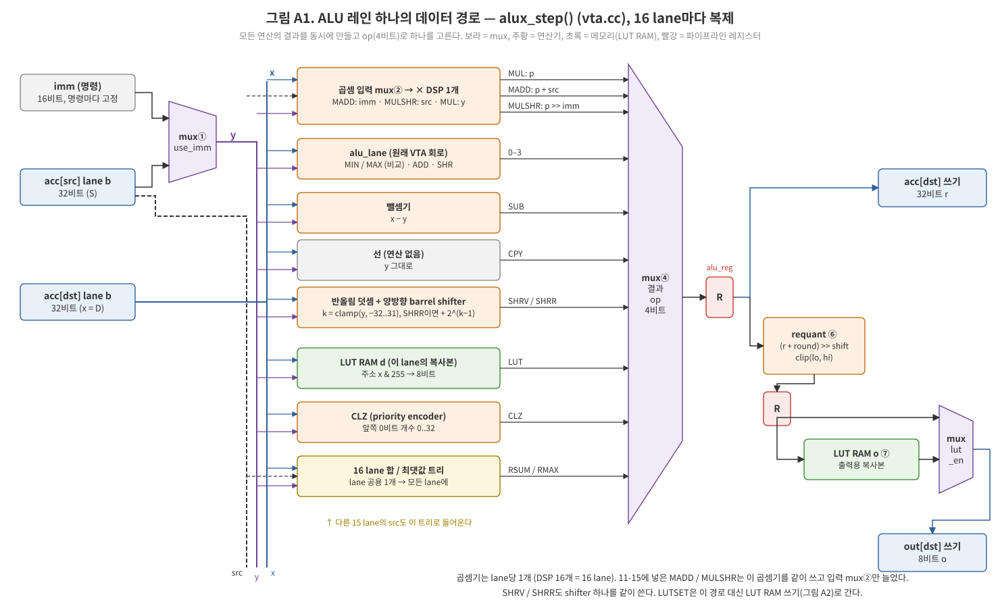
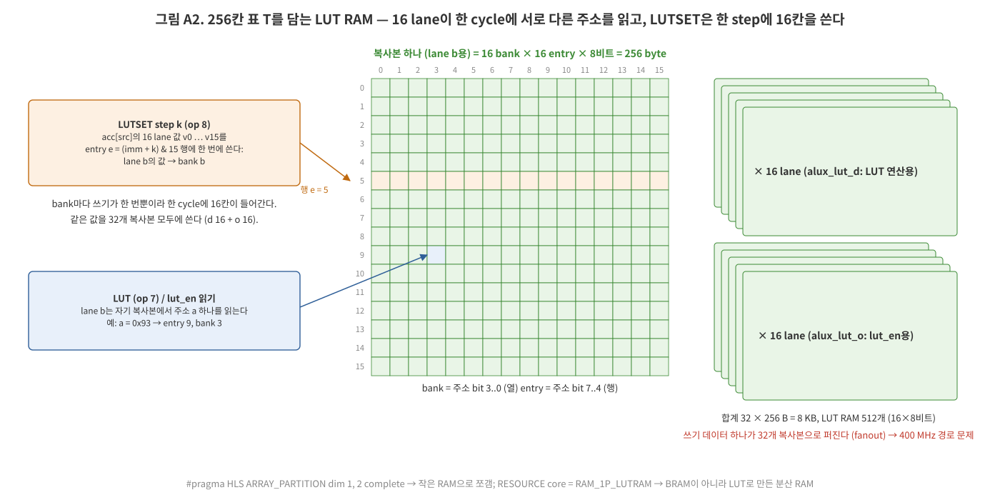
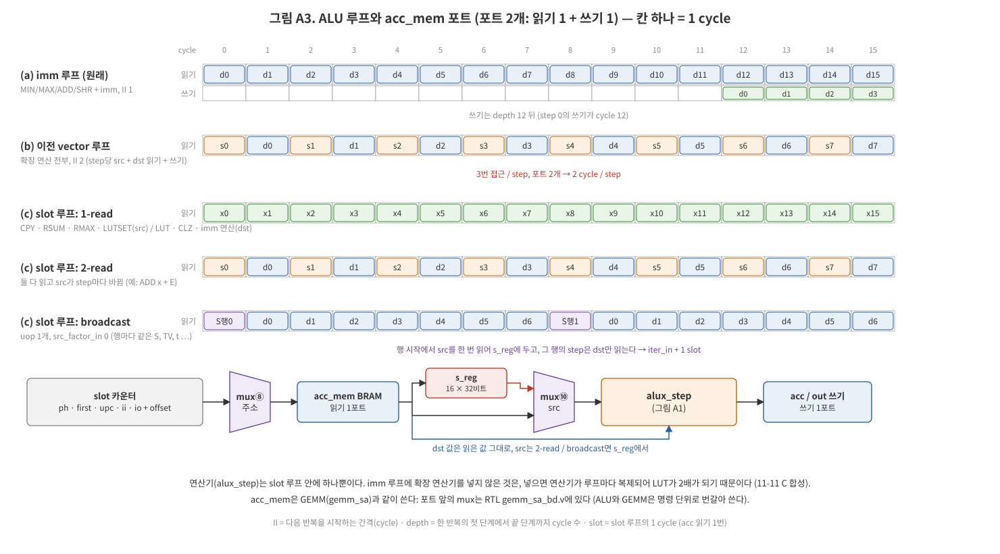
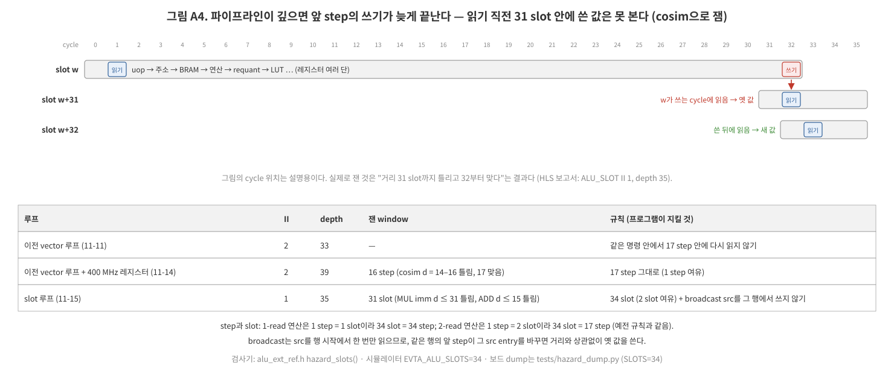

# ALU 확장의 하드웨어: 코드와 회로 (HLS `vta.cc`)

2026-11-15. ALU 확장(`_alux`, `_alux2`)을 넣으려고 HLS 코드를 어떻게 고쳤는지 정리한다. 고친 결과 어떤 연산기, 메모리, mux가 생겼는지도 그림으로 보인다.

- 명령 형식, 연산의 뜻, 소프트웨어 쪽: [evta_isa_ext.md](evta_isa_ext.md) §8
- ALU 확장을 모델에 쓴 곳: [evta_alux_epilogue.md](evta_alux_epilogue.md)

코드는 거의 모두 [vta-hw-zcu102-systolic/hardware/xilinx/src/vta.cc](../vta-hw-zcu102-systolic/hardware/xilinx/src/vta.cc)에 있다. 모두 `#ifdef VTA_ALUX` 안이라 `make ... SYSTOLIC=1 ALUX=1`일 때만 합성된다. 아래 줄 번호는 이 문서를 쓴 날 기준이다.

**용어**

| 용어 | 뜻 |
|---|---|
| lane | acc entry 하나는 int32 16개다. 16개를 동시에 계산하며, 그 하나하나가 lane이다 |
| step | ALU 명령 루프의 한 번. entry 하나를 계산한다 |
| mux | 여러 입력 중 하나를 선택 신호로 고르는 회로 |
| DSP | FPGA 안에 있는 고정 곱셈·덧셈 블록 |
| LUT RAM | LUT를 작은 RAM으로 쓰는 것(분산 RAM). BRAM보다 작고 포트가 자유롭다 |
| II | 다음 반복을 시작하는 간격(cycle) |
| depth | 한 반복이 첫 단계에서 끝 단계까지 걸리는 cycle 수 |
| slot | 11-15의 II 1 루프에서의 1 cycle. acc를 한 번 읽는다 |
| fanout | 한 신호가 들어가는 곳의 수 |
| hazard | 앞 step이 쓴 값을, 쓰기가 끝나기 전에 뒤 step이 읽어 옛 값을 얻는 것 |

## 1. 원래 VTA의 ALU 명령

ALU 명령 하나는 3중 루프다. step마다 acc entry 하나를 계산한다.

```
for io < iter_out:  for ii < iter_in:  for u in [uop_bgn, uop_end):
    d = uop[u].dst + io*dst_factor_out + ii*dst_factor_in
    s = uop[u].src + io*src_factor_out + ii*src_factor_in
    acc[d] = op(acc[d], use_imm ? imm : acc[s])        // 16 lane을 동시에
    out[d] = acc[d]의 하위 8비트 (rq_en이면 requantize, 11-04)
```

원래 op는 MIN / MAX / ADD / SHR 4개(`alu_opcode` 2비트)였다. 원래 연산은 `alu_lane()`(`vta.cc:508`)이 한다.

## 2. 명령 형식: opcode를 4비트로

256비트 명령의 pad에서 비트를 가져왔다([hw_spec.h](../vta-hw-zcu102-systolic/include/vta/hw_spec.h) `VTAAluInsn`).

```c
uint64_t alu_opcode : 2;   // 원래 필드
...
uint64_t alu_op_ext : 2;   // op = alu_op_ext << 2 | alu_opcode  → 0..15
uint64_t lut_en     : 1;   // out에 쓰기 전에 256칸 표 T를 한 번 거친다
uint64_t pad_0      : 5;   // 아직 남은 비트
```

이전 명령은 pad가 0이므로 `alu_op_ext = 0`이 되고, 그대로 동작한다.

| op | 이름 | 동작 | 읽는 것 | 넣은 날 |
|---|---|---|---|---|
| 0–3 | MIN MAX ADD SHR | 원래 연산 | dst, src(또는 imm) | VTA |
| 4 | MUL | dst × (int16)src | 둘 다 | 11-11 |
| 5 | SUB | dst − src | 둘 다 | 11-11 |
| 6 | CPY | dst = src | src | 11-11 |
| 7 | LUT | dst = T[dst & 255] | dst | 11-11 |
| 8 | LUTSET | T에 src를 써 넣는다(acc는 안 씀) | src | 11-11 |
| 9 / 10 | RSUM / RMAX | src 16 lane의 합 / 최댓값을 모든 lane에 | src | 11-11 |
| 11 | CLZ | 앞쪽 0비트 개수 | dst | 11-11 |
| 12 | MADD | dst × (int16)imm + src | 둘 다 | 11-15 |
| 13 | MULSHR | (dst × (int16)src) >> imm | 둘 다 | 11-15 |
| 14 | SHRV | dst >> k, k = src를 −32..31로 자름(음수면 왼쪽) | 둘 다(또는 imm) | 11-15 |
| 15 | SHRR | SHRV에 반올림: (dst + 2^(k−1)) >> k | 둘 다(또는 imm) | 11-15 |

"읽는 것" 열이 §5 루프의 slot 수를 정한다. 기준 모델(소프트웨어로 쓴 같은 의미)은 [alu_ext_ref.h](../vtalib-zcu102-systolic/include/zcu102/vta/alu_ext_ref.h)이고, HLS 결과는 이것과 byte 단위로 같아야 한다.

## 3. 레인 하나의 데이터 경로: `alux_step()` (`vta.cc:564`)



HLS는 `if / else if`를 "모든 결과를 동시에 계산해 두고 op로 하나를 고르는 mux"로 만든다. 아래 블록이 16 lane마다 하나씩 생긴다(`for b` 루프가 unroll된다).

```cpp
const acc_T x  = D[i][b];                       // dst 값
const acc_T y  = f.use_imm ? imm : S[i][b];     // mux①: imm / src
const acc_T sv = S[i][b];
// 곱셈기는 lane당 1개. MUL / MADD / MULSHR이 같이 쓰고, 입력만 mux②로 고른다
const ap_int<16> m = op == VTA_ALUX_MADD ? imm.range(15, 0) : (op == VTA_ALUX_MULSHR ? sv : y).range(15, 0);
const acc_T p = (acc_T) (x * m);                // DSP 1개
// 양방향 barrel shifter 1개 (SHRV / SHRR 공용). 범위 -32..31로 자르고, SHRR은 먼저 2^(k-1)을 더한다
const ap_int<7> kk = y > 31 ? 31 : y < -32 ? -32 : y;
const acc_T xr = op == VTA_ALUX_SHRR && kk > 0 ? x + (1 << (kr - 1)) : x;
const acc_T sh = kk == -32 ? 0 : kk >= 0 ? xr >> kr : x << kl;
if (op < 4)                      alu_lane(op, x, y, r, o0);   // 원래 회로
else if (op == VTA_ALUX_MUL)     r = p;
else if (op == VTA_ALUX_MADD)    r = p + sv;                  // 덧셈기
else if (op == VTA_ALUX_MULSHR)  r = p >> imm[4:0];           // shifter
else if (op == SHRV || SHRR)     r = sh;
else if (op == VTA_ALUX_SUB)     r = x - y;
else if (op == VTA_ALUX_CPY)     r = y;
else if (op == VTA_ALUX_LUT)     r = alux_lut_d[lane][x & 15][(x >> 4) & 15];   // 표 읽기
else if (op == RSUM || RMAX)     r = red;                     // lane 공용 트리의 결과
else if (op == VTA_ALUX_CLZ)     r = alux_clz(x);             // priority encoder (vta.cc:541)
r = alu_reg(r);                                               // 파이프라인 레지스터 (§6)
D[i][b] = r;                                                  // → acc
out_T o = requant_p(r, ...);                                  // (r + round) >> shift → clip(lo, hi)
o = alu_reg(o);
if (f.lut_en) o = alux_lut_o[lane][o & 15][(o >> 4) & 15];    // 출력 LUT
```

- **결과 mux④**: 32비트 폭이고 입력이 약 12개다. lane마다 하나씩 있다. HLS 보고서의 Multiplexer 14.8k LUT 대부분이 이런 선택 회로다.
- **RSUM / RMAX**(`vta.cc:582`): lane을 가로지르는 유일한 회로다. 16개 값을 더하는 adder tree와 비교 tree가 명령마다 하나씩 있고, 결과가 16 lane 모두에 나간다.
- **requant**(`requant_p`, `vta.cc:378`): 11-04에 GEMM과 같이 넣은 출력 양자화다. round 상수를 더하고, shift하고, lo / hi로 자른다.
- **11-15의 결합 연산**은 연산기를 새로 만들지 않았다. 곱셈기는 MUL의 것을 같이 쓰고 입력 mux②만 늘었다. 그래서 DSP 수는 그대로다. SHRV / SHRR은 shifter 하나를 같이 쓴다.

## 4. LUT 메모리: lane 복사본과 bank (`vta.cc:538`)



```cpp
static ap_uint<8> alux_lut_d[VTA_ALUX_LANES][16][16];   // LUT 연산용   [lane][bank][entry]
static ap_uint<8> alux_lut_o[VTA_ALUX_LANES][16][16];   // lut_en용
#pragma HLS ARRAY_PARTITION variable = alux_lut_d complete dim = 1   // lane마다 따로
#pragma HLS ARRAY_PARTITION variable = alux_lut_d complete dim = 2   // bank마다 따로
#pragma HLS RESOURCE variable = alux_lut_d core = RAM_1P_LUTRAM      // LUT RAM으로
```

- **lane마다 복사본이 있는 이유**: 표 T는 256 byte뿐이다. 하지만 16 lane이 한 cycle에 서로 다른 주소를 읽는다. RAM 하나는 포트가 1–2개라서, 같은 내용의 복사본을 lane마다 하나씩 둔다.
- **bank로 나눈 이유**: LUTSET 한 step은 16 lane의 값을 표의 연속된 16칸에 한 번에 쓴다. 주소 하위 4비트를 bank 번호로 써서 16칸이 서로 다른 bank에 가게 했다. 그러면 bank 하나는 step마다 한 번만 쓰인다. LUTSET은 같은 값을 32개 복사본 모두에 쓴다.
- **d와 o가 따로 있는 이유**: 한 명령이 LUT 연산과 `lut_en`을 둘 다 쓸 수 있어서, 읽기 포트가 둘 필요하다.
- **크기**: 32 × 256 B = 8 KB. HLS로는 16×8비트 RAM 512개, LUT 약 1k다.
- **대가**: 쓰기 데이터 하나가 32개 복사본으로 퍼진다(fanout). 400 MHz에서 이 경로가 timing을 넘었고, 레지스터를 넣어 풀었다(§6).

## 5. 루프와 acc_mem 포트 (`alu()`, `vta.cc:644`)



acc_mem은 포트가 2개인 BRAM이다(`RAM_T2P_BRAM`). ALU는 읽기 1, 쓰기 1로 쓴다. GEMM(RTL `gemm_sa`)과 같이 쓰므로 포트 앞에 mux가 있다(`gemm_sa_bd.v`). ALU와 GEMM은 명령 단위로 번갈아 쓴다.

**(a) imm 루프** (`vta.cc:690`, 원래 있던 것)
- `MIN/MAX/ADD/SHR + imm`이면서 `lut_en`이 없을 때만 탄다.
- step당 읽기 1, 쓰기 1이라 II 1이다.
- 확장 연산기는 여기에 넣지 않았다. 넣으면 연산기 전체가 루프마다 복제된다. 11-11 C 합성에서 LUT가 42.6k에서 82.0k로 늘었다.

**(b) 이전 vector 루프** (11-11–11-14, 지금은 `-DVTA_ALUX_II2`일 때만)
- step마다 src 읽기 + dst 읽기 + dst 쓰기, 3번 접근한다.
- 포트가 2개라서 2 cycle이 든다(II 2). 확장 연산이 모두 여기서 돌았다.

**(c) slot 루프** (11-15, `vta.cc:724`): 한 cycle에 읽기를 딱 한 번 한다.

```cpp
const bool rd_src = op == LUTSET || op == MADD || op == MULSHR || (!insn.use_imm && op != LUT && op != CLZ);
const bool rd_dst = !(op == CPY || op == RSUM || op == RMAX || op == LUTSET);
const bool two = rd_src && rd_dst;                                // 둘 다 읽는 연산
const bool bc  = two && nu == 1 && insn.src_factor_in == 0;       // 행마다 같은 src (broadcast)
const int per_out = bc ? insn.iter_in + 1 : (two ? 2 : 1) * insn.iter_in * nu;
ALU_SLOT: for (int t = 0; t < insn.iter_out * per_out; t++) {
#pragma HLS PIPELINE II = 1
  const bool fetch = bc ? first : (two && !ph);                   // 이번 slot은 src만 읽는가
  a = (fetch || (!two && rd_src)) ? src 주소 : dst 주소;          // mux⑧
  read_tensor(a) → v
  if (fetch) s_reg = v;                                           // src를 레지스터에 둔다 (16 × 32비트)
  src = two ? s_reg : v;  dst = v;                                // mux⑩
  if (!fetch) { alux_step(...); acc / out 쓰기; }
  // 다음 slot: ph, first, upc, ii, io 카운터와 주소 offset을 바꾼다
}
```

- 새로 생긴 하드웨어:
  - 읽기 주소 mux⑧
  - `s_reg`(512비트 레지스터)
  - 피연산자 mux⑩
  - slot 카운터와 비교기, offset 덧셈기
- 연산기 `alux_step`은 루프 안에 하나뿐이다.
- **LayerNorm이 빨라지는 이유**: 행마다 같은 값(합 S, 1/√ 표값 TV, shift t)을 쓰는 연산은 broadcast다. 행 시작에서 src를 한 번만 읽으므로, 원소 하나에 1 slot이 든다. (b)에서는 같은 값을 매 step 다시 읽어 2 cycle이 들었다.
- HLS 결과: ALU_SLOT II 1, depth 35. 예상 Fmax는 이전과 같다.

## 6. 파이프라인 레지스터와 hazard window



400 MHz(2.5 ns)에 맞추려고 긴 경로 사이에 FF를 넣었다(11-14, `alu_reg`, `vta.cc:34`).

```cpp
template <typename T> T alu_reg(T in) {
#pragma HLS INLINE off
#pragma HLS INTERFACE ap_none port=return register   // 출력에 FF 한 단을 강제로 둔다
  return in;
}
```

넣은 곳은 다음과 같다.
- uop 읽기 뒤, 주소 덧셈 뒤
- BRAM 출력(src / dst) 뒤
- 연산 결과 뒤
- requant 안의 덧셈 뒤(`requant_p`)
- requant 출력 뒤(출력 LUT 앞)

레지스터 하나마다 depth가 1씩 는다. HLS ALU 루프에는 forwarding이 없다(`DEPENDENCE inter false`). 그래서 같은 명령 안에서 최근에 쓴 entry를 읽으면 옛 값을 얻는다. 이 거리를 cosim으로 쟀다.
- 일부러 같은 entry를 거리 d마다 다시 읽는 명령을 만들었다(`sim/run_cosim.sh`, `VTA_ALUX_DIST`, `VTA_ALUX_DIST_OP=muli`).
- 그것을 RTL 시뮬레이션으로 돌려 기준 모델과 비교했다.

| 루프 | II | depth | 잰 window | 프로그램 규칙 |
|---|---|---|---|---|
| 이전 vector 루프 (11-11) | 2 | 33 | — | 같은 명령 안에서 17 step 안에 다시 읽지 않기 |
| + 400 MHz 레지스터 (11-14) | 2 | 39 | 16 step (d = 14–16 틀림, 17 맞음) | 17 step 그대로 |
| slot 루프 (11-15) | 1 | 35 | 31 slot (MUL imm은 d ≤ 31 틀림·32 맞음, ADD는 d ≤ 15 틀림·16 맞음) | **34 slot** + broadcast src를 그 행 안에서 쓰지 않기 |

- 1-read 연산은 1 step = 1 slot이라 34 step이고, 2-read 연산은 1 step = 2 slot이라 17 step이다. 2-read는 예전 규칙과 같다.
- broadcast는 src를 행 시작에서 한 번만 읽는다. 그래서 같은 행의 앞 step이 그 src entry를 바꾸면, 거리와 상관없이 옛 값을 쓴다.
- 검사기:
  - [alu_ext_ref.h](../vtalib-zcu102-systolic/include/zcu102/vta/alu_ext_ref.h) `hazard_slots()`
  - 시뮬레이터 `EVTA_ALU_SLOTS=34`: slot 수(cycle 수)도 센다
  - 보드 dump: [hazard_dump.py](../vtalib-zcu102-systolic/tests/hazard_dump.py) `SLOTS=34`
- 무작위 명령열 cosim: 34 slot 규칙을 지키는 것만 남기면 6 seed 모두 PASS다.

## 7. 자원

| | LUT | FF | DSP | BRAM |
|---|---|---|---|---|
| ALU 확장 1차 (11-11, HLS C 합성, 이전 compute 대비 증가분) | +19.9k | +36.4k | +16 | |
| 지금 compute (11-15 slot 루프, HLS 추정) | 80.7k | 107.7k | 22 | 37 (18K) |
| └ mux / 연산식 / 레지스터 | 14.8k / 51.0k / 8.6k | 92.3k (레지스터) | | |
| 설계 전체, 배치·배선 후, 380 MHz `_alux` | 53.6k | 68.5k | 305 | 258 tile |
| 설계 전체, 배치·배선 후, 400 MHz `_alux` (레지스터 추가) | 55.7k | 73.0k | 305 | 258 tile |

- HLS 추정치는 실제보다 크게 나온다. 배치·배선 단계에서 상수 전파와 공유가 일어나기 때문이다.
- DSP 16개 증가는 lane마다 곱셈기 하나씩이다.
- `_alux2`(slot 루프)의 배치·배선 결과는 비트스트림이 나오면 [evta_isa_ext.md](evta_isa_ext.md) §8.14에 적는다.

## 8. 관련 파일

| 파일 | 내용 |
|---|---|
| `vta-hw-zcu102-systolic/hardware/xilinx/src/vta.cc` | `alux_step`, LUT RAM, imm 루프, slot 루프, `alu_reg`, `requant_p` |
| `vta-hw-zcu102-systolic/include/vta/hw_spec.h` (+ vtalib-systolic의 두 사본) | `alu_op_ext`, `lut_en`, `VTA_ALUX_*` 번호 |
| `vtalib-zcu102-systolic/include/zcu102/vta/alu_ext_ref.h` | 기준 모델 `run()`, 검사기 `hazards()`(step) / `hazard_slots()`(slot) |
| `vta-hw-zcu102-systolic/hardware/xilinx/sim/alux_test.cc`, `run_csim.sh`, `run_cosim.sh` | 무작위 명령열 C-sim / cosim, 거리 시험(`VTA_ALUX_DIST`) |
| `vtalib-zcu102-systolic/lib/simulator/sim_driver.cc` | PC 시뮬레이터: 기준 모델로 실행, `EVTA_ALU_HAZARD` / `EVTA_ALU_SLOTS` |
| `vtalib-zcu102-systolic/lib/Bundle/VTABundle.cpp` | ALU 프로그램: `layernorm_evta`(`_alux2`면 결합 연산), `softmax_evta`, epilogue, avgpool |
| 그림 원본 | `docs/figs/evta_alux_0[1-4]_*.svg` |
