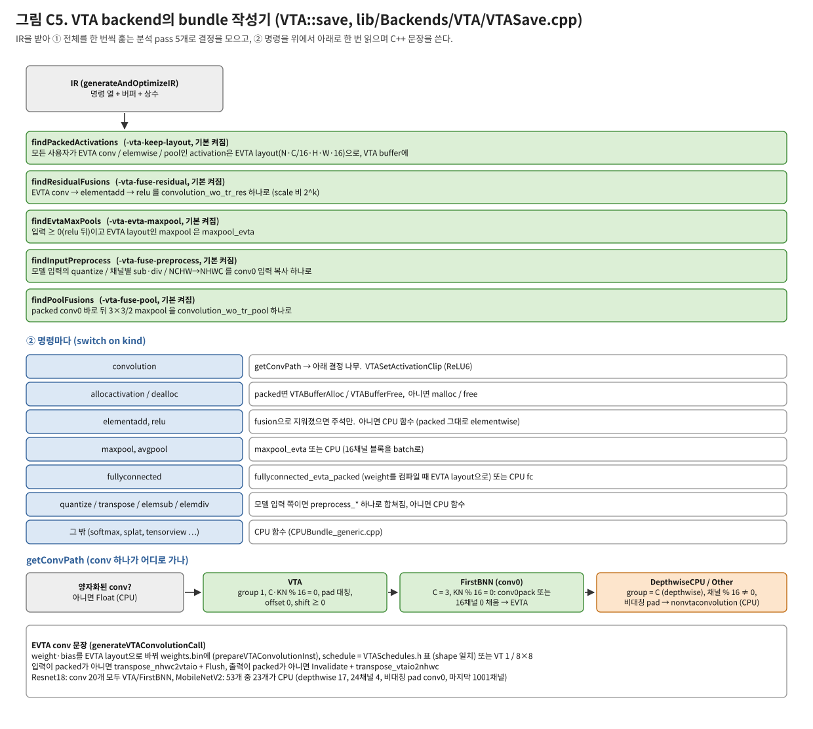

# NEST-C VTA backend: IR에서 EVTA bundle C++까지

양자화된 Glow IR을 받아, 보드에서 vtalib을 부르는 C++ bundle을 쓰는 VTA backend를 설명한다. 이 단계에서 정해지는 것은 다음과 같다:
- 무엇을 EVTA에서, 무엇을 CPU에서 돌릴지
- activation을 어떤 layout으로 둘지
- 어떤 연산을 EVTA call 하나로 합칠지
- tile 크기는 얼마로 할지

앞단(frontend, lowering, 양자화, IR)은 [evta_compiler_frontend.md](evta_compiler_frontend.md), bundle이 부르는 runtime은
[evta_runtime_arch.md](evta_runtime_arch.md), 전체를 그림으로 훑는 문서는 [evta_stack_arch.md](evta_stack_arch.md)다.

- 기준: 2026-11-07 `main`. 코드: `lib/Backends/VTA/`(`VTA.cpp`, `VTASave.cpp`), `include/Backends/VTA/`(`VTA.h`, `VTASchedules.h`).
- 그림: `python3 docs/figs/src/make_evta_compiler_figs.py` → `docs/figs/evta_cc_*.svg`.
- 옵션과 생성 명령: [evta_user_manual.md](evta_user_manual.md) §2.2. 바꾼 이유와 측정은 [evta_runtime_compare.md](evta_runtime_compare.md) §7.

## 1. backend의 모양

Glow backend 인터페이스(`glow/include/glow/Backend/Backend.h`)를 따른다. EVTA에서 쓰는 부분:

| 메서드 | VTA 구현 | 쓰이는 곳 |
|---|---|---|
| `isOpSupported(NodeInfo)` | 지원 노드 목록(conv, fc, pool, add/sub/div, relu, clip, quantize, transpose …)과 element type | lowering 여부(`shouldLower = !isOpSupported`), 양자화 대상 |
| `supportsFusedActivation(conv, act)` | conv + Relu, conv + Clip(min 0) (`GLOW_VTA_FUSION`, 기본 ON) | `foldActivations` |
| `transformPostLowering` | channelwise conv의 bias를 int32로, `NESTC_EVTA_GRAPH_OPT`면 6-D `VTAConvolution`(OFF) | `optimizeFunction` 끝 |
| `verify(Function / IR)` | layout 검사, 허용하는 fused activation | 마지막 검사 |
| `save(F, dir, name, entry)` | **bundle 작성기 (`VTASave.cpp`)** | `model-compiler -emit-bundle` |
| `compile(F)` | IR을 `VTAFunction`(C++ 해석 실행, `VTANodes.cpp`)으로 | `image-classifier -backend=VTA` (보드 bundle과는 별개) |

- 보드 실행에는 `save`만 쓴다. `compile` 경로(in-process 실행)는 디버깅용으로 남아 있다.
- 노드·명령 추가 정의(`VTAConvolution`, `BNNConvolution` 등)는 `lib/Backends/VTA/ClassGen/`에 있다.

## 2. `VTA::save`의 흐름



1. **IR 생성:** `generateAndOptimizeIR(F, *this, shouldShareBuffers())`로 frontend 문서 §6의 IR을 만든다.
2. **EVTA 번호:** `-index-multi-evta=<bit>`(1, 2, 4, 8 중 하나)로 이 bundle의 EVTA 번호를 정한다. 생성되는 모든 call의 `idEVTA` 인자와 `vtaCmdH<i>` 이름이 이것으로 정해진다.
3. **분석 pass 다섯 개:** IR 전체를 미리 한 번씩 훑어 결정을 `VTASaveContext`에 모은다(§4).
4. **IR을 위에서 아래로 한 번 읽으며 명령마다 C++ 문장을 쓴다:**
   - 분석에서 "합쳐짐"으로 표시된 명령은 주석만 남긴다.
   - 모르는 명령은 `llvm_unreachable("<kind> is an unhandled instruction")`로 멈춘다.
5. **파일 쓰기:**

   | 파일 | 내용 |
   |---|---|
   | `<name>.cpp` | `load_module`, 추론 함수, `destroy_module` |
   | `<name>.h` | 심볼 표, 메모리 크기, entry 선언 |
   | `<name>.weights.bin` | EVTA layout으로 바꾼 weight와 bias, preprocess LUT |
   | `VTARuntime.h` | `vtaCmdH[0-3]`, `initVTARuntime*()`, uop handle 목록 |

   main은 손으로 쓴다(`vta/bundles/<Test>/*Main.cpp`, `vta/multievta_bundles/*/multi_threads_main.cpp`).

## 3. 명령 하나가 무엇이 되나

| IR 명령 | 생성 코드 |
|---|---|
| `allocactivation` / `deallocactivation` | packed(§4.1)면 `VTABufferAlloc` / `VTABufferFree` (CMA, pool), 아니면 `malloc` / `free` |
| `convolution` | §5 경로에 따라 `convolution_wo_tr[_res\|_pool]`, `nonvtaconvolution`(CPU), float conv |
| `fullyconnected` | 조건이 맞으면 `fullyconnected_evta_packed`(weight를 컴파일 때 EVTA layout으로), 아니면 CPU `fullyconnected` |
| `maxpool` | `maxpool_evta`(§4.3) 또는 CPU `maxpool` (packed면 16채널 블록을 batch로) |
| `avgpool` | CPU `avgpool` (packed 그대로) |
| `elementadd`, `relu` | fusion으로 지워졌으면 주석, 아니면 CPU `elemadd` / `relu` (packed 그대로 elementwise) |
| `quantize`, `elementsub`, `elementdiv`, `transpose` | 모델 입력 쪽이면 conv0 입력 복사 하나에 합쳐짐(§4.4), 아니면 CPU 함수 |
| `softmax`, `dequantize`, `splat`, `tensorview`, `inserttensor` … | CPU 함수 (`CPUBundle_generic.cpp`) |

- CPU 함수가 packed activation을 쓰면 그 뒤에 `VTABufferFlush`가 붙는다. EVTA가 쓴 것을 CPU가 읽기 전에는 `VTABufferInvalidate`가 붙는다.
- 상수(weight, bias, LUT)는 `load_module`에서 `VTAConstBufferAlloc(constantWeight + offset, size)`로 CMA에 올린다. 같은 바이트면 공유된다.

## 4. 분석 pass (VTASave가 IR 전체를 보고 정하는 것)

모두 `model-compiler` 옵션으로 끌 수 있고 기본은 켜짐이다. 끄면 이전 방식(그 기능이 없던 코드)으로 생성한다.

### 4.1 `findPackedActivations` (`-vta-keep-layout`, 2026-10-31)

- **조건:** activation이 4-D int8이고, N = 1, C % 16 = 0, H·W > 1이며, 그 activation을 쓰는 모든 명령이 아래 중 하나일 때 **EVTA layout(N, C/16, H, W, 16)으로 둔다**.
  - EVTA conv
  - elementwise(add, relu)
  - pool(16채널 블록을 batch로)
- **효과:** conv → conv 사이에 transpose도 cache 관리도 없다. Resnet18 73.6 → 56.4 ms.
- **나머지는 NHWC다:** 모델 입출력, tensorview, 다른 연산. 경계에서 `transpose_nhwc2vtaio` / `transpose_vtaio2nhwc`(16 B 단위 복사)를 쓴다.

### 4.2 `findResidualFusions` (`-vta-fuse-residual`, 10-31)

- **패턴:** EVTA conv → elementadd(packed residual) → relu. 셋 다 offset 0이고, scale 비가 2^k여야 한다.
- **생성:** `convolution_wo_tr_res(..., residual, convShl, resShl, sumShr, relu)` 하나가 된다.
  - residual을 inp SRAM에 LOAD해서 identity weight GEMM으로 acc에 더한다.
  - 두 scale은 shift로 맞춘다.
- add 뒤 relu가 2^q만큼 작은 scale로 가는 경우(Resnet50 res2_0)도 받는다.
- Resnet18의 residual 8개가 모두 합쳐진다(그림 C3).

### 4.3 `findEvtaMaxPools` (`-vta-evta-maxpool`, 10-31)

- **조건:** maxpool 입력이 packed이고, ≥ 0이 보장되며(relu가 붙은 EVTA conv나 relu가 썼음), 정사각 kernel·stride·pad일 때.
- **생성:** `maxpool_evta`. LOAD의 pad가 0으로 채워지므로 ≥ 0 조건이 필요하다. 창 위치마다 ALU MAX를 쓴다.

### 4.4 `findInputPreprocess` (`-vta-fuse-preprocess`, 11-02)

- **패턴:** 모델 입력에서 첫 EVTA conv까지의 `quantize` → 채널별 상수 `elementsub` / `elementdiv` → NCHW→NHWC `transpose`.
- **생성:** conv0 입력 복사 하나에 합친다. 채널별 연산은 컴파일 때 [C][256] 표로 만든다.
  - zero-fill 경로: `preprocess_nhwc2vtaio_zerofill`
  - pack 경로: `preprocess_conv0pack[_stream]`
- bit-exact. Resnet18 2.4 → 0.37 ms.

### 4.5 `findPoolFusions` (`-vta-fuse-pool`, 11-02)

- **패턴:** packed conv0(§5.2) 바로 뒤 3×3/2 maxpool.
- **생성:** `convolution_wo_tr_pool` 하나. pool halo 행·열은 다시 계산하고, ALU MAX로 pooled 영역만 STORE한다.

## 5. conv 하나의 경로 (`getConvPath`, `saveConvolutionInst`)

### 5.1 결정

| 경로 | 조건 | 생성 |
|---|---|---|
| `Float` | 입력이 양자화되지 않음 | CPU float conv |
| `VTA` | group 1, C % 16 = 0, KN % 16 = 0, **pad 네 방향 같음**, offset 0, bias scale = in·w, shift ≥ 0 | `convolution_wo_tr` (`_res`, `_pool`) |
| `FirstBNN` | group 1, C = 3, KN % 16 = 0, pad 대칭 (이미지 conv0) | conv0 pack(§5.2) 또는 16채널 0 채움 → `convolution_wo_tr` |
| `DepthwiseCPU` | group = C (depthwise) | `nonvtaconvolution` (CPU) |
| `Other` | 그 밖 (채널 % 16 ≠ 0, 비대칭 pad, scale 조건 불만족) | `nonvtaconvolution` (CPU) |

- **ReLU6:** conv에 Clip(0, x)이 접혀 있으면 앞뒤에 `VTASetActivationClip(round(x / s_out))` / `VTASetActivationClip(127)`을 쓴다(2026-11-06). vtalib가 relu의 상한으로 쓴다.
- **비대칭 pad:** TF SAME padding의 stride 2 conv(위·왼쪽 0, 아래·오른쪽 1)는 CPU로 간다(2026-11-06). 전에는 `pad[0]`만 보고 EVTA로 보내 틀렸다.
- **모델별 결과:**
  - Resnet18, Resnet50, VGG16: conv 전부가 VTA/FirstBNN이다.
  - MobileNetV2: conv 53개 중 23개가 CPU로 간다(depthwise 17, 24채널 4, conv0 1, 마지막 1001채널 1). 그래서 1110 ms 중 97 %가 CPU다.

### 5.2 conv0: 3채널 이미지 conv (`getConv0Pack`, `-vta-conv0-pack`)

- **pack:** KH×KW / stride s conv를 다음으로 바꾼다.
  - 형태: ceil(KH/s)×1 / stride 1, pad 0인 conv.
  - 입력 채널: s·KW·3을 16 단위로 올림. stride 행 s개와 KW tap을 채널로 옮긴다.
  - weight도 컴파일 때 같은 배치로 다시 쓴다(`writeConv0PackFilter`). 출력은 bit-identical이다.
  - 예: Resnet18 conv0 7×7/2는 4×1 conv(입력 115×112×48)가 된다. 9.13 → 3.64 ms.
- **조건:** packed conv의 schedule이 출력을 나누어떨어지게 하고, 입력 tile이 multi 버퍼 inp SRAM의 반(1024 entry)에 들어갈 것. 아니면 16채널 0 채움 conv(`_zerofill`)로 간다.
- **입력 겹치기:** pack 경로의 입력 복사는 `preprocess_conv0pack_stream`으로 쓰고, runtime이 행 단위로 conv와 겹친다(runtime §6.3).

### 5.3 EVTA conv 문장 만들기 (`prepareVTAConvolutionInst`, `generateVTAConvolutionCall`)

- **weight:** [KN/16][C/16][KH][KW][16][16] 블록으로 바꿔 `weights.bin`에 쓴다. bias는 int32로 쓴다.
- **scale:** `shift = log2(s_out / (s_in · s_w))`를 계산한다. 정수가 아니면 `VTA` 경로 조건에서 빠진다.
- **schedule:** `getConvSchedule`이 `include/Backends/VTA/VTASchedules.h`의 표(shape 10개가 정확히 일치하는 항목, 약 40개)에서 (virtual thread 수, tileH, tileW)를 찾는다.
  - 없으면 (1, 8, 8)이다.
  - 표는 보드에서 vtalib의 `EVTA_SCHED` 탐색으로 찾은 값이다. Resnet18/50, VGG16 shape이 들어 있다.
- **입출력:** 입력이 packed가 아니면 `VTABufferAlloc` + `transpose_nhwc2vtaio` + `VTABufferFlush`를 쓴다. 출력이 packed가 아니면 `VTABufferInvalidate` + `transpose_vtaio2nhwc`를 쓴다.
- **문장 예** (Resnet18 stage1 conv0, IR 15):

  ```c++
  convolution_wo_tr(in, w, (int32_t *)bias, out, /*N H W C*/ 1, 56, 56, 64, /*KN KH KW*/ 64, 3, 3, /*pad stride*/ 1, 1,
                    /*relu bias shift*/ 1, 1, 7, /*out_h out_w*/ 56, 56, vtaCmdH, /*VT tileH tileW*/ 2, 8, 56, /*EVTA*/ 0);
  ```

## 6. 생성되는 bundle의 성질 (runtime 쪽에서 보면)

- **graph executor가 없다.** 추론 함수 하나에 IR 순서대로 호출이 펼쳐진다. 분기도, 동적 shape도, 연산 순서 바꾸기도 없다.
- **메모리 계획이 없다.** activation은 IR의 alloc/dealloc 위치에서 할당하고 푼다. Glow 표준 bundle은 activation을 한 영역(arena)에 offset으로 배치하는데, VTA bundle은 `activations` 인자를 쓰지 않는다. runtime의 크기별 pool이 첫 추론 뒤의 `cma_alloc`을 없앤다.
- **모든 결정이 컴파일 때 끝난다:** schedule, layout, fusion, shift, weight 배치. runtime이 정하는 것은 명령 열 생성(첫 호출)과 replay뿐이다.
- **bundle 하나는 EVTA 하나용이다.** 여러 EVTA에 같은 모델을 돌리려면 `-index-multi-evta`만 다르게 copy를 만든다(`vtabundles_xcmpl/gen_multi4_bundles.sh`). 한 모델을 여러 EVTA로 나누는 것은 NEST-C partitioner(`model-partition-tuner`)의 영역인데, 지금의 EVTA 측정에는 쓰지 않는다.

## 7. 옵션 (model-compiler, VTA backend)

| 옵션 | 기본 | 내용 |
|---|---|---|
| `-vta-keep-layout` | on | §4.1 |
| `-vta-fuse-residual` | on | §4.2 |
| `-vta-evta-maxpool` | on | §4.3 |
| `-vta-evta-fc` | on | fc를 EVTA로 (batch 1, offset 0, power-of-two 비) |
| `-vta-fuse-preprocess` | on | §4.4 |
| `-vta-conv0-pack` | on | §5.2 |
| `-vta-fuse-pool` | on | §4.5 |
| `-index-multi-evta=<1\|2\|4\|8>` | 1 | 이 bundle의 EVTA 번호 |
| `-network-name`, `-main-entry-name` | 모델 파일 이름 | 생성 심볼 이름 (multi copy마다 다르게) |

- CMake 쪽 스위치: `GLOW_VTA_FUSION`(activation fold), `NESTC_EVTA_GRAPH_OPT`(6-D VTAConv 경로, OFF), `VTA_PROFILE`(문장마다 clock 측정 코드 삽입).
- 문장별 시간 측정은 이와 별도로 `vtabundles_xcmpl/timed_bundle.py`가 생성된 `.cpp`에 계측 코드를 넣어 빌드한다(`_timed`, `_systimed`).

## 8. 다른 backend와 비교할 때 볼 점

| 항목 | VTA backend | 흔한 다른 방식 |
|---|---|---|
| 출력 | C++ 소스 (호출 열) + weight 파일 | 장치 명령 바이너리(Vitis AI xmodel, Ethos-U command stream), LLVM 목적 파일(Glow CPU bundle), 런타임 graph(TVM) |
| 연산 배치 | IR 명령마다 조건으로 EVTA/CPU 결정 (§5.1 표) | partitioner가 subgraph 단위로 (TVM BYOC, ORT EP) |
| fusion | IR 위에서 고정 패턴 몇 개 (§4) | 그래프 단계의 일반 fusion, tensor 컴파일러의 loop fusion |
| layout | backend가 activation마다 EVTA layout 유지 여부 결정 | 그래프 단계 layout 변환 pass |
| schedule | shape 표 + 기본값, 보드 탐색으로 표를 채움 | auto-tuning (TVM AutoTVM/Ansor), 분석 cost model |
| 명령 생성 | runtime이 첫 호출 때 (backend는 인자만 정함) | 컴파일러가 명령까지 생성 (AOT) |
| CPU fallback | 같은 bundle 안의 vtalib CPU 함수 | framework CPU kernel, LLVM codegen |

## 9. 코드 위치

| 파일 | 내용 |
|---|---|
| `include/Backends/VTA/VTA.h` | backend 클래스, `supportsFusedActivation`, multi-EVTA 번호 |
| `lib/Backends/VTA/VTA.cpp` | `isOpSupported`, `verify`, `transformPostLowering`, `compile` |
| `lib/Backends/VTA/VTASave.cpp` | `VTA::save`, 분석 pass(`find*`), 명령별 `save*Inst`, `getConvPath`, conv0 pack, fc, preprocess, 옵션 정의 |
| `include/Backends/VTA/VTASchedules.h` | conv schedule 표 |
| `lib/Backends/VTA/VTANodes.cpp`, `VTAFunction.cpp` | in-process 해석 실행 (`-backend=VTA`로 image-classifier) |
| `lib/Backends/VTA/ClassGen/VTASpecific*.h` | VTA 고유 노드·명령 정의 |
| `lib/Backends/VTAInterpreter/` | profile과 정확도 확인용 참조 backend |
| `vtabundles_xcmpl/gen_*_bundles.sh`, `Debug2_remote/build_sim_bundles.sh` | bundle 생성 명령 (NEST-C CMake를 다시 돌리지 않고) |
