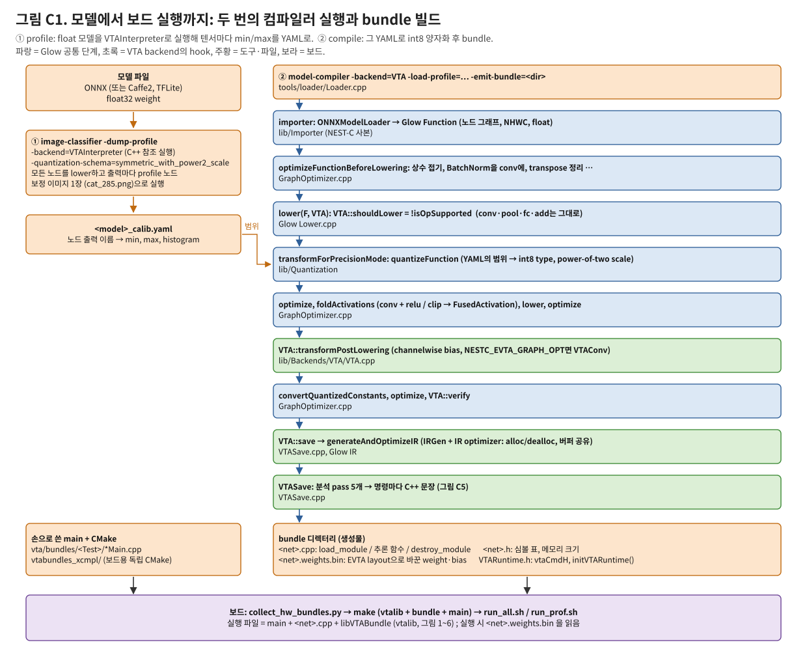
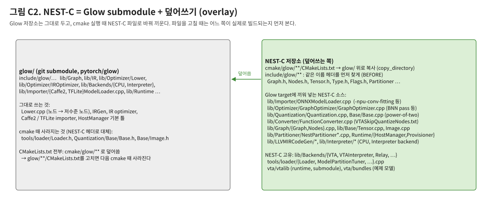
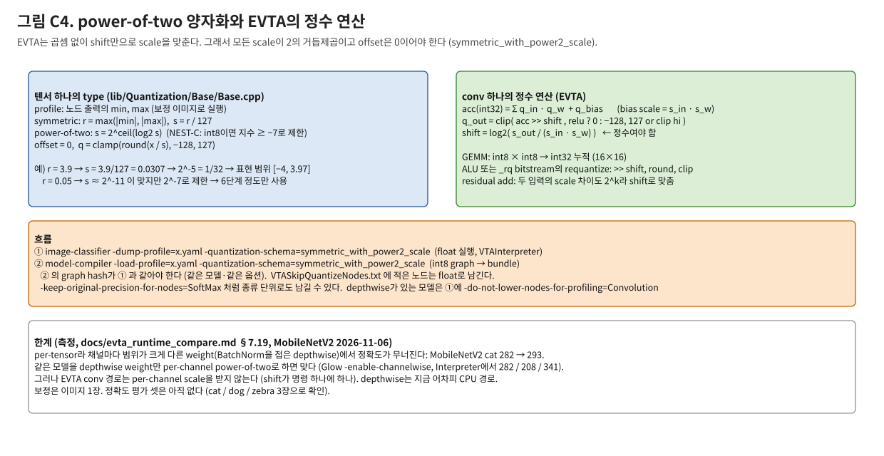
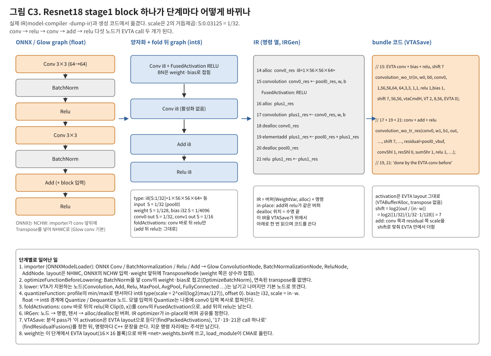

# NEST-C compiler 앞단: frontend, 그래프 최적화, lowering, 양자화, IR

모델 파일이 EVTA backend에 넘어가기 직전까지의 컴파일러를 설명한다. Glow와 NEST-C를 몰라도 읽을 수 있게 썼다.
다른 컴파일러(TVM Relay/Relax, IREE/MLIR, TFLite converter, Vitis AI 양자화기·컴파일러, ONNX Runtime)와 비교하려는 사람을 위한 문서다.

- 문서 세 편:
  - 이 문서: 앞단.
  - [evta_compiler_backend.md](evta_compiler_backend.md): VTA backend가 bundle C++를 쓰는 부분.
  - [evta_runtime_arch.md](evta_runtime_arch.md): 그 bundle이 보드에서 도는 runtime / driver.
  - 셋을 그림 중심으로 한 번에 훑는 문서: [evta_stack_arch.md](evta_stack_arch.md).
- 기준: 2026-11-07 `main`. 그림: `python3 docs/figs/src/make_evta_compiler_figs.py` → `docs/figs/evta_cc_*.svg`.
- 저장소 구조와 빌드: [CLAUDE.md](../CLAUDE.md). 명령과 옵션: [evta_user_manual.md](evta_user_manual.md) §2.

## 0. 용어

| 용어 | 뜻 |
|---|---|
| Glow | PyTorch 팀의 NN 컴파일러(2018~). 그래프 → 저수준 IR → backend. NEST-C의 바탕 (`glow/` submodule) |
| NEST-C | ETRI의 Glow 확장. EVTA용 VTA backend, 여러 가속기에 나누는 partitioner, 양자화 변경 등 |
| Function / Node | Glow 그래프. Function 하나가 모델 하나(또는 partition 하나), Node가 연산(`ConvolutionNode` 등) |
| Placeholder / Constant | 그래프의 입력·출력 텐서 / weight 같은 상수 텐서 |
| lowering | 고수준 Node를 backend가 지원하는 저수준 Node 조합으로 바꾸는 것 (예: FullyConnected → MatMul + BatchedAdd) |
| IR | Glow의 저수준 명령 열(`IRFunction`): 버퍼(`WeightVar`, `allocactivation`)와 명령(`convolution` 등) |
| profile | 양자화용 보정 결과. 노드 출력마다 float 범위(min/max, histogram)를 담은 YAML |
| bundle | backend가 출력하는 독립 실행 코드 (EVTA는 C++ 소스 + weight 파일) |

## 1. 전체 흐름

컴파일러를 **두 번** 돌린다.

1. **profile** (`image-classifier -dump-profile`):
   - float 모델을 VTAInterpreter backend로 실행한다(C++ 참조 구현).
   - 실행할 때 모든 노드를 lower하고, 출력마다 profile 노드를 붙여 범위를 모은 뒤 YAML로 쓴다.
   - 보정 데이터는 지금 이미지 한 장이다(`glow/tests/images/imagenet/cat_285.png`).
2. **compile** (`model-compiler -backend=VTA -load-profile=<yaml> -emit-bundle=<dir>`):
   - 같은 모델을 다시 읽고, YAML 범위로 int8로 양자화한 뒤 VTA backend가 bundle을 쓴다.
   - profile 때와 graph hash가 같아야 한다(같은 모델, 같은 옵션).

- 둘 다 `tools/loader/Loader.cpp`(NEST-C 사본)와 driver 하나로 만든 도구다. 같은 구조로 `model-partition-tuner`(여러 backend로 나누기), `ccode-generator`도 있다.
- 보드에서는 NEST-C CMake가 컴파일러를 빌드하지 않는다(`NESTC_EVTA_RUN_ON_ZCU102=ON`이면 `lib`/`tools`를 건너뜀). 그래서 컴파일러는 simulator 빌드(`Debug2_remote`, 보드의 aarch64)에서 돌린다. bundle은 `vtabundles_xcmpl/`이 보드용으로 빌드한다.

## 2. NEST-C와 Glow의 관계 (overlay)

- **NEST-C는 Glow를 fork하지 않는다.**
  - `glow/`는 원본 submodule 그대로다.
  - top-level `CMakeLists.txt`가 cmake 때 `cmake/glow/**`를 `glow/` 위에 복사하고, 몇몇 Glow 헤더를 지운다.
  - `include/glow/**`를 include 경로 맨 앞에 둬서 같은 이름의 헤더가 NEST-C 것으로 잡히게 한다.
- **Glow target에 NEST-C `.cpp`를 끼워 넣는다.** 예: `cmake/glow/lib/Importer/CMakeLists.txt`가 `${NESTC_ROOT_DIR}/lib/Importer/ONNXModelLoader.cpp`를 쓴다.
  - 그래서 `lib/` 아래 파일을 고칠 때는 `cmake/glow/lib/.../CMakeLists.txt`에서 어느 target이 그 파일을 빌드하는지 먼저 본다.
  - `glow/**/CMakeLists.txt`를 직접 고치면 다음 cmake 때 사라진다.
- **덮어쓰는 것 (EVTA 경로에 쓰이는 것):**

  | NEST-C 파일 | 바뀐 점 |
  |---|---|
  | `lib/Importer/ONNXModelLoader.cpp` | `-npu-conv-fitting=<n>`: conv 입력·출력 채널을 n의 배수로 0 채움 (아래 §3) 등 |
  | `lib/Optimizer/GraphOptimizer/GraphOptimizer.cpp` | `optimizeFunction` 파이프라인, BNN용 pass, activation fold |
  | `lib/Quantization/Quantization.cpp`, `Base/Base.cpp` | BNN conv 입력 type, power-of-two scale의 지수 하한 (§5) |
  | `lib/Converter/FunctionConverter.cpp` | `./VTASkipQuantizeNodes.txt`에 적힌 노드 이름은 양자화하지 않음 |
  | `lib/Graph/{Graph,Nodes}.cpp`, `include/glow/Graph/*` | NEST-C 노드(`VTAConvolution`, `BNNConvolution` 등)와 생성 함수 |
  | `lib/Partitioner/NestPartitioner*.cpp`, `lib/Runtime/*` | 여러 backend/장치로 나누기. EVTA 단독 bundle에는 쓰이지 않음 |

- **Glow 원본 그대로 쓰는 것:** `Lower.cpp`(lowering 규칙), IRGen, IR optimizer, Caffe2/TFLite importer, 대부분의 Node 정의.
- **backend 등록:** `lib/Backends/<Name>/`를 glob으로 찾는다(`cmake/glow/cmake/modules/FindBackends.cmake`). EVTA 경로에서는 `VTA`(bundle 생성)와 `VTAInterpreter`(profile과 정확도 확인)를 쓴다. 노드·명령 정의 추가는 `lib/Backends/VTA/ClassGen/VTASpecific{Nodes,Instrs}.h`에서 한다.

## 3. frontend: 모델 읽기 (importer)

- **`Loader::loadModel`이 파일 형식으로 고른다:**
  - `.onnx` → `ONNXModelLoader` (NEST-C 사본)
  - Caffe2 디렉터리 → `Caffe2ModelLoader`
  - `.tflite` → `TFLiteModelLoader` (Glow 원본)
- **결과는 Glow `Function` 하나다.**
  - 입력은 Placeholder(`-model-input=<name>,float,[shape]`로 이름과 shape을 준다), weight는 Constant다.
  - shape은 정적이다. 동적 shape이나 control flow는 없다.
- **layout:**
  - Glow의 conv/pool 노드는 NHWC가 기본이다.
  - ONNX가 NCHW라서 importer가 conv와 pool 앞뒤에 `TransposeNode`를 넣는다. weight 쪽은 Constant라 컴파일 중에 접힌다. activation 쪽 transpose는 이웃 transpose와 상쇄되어 대부분 사라진다.
  - 모델 입력이 NCHW float이면 `quantize → transpose`가 남고, VTA backend가 이를 conv0 입력 복사에 합친다(backend §4.4).
- **ONNX op 지원:** Glow ONNX importer가 아는 op만 된다(CNN op 대부분과 `QuantizeLinear`/`QLinearConv` 일부).
  - MobileNetV2 MXNet export(opset 7), Resnet18 MXNet, Resnet50 Caffe2→ONNX, VGG16 CIFAR-10 ONNX는 그대로 읽힌다.
  - TF 계열은 TFLite 파일을 float ONNX로 바꿔 쓴다(`vta/bundles/MobileNetV2Test/tfl2onnx.py`).
- **`-npu-conv-fitting=16` (NEST-C):** conv의 입력·출력 채널이 16의 배수가 아니면 importer 단계에서 weight와 입력에 0 채널을 덧붙인다(Pad). EVTA 경로에 들어갈 수 있게 하려는 옵션이다. 지금 쓰는 bundle들은 이 옵션을 쓰지 않는다. MobileNetV2의 24채널 conv(CPU로 감)에 시험해 볼 만하다.

## 4. 그래프 최적화와 lowering (`glow::optimizeFunction`, `lib/Optimizer/GraphOptimizer/GraphOptimizer.cpp`)

순서(compile pass, 그림 C1 가운데):

| 단계 | 하는 일 |
|---|---|
| `optimizeFunctionBeforeLowering` | `fold`(상수 접기), `optimize`(BatchNorm을 앞 conv의 weight·bias에, 연속 transpose 상쇄, 같은 노드 합치기, DCE 등) |
| `lower(F, cctx, &VTA)` | **backend가 지원한다고 한 노드는 그대로 두고**(`VTA::shouldLower = !isOpSupported`), 나머지는 `Lower.cpp` 규칙으로 기본 노드로 쪼갬. profile pass에서는 backend 없이(`nullptr`) 전부 쪼갠다 |
| `transformForPrecisionMode` | profile pass: profile 노드 삽입 / compile pass: `quantizeFunction` (§5) |
| `optimize` | 양자화가 만든 Quantize/Dequantize 정리 |
| `foldActivations` | conv 바로 뒤 activation을 `FusedActivation`으로 (backend가 `supportsFusedActivation`로 허락한 것만: VTA는 conv + Relu, conv + Clip(0, x); `GLOW_VTA_FUSION=ON`(기본)일 때) |
| `lower` 다시 | 양자화가 새로 만든 노드(예: Clip)를 위해 |
| `convertQuantizedConstants` | float weight를 int8/int32 데이터로 실제 변환 |
| `VTA::transformPostLowering` | channelwise conv의 bias 양자화. `NESTC_EVTA_GRAPH_OPT`면 conv를 6-D layout의 `VTAConvolution`으로(`Debug2_remote`에서는 OFF) |
| `optimize(F, cctx, VTA)`, `VTA::verify` | 마지막 정리와 검사 |

- **VTA가 lower하지 않는(지원한다고 하는) 노드** (`lib/Backends/VTA/VTA.cpp isOpSupported`):
  - Convolution(그룹 포함, int8/float), FullyConnected, MaxPool, AvgPool
  - Add, Sub, Div, Relu, Clip
  - Quantize, Dequantize, SoftMax, Transpose, Reshape, Splat, InsertTensor, Sign
  - BNNConvolution

  나머지는 이 노드들로 쪼개질 수 있어야 한다. 그렇지 않으면 VTASave가 모르는 명령을 만나 멈춘다(`llvm_unreachable("<kind> is an unhandled instruction")`).
- **profile pass에서 group conv를 쪼개면 그래프가 폭발한다.** depthwise conv(group = C) 하나가 conv C개 + slice + concat이 된다. MobileNetV2에서는 수천 개 노드가 되어 profile이 몇 시간 걸렸다(O(n²) verify, LLVM register 할당).
  - 해결: `-do-not-lower-nodes-for-profiling=Convolution` (27 s).
  - 이 옵션을 쓰면 compile pass에서도 conv를 쪼개지 않아야 하는데, VTA는 원래 conv를 쪼개지 않으므로 그대로 맞는다.

## 5. 양자화

- **schema:** EVTA 경로는 `-quantization-schema=symmetric_with_power2_scale`만 쓴다.
  - offset 0, scale = 2의 거듭제곱이다. EVTA는 곱셈기 없이 `>> shift`로 scale을 맞추기 때문이다(backend가 `shift = log2(s_out / (s_in·s_w))`를 계산).
  - bias는 int32이고 scale = s_in · s_w다.
- **텐서 type 계산 (`lib/Quantization/Base/Base.cpp`):**
  - `s = max(|min|, |max|) / 127`, `s ← 2^ceil(log2 s)`.
  - NEST-C의 `lib/Quantization/Base/Base.cpp`는 int8이면 지수를 −7 아래로 내리지 않는다(`aux <= -8 → -7`). 다만 이 파일은
    `NESTC_WITH_NMP`일 때만 빌드된다. 이 보드(`NESTC_WITH_NMP=OFF`)는 Glow의 `Base.cpp`를 쓰므로 하한이 없다
    (`cmake/glow/lib/Quantization/Base/CMakeLists.txt`, 2026-11-07 확인).
- **노드 단위 예외:**
  - `-keep-original-precision-for-nodes=SoftMax`: 종류 단위로 float 유지.
  - `./VTASkipQuantizeNodes.txt`: 노드 이름 단위. `FunctionConverter`가 작업 디렉터리에서 읽는다.
  - float로 남은 노드는 Dequantize/Quantize와 CPU float 함수로 간다.
- **channelwise:** Glow `-enable-channelwise`는 conv weight를 출력 채널별 scale로 양자화한다(`ChannelwiseQuantizedConvolution`).
  NEST-C `-enable-channelwise-depthwise`(2026-11-07)는 group > 1 conv만 그렇게 바꾼다. VTASave는 이를 vtalib `cw_convolution`(CPU)으로 내보낸다.
  MobileNetV2 depthwise처럼 채널마다 weight 범위가 크게 다를 때 필요하다(`evta_runtime_compare.md` §7.20).
- **측정된 한계 (MobileNetV2, 2026-11-06):**
  - power-of-two per-tensor로는 depthwise weight(BatchNorm이 접힌, 채널마다 범위가 다른 3×3)에서 무너진다. 고양이 사진이 282 대신 293(cheetah)으로 나온다.
  - depthwise weight만 per-channel이면 cat/dog/zebra가 모두 맞는다.
  - Resnet18/50과 VGG16은 per-tensor로 맞는다.
  - 상세: `vta/bundles/MobileNetV2Test/fakequant_sim.py`, [evta_runtime_compare.md](evta_runtime_compare.md) §7.19.

## 6. IR 만들기 (`generateAndOptimizeIR`, Glow 원본)

- **IRGen:** 노드마다 명령 하나(대부분 1:1), 텐서마다 버퍼를 만든다.
  - 상수는 `WeightVar const`, 입력·출력은 `WeightVar mutable`이다.
  - 중간값은 `allocactivation` / `deallocactivation` 쌍이다.
- **IR optimizer:** 수명이 끝난 버퍼를 다시 쓰고(in-place: 같은 shape의 elementwise가 입력 버퍼에 씀), 필요 없는 복사를 없앤다(`shouldShareBuffers`).
- **예:** 그림 C3의 Resnet18 stage1 block. IR은 실제 `model-compiler -dump-ir` 출력이다.

  | IR 명령 | 내용 |
  |---|---|
  | 15 | `convolution` (FusedActivation RELU) |
  | 17 | `convolution` (활성화 없음) |
  | 19 | `elementadd` |
  | 21 | `relu` |

  add와 relu는 같은 버퍼(`plus1_res`)에 in-place로 쓴다.
- **VTA backend는 이 IR을 바로 받는다.** Glow CPU backend처럼 LLVM IR로 내리지 않고, 명령마다 C++ 문장을 쓴다([evta_compiler_backend.md](evta_compiler_backend.md)).

## 7. 다른 컴파일러와 비교할 때 볼 점

| 항목 | NEST-C (EVTA 경로) | 흔한 다른 방식 |
|---|---|---|
| 그래프 표현 | Glow Function (정적 shape, NHWC 기본) | Relay/Relax, MLIR dialect(TOSA, Linalg), TFLite flatbuffer |
| 연산 선택 | backend의 `isOpSupported` 하나로 lower 여부 결정, 그 뒤 VTASave가 명령마다 경로 결정 | pattern 기반 partition(TVM BYOC, ORT EP, TFLite delegate), cost model |
| 양자화 | post-training, min/max 보정 1장, per-tensor power-of-two 대칭 | per-channel 대칭 weight + 비대칭 activation(TFLite, ORT), QAT 지원, 보정 셋 수백 장 |
| 실행 계획 | 직선 C++ bundle (AOT 코드, graph executor 없음) | 그래프 executor / VM / 명령 바이너리 |
| layout | NHWC 그래프, backend가 EVTA layout을 따로 관리 | layout 변환 pass가 그래프 단계에서 (TVM ConvertLayout, IREE) |
| fusion | 그래프 단계는 conv + activation만, 나머지는 backend(VTASave)가 IR 위에서 패턴으로 | 그래프/텐서 IR 단계의 일반 fusion pass |
| 확장 | Glow fork 없이 overlay. Glow submodule은 2022-08-25 커밋(`530db8211`)에 고정 | upstream 위에서 plugin/backend |
