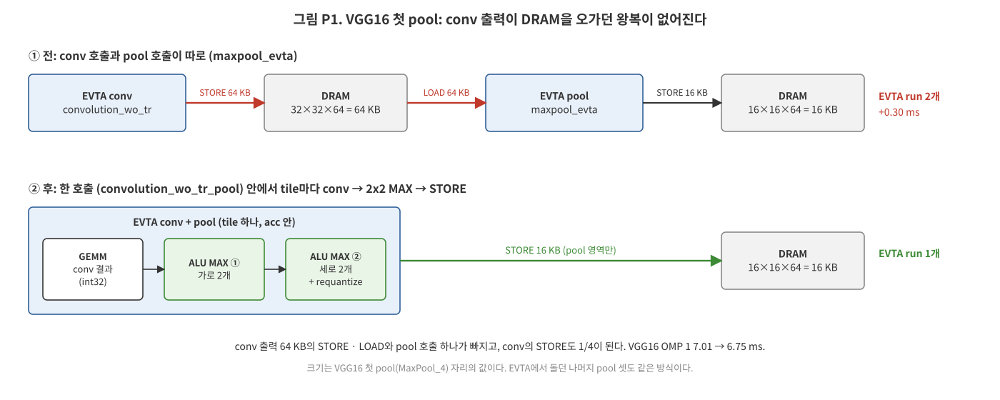
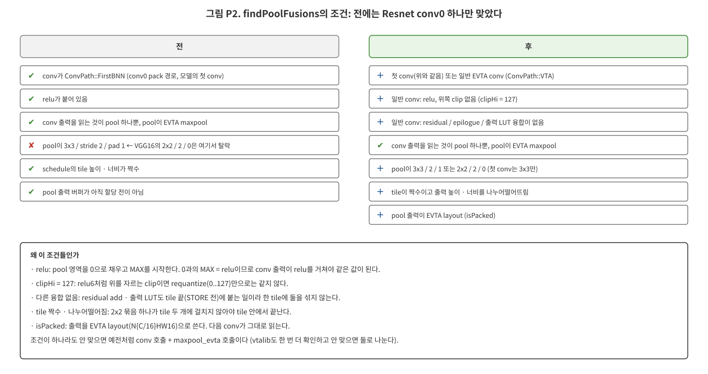
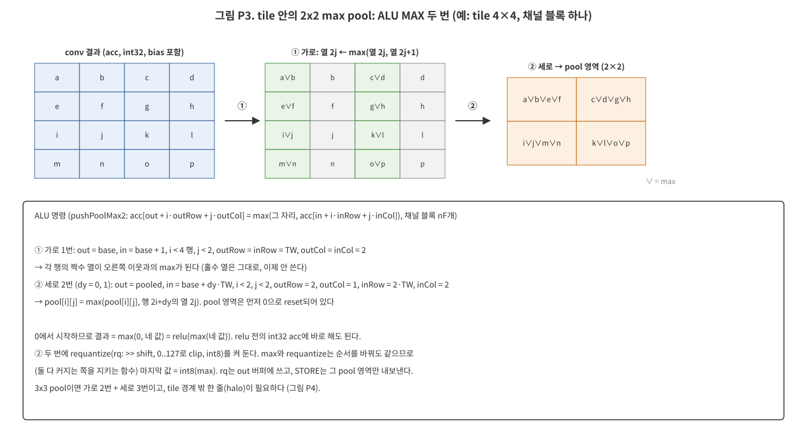
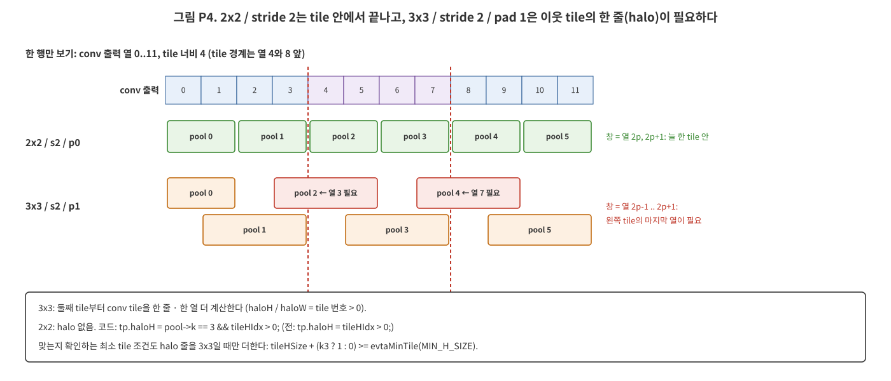
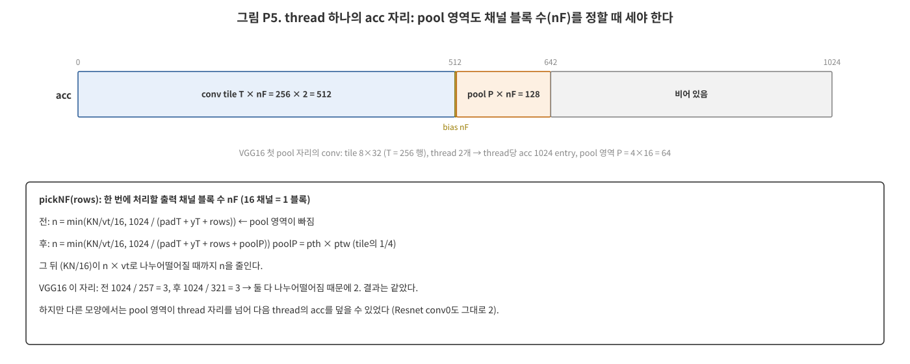

# conv + 2x2 max pool을 한 EVTA 호출로 (VGG16, 2026-11-17)

VGG16에서 conv 바로 뒤의 2x2 max pool을 conv 호출 안으로 넣은 변경을 설명한다. 코드는 바꾸기 전과 후를 나란히 보인다.
EVTA tile, acc, ALU를 처음 보는 사람도 읽을 수 있게 썼다(용어는 §9).

- 커밋: `186e53d` (VGG16: conv + 2x2 max pool in one EVTA call)
- 측정 기록: [vgg16_optimization.md](vgg16_optimization.md) §3.7
- 바탕이 된 기능(Resnet conv0 + 3x3 pool, 2026-11-02): [resnet18_optimization.md](resnet18_optimization.md), CLAUDE.md "conv0 + maxpool in one EVTA call"
- 코드:
  - 컴파일러: `lib/Backends/VTA/VTASave.cpp` (`findPoolFusions`, `generateVTAConvolutionCall`)
  - 런타임: `vtalib-zcu102-systolic/lib/Bundle/VTABundle.cpp` (`ConvPool`, `conv_kernel`, `convolution_wo_tr_impl`, `convolution_wo_tr_pool`)
- 그림 생성 스크립트: [figs/gen_evta_pool_figs.py](figs/gen_evta_pool_figs.py)

목차
1. 한 줄 요약과 결과
2. 왜 빠져 있었나
3. 컴파일러 ①: 후보 찾기 (`findPoolFusions`)
4. 컴파일러 ②: 합친 호출 내기 (`generateVTAConvolutionCall`)
5. 런타임 ①: tile 안의 2x2 pool (`conv_kernel`)
6. 런타임 ②: halo와 받아들이는 조건
7. 런타임 ③: 함께 고친 결함 (`pickNF`)
8. 확인한 방법
9. 용어

## 1. 한 줄 요약과 결과

conv 결과가 EVTA 안(acc)에 남아 있는 동안 2x2 max pool까지 계산하고, pool 결과만 DRAM에 내보낸다.
conv 출력이 DRAM을 오가는 왕복(STORE · LOAD)과 pool 호출 하나가 없어진다.



생성되는 번들 코드(VGG16의 첫 pool 자리)는 이렇게 바뀐다.

```cpp
// 전
convolution_wo_tr(Conv_2__2_input_transpose, ..., vtaCmdH, 2, 8, 32, 0);
maxpool_evta(Conv_2__2_res_vbuf, MaxPool_4__1_res_vbuf, 1, 32, 32, 64, 2, 2, 0, 2, vtaCmdH, 0);

// 후
convolution_wo_tr_pool(Conv_2__2_input_transpose, ..., vtaCmdH, 2, 8, 32, 0,
                       MaxPool_4__1_res_vbuf, 2, 2, 0);     // pool 출력, kernel 2, stride 2, pad 0
VTABufferInvalidate(MaxPool_4__1_res_vbuf, 0, 16384);
// maxpool_evta 자리에는 "done by the EVTA conv before" 주석만 남는다
```

보드(`_alux3` 400 MHz, OMP 1, 25회 중앙값):

| | 전 | 후 |
|---|---|---|
| VGG16 (CIFAR-10) | 7.01 ms | **6.75 ms** |
| `maxpool_evta` | 0.30 ms (4개) | 0 |
| 출력 | | 바이트까지 같음 |

엄밀히 말하면 conv epilogue 프로그램(`VTAEpilogue`의 ADD / RQ / CLIP / LUT 단계)에 pool 단계를 넣은 것은 아니다.
Resnet conv0용으로 이미 있던 "conv + pool 융합" 경로(`ConvPool`, `convolution_wo_tr_pool`)를 넓혔다.
하는 일은 epilogue와 같다. tile의 GEMM이 끝난 뒤, STORE 전에 acc 안에서 ALU로 후처리한다.

## 2. 왜 빠져 있었나

기능은 2026-11-02부터 있었지만, 찾기 규칙이 Resnet18 conv0 한 경우에 맞춰져 있었다.

- conv 쪽: **conv0 pack 경로(`ConvPath::FirstBNN`)**, 즉 모델의 첫 conv만 봤다.
- pool 쪽: **3x3 / stride 2 / pad 1**만 봤다.

VGG16의 pool은 모두 일반 EVTA conv(`ConvPath::VTA`) 뒤의 **2x2 / stride 2 / pad 0**이라 두 조건 모두에서 탈락했다.
"무슨 명령이냐(첫 conv인가)"로 거르지 말고 "실제로 무슨 계산이냐(EVTA tile에서 도는 conv 뒤의 pool인가)"로 골라야 했던 경우다.



## 3. 컴파일러 ①: 후보 찾기 (`findPoolFusions`)

IR 명령을 차례로 보면서 "conv → (alloc / dealloc만) → max pool"이 이어진 곳을 찾는다. 찾으면 pool을 conv에 묶고(`getPoolFusions()[C]`), pool 명령은 따로 내지 않는다(`getFusedAway()`).

### 3.1 어떤 conv인가

```cpp
// 전: 첫 conv(conv0 pack 경로)만
Conv0Pack pk;
if (!C || getConvPath(C) != ConvPath::FirstBNN || C->getFusedActivation() != RELU || !getConv0Pack(C, &pk))
  continue;
```

```cpp
// 후: 첫 conv 또는 일반 EVTA conv
const bool first = C && getConvPath(C) == ConvPath::FirstBNN && C->getFusedActivation() == RELU && getConv0Pack(C, &pk);
const bool vta = C && getConvPath(C) == ConvPath::VTA && convRelu(C) && convClipHi(C) == 127 && !ctx->getFusion(C) &&
                 !ctx->outLutConv.count(C);
if (!first && !vta)
  continue;
```

일반 conv(`vta`)에 붙은 조건과 그 이유:

| 조건 | 이유 |
|---|---|
| `convRelu(C)` | pool 영역을 0으로 채우고 MAX를 시작한다(§5). max(0, …) = relu이므로 conv 출력이 relu를 거쳐야 같은 값이 나온다 |
| `convClipHi(C) == 127` | relu6처럼 위쪽을 자르는 clip이 있으면 requantize의 0..127 clip만으로는 같지 않다 |
| `!ctx->getFusion(C)` | residual add / epilogue가 붙은 conv는 빼 둔다. 둘 다 tile 끝(STORE 전)에 붙는 일이라 한 tile에 섞지 않는다 |
| `!ctx->outLutConv.count(C)` | 출력 LUT(GELU 표 등)도 같은 자리를 쓴다 |

### 3.2 어떤 pool인가

```cpp
// 전: 3x3 / 2 / 1만
if (k[0] != 3 || k[1] != 3 || st[0] != 2 || st[1] != 2)
  continue;
bool pad1 = true;
for (auto p : pads)
  pad1 = pad1 && p == 1;
```

```cpp
// 후: 3x3 / 2 / 1 또는 2x2 / 2 / 0 (첫 conv는 3x3만: conv0 pack 경로는 2x2를 시험하지 않았다)
const int kk = k[0];
if (k[0] != k[1] || (kk != 3 && kk != 2) || st[0] != 2 || st[1] != 2 || (first && kk != 3))
  continue;
bool padOk = true;
for (auto p : pads)
  padOk = padOk && p == (kk == 3 ? 1u : 0u);
```

앞뒤로 남아 있는 공통 조건도 있다. conv 출력을 읽는 명령이 그 pool 하나뿐이어야 하고(`users[D] != 2`이면 탈락; 쓰는 conv와 읽는 pool이 2),
pool이 EVTA maxpool 후보여야 한다(`isEvtaMaxPool`).

### 3.3 tile 크기

pool 창이 tile 경계에 걸치지 않아야 tile 안에서 끝난다. 그러려면 conv의 tile(schedule)을 알아야 한다.

```cpp
// 전: conv0 pack 모양으로만 schedule을 찾았다
getConvSchedule(C->getSrc()->dims()[0], pk.H2, pk.W2, pk.CO, C->getFilter()->dims()[0], pk.KH2, 1, 1, 0, &vt, &th, &tw);
const Value *O = P->getDest();
if (!pad1 || th % 2 || tw % 2 || !allocAt.count(O))
  continue;
```

```cpp
// 후: 일반 conv면 그 conv의 실제 모양(입력 N H W C, 필터 KN KH KW, stride, pad)으로 찾는다
if (first)
  getConvSchedule(C->getSrc()->dims()[0], pk.H2, pk.W2, pk.CO, C->getFilter()->dims()[0], pk.KH2, 1, 1, 0, &vt, &th, &tw);
else {
  auto sd = C->getSrc()->dims(), fd = C->getFilter()->dims();
  getConvSchedule(sd[0], sd[1], sd[2], sd[3], fd[0], fd[1], fd[2], C->getStrides()[0], C->getPads()[0], &vt, &th, &tw);
}
const Value *O = P->getDest();
auto od = D->dims();
if (!padOk || th % 2 || tw % 2 || !allocAt.count(O) || od[1] % th || od[2] % tw || !ctx->isPacked(O))
  continue;
```

- `th % 2 || tw % 2`: tile 높이 · 너비가 짝수여야 2x2 묶음이 tile 안에 들어간다.
- `od[1] % th || od[2] % tw` (추가): tile이 출력을 나누어떨어뜨려야 한다. 끝에 남는 작은 tile이 없어야 한다.
  conv0은 schedule을 그렇게 골라 두어 필요 없었다.
- `isPacked(O)` (추가): pool 출력이 EVTA layout(N{C/16}HW16)이어야 한다. vtalib은 그 layout으로 쓴다.
- 어느 하나라도 안 맞으면 융합하지 않는다. 예전처럼 conv 호출과 `maxpool_evta` 호출이 따로 나간다.

## 4. 컴파일러 ②: 합친 호출 내기 (`generateVTAConvolutionCall`)

예전에는 첫 conv의 호출을 만드는 코드만 `convolution_wo_tr_pool`을 낼 줄 알았다. 일반 conv의 호출을 만드는 이 함수도 이제 낸다.

```cpp
// 전
bundle->append(fu && !epi ? "  convolution_wo_tr_res(" : "  convolution_wo_tr(");
...
bundle->append(");\n");
```

```cpp
// 후
const PoolFusion *pfv = ctx->getPoolFusion(Inst);
bundle->append(pfv ? "  convolution_wo_tr_pool(" : fu && !epi ? "  convolution_wo_tr_res(" : "  convolution_wo_tr(");
...   // conv 인자는 같다
if (pfv) {   // 끝에 pool 출력 버퍼와 kernel / stride / pad
  auto *P = llvm::cast<MaxPoolInst>(pfv->pool);
  bundle->append(", " + pfv->out->getName().str() + "_vbuf");
  for (int v : {(int)P->getKernels()[0], (int)P->getStrides()[0], (int)P->getPads()[0]})
    bundle->append(", " + std::to_string(v));
}
bundle->append(");\n");
if (pfv)   // CPU가 pool 출력을 읽을 수 있게 (보드는 cache coherent가 아니다)
  bundle->append("  VTABufferInvalidate(" + pfv->out->getName().str() + "_vbuf, 0, " +
                 std::to_string(pfv->out->getSizeInBytes()) + ");\n");
```

conv 출력 버퍼(`Conv_2__2_res_vbuf`)는 그대로 인자로 넘어가지만, 융합된 경우 vtalib은 거기에 쓰지 않는다. 쓰는 곳은 pool 출력 버퍼다.

## 5. 런타임 ①: tile 안의 2x2 pool (`conv_kernel`)

먼저 pool 종류를 기억할 칸을 `ConvPool`에 더했다. 기본값이 3이라 Resnet conv0 경로는 바뀌지 않는다.

```cpp
struct ConvPool {
  int8_t *out;          // the pooled output (EVTA layout)
  uint32_t PH, PW;      // its height / width
  uint32_t py0, px0;    // this tile's first pooled pixel
  uint32_t pth, ptw;    // this tile's pooled pixels (conv tile / 2)
  bool haloH, haloW;    // the conv tile has the extra row above / column to the left
  uint32_t k = 3;       // 추가: 3 (3 x 3 / 2 / pad 1, halo) 또는 2 (2 x 2 / 2 / pad 0, halo 없음: VGG16)
};
```

계산의 핵심은 tile의 GEMM이 끝난 뒤 내는 ALU MAX 명령 세 개(가로 1번, 세로 2번)다.
`pushPoolMax2`는 ALU 명령 하나를 낸다. 그 명령은 `acc[out + i·outRow + j·outCol] = max(그 자리, acc[in + i·inRow + j·inCol])`을
i, j와 채널 블록 nF개에 대해 한다(인자: out, in, 행 수, 열 수, outRow, outCol, inRow, inCol, nF, out 블록 간격, in 블록 간격).

```cpp
// 후 (2x2 분기, 새로 추가; else 쪽은 기존 3x3 코드 그대로)
const uint32_t pooled = outputSramBaseAddr + T * nFilterinLoop + nFilterinLoop;   // tile, bias 다음 자리
const uint32_t TW = resizedOutTileW, nF = nFilterinLoop;
pushReset(vtaCmdH, idEVTA, pooled, P * nF);                                         // pool 영역 = 0
if (pool->k == 2) {
  const uint32_t base = outputSramBaseAddr;
  // ① 가로: 열 2j <- max(열 2j, 열 2j + 1), 모든 행
  pushPoolMax2(vtaCmdH, idEVTA, {base, base + 1, resizedOutTileH, pool->ptw, TW, 2, TW, 2, nF, T, T});
  if (rqPool) VTARequant(vtaCmdH, 1, 0, shift, 0, 127);      // 다음 명령들은 requantize해서 out에 쓴다
  // ② 세로: pool[i][j] <- max(pool[i][j], 행 2i + dy의 열 2j), dy = 0, 1
  for (uint32_t dy = 0; dy < 2; dy++)
    pushPoolMax2(vtaCmdH, idEVTA, {pooled, base + dy * TW, pool->pth, pool->ptw, pool->ptw, 1, 2 * TW, 2, nF, P, T});
  if (rqPool) VTARequant(vtaCmdH, 0, 0, 0, 0, 0);
} else {
  ... 3x3: 가로 2번 + 세로 3번, halo 처리 ...
}
```



이것이 맞는 이유는 두 가지다.

1. **0에서 시작해도 된다.** pool 영역을 0으로 reset하고 MAX를 하므로 결과는 max(0, 네 값)이다.
   이것은 relu(max(네 값)) = max(relu(네 값))과 같다. 그래서 relu를 따로 하지 않은 int32 acc(bias 포함)에 바로 할 수 있다.
   §3.1에서 relu를 요구한 이유가 이것이다.
2. **requantize를 맨 끝에 한 번만 해도 된다.** requantize(int32 → int8: `>> shift`로 반올림, 0..127로 clip)도 max도
   값의 크기 순서를 지키는 함수라 순서를 바꿔도 같다. 즉 rq(max(a, b)) = max(rq(a), rq(b))다.
   그래서 conv tile 전체를 requantize하지 않고 세로 pass 두 번에만 rq를 켠다. rq는 out 버퍼에 쓰므로 out에는 마지막 pass의 값,
   곧 int8(pool 결과)이 남는다. STORE는 그 pool 영역(tile의 1/4)만 내보낸다.

## 6. 런타임 ②: halo와 받아들이는 조건

### 6.1 halo

3x3 / stride 2 / pad 1 pool의 창은 열 2p−1..2p+1이라, tile의 첫 pool은 왼쪽(위쪽) tile의 마지막 열(행)이 필요하다.
그래서 3x3은 둘째 tile부터 conv tile을 한 줄 · 한 열 더 계산한다(halo).
2x2 / stride 2의 창은 열 2p, 2p+1이라 tile 너비가 짝수면 늘 한 tile 안에 있다.



```cpp
// convolution_wo_tr_impl, tile마다
// 전
tp.haloH = tileHIdx > 0;
tp.haloW = tileWIdx > 0;
// 후
tp.haloH = pool->k == 3 && tileHIdx > 0;   // 2x2 pool은 halo 없음
tp.haloW = pool->k == 3 && tileWIdx > 0;
```

### 6.2 받아들이는 조건 (`convolution_wo_tr_pool`)

vtalib도 호출을 받을 때 한 번 더 확인한다. 안 맞으면 conv와 `maxpool_evta`로 나누어 한다. 그래서 컴파일러가 잘못 골라도 결과는 틀리지 않는다.

```cpp
// 전: 3x3 / 2 / 1만, 최소 tile은 HLS GEMM 기준(MIN_H_SIZE 7)에 halo 1을 더해서
const bool fits = N == 1 && doRelu && poolK == 3 && poolStride == 2 && poolPad == 1 && KN % 16 == 0 && nF > 0 &&
                  tileHSize % 2 == 0 && tileWSize % 2 == 0 && out_h % tileHSize == 0 && out_w % tileWSize == 0 &&
                  tileHSize + 1 >= MIN_H_SIZE && tileWSize + 1 >= MIN_W_SIZE &&
                  (tileHSize + 1) * (tileWSize + 1) * nF + nF + tileHSize * tileWSize / 4 * nF <= 2048 / (uint32_t)nVirtualThread;
```

```cpp
// 후: 2x2 / 2 / 0도. 최소 tile은 실제 비트스트림 기준(evtaMinTile: systolic GEMM은 1), halo 줄은 3x3일 때만
const bool k3 = poolK == 3 && poolStride == 2 && poolPad == 1, k2 = poolK == 2 && poolStride == 2 && poolPad == 0;
const bool fits = N == 1 && doRelu && (k3 || k2) && KN % 16 == 0 && nF > 0 &&
                  tileHSize % 2 == 0 && tileWSize % 2 == 0 && out_h % tileHSize == 0 && out_w % tileWSize == 0 &&
                  tileHSize + (k3 ? 1 : 0) >= (int)evtaMinTile(MIN_H_SIZE) &&
                  tileWSize + (k3 ? 1 : 0) >= (int)evtaMinTile(MIN_W_SIZE) &&
                  (tileHSize + 1) * (tileWSize + 1) * nF + nF + tileHSize * tileWSize / 4 * nF <= 2048 / (uint32_t)nVirtualThread;
```

VGG16 뒤쪽 conv는 tile이 작다(예: 4×4, 2×2). 전처럼 `MIN_H_SIZE`(HLS GEMM의 7)로 보면 탈락했다.
systolic 비트스트림은 최소 tile이 1이다(`evtaMinTile`, CLAUDE.md "conv tiles below 7 x 7").

`vta/vtalib`(systolic이 아닌 vtalib)은 바꾸지 않았다. 2x2 호출이 오면 이 대체 경로(conv + `maxpool_evta`)로 간다.

## 7. 런타임 ③: 함께 고친 결함 (`pickNF`)

`conv_kernel`은 출력 채널 블록(16채널)을 한 번에 몇 개(nF) 계산할지 정한다. thread마다 acc 자리가 정해져 있으므로(1024 entry, thread 2개)
nF개 블록의 tile · bias · pool 영역이 그 안에 들어가야 한다. 그런데 pool 영역을 세지 않고 있었다.



```cpp
// 전: 블록 하나 = tile(padT 행) + residual 자리(yT) + bias 등(rows)
auto pickNF = [&](uint32_t rows) {
  uint32_t n = min(KN / nVirtualThread / 16, ACC_MEM_ENTRY / nVirtualThread / (padT + yT + rows));
  for (; n > 0; n--)
    if ((KN / 16) % (n * nVirtualThread) == 0) break;
  return n;
};
```

```cpp
// 후: + pool 영역 (tile의 1/4)
const uint32_t poolP = pool ? pool->pth * pool->ptw : 0;
auto pickNF = [&](uint32_t rows) {
  uint32_t n = min(KN / nVirtualThread / 16, ACC_MEM_ENTRY / nVirtualThread / (padT + yT + rows + poolP));
  ...
};
```

VGG16 첫 pool 자리(tile 8×32 = 256)에서는 전 1024 / 257 = 3, 후 1024 / 321 = 3이고, 채널 블록 수(64채널 = 4블록)를
n × 2로 나누어떨어뜨리는 조건 때문에 둘 다 2가 된다. 이 모양에서는 결과가 같았지만, 다른 모양에서는 pool 영역이 thread 자리를
넘어 이웃 thread의 acc를 덮을 수 있었다. Resnet conv0도 2 그대로다.

## 8. 확인한 방법

| 확인 | 결과 |
|---|---|
| `EVTA_RES_CHECK=1`: 융합 호출마다 conv + CPU maxpool로 다시 계산해 비교 | 4종 모두 0 differ |
| `EVTA_DUMP_CONV`: 새 dump(pool 출력 13개)를 이전 실행 파일의 dump와 비교 | 모두 같음 (새 dump가 이전 dump의 부분집합) |
| CIFAR-10 시험 그림 20장 분류 | 전과 같음 |
| 공통 코드를 건드렸으므로 Resnet18 / 50 dump(40 / 106개) | 그대로 |
| 시간 (OMP 1) | 7.01 → 6.75 ms |

마지막 pool(2x2 → 1x1)은 EVTA maxpool 후보가 아니어서(`isEvtaMaxPool` 아님) CPU pool 그대로다(0.04 ms).

## 9. 용어

- **acc:** EVTA 안의 int32 누적 버퍼. GEMM 결과가 STORE 전까지 여기 있다. thread마다 정해진 영역을 쓴다.
- **ALU MAX:** EVTA ALU의 원소별 max 명령. 두 acc 자리 중 큰 값을 dst에 쓴다.
- **conv0 pack (`ConvPath::FirstBNN`):** 모델의 첫 conv를 채널 수가 많은 1xN conv로 바꿔 EVTA에서 돌리는 경로. Resnet conv0, DeiT patch conv가 탄다.
- **EVTA layout (packed):** N{C/16}HW16. 16채널씩 묶어 둔 배치. EVTA conv의 입출력 형태다.
- **epilogue:** tile의 GEMM 뒤, STORE 전에 acc에서 하는 후처리(bias, residual add, requantize, clip, LUT).
- **halo:** tile 경계 밖에서 더 필요한 줄. 3x3 pool은 한 줄이 필요하고 2x2 / stride 2는 필요 없다.
- **nF (`nFilterinLoop`):** 한 번에 계산하는 출력 채널 블록 수.
- **requantize (rq):** int32 누적값을 shift · 반올림 · clip해 int8로 만드는 것. `_rq` 비트스트림에서는 명령에 붙은 필드로 하고 결과는 out 버퍼에 간다.
- **schedule:** conv마다 정한 tile 크기와 virtual thread 수(`VTASchedules.h`, `getConvSchedule`).
- **tile:** 출력을 EVTA 버퍼에 들어가게 자른 조각. VGG16 첫 pool 자리의 conv는 8×32다.
- **virtual thread (vt):** 같은 EVTA에서 두 tile 묶음을 번갈아 돌려 전송과 계산을 겹치는 방법. acc · inp를 반씩 나눠 쓴다.
