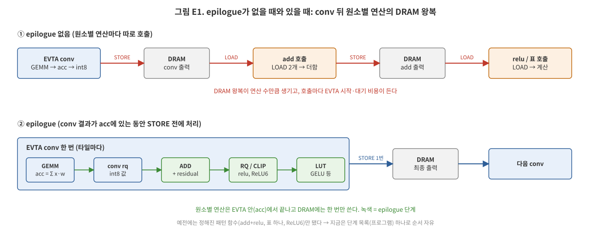
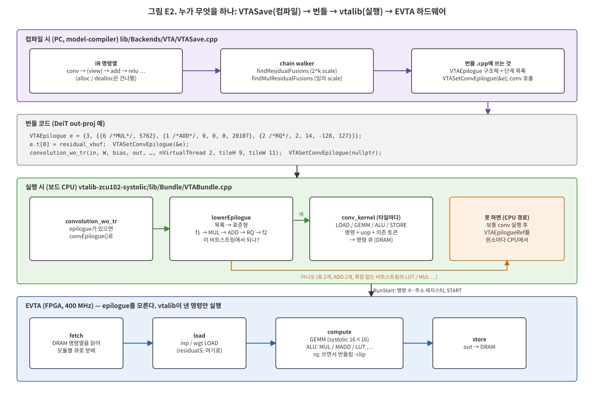
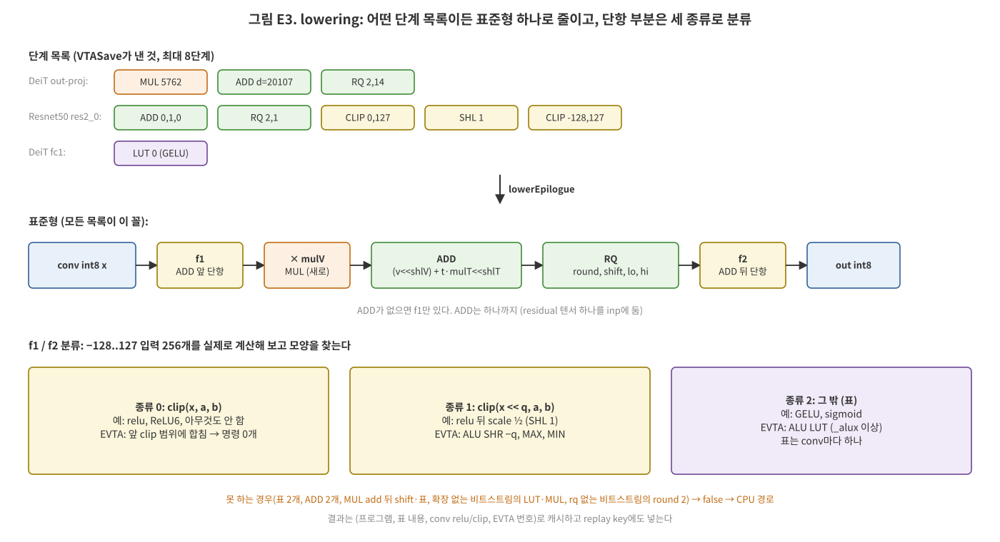
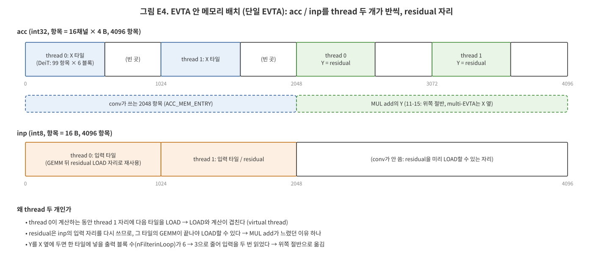
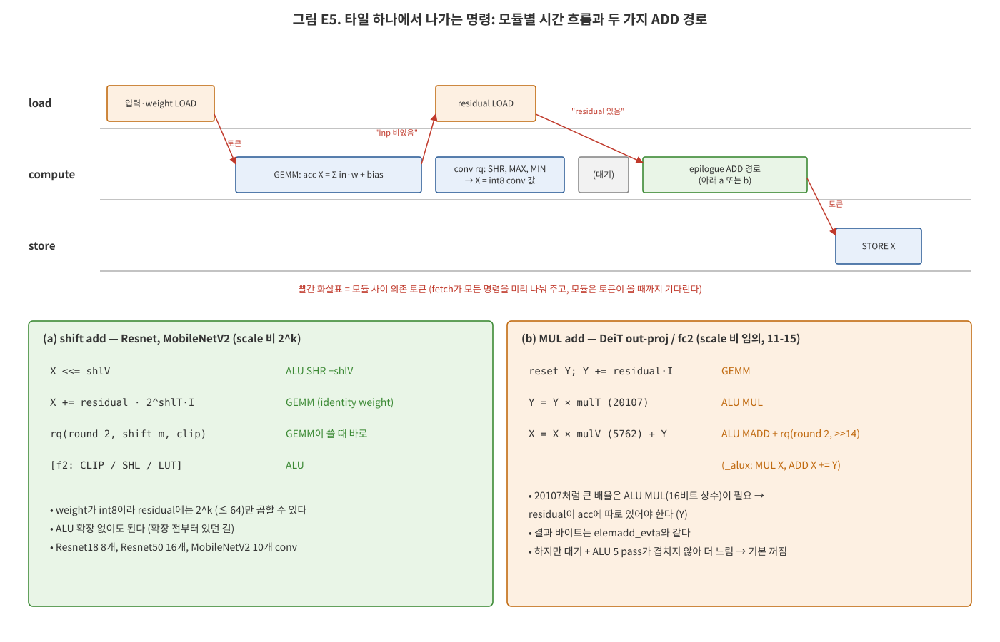
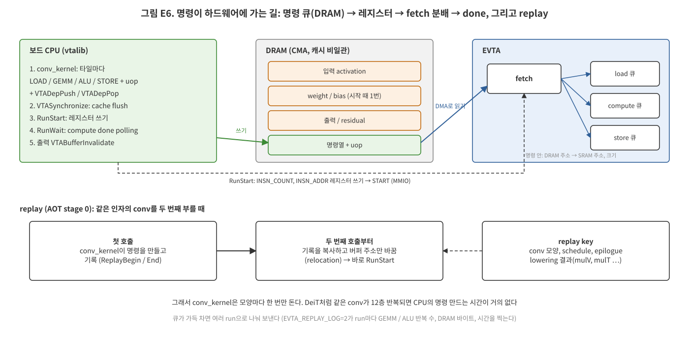
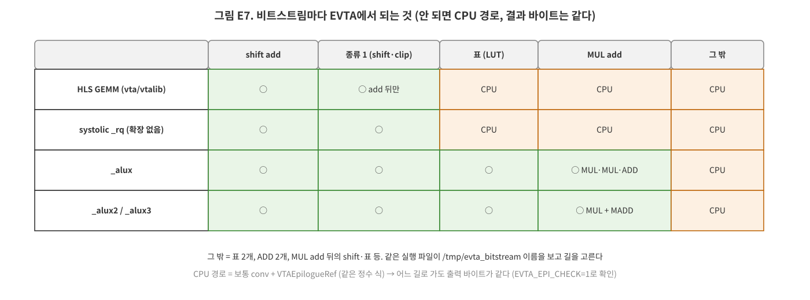

# conv epilogue 쉽게 보기: 컴파일러부터 EVTA 명령까지 (2026-11-15)

conv 뒤의 원소별 연산(add, relu, ReLU6, GELU 표, scale 맞추기)을 EVTA 안에서 끝내는 구조를 처음 보는 사람용으로 설명한다.
- 설계와 측정 기록: [evta_alux_epilogue.md](evta_alux_epilogue.md)
- ISA와 MUL add 측정: [evta_isa_ext.md](evta_isa_ext.md) §8.18
- 그림 생성 스크립트: [figs/gen_evta_epi_figs.py](figs/gen_evta_epi_figs.py)

목차
1. 무엇을 해결하나
2. 누가 무엇을 하나: 세 층
3. 프로그램 형식
4. lowering: 표준형과 세 종류
5. EVTA 안 메모리 배치
6. 타일 하나에서 나가는 명령
7. 명령이 하드웨어에 가는 길
8. 비트스트림별로 되는 것과 CPU 경로
9. 컴파일러가 사슬을 찾는 법
10. 확인하는 법
11. MUL add(2026-11-15)의 결과와 남은 일
12. 코드 위치
13. 용어

## 1. 무엇을 해결하나



conv 결과는 EVTA의 acc(int32 누적 메모리)에 먼저 생긴다. 원소별 연산을 따로 호출하면, 연산마다 다음 일이 반복된다.
- DRAM에 STORE하고 다시 LOAD한다.
- EVTA 실행을 시작하고 끝나기를 기다린다.

epilogue는 conv 결과가 **아직 acc에 있을 때, STORE 전에** 그 연산들을 한다. DRAM에는 최종 출력만 한 번 쓴다.

예전에는 붙일 수 있는 것이 정해진 패턴 함수뿐이었다.
- `convolution_wo_tr_res`: add + relu 하나
- `VTASetOutputLut`: 표 하나
- `VTASetActivationClip`: ReLU6

지금은 **단계 목록(작은 프로그램)** 하나로 순서를 자유롭게 적는다(2026-11-14). 예전 함수들도 내부에서 이 프로그램으로 바뀐다.

## 2. 누가 무엇을 하나: 세 층



| 층 | 언제 | 하는 일 | 모르는 것 |
|---|---|---|---|
| VTASave (`lib/Backends/VTA/VTASave.cpp`) | 컴파일 시, PC | IR에서 "conv → add → relu …" 사슬을 찾아 단계 목록을 만들고, 번들 `.cpp`에 적는다 | `conv_kernel`, 비트스트림 종류 |
| vtalib (`vtalib-zcu102-systolic/lib/Bundle/VTABundle.cpp`) | 실행 시, 보드 CPU | 목록을 지금 실린 비트스트림에서 되는 EVTA 명령으로 바꾸고(lowering), 타일마다 명령을 만든다. 안 되면 CPU에서 같은 식을 쓴다 | 모델 |
| EVTA (FPGA) | 실행 시 | fetch, load, compute(GEMM / ALU / rq), store가 명령을 실행한다 | epilogue라는 개념 자체 |

VTASave는 `convolution_wo_tr(...)`을 부르는 코드만 쓴다. `conv_kernel`은 참조하지 않는다. 다만 다음 세 가지는 컴파일 때 정해서 넘긴다.
- **타일 크기(schedule):** `VTASchedules.h`의 nVirtualThread와 tileH/tileW를 호출 인자로 넘긴다. vtalib은 그 크기로 자르고, 맞지 않을 때만 고친다.
- **데이터 배치:** weight와 bias는 EVTA 배치로 미리 바꿔 `.weights.bin`에 넣는다. activation은 N{C/16}HW16으로 둔다.
- **단계 목록:** 어떤 EVTA 명령으로 바꿀지는 vtalib이 정한다.

DeiT out-proj의 번들 코드(`-vta-fuse-elemadd-mul`을 켰을 때):

```c
VTAEpilogue e = {3, {{6 /*MUL*/, 5762, 0, 0, 0},       // v = conv × 5762
                     {1 /*ADD*/, 0, 0, 0, 20107},       // v += residual × 20107
                     {2 /*RQ*/,  2, 14, -128, 127}}};   // v = clip(round(v / 2^14))
e.t[0] = residual_vbuf;
VTASetConvEpilogue(&e);
convolution_wo_tr(in, W, bias, out, 1, 18, 11, 192, 192, 1, 1, 0, 1, 0, 1, 7, 18, 11, vtaCmdH, 2, 9, 11, 0);
VTASetConvEpilogue(nullptr);
```

- 구조체는 지역 변수다. 여러 thread가 같은 함수를 돌려도 섞이지 않는다.
- 한 줄에 한 문장만 쓴다(`timed_bundle.py`가 문장 줄마다 시간 코드를 끼운다).

## 3. 프로그램 형식

```c
struct VTAEpiStep  { int32_t op, a, b, c, d; };
struct VTAEpilogue { int32_t n; VTAEpiStep s[8]; void *t[2]; const int8_t *lut[2]; };
void   VTASetConvEpilogue(const VTAEpilogue *e);                         // 다음 convolution_wo_tr들에, nullptr = 끔
int8_t VTAEpilogueRef(const VTAEpilogue *e, int8_t x, const int8_t *tv);  // 출력 하나의 CPU 값 (기준)
```

v는 **conv 자신의 int8 출력**(conv의 shift, relu, ReLU6가 이미 적용된 값)에서 시작한다. 단계를 차례로 지난 마지막 값을 int8로 쓴다.

| op | 단계 | 식 | 생긴 날 |
|---|---|---|---|
| 1 | ADD | v = (v << b) + (t[a] << c) × d (d = 0이면 1) | 11-14 (d는 11-15) |
| 2 | RQ | v = clip((v + r) >> b, c, d). round a: 0 버림, 1 반올림, 2 0에서 먼 쪽(CPU `std::round`) | 11-14 |
| 3 | CLIP | v = min(max(v, a), b) | 11-14 |
| 4 | SHL | v = v << a | 11-14 |
| 5 | LUT | v = lut[a][(uint8_t) v] (256칸 표) | 11-14 |
| 6 | MUL | v = v × a | 11-15 |

지금 모델들이 쓰는 프로그램:

| 모델 / 위치 | IR에서 conv 뒤 | 프로그램 | 켜는 옵션 |
|---|---|---|---|
| Resnet18 / 50 | add, relu | ADD(0, shlV, shlT) · RQ(2, m) · CLIP(0, 127) | `-vta-fuse-residual` (기본 켜짐) |
| Resnet50 res2_0 | add, relu (출력 scale ½) | … CLIP(0, 127) · SHL(1) · CLIP(−128, 127) | 같음 |
| MobileNetV2 | add (relu 없음) | ADD · RQ(2, m) | `-vta-fuse-residual-norelu` (기본 켜짐) |
| DeiT fc1 | GELU 표 | LUT(0) | `-vta-alu-output-lut` (기본 켜짐) |
| DeiT out-proj / fc2 | add (scale 비 임의) | MUL · ADD(d) · RQ(2, n) | `-vta-fuse-elemadd-mul` (**기본 꺼짐**, §11) |

## 4. lowering: 표준형과 세 종류



ADD를 뺀 단계(CLIP, SHL, LUT, RQ)는 모두 **int8 → int8 함수**다. 그래서 `lowerEpilogue`는 어떤 목록이든 다음 표준형으로 줄인다.

```
conv int8 x → f1 → [× mulV] → ADD (v << shlV) + (t × mulT) << shlT → RQ(rnd, shift, lo, hi) → int8 → f2 → out
```

f1과 f2는 가능한 입력(−128..127 가운데 앞 clip의 범위)을 **모두 실제로 계산해 보고** 세 종류로 나눈다.

| 종류 | 모양 | EVTA 명령 | 예 |
|---|---|---|---|
| 0 | clip(x, a, b) | 앞 clip 범위에 합친다. 명령이 늘지 않는다 | relu, ReLU6, 아무것도 안 함 |
| 1 | clip(x << q, a, b), q = 1..7 | ALU SHR −q, MAX, MIN | relu 뒤 scale ½ |
| 2 | 그 밖 | ALU LUT (표, `_alux` 이상). 표는 conv마다 하나 | GELU, sigmoid |

- 다음 경우는 false를 돌려 CPU 경로로 간다(§8): 표 2개, ADD 2개, MUL add 뒤의 shift나 표, 확장 없는 비트스트림의 LUT나 MUL, rq 없는 비트스트림의 round 2.
- add 뒤에 relu가 있으면 음수 쪽은 결과가 같은 값으로 모인다. 이때는 round 2를 round 1로 바꿔 rq 없이 acc 안에서 할 수 있다.
- 결과는 (프로그램, 표 내용, conv의 relu/clip, EVTA 번호)로 캐시한다. replay key에도 lowering 결과 전체가 들어간다.

## 5. EVTA 안 메모리 배치



- **acc:** int32. 항목 하나가 16채널 × 4 B이고, 단일 EVTA는 4,096 항목이다. conv는 앞쪽 2,048 항목(`ACC_MEM_ENTRY`)을 thread 두 개가 반씩 쓴다. 각 반에는 출력 타일 X(출력 블록 nFilterinLoop개)와 bias 칸이 있다.
- **inp:** int8. 항목 하나가 16 B이고 4,096 항목이다. conv는 앞쪽 2,048 항목을 thread별 입력 타일에 쓴다. residual은 그 타일의 GEMM이 끝난 뒤 같은 자리에 LOAD한다.
- **virtual thread 둘:** thread 0이 계산하는 동안 thread 1 자리에 다음 타일을 LOAD한다. 그래서 LOAD와 계산이 겹친다.
- **MUL add의 Y(residual × 배율):** 처음에는 X 옆에 두었다. 그러자 DeiT의 nFilterinLoop가 6 → 3으로 줄어 conv가 입력을 두 번 읽었다. 그래서 단일 EVTA에서는 acc 위쪽 절반(base + 2048)으로 옮겼다. multi-EVTA는 acc가 2,048 항목뿐이라 여전히 X 옆에 둔다.

## 6. 타일 하나에서 나가는 명령



`conv_kernel`은 출력 채널 묶음과 타일마다, thread마다 다음 순서로 명령을 낸다.

1. load: 입력과 weight를 LOAD한다. 토큰 → compute.
2. compute: GEMM(acc X = Σ in·w + bias)을 한다. 토큰 → load("inp 비었음").
3. load: residual을 inp에 LOAD한다. 토큰 → compute("residual 있음"). ADD가 있을 때만이다.
4. compute: conv requantize를 acc 안에서 한다(ALU SHR, MAX, MIN → X = int8 conv 값). ADD나 종류 1이 없으면 대신 GEMM이 쓸 때 rq를 적용한다.
5. compute: f1을 한다(종류 1: SHR/MAX/MIN, 종류 2: ALU LUT).
6. compute: ADD 경로(a 또는 b)를 한다. 끝나면 토큰 → store.
7. store: STORE X → DRAM.

**(a) shift add** (scale 비가 2^k인 경우: Resnet, MobileNetV2)

| 명령 | 하는 일 |
|---|---|
| ALU SHR −shlV | X <<= shlV |
| GEMM (identity weight 2^shlT·I) | X += residual · 2^shlT |
| GEMM에 rq | 쓰면서 round 2, shift m, clip |
| ALU (있으면) | f2: CLIP, SHL, LUT |

- weight가 int8이라 residual에는 2^k(≤ 64)만 곱할 수 있다. 그래서 이 경로는 scale 비가 2의 거듭제곱일 때만 쓴다.
- ALU 확장 없이 된다. Resnet18 8개, Resnet50 16개, MobileNetV2 10개 conv가 이 길이다.

**(b) MUL add** (scale 비가 임의인 경우: DeiT out-proj / fc2, 2026-11-15)

| 명령 | 하는 일 |
|---|---|
| reset Y, GEMM (identity weight) | Y = residual |
| ALU MUL (imm mulT) | Y = Y × mulT |
| ALU MADD (imm mulV) + rq | X = X × mulV + Y, 쓰면서 round 2 / shift / clip |
| (`_alux`, MADD 없음) | ALU MUL X, 그다음 ALU ADD X += Y (rq와 함께) |

- 20107 같은 배율은 ALU MUL(16비트 상수)이 필요하다. 그래서 residual을 acc Y에 따로 둔다.
- 계산식이 `elemadd_evta`(§8.17)와 같아서 결과 바이트도 같다.

## 7. 명령이 하드웨어에 가는 길



1. **명령 만들기:** `conv_kernel`이 명령(LOAD / GEMM / ALU / STORE)과 uop, 의존 토큰(`VTADepPush` / `VTADepPop`)을 명령 큐에 쌓는다. 명령 큐는 DRAM의 CMA 버퍼다. 명령에는 "DRAM 주소 → SRAM 주소, 크기"만 들어 있다. 데이터(입력, weight, residual)는 이미 DRAM에 있다.
2. **cache flush:** 보드는 cache 비일관이라 `VTASynchronize`가 명령열을 flush한다(+ `dsb sy`).
3. **시작 알리기:** `pynq_driver.cc` `RunStart`가 레지스터를 쓴다.
   ```c
   VTAWriteMappedReg(fetch, VTA_FETCH_INSN_COUNT_OFFSET, insn_count);
   VTAWriteMappedReg(fetch, VTA_FETCH_INSN_ADDR_OFFSET,  insn_phy_addr);
   VTAWriteMappedReg(fetch, 0x0, VTA_START);
   ```
4. **나눠 주기:** fetch가 DMA로 명령을 읽어 opcode대로 load / compute / store 큐에 넣는다. 명령 하나가 끝나기를 기다리지 않는다.
5. **동시 실행:** 세 모듈은 동시에 돈다. 순서는 토큰 FIFO로만 맞춘다.
6. **끝:** `RunWait`가 compute done 레지스터를 polling한다. 그 뒤 CPU가 출력을 `VTABufferInvalidate`하고 읽는다.

**replay.** 첫 호출의 명령과 uop를 기록한다. 같은 인자로 다시 부르면 기록을 복사하고 버퍼 주소만 바꿔(relocation) 바로 RunStart한다. 그래서 `conv_kernel`은 모양마다 한 번만 돈다. 명령 큐가 차면 여러 run으로 나눠 보낸다.

## 8. 비트스트림별로 되는 것과 CPU 경로



- 같은 실행 파일이 모든 비트스트림에서 돈다. vtalib이 `/tmp/evta_bitstream`의 이름(`_rq`, `_alux`, `_alux2` …)을 보고 길을 고른다. 환경변수 `EVTA_REQUANT`, `EVTA_ALUX`, `EVTA_ALUX2`로 덮어쓸 수 있다.
- **CPU 경로:** 보통 conv를 돌리고, 원소마다 `VTAEpilogueRef`(같은 정수 식)를 CPU에서 적용한다. 그래서 **어느 길로 가도 출력 바이트가 같다**.
  - residual이 출력 버퍼와 같으면(in place) conv는 임시 버퍼에 쓴다.
- **vta/vtalib(HLS GEMM 비트스트림):** API는 같다. residual 형태(ADD · RQ · [CLIP · [SHL · CLIP]])만 `convolution_wo_tr_res`로 EVTA에서 하고, 나머지는 CPU 경로다.

## 9. 컴파일러가 사슬을 찾는 법

| pass | 찾는 것 | 단계 |
|---|---|---|
| `findResidualFusions` (11-14, chain walker) | EVTA conv 뒤 add(scale 비 2^k), relu(scale 비 2^q)를 순서 상관없이. add는 하나까지 | ADD · RQ(2, m), CLIP [· SHL q · CLIP] |
| `findOutLutConvs` | conv 뒤 원소별 사슬이 256칸 표로 되는 것 (GELU) | LUT(0) |
| `findMulResidualFusions` (11-15, `findPackedRows` 뒤) | 위에서 못 묶인 conv → (offset 0 view) → add (scale 비 임의) | MUL · ADD(d) · RQ(2, N) |

공통 조건:
- 사슬 중간 값은 사슬 밖에서 읽지 않는다.
- 마지막 출력은 conv 전에 할당되어 있거나, 할당을 conv 앞으로 옮길 수 있다.
- 출력이 conv 입력이 아니다.
- 모든 값이 EVTA 배치다.

묶인 명령은 번들에 `// done by the EVTA conv before …` 주석만 남는다.

## 10. 확인하는 법

| 무엇 | 어떻게 |
|---|---|
| EVTA 결과 = CPU 식 | `EVTA_EPI_CHECK=1`: 융합 실행과 "보통 conv + `VTAEpilogueRef`"를 둘 다 돌려 다른 바이트 수를 찍는다 |
| 프로그램 모양 전부 | `vtalib-zcu102-systolic/tests/epi_conv_test.cc`: 모델 패턴, 새 순서, CPU로 가는 경우, 무작위 24개, MUL add 10개. `run_epi_test.sh`가 시뮬레이터에서 rq 끔 / rq 켬 / `EVTA_ALUX2=0` / `EVTA_ALUX=0` 네 모드로 돌린다. 보드는 `run_alux_board_tests.sh` |
| ALU hazard | 시뮬레이터 `EVTA_ALU_SLOTS=34`, `EVTA_ALU_HAZARD=17`. 보드 `EVTA_REPLAY_DUMP=<dir>` 뒤 `tests/hazard_dump.py <dir>` |
| run마다 시간 | `EVTA_REPLAY_LOG=2`: run마다 GEMM / ALU 반복 수, DRAM 바이트, us |
| 번들이 어떤 옵션으로 만들어졌나 | `head -40 <bundle>.cpp` (옵션 주석) |

## 11. MUL add(2026-11-15)의 결과와 남은 일

결과 바이트는 `elemadd_evta`와 같았다.
- DeiT 281 / 207 / 340, cat 0.736180.
- `EVTA_EPI_CHECK` 3,500번 0 differ.
- 모든 fallback이 같다.

하지만 더 느렸다(보드 `_alux3`, run 하나씩 측정, us):

| conv | 따로 (conv + `elemadd_evta`) | epilogue |
|---|---|---|
| out-proj | 115 + 58 = 173 | 207 |
| fc2 | 406 + 58 = 464 | 544 |

- DeiT 전체로는 OMP 1에서 47.04 → 47.95 ms였다. 그래서 `-vta-fuse-elemadd-mul`은 기본 꺼짐이다.
- **원인 ①:** residual LOAD가 그 타일의 GEMM 뒤에야 시작된다(inp 자리를 같이 써서, 그림 E5의 "(대기)").
- **원인 ②:** ALU 5 pass(conv requantize 3, MUL, MADD)가 다음 타일의 GEMM과 겹치지 않는다.
- `elemadd_evta`는 버퍼 반쪽 두 개로 LOAD · ALU · STORE를 겹쳐 58 us면 된다.

남은 일:
1. residual을 inp 위쪽 절반(그림 E4의 빈 자리)에 타일 입력과 함께 미리 LOAD한다. 대기가 없어져도 ALU 약 42 us는 남아, 이득 상한은 DeiT 전체로 약 0.4 ms다.
2. EVTA 배치 activation 뒤의 표(sigmoid, SiLU, hard-swish)를 epilogue LUT로 넣는다. CNN의 다른 모델용이다([evta_alux_epilogue.md](evta_alux_epilogue.md) §7).
3. ADD 둘이나 표 둘을 지원한다(inp 두 번째 residual 자리, 타일마다 LUTSET).

## 12. 코드 위치

| 무엇 | 파일 · 함수 |
|---|---|
| API, 단계 정의 | `vtalib-zcu102-systolic/include/Bundle/VTABundle.h` (`VTAEpilogue`, `VTA_EPI_*`), vta/vtalib 같은 이름 |
| CPU 기준식 | `VTABundle.cpp` `epiRun`, `VTAEpilogueRef` |
| lowering | `VTABundle.cpp` `lowerEpilogueUncached`, `lowerEpilogue`, `struct ConvEpi` |
| 타일 명령 | `VTABundle.cpp` `conv_kernel` (residual LOAD, `if (res)` 블록) |
| 진입, CPU 경로, check | `VTABundle.cpp` `convolution_wo_tr`, `convEpilogue` |
| 레지스터, 시작 / 대기 | `vtalib-zcu102-systolic/lib/zcu102/pynq_driver.cc` `RunStart`, `RunWait` |
| 사슬 찾기 | `lib/Backends/VTA/VTASave.cpp` `findResidualFusions`, `findMulResidualFusions`, `findOutLutConvs` |
| 번들 코드 쓰기 | `VTASave.cpp` `saveConvolutionInst` (`VTAEpilogue … VTASetConvEpilogue`) |

## 13. 용어

- **epilogue:** conv 결과가 acc에 있는 동안 STORE 전에 하는 원소별 연산 목록.
- **lowering:** 단계 목록을 실제 EVTA 명령(GEMM / ALU / rq)으로 바꾸는 일.
- **acc / inp / wgt / out:** EVTA 안 SRAM. 각각 int32 누적값, int8 입력, int8 weight, STORE할 int8 출력을 담는다.
- **rq (requantize):** acc 값을 쓰면서 shift, 반올림, clip을 한 번에 해 int8로 만드는 하드웨어 기능(`_rq` 비트스트림).
- **ALU 확장:** `_alux`부터 있는 ALU 연산(MUL, LUT …). `_alux2`부터는 MADD 같은 결합 연산도 있다.
- **MADD:** dst = dst × 상수 + src를 한 명령으로 하는 ALU 연산.
- **uop:** GEMM / ALU 명령이 반복할 (acc, inp, wgt 주소) 짝 목록.
- **의존 토큰:** load / compute / store 모듈 사이의 FIFO 신호. "이 자리를 다 썼다", "데이터가 왔다"를 알린다.
- **virtual thread:** SRAM을 반씩 나눠 두 타일을 번갈아 처리하는 방식. LOAD와 계산이 겹친다.
- **nFilterinLoop:** 한 타일에서 같이 계산하는 출력 채널 블록(16채널) 수. 줄면 같은 입력을 더 여러 번 읽는다.
- **replay / relocation:** 첫 호출의 명령을 기록해 두었다가, 버퍼 주소만 바꿔 다시 쓰는 것.
- **CMA / MMIO:** CMA는 EVTA가 물리 주소로 읽는 연속 DRAM 영역이다. MMIO는 CPU가 메모리처럼 쓰는 하드웨어 레지스터다.
