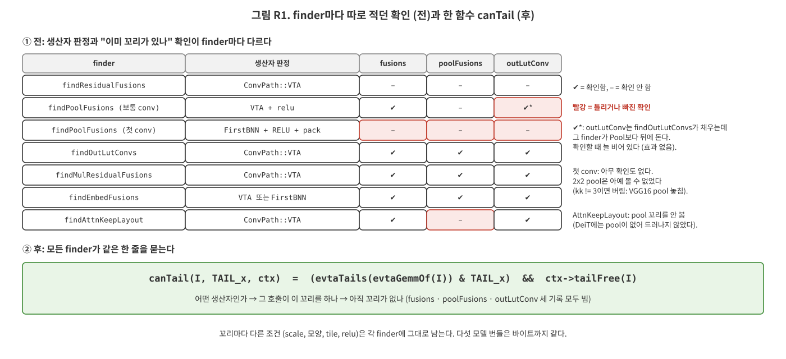
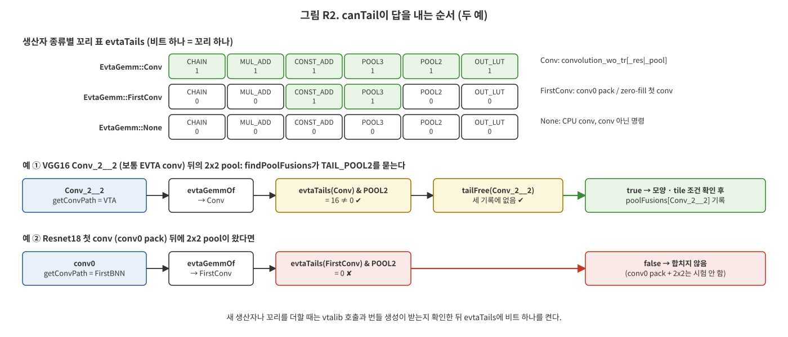
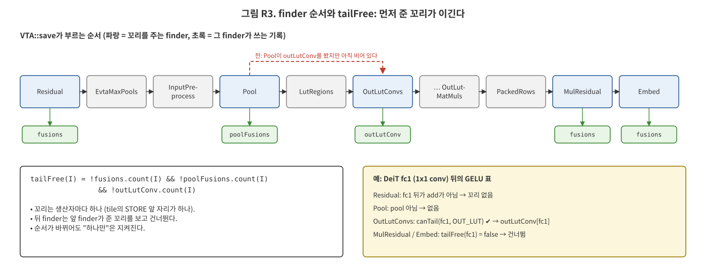
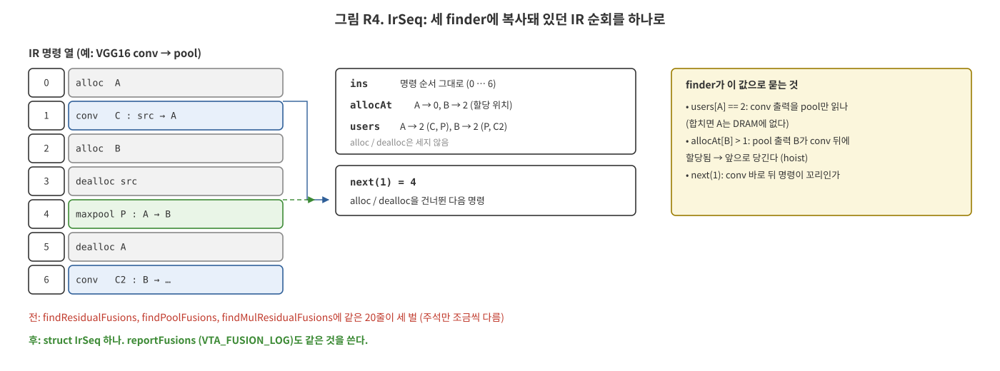
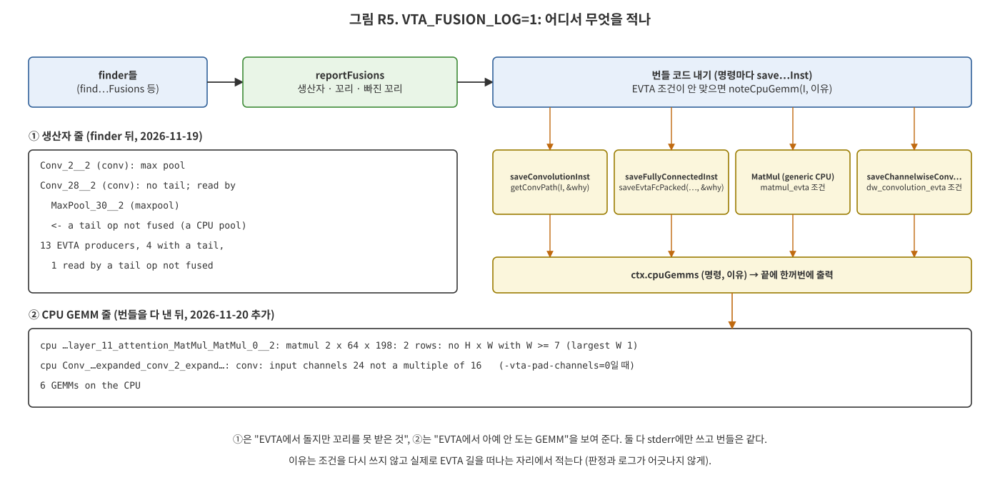

# 융합 찾기 규칙 정비: 코드 전 / 후 (2026-11-19 / 20)

VTASave의 finder 여섯 개가 "합칠 수 있나"를 각자 판단하던 코드를 한곳으로 모은 변경을 코드와 그림으로 설명한다.
점검 로그 `VTA_FUSION_LOG`를 넓힌 변경도 함께 다룬다.
규칙 표만 빠르게 보려면 [evta_fusion_rules.md](evta_fusion_rules.md)를 본다.
계기가 된 VGG16 2x2 pool 일은 [evta_conv_pool_guide.md](evta_conv_pool_guide.md)에 있다.

| 커밋 | 내용 | 번들 |
|---|---|---|
| `a6962eb` | 생산자 / 꼬리 / `tailFree` / `IrSeq`로 정리, `VTA_FUSION_LOG` ① 생산자 줄 | 다섯 모델 바이트 동일 |
| `9ca9d7d` | `VTA_FUSION_LOG` ② CPU로 간 GEMM과 그 이유 | 다섯 모델 바이트 동일 |

코드는 모두 `lib/Backends/VTA/VTASave.cpp`에 있다.

## 1. 한 줄 요약

**융합 = 생산자 + 꼬리.**

- **생산자:** EVTA GEMM tile로 도는 명령.
- **꼬리:** 그 호출이 STORE 전에 acc 안에서 하는 후처리 하나.

finder는 "이 명령에 이 꼬리를 붙일 수 있나?"를 `canTail` 한 함수로 묻는다.
꼬리마다 다른 조건(scale, 모양, tile)만 각 finder에 남는다.

## 2. 왜 고쳤나: finder마다 확인이 달랐다



전에는 finder마다 두 가지를 따로 적었다.
- **(a) 생산자 판정:** 이 conv가 EVTA에서 도나.
- **(b) 이미 꼬리가 있나:** 기록 `fusions`, `poolFusions`, `outLutConv` 중 무엇을 볼지.

그림 R1의 빨간 칸이 그렇게 생긴 문제다.

| 문제 | 무엇이 틀렸나 | 결과 |
|---|---|---|
| `findPoolFusions`가 `outLutConv`를 봄 | 그 기록은 더 뒤에 도는 `findOutLutConvs`가 채운다 | 확인할 때 늘 비어 있다. 효과가 없는 코드 |
| `findPoolFusions`의 첫 conv | (b) 확인이 하나도 없음 | 지금은 앞 finder가 첫 conv에 꼬리를 안 줘서 문제가 드러나지 않음 |
| `findPoolFusions` 생산자 판정 | 11-17 전에는 "packed 첫 conv + 3x3"만 | **VGG16의 2x2 pool 네 개를 놓쳤다** |
| `findAttnKeepLayout` | `poolFusions`를 안 봄 | DeiT에는 pool이 없어 드러나지 않았다 |

규칙은 하나인데 여섯 군데에 따로 쓰여 있어서 생긴 문제다.
고칠 때 한 곳만 고치고 나머지를 잊기 쉽다.

## 3. 세 함수: `evtaGemmOf`, `evtaTails`, `canTail`



### 3.1 `evtaGemmOf`: 어떤 생산자인가

```cpp
enum class EvtaGemm { None, Conv, FirstConv };

static EvtaGemm evtaGemmOf(const Instruction *I) {
  auto *C = llvm::dyn_cast_or_null<ConvolutionInst>(I);
  if (!C)
    return EvtaGemm::None;
  switch (getConvPath(C)) {
  case ConvPath::VTA: return EvtaGemm::Conv;            // convolution_wo_tr[_res|_pool]
  case ConvPath::FirstBNN: return EvtaGemm::FirstConv;  // the first conv over a packed / zero-filled input
  default: return EvtaGemm::None;
  }
}
```

- 생산자는 IR 이름(`ConvolutionInst`)이 아니라 **번들이 실제로 무슨 호출을 내는지**로 정한다.
  - 그래서 `getConvPath`를 그대로 쓴다. 번들 코드를 낼 때 `saveConvolutionInst`가 쓰는 바로 그 함수다.
  - 판정과 실제 코드가 어긋날 수 없다.
- DeiT의 Linear(MatMul + 상수 가중치)도 여기에 든다. `VTA.cpp`의 `matMulToConv`가 미리 1x1 conv로 바꿔 두기 때문이다.
- **`FirstConv`를 따로 두는 이유:**
  - 첫 conv도 결국 같은 `convolution_wo_tr`를 부른다.
  - 다만 번들 코드를 내는 함수(`saveFirstBNNVTAConvolutionInst`)가 일부 꼬리를 아직 못 낸다.
  - 원칙이 아니라 구현이 모자라서 나눈 것이다. 그 함수가 같은 꼬리 코드를 쓰게 되면 합칠 수 있다(§8).

### 3.2 `evtaTails`: 그 호출이 할 수 있는 꼬리

```cpp
enum : unsigned {
  TAIL_CHAIN = 1,      // add of a packed residual (power-of-two scales) and relus: findResidualFusions
  TAIL_MUL_ADD = 2,    // integer add of a packed tensor (MUL, ADD d, RQ): findMulResidualFusions
  TAIL_CONST_ADD = 4,  // integer add of a constant, out = the conv's own buffer: findEmbedFusions
  TAIL_POOL3 = 8,      // max pool 3 x 3 / 2 / pad 1: findPoolFusions
  TAIL_POOL2 = 16,     // max pool 2 x 2 / 2 / pad 0: findPoolFusions
  TAIL_OUT_LUT = 32,   // a 256-entry table of an elementwise region: findOutLutConvs
};
static unsigned evtaTails(EvtaGemm k) {
  switch (k) {
  case EvtaGemm::Conv:
    return TAIL_CHAIN | TAIL_MUL_ADD | TAIL_CONST_ADD | TAIL_POOL3 | TAIL_POOL2 | TAIL_OUT_LUT;
  case EvtaGemm::FirstConv:
    return TAIL_CONST_ADD | TAIL_POOL3;
  default:
    return 0;
  }
}
```

- 꼬리 하나가 비트 하나다. 생산자마다 할 수 있는 꼬리를 비트로 켠다(그림 R2 위쪽 표).
- **표가 코드에 한 번만 있다.** 새 꼬리나 새 생산자를 더할 때는 여기에 비트 하나를 켠다.
  - 켜기 전에 vtalib 호출과 번들 생성 코드가 그 꼬리를 정말 받는지 확인한다.
  - 예를 들어 `FirstConv`의 `POOL2`는 꺼져 있다. conv0 pack 경로에서 2x2 pool을 시험한 적이 없기 때문이다.

### 3.3 `canTail`: finder가 묻는 한 줄

```cpp
// I is a producer whose call can do the tail t and has no tail yet
static bool canTail(const Instruction *I, unsigned t, const VTASaveContext *ctx) {
  return (evtaTails(evtaGemmOf(I)) & t) && ctx->tailFree(I);
}
```

그림 R2의 두 예를 따라가 보자.

1. **VGG16 `Conv_2__2` 뒤의 2x2 pool:**
   - `Conv` → `evtaTails(Conv) & POOL2 = 16`(0이 아님).
   - 아직 꼬리가 없다 → `true`.
   - finder는 이어서 모양과 tile 조건을 보고 `poolFusions`에 적는다.
2. **첫 conv 뒤에 2x2 pool이 온 경우:**
   - `FirstConv` → `evtaTails(FirstConv) & POOL2 = 0` → `false`.
   - 합치지 않는다.

## 4. `tailFree`: 꼬리는 하나



```cpp
// VTASaveContext
bool tailFree(const Instruction *I) const {
  return !fusions.count(I) && !poolFusions.count(I) && !outLutConv.count(I);
}
```

- 꼬리가 하나인 이유는 하드웨어에 있다. 한 tile에서 STORE 앞 자리는 하나다.
  - 거기서 epilogue 프로그램, pool, 출력 표 중 하나만 돈다.
- 꼬리 기록은 세 가지다(그림 R3 초록 상자).

  | 기록 | 채우는 finder |
  |---|---|
  | `fusions` | Residual, MulResidual, Embed |
  | `poolFusions` | Pool |
  | `outLutConv` | OutLutConvs |

  `tailFree`는 세 기록을 모두 본다.
- **결과:** finder 순서는 그대로 두었다. 대신 "앞 finder가 준 꼬리를 뒤 finder가 덮어쓰지 않는다"가 모든 finder에 똑같이 걸린다.
- **전의 빨간 점선(그림 R3):**
  - `findPoolFusions`는 `outLutConv`를 봤지만, 그 기록은 더 뒤의 `findOutLutConvs`에서야 채워진다.
  - 그래서 그 확인은 아무 일도 하지 않았다.
  - 지금은 순서가 거꾸로 된 확인 대신 `tailFree` 하나가 "앞에서 준 것"만 본다.

## 5. finder별 전 / 후

조건 줄만 보인다. 꼬리마다 다른 뒤쪽 조건은 그대로다.

### 5.1 `findResidualFusions` (epilogue chain)

```cpp
// 전
if (!C || getConvPath(C) != ConvPath::VTA || !ctx->isPacked(C->getDest()))
// 후
if (!canTail(C, TAIL_CHAIN, ctx) || !ctx->isPacked(C->getDest()))
```

맨 처음 도는 finder라 `tailFree`가 늘 참이다. 결과는 같다.

### 5.2 `findPoolFusions` (conv + max pool)

```cpp
// 전
const bool first = C && getConvPath(C) == ConvPath::FirstBNN && C->getFusedActivation() == RELU && getConv0Pack(C, &pk);
const bool vta = C && getConvPath(C) == ConvPath::VTA && convRelu(C) && convClipHi(C) == 127 && !ctx->getFusion(C) &&
                 !ctx->outLutConv.count(C);
if (!first && !vta)
  continue;
...
if (k[0] != k[1] || (kk != 3 && kk != 2) || st[0] != 2 || st[1] != 2 || (first && kk != 3))
  continue;

// 후
if (!canTail(C, TAIL_POOL3 | TAIL_POOL2, ctx) || !convRelu(C) || convClipHi(C) != 127)
  continue;
// the first conv's call is the conv0 pack one (preprocess_conv0pack + convolution_wo_tr_pool)
const bool first = evtaGemmOf(C) == EvtaGemm::FirstConv;
if (first && (C->getFusedActivation() != RELU || !getConv0Pack(C, &pk)))
  continue;
...
if (k[0] != k[1] || (kk != 3 && kk != 2) || st[0] != 2 || st[1] != 2 ||
    !(evtaTails(evtaGemmOf(C)) & (kk == 3 ? TAIL_POOL3 : TAIL_POOL2)))
  continue;
```

- **처음 거르기:** "3x3이든 2x2든 pool을 받을 수 있는 생산자인가"로 거른다(`POOL3 | POOL2`).
- **나중 확인:** pool의 커널 크기를 안 다음, 그 크기의 꼬리가 켜져 있는지 다시 본다.
  - 전에 있던 `(first && kk != 3)`는 이제 표(`FirstConv`에 `POOL2` 없음)에서 나온다.
- **첫 conv의 조건은 그대로 뒀다:** `RELU`만, `CLIP`은 안 받는다. conv0 pack 경로여야 한다.
  - `convRelu`로 바꾸면 CLIP(relu6)까지 받게 돼 조건이 넓어지기 때문이다.

### 5.3 `findOutLutConvs` (출력 표)

```cpp
// 전
if (!conv || getConvPath(conv) != ConvPath::VTA || ctx->getPoolFusion(conv) || ctx->getFusion(conv) ||
    conv->getDest()->dims()[1] * conv->getDest()->dims()[2] <= 1 || ctx->outLutConv.count(conv))
// 후
if (!conv || !canTail(conv, TAIL_OUT_LUT, ctx) ||
    conv->getDest()->dims()[1] * conv->getDest()->dims()[2] <= 1)
```

### 5.4 `findMulResidualFusions`, `findEmbedFusions`, `findAttnKeepLayout`

```cpp
// findMulResidualFusions  전 → 후
if (!C || getConvPath(C) != ConvPath::VTA || ctx->getFusion(C) || ctx->getPoolFusion(C) || ctx->outLutConv.count(C))
if (!canTail(C, TAIL_MUL_ADD, ctx))

// findEmbedFusions  전 → 후
if (!C || (getConvPath(C) != ConvPath::VTA && getConvPath(C) != ConvPath::FirstBNN) || ctx->getFusion(C) ||
    ctx->getPoolFusion(C) || ctx->outLutConv.count(C) || ctx->isPacked(C->getDest()) || !i8(C->getDest()) || convRelu(C))
if (!canTail(C, TAIL_CONST_ADD, ctx) || ctx->isPacked(C->getDest()) || !i8(C->getDest()) || convRelu(C))

// findAttnKeepLayout ("꼬리 없는 보통 conv"만 layout을 유지)  전 → 후
if (getConvPath(cv) != ConvPath::VTA || ctx->getFusion(cv) || ctx->outLutConv.count(cv) || ...
if (evtaGemmOf(cv) != EvtaGemm::Conv || !ctx->tailFree(cv) || ...
```

- `findEmbedFusions`의 "VTA 또는 FirstBNN"은 이제 표의 `CONST_ADD` 비트에서 나온다. 둘 다 켜져 있다.
- `findAttnKeepLayout`은 꼬리를 붙이는 finder가 아니다. "꼬리가 없는 보통 conv인가"를 묻는다.
  - 그래서 `canTail`이 아니라 `evtaGemmOf`와 `tailFree`를 직접 쓴다.

## 6. `IrSeq`: IR 순회를 하나로



세 finder(Residual, Pool, MulResidual)에 같은 IR 순회 코드가 20줄씩 복사돼 있었다.

```cpp
// 전 (세 곳에 거의 같은 코드)
std::vector<const Instruction *> ins;
std::map<const Value *, size_t> allocAt;
std::map<const Value *, int> users; // instructions other than alloc/dealloc that use a value
for (const auto &I : IR->getInstrs()) {
  if (auto *A = llvm::dyn_cast<AllocActivationInst>(&I))
    allocAt[A] = ins.size();
  if (!llvm::isa<AllocActivationInst>(&I) && !llvm::isa<DeallocActivationInst>(&I)) {
    std::set<const Value *> ops; // once per instruction (relu in place lists its value twice)
    for (const auto &op : I.getOperands())
      ops.insert(op.first);
    for (auto *v : ops)
      users[v]++;
  }
  ins.push_back(&I);
}
auto next = [&](size_t i) { /* skip alloc / dealloc */ };

// 후
const IrSeq seq(IR);
const auto &ins = seq.ins;
auto allocAt = seq.allocAt;
auto users = seq.users;
auto next = [&](size_t i) { return seq.next(i); };
```

| 멤버 | 뜻 | finder가 쓰는 곳 |
|---|---|---|
| `ins` | 명령 순서 | 생산자 다음에 무엇이 오나 |
| `allocAt[v]` | `v`가 할당되는 위치 | 꼬리의 출력이 생산자 뒤에서 할당되면 앞으로 당긴다(hoist) |
| `users[v]` | `v`를 읽거나 쓰는 명령 수(alloc / dealloc 제외, 명령마다 한 번) | 생산자 출력을 꼬리만 읽나: 합치면 그 출력은 DRAM에 없다 |
| `next(i)` | alloc / dealloc을 건너뛴 다음 명령 | 생산자 바로 뒤가 꼬리인가 |

- **`users`를 명령마다 한 번만 세는 이유:** in-place relu는 자기 값을 operand에 두 번 적는다(입력과 출력). 그래서 집합에 넣어 한 번만 센다.
- 아래의 `reportFusions`도 같은 `IrSeq`를 쓴다.

## 7. `VTA_FUSION_LOG=1`: 빠진 것을 보는 로그



규칙을 모아도 조건이 맞지 않아 조용히 빠지는 곳은 남는다. VGG16 pool이 그런 예였다.
그래서 model-compiler가 무엇을 합쳤고 무엇을 놓쳤는지 적게 했다. 로그는 stderr로만 나가고 번들은 바뀌지 않는다.

### 7.1 ① 생산자 줄 (`reportFusions`, finder 뒤, `a6962eb`)

모든 생산자에 대해 받은 꼬리를 적는다.
꼬리가 없으면 그 출력을 처음 읽는 명령을 적는다.
그 명령이 꼬리가 될 수 있는 연산이면 `<- a tail op not fused`로 표시하고, 아는 이유를 덧붙인다.
- 꼬리가 될 수 있는 연산: max / avg pool, add, relu, clip, 표 구간.

```cpp
const bool tailOp = R && (llvm::isa<MaxPoolInst>(R) || llvm::isa<AvgPoolInst>(R) || llvm::isa<ElementAddInst>(R) ||
                          llvm::isa<ReluInst>(R) || llvm::isa<ClipInst>(R) || ctx->getLutRegions()->count(R) ||
                          ctx->isLutAway(R));
// an add fused into another producer's epilogue reads this output as its residual: not a miss
const bool elsewhere = tailOp && ctx->isFusedAway(R);
```

`elsewhere`는 Resnet의 residual 때문에 넣었다.
- 어떤 conv의 출력을 add가 읽더라도, 그 add가 **다른** conv의 epilogue에 이미 들어갔으면 놓친 것이 아니다.
- 이 conv의 출력은 그 add의 residual 입력일 뿐이다.

VGG16 예:

```
VTA_FUSION_LOG Conv_2__2 (conv): max pool
VTA_FUSION_LOG Conv_5__2 (conv): no tail; read by Conv_7__2 (convolution)
VTA_FUSION_LOG Conv_28__2 (conv): no tail; read by MaxPool_30__2 (maxpool)  <- a tail op not fused (a CPU pool)
VTA_FUSION_LOG 13 EVTA producers, 4 with a tail, 1 read by a tail op not fused
```

### 7.2 ② CPU GEMM 줄 (번들을 다 낸 뒤, `9ca9d7d`)

①은 "EVTA에서 돌지만 꼬리를 못 받은 것"만 보인다.
**EVTA에서 아예 돌지 않는 conv / fc / matmul**은 생산자가 아니라서 ①에 나오지 않는다.
다른 모델에서 새 모양의 곱셈이 나와 CPU로 빠져도 로그에 보이지 않는다는 뜻이다. ②가 그것을 적는다.

**원칙: 조건을 로그 코드에 다시 쓰지 않는다.**
- 실제로 EVTA 경로를 떠나는 자리에서 `noteCpuGemm(I, 이유)`를 부른다.
- 이유도 그 판정 코드가 낸다. 그래서 판정과 로그가 어긋날 수 없다.

```cpp
// VTASaveContext
std::vector<std::pair<const Instruction *, std::string>> cpuGemms;
void noteCpuGemm(const Instruction *I, const std::string &why) { cpuGemms.emplace_back(I, why); }
```

| 자리 | EVTA 판정 | 이유를 내는 방법 |
|---|---|---|
| `saveConvolutionInst` | `getConvPath` | 새 인자 `why`: VTA 경로 조건 중 처음 어긋난 것 |
| `saveFullyConnectedInst` | `saveEvtaFcPacked` | 새 인자 `why`: `return false` 자리마다 이유 |
| MatMul (generic CPU) | `matmul_evta` 조건 | 조건 바로 뒤에서 어긋난 것을 고른다 |
| `saveChannelwiseConvolutionInst` | `dw_convolution_evta` 조건 | 같음 |

`getConvPath`의 변경. 판정식은 그대로 두고 `Other`를 돌려주기 직전에만 이유를 고른다.

```cpp
ConvPath getConvPath(const glow::ConvolutionInst *Inst, std::string *why) {   // why = nullptr: as before
  ...
  if (symPad && Inst->getGroup() == 1 && scale > 1 && srcDims[3] % 16 == 0 && ...)
    return ConvPath::VTA;
  ...
  if (why) {
    if (outOffset || inOffset || filterOffset || biasOffset)  "offset not 0 (...)"
    else if (!sameScale(biasScale, matMulScale))             "bias scale != in * filter scale"
    else if (!(scale > 1) || shift < 0)                      "scale ratio ... not a power of two >= 2"
    else if (Inst->getGroup() != 1)                          "group g conv"
    else if (!symPad)                                        "pads ... not all equal"
    else if (filterDims[0] % 16)                             "output channels N not a multiple of 16"
    else                                                     "input channels C not a multiple of 16 (nor the 3 of a first conv)"
  }
  return ConvPath::Other;
}
```

`saveEvtaFcPacked`의 변경. 한 줄에 묶여 있던 `return false`들을 나눠 각각 이유를 적었다. 조건 자체는 같다.

```cpp
auto no = [&](const std::string &r) { if (why) *why = r; return false; };
if (filter->getElementType() != ElemKind::Int8QTy || ...)  return no("not int8 weights / int32 bias");
if (IN % 16)                                               return no("inputs IN not a multiple of 16");
...
if (shift < 0)                                             return no("scale ratio not 2^-k with 0 <= k <= 15");
if (gEven < 1 || 2 * NB > 2048)                            return no("too many outputs for the acc (OUT)");
```

현재 결과(기본 옵션):

| 모델 | CPU GEMM | 이유 |
|---|---|---|
| Resnet18 / 50, VGG16, MobileNetV2 | 0 | |
| DeiT | 6 | 마지막 블록 attention 곱 2×64×198, 2×198×64(head 3개씩). `2 rows: no H x W with W >= 7` |

```
VTA_FUSION_LOG cpu _deit_encoder_layer_11_attention_attention_MatMul_MatMul_0__2: matmul 2 x 64 x 198: 2 rows: no H x W with W >= 7 (largest W 1)
...
VTA_FUSION_LOG 6 GEMMs on the CPU
```

DeiT의 6개가 CPU로 가는 이유:
- 마지막 블록을 2행(class / distillation token)으로 줄였기 때문이다(`docs/deit_optimization.md` §6.7).
- `matmul_evta`는 M행을 H×W 이미지로 볼 때 W가 7 이상이어야 한다(HLS GEMM의 최소 tile 7×7).
- systolic bitstream의 최소 tile은 1이라 풀 수 있을 것 같다. 다음 일이다(§8).

**이유가 제대로 나오는지 확인했다.** MobileNetV2를 일부러 CPU 경로로 보내 봤다(`-vta-pad-channels=0 -vta-keep-layout=0 -vta-evta-fc=0`).
22개가 CPU로 갔고, 이유가 모두 맞았다.

```
cpu Conv_…expanded_conv_1_project…: conv: output channels 24 not a multiple of 16
cpu Conv_…expanded_conv_2_expand…:  conv: input channels 24 not a multiple of 16 (nor the 3 of a first conv)
cpu Conv_…Logits_Conv2d_1c_1x1…:    conv: output channels 1001 not a multiple of 16
cpu ChannelwiseQuantizedConv__3:    channelwise conv: input / output not in the EVTA layout
```

### 7.3 쓰는 법

**단계 (2026-11-21):** 값으로 정한다. 변수가 없거나 비어 있으면 **요약만**(기본, 늘 켜짐), `0`이면 아무것도 안 찍고, 그 밖의 값(`1` 등)이면 명령마다 자세히 찍는다.
요약은 생산자 수 / 꼬리 있음 / 빠진 꼬리, CPU로 간 GEMM 수와 그 이유별 개수다. 같은 요약이 번들 `.cpp` 맨 위(옵션 주석 바로 뒤)에 `// EVTA fusion summary` 주석으로 **값과 상관없이** 늘 들어간다(번들이 환경 변수에 따라 달라지지 않게).
`build_sim_bundles.sh`, `gen_deit_bundle.sh`, `gen_mobilenetv2_bundle.sh`는 끝에 요약을 화면에 찍는다.

```
// EVTA fusion summary (VTA_FUSION_LOG=1 for every instruction; docs/evta_fusion_rules.md):
//   73 EVTA producers, 13 with a tail, 24 read by a tail op not fused
//     not fused: 24 x an add: -vta-fuse-elemadd-mul is off (elemadd_evta is faster)
//   6 GEMMs (conv / fc / matmul) on the CPU
//     on the CPU: 3 x matmul 2 x 198 x 64: 2 rows: no H x W with W >= 7 (largest W 1)
//     on the CPU: 3 x matmul 2 x 64 x 198: 2 rows: no H x W with W >= 7 (largest W 1)
```

```bash
# 호스트 PC 컨테이너 nestc-build (또는 보드 Debug2_remote)
VTA_FUSION_LOG=1 ../vtabundles_xcmpl/build_sim_bundles.sh vtaVGG16Cifar10Bundle;  grep VTA_FUSION_LOG bundle_logs/vtaVGG16Cifar10Bundle.log
VTA_FUSION_LOG=1 ../vtabundles_xcmpl/gen_deit_bundle.sh;        grep VTA_FUSION_LOG vta/bundles/DeiTTest/gen.log
# 요약만
grep "VTA_FUSION_LOG [0-9]" <log>
```

## 8. 확인과 남은 일

**확인:**
- 두 커밋 모두 다섯 모델의 번들 `.cpp`가 바꾸기 전과 바이트까지 같다.
  - 모델: Resnet18, Resnet50, VGG16, MobileNetV2, DeiT.
  - 보드 실행 파일이 바뀌지 않으므로 보드에서 다시 돌리지 않았다.
- 로그의 이유가 맞는지는 위의 MobileNetV2 강제 시험으로 봤다.

**남은 일** (일반화 쪽, 재서 켤지 정한다):
1. **`Conv`와 `FirstConv`를 합치기.** 첫 conv의 번들 코드가 일반 conv와 같은 꼬리 코드(chain, 출력 표, 2x2 pool)를 쓰게 하면 생산자는 "EVTA GEMM 호출" 하나가 된다.
2. **나머지 GEMM 호출도 꼬리를 받게 하기.** `matmul_evta`, fc, depthwise는 vtalib에서 같은 `conv_kernel`을 돈다. epilogue를 받게 하면 `evtaTails`가 "호출의 능력" 표가 된다.
3. **CPU로 가는 조건 줄이기.**
   - `matmul_evta`의 `W >= 7`을 systolic에서 풀기. DeiT 마지막 블록 6개가 대상이다.
   - MatMul의 K / N이 16의 배수가 아니면 0을 채우기. conv의 `-vta-pad-channels`와 같은 방식이다.
4. 일반화가 늘 빠르지는 않다. DeiT의 fused add가 그 예다(`-vta-fuse-elemadd-mul` 기본 off). 그래서 켤 때마다 보드에서 잰다.

## 9. 용어

- **acc:** EVTA 안의 int32 누적 버퍼. GEMM 결과가 STORE 전까지 여기 있다.
- **finder:** `find…` 함수. IR을 훑어 합칠 곳을 `VTASaveContext`에 적는다. 번들 코드를 낼 때 그 기록을 본다.
- **생산자 (producer):** EVTA GEMM tile로 도는 명령(`evtaGemmOf != None`).
- **꼬리 (tail):** 생산자 호출이 tile마다 STORE 전에 acc 안에서 하는 후처리 하나. epilogue 프로그램, pool, 출력 표가 있다.
- **비트마스크:** 정수의 비트 하나하나를 켜고 끄는 표. `&`로 켜져 있는지 본다.
- **`getConvPath`:** conv 하나가 어느 경로(EVTA, 첫 conv, CPU)로 가는지 정하는 함수. 번들 코드 생성도 이것을 쓴다.
- **GEMM:** 행렬곱. EVTA는 1x1 conv 모양의 GEMM 하나만 하고, conv / fc / matmul은 모두 그 모양으로 바뀐다.
- **hoist:** 꼬리의 출력 버퍼 할당을 생산자 앞으로 옮기는 것. 생산자 호출이 거기에 바로 쓴다.
- **packed / EVTA layout:** N{C/16}HW16. EVTA가 바로 읽고 쓰는 배치.
- **`W >= 7`:** `matmul_evta`가 M행을 H×W로 나눌 때 W(가로)가 7 이상이어야 한다는 조건.
- **바이트 동일:** 생성된 C++ 코드가 같다. 따라서 보드 실행 파일도 같다.
