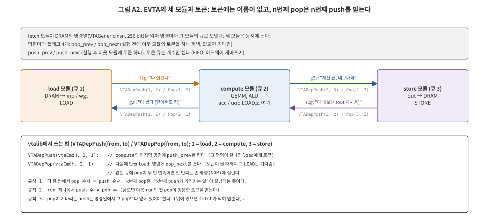
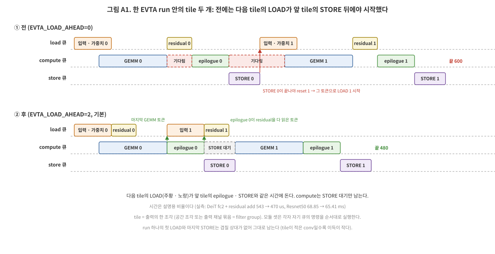
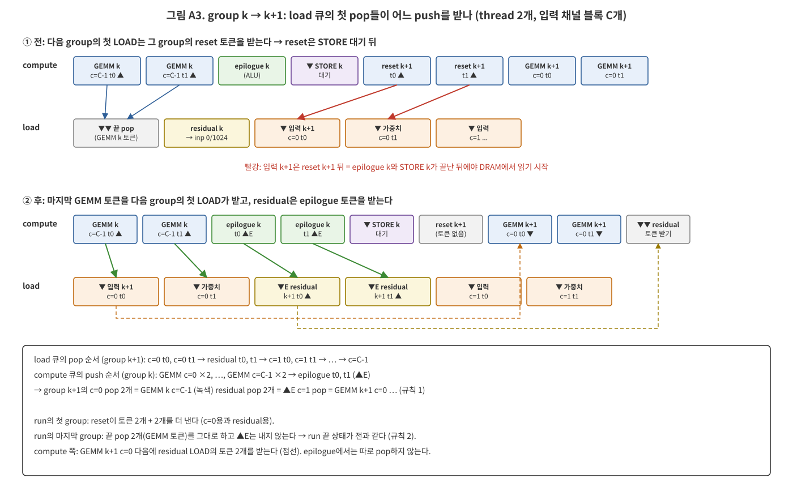
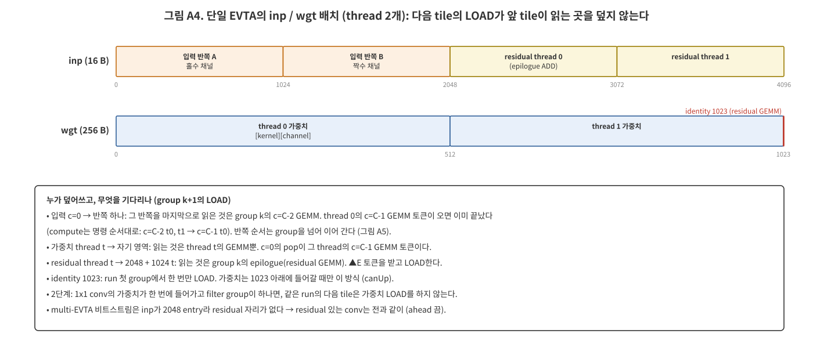
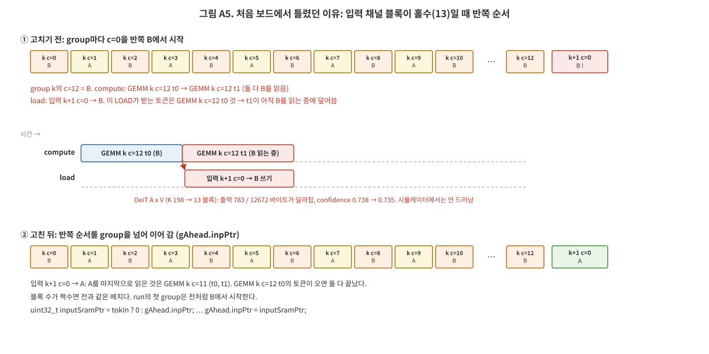

# 다음 tile의 LOAD를 앞 tile의 epilogue · STORE와 겹치기 (`EVTA_LOAD_AHEAD`, 2026-11-16)

EVTA conv에서 다음 tile의 입력 · 가중치 · residual LOAD를 앞 tile의 epilogue · STORE와 같은 시간에 돌게 한 변경을 설명한다.
하드웨어(비트스트림)는 그대로이고, vtalib이 내는 명령의 순서와 의존 토큰만 바꿨다. EVTA 명령 큐와 토큰을 처음 보는 사람도 읽을 수 있게 썼다.

- 측정 기록 요약: [evta_isa_ext.md](evta_isa_ext.md) §8.21. 동기가 된 측정은 §8.20.
- epilogue 자체의 설명: [evta_epilogue_guide.md](evta_epilogue_guide.md)
- 코드: `vtalib-zcu102-systolic/lib/Bundle/VTABundle.cpp` (`ConvAhead`, `conv_kernel`, `convolution_wo_tr_impl`)
- 그림 생성 스크립트: [figs/gen_evta_ahead_figs.py](figs/gen_evta_ahead_figs.py)

목차
1. 한 줄 요약과 결과
2. 배경: 세 모듈, 큐, 토큰
3. 무엇이 느렸나
4. 원래 `conv_kernel`이 tile마다 내던 명령
5. 바꾼 것 ①: 다음 tile의 첫 LOAD가 받는 토큰
6. 바꾼 것 ②: residual 자리와 토큰
7. 바꾼 것 ③: run의 처음과 끝
8. 바꾼 것 ④: 가중치를 다시 싣지 않기
9. SRAM 배치: 무엇이 무엇을 덮지 않나
10. 처음에 틀렸던 이유: 홀수 채널 블록
11. 토큰 수가 맞는지 세어 보기
12. 확인한 방법
13. 해 봤지만 뺀 것, 남은 한계
14. 스위치와 코드 위치
15. 용어

## 1. 한 줄 요약과 결과

한 EVTA run 안에서, 다음 tile의 첫 LOAD는 **앞 tile의 마지막 GEMM이 끝나자마자** 시작한다. 전에는 앞 tile의 **STORE가 끝난 뒤**에야 시작했다.

보드 `_alux3` 400 MHz, 1코어(OMP 1), 25회 중앙값이다. 같은 실행 파일에서 `EVTA_LOAD_AHEAD`만 바꿨다.
모든 EVTA conv 출력(dump)이 바이트까지 같고, 분류 결과와 confidence도 같다.

| 모델 | 전 (0) | 후 (2, 기본) | 줄어든 비율 |
|---|---|---|---|
| Resnet50 | 68.85 ms | 65.41 ms | −5.0 % |
| MobileNetV2 | 17.29 ms | 15.29 ms | −11.6 % |
| Resnet18 | 23.05 ms | 22.55 ms | −2.2 % |
| VGG16 (CIFAR-10) | 7.02 ms | 7.01 ms | 0 |
| DeiT-tiny (add는 `elemadd_evta`) | 47.09 ms | 46.23 ms | −1.8 % |
| DeiT-tiny (add를 conv epilogue로, `-vta-fuse-elemadd-mul`) | 48.13 ms | 46.73 ms | −2.9 % |

## 2. 배경: 세 모듈, 큐, 토큰



EVTA 안에는 일을 나눠 맡은 모듈이 셋 있다.
- **load** (큐 1): DRAM의 입력 · 가중치를 EVTA 안 SRAM(inp, wgt)에 싣는다.
- **compute** (큐 2): GEMM(행렬 곱)과 ALU(더하기, shift, clip 등)를 한다. 결과는 acc(int32)와 out(int8)에 생긴다.
- **store** (큐 3): out을 DRAM에 내보낸다.

vtalib은 명령을 한 줄로 늘어놓은 **명령열**을 DRAM에 만든다. EVTA의 fetch 모듈이 이를 읽어 명령마다 해당 모듈의 큐로 보낸다.
세 모듈은 **동시에** 돌고, 각자 자기 큐의 명령을 순서대로 실행한다.

동시에 돌기 때문에 순서를 맞출 장치가 필요하다. 그것이 **의존 토큰**이다.
- 명령에는 플래그가 4개 있다. pop 두 개(실행 전에 이웃 모듈의 토큰을 하나 꺼냄, 없으면 기다림)와 push 두 개(실행 후 이웃에게 토큰 하나)다.
- 토큰 큐는 **개수만 센다**. 토큰에는 이름이 없고, n번째 pop은 n번째 push를 받는다.

vtalib에서는 두 함수로 토큰을 넣는다. 숫자는 큐 번호다(1 = load, 2 = compute, 3 = store).

```cpp
VTADepPush(vtaCmdH, 2, 1);  // 방금 만든 compute 명령이 끝나면 load에게 토큰 하나 ("이 SRAM 자리를 다 썼다")
VTADepPop(vtaCmdH, 2, 1);   // 다음에 만들 load 명령은 compute의 토큰을 하나 받고 시작 ("덮어써도 되나?")
VTADepPush(vtaCmdH, 1, 2);  // load 명령이 끝나면 compute에게 ("데이터가 왔다")
VTADepPop(vtaCmdH, 1, 2);   // 다음 compute 명령은 그 토큰을 받고 시작
```

지켜야 할 규칙은 세 가지다.
1. 각 큐 쌍에서 **pop 순서 = push 순서**다. 따라서 k번째 pop은 "k번째 push를 단 명령이 끝났다"는 뜻이다.
2. run 하나에서 **push 수 = pop 수**여야 한다. 토큰이 남으면 다음 run의 첫 pop이 엉뚱한 토큰을 받는다.
3. pop이 기다리는 push는 명령열에서 그 pop보다 **앞**에 있어야 한다. 뒤에 있으면 fetch가 막혀 멈춘다.

## 3. 무엇이 느렸나



§8.20에서 DeiT의 out-proj / fc2 conv에 residual add를 붙인 경우(융합 add)를 쟀다. 전송을 모두 빼면 빨라지지만 ALU 명령을 빼면 그대로였다.
즉 시간을 잡아먹는 것은 계산이 아니라 **compute와 겹치지 못한 전송**이었다.

그림 A1 ①이 원래 순서다. tile 1의 입력 LOAD는 tile 0의 STORE가 끝난 뒤에야 시작한다. 그동안 compute는 논다.
- LOAD 1은 "tile 1의 acc reset" 토큰을 기다린다.
- reset은 compute 큐에서 STORE 0을 기다린다. acc를 지우기 전에 STORE가 out을 다 읽었는지 확인해야 하기 때문이다.

LOAD 1이 기다릴 이유는 원래 없다. inp와 wgt는 GEMM 0이 끝나면 이미 비어 있다.

## 4. 원래 `conv_kernel`이 tile마다 내던 명령

`conv_kernel`은 tile 하나(출력의 공간 조각 하나 × 출력 채널 묶음 하나 = **filter group**)의 명령을 만든다.
`convolution_wo_tr_impl`이 tile마다 이를 부르고, 마지막에 `VTASynchronize`로 run 하나를 실행한다.
아래는 thread 2개(`nVirtualThread`)와 입력 채널 블록 C개(`cBlocks`, 16채널씩)일 때의 뼈대다.

```cpp
for (filterIdx ...) {                                   // filter group
  // ① acc reset (compute) — thread마다 load에게 토큰 1개
  for (thread) { reset GEMM; VTADepPush(2, 1); }
  // ② 입력 채널마다: LOAD (load) → GEMM (compute)
  for (channelIdx = 0 .. C-1) {
    for (thread) { VTADepPop(2, 1); LOAD 입력(thread 0만) + 가중치; VTADepPush(1, 2); }
    for (thread) { VTADepPop(1, 2); GEMM; VTADepPush(2, 1); }
  }
  for (thread) VTADepPop(2, 1);                         // 마지막 GEMM 토큰을 load가 받음
  // ③ residual LOAD (융합 add일 때) → inp 아래쪽 (입력이 쓰던 곳)
  for (thread) { LOAD residual; VTADepPush(1, 2); }
  // ④ epilogue (compute): requantize, residual GEMM, ALU ...; store에게 토큰
  for (thread) { ...; VTADepPop(1, 2) /* residual */; ...; VTADepPush(2, 3); }
  // ⑤ STORE (store), 끝나면 compute에게 토큰 → 다음 group의 reset이 받음
  for (thread) { VTADepPop(2, 3); STORE; VTADepPush(3, 2); VTADepPop(3, 2); }
}
```

load 큐 입장에서 보면, 채널 0의 pop은 ①의 reset 토큰을 받는다. reset은 ⑤의 STORE 토큰을 받은 뒤에 돈다. 그래서 다음 group의 LOAD가 앞 group의 STORE 뒤로 밀렸다.

## 5. 바꾼 것 ①: 다음 tile의 첫 LOAD가 받는 토큰



생각은 간단하다. ②의 마지막 채널 GEMM이 내는 토큰을 group 끝에서 load가 받지 않고 **남겨 둔다**. 다음 group의 채널 0 LOAD가 그 토큰을 받는다.
그 대신 다음 group의 reset은 토큰을 내지 않는다. 토큰 수는 그대로다.

group마다 두 가지 값을 정한다.

```cpp
for (uint32_t filterIdx = 0; filterIdx < nGroups; filterIdx++) {
  const bool tokIn = !(ahead && gAhead.open);       // 앞 group이 토큰을 남겨 두지 않았다 → reset이 토큰을 낸다 (전과 같음)
  const bool closeOut = !ahead || (gAhead.last && filterIdx + 1 == nGroups);   // run의 마지막 group → 전과 같이 끝냄
```

- `gAhead.open`: 앞 group이 토큰을 남겨 두었다(다음 group이 받아야 한다).
- `gAhead.last`: 이 tile이 run의 마지막 tile이다(뒤에 `VTASynchronize`가 온다). 호출하는 쪽이 정한다(7장).

reset은 `tokIn`일 때만 토큰을 낸다.

```cpp
VTAPushGEMMOp(vtaCmdH, uopHandle_reset, &reset_acc, &reset, 0);
if (tokIn) VTADepPush(vtaCmdH, 2, 1);
```

group 끝의 pop은 `closeOut`일 때만 한다. 아니면 토큰이 그대로 남아 다음 group의 채널 0 pop이 받는다.

```cpp
for (uint32_t threadIdx = 0; closeOut && threadIdx < nVirtualThread; threadIdx++)
  VTADepPop(vtaCmdH, 2, 1);
```

group 마지막에 다음 group을 위한 상태를 남긴다.

```cpp
gAhead.open = ahead && !closeOut;
gAhead.inpPtr = inputSramPtr;   // 10장
```

이렇게 하면 compute 큐의 순서는 바뀌지 않는다. reset은 여전히 STORE를 기다린다(acc를 STORE가 읽고 있으니 당연하다).
바뀐 것은 load 큐뿐이다. load는 다음 group의 입력 · 가중치를 앞 group의 epilogue와 STORE 동안 미리 싣고, compute는 STORE가 끝나자마자 GEMM을 시작한다.

## 6. 바꾼 것 ②: residual 자리와 토큰

융합 add(epilogue에 ADD가 있는 conv, `res->add`)는 residual(더할 텐서)도 LOAD해야 한다. 원래는 ③에서 **inp 아래쪽**에 실었다.
아래쪽은 다음 group의 입력이 들어갈 곳이므로, 그대로 두면 다음 group의 입력 LOAD가 아직 epilogue가 읽는 residual을 덮어쓴다.

그래서 residual은 **inp 위쪽**(entry 2048 이상)에 둔다(§8.19의 `EVTA_RES_PREFETCH`와 같은 자리). 그리고 토큰을 하나 더 쓴다.
- compute는 thread t의 epilogue가 끝나면(residual을 다 읽었으면) load에게 토큰 ▲E를 하나 준다.
- load는 다음 group의 residual을 싣기 전에 그 토큰을 받는다.

```cpp
// epilogue 끝 (compute): 이 thread의 residual 자리가 비었다
if (resAhead && !closeOut) VTADepPush(vtaCmdH, 2, 1);
VTADepPush(vtaCmdH, 2, 3);
```

다음 group의 load 큐에서 residual은 채널 0 입력 바로 뒤에 온다. 규칙 1(순서) 때문에 이 위치가 정해진다.
compute의 push 순서는 "GEMM 마지막 채널 ×2 → ▲E ×2"이므로, load의 pop도 "채널 0 ×2 → residual ×2" 순서여야 짝이 맞는다.

```cpp
for (channelIdx ...) {
  for (thread) { VTADepPop(2, 1); LOAD 입력 / 가중치; VTADepPush(1, 2); }
  if (resAhead && channelIdx == 0)
    for (uint32_t threadIdx = 0; threadIdx < nVirtualThread; threadIdx++) {
      VTADepPop(vtaCmdH, 2, 1);       // ▲E: 앞 group의 이 thread epilogue가 residual을 다 읽었다
      resPreLoad(threadIdx);          // inp 2048 + 1024 * threadIdx 에 residual
      VTADepPush(vtaCmdH, 1, 2);      // compute에게 "residual 왔다"
    }
  for (thread) { VTADepPop(1, 2); GEMM; VTADepPush(2, 1); }
  if (resAhead && channelIdx == 0)    // compute도 같은 순서로 residual 토큰을 받는다
    for (uint32_t threadIdx = 0; threadIdx < nVirtualThread; threadIdx++)
      VTADepPop(vtaCmdH, 1, 2);
}
```

compute는 채널 0 GEMM 다음에 residual 토큰을 받는다(그림 A3 ②의 점선). epilogue에서는 따로 pop하지 않는다(`if (!resUp) VTADepPop(1, 2)`).
그래서 채널 1 GEMM이 residual LOAD를 기다리는 셈이지만, load 큐에서 residual은 채널 1 입력보다 앞에 있으므로 따로 늦어지지 않는다.

이 방식을 쓸 수 있는지는 conv마다 처음에 정한다.

```cpp
const bool canUp = res && res->add && !dw && !pool && INP_BUFF_DEPTH >= 2 * INP_MEM_ENTRY &&
                   lastWgt + (가중치 entry 수) <= RES_WGT_ENTRY;   // identity weight 자리(1023)를 침범하지 않음
const bool ahead = gAhead.on && !(res && res->add && !canUp);     // residual이 위쪽에 못 들어가면 이 conv는 전과 같이
const bool resAhead = ahead && res && res->add;
```

inp가 2048 entry뿐인 multi-EVTA 비트스트림에서는 residual이 있는 conv에 이 방식을 쓰지 않는다. residual이 없는 conv는 그대로 쓴다.

## 7. 바꾼 것 ③: run의 처음과 끝

토큰을 group 사이에 남겨 두면 run의 처음과 끝에서 수를 맞춰야 한다(규칙 2).

**run의 첫 group** (`tokIn`): 앞 group이 남긴 토큰이 없다. reset이 전처럼 토큰을 내고, residual이 있으면 ▲E 대신 쓸 토큰을 thread마다 하나씩 더 낸다.
identity weight(residual GEMM용, wgt entry 1023)도 이때 한 번만 싣는다.

```cpp
if (resAhead && tokIn)
  for (uint32_t threadIdx = 0; threadIdx < nVirtualThread; threadIdx++)
    VTADepPush(vtaCmdH, 2, 1);
...
if (resPre ? filterIdx == 0 : resAhead && tokIn)
  VTALoadBuffer2D(vtaCmdH, res->idWgt, res->shlT, 1, 1, 1, 0, 0, 0, 0, RES_WGT_ENTRY, 1);
```

**run의 마지막 group** (`closeOut`): 전과 똑같이 끝낸다. group 끝 pop을 하고 ▲E는 내지 않는다.
그러면 run이 끝날 때 큐에 남는 토큰이 전과 같다. 런타임이 run 끝에 붙이는 FINISH 처리도 그대로 맞는다.

어느 tile이 run의 마지막인지는 `conv_kernel`이 모른다. 그래서 tile 루프를 도는 `convolution_wo_tr_impl`이 호출 전에 알려 준다.

```cpp
ConvAheadScope aheadScope;   // 함수 시작: gAhead를 비우고 on = (EVTA_LOAD_AHEAD > 0). 끝나면 다시 비움
...
// tile 루프 안, conv_kernel 호출 직전
gAhead.last = tileWIdx == nTileW - 1 &&
              (stream || (tileHIdx == (int)nTileH - 1 && bi == (batch ? batch->n : 1) - 1));
```

- `stream`(conv0의 입력을 행마다 만들며 도는 경우)은 tile 행마다 `VTASynchronize`가 있어서, 행의 마지막 tile이 run의 마지막이다.
- `bi`는 attention head처럼 같은 run에서 버퍼만 바꿔 여러 번 도는 batch(`gConvBatch`)다.
- 상태(`gAhead`)는 `thread_local`이다. multi-EVTA처럼 thread마다 다른 EVTA를 쓰는 경우에도 섞이지 않는다.
- 이 함수 밖에서 `conv_kernel`을 부르는 옛 경로들은 `gAhead.on`이 false라 전과 같다.

## 8. 바꾼 것 ④: 가중치를 다시 싣지 않기 (`EVTA_LOAD_AHEAD=2`)

DeiT의 linear(1x1 conv)는 가중치가 wgt SRAM에 한 번에 들어간다(`wgtAll`, `EVTA_CONV_BURST`).
출력 채널 묶음이 하나뿐이면(`nGroups == 1`), 같은 run의 tile은 모두 **같은 가중치**를 쓴다. 그런데 전에는 tile마다 다시 실었다.

```cpp
const uint32_t wgtKey = nFilterinLoop | cBlocks << 10 | nVirtualThread << 22;
const bool wgtKeep = ahead && evtaLoadAhead() >= 2 && wgtAll && nGroups == 1 && gAhead.open &&
                     gAhead.wgt == vta_filter_buf && gAhead.wgtKey == wgtKey;
...
if (wgtAll) {
  if (channelIdx == 0 && !wgtKeep)
    loadBuffer2D(vtaCmdH, vta_filter_buf, ...);
}
...
// group 끝: 다음 tile이 쓸 수 있게 기록
if (gAhead.open && wgtAll && nGroups == 1)
  gAhead.wgt = vta_filter_buf, gAhead.wgtKey = wgtKey;
else
  gAhead.wgt = nullptr;
```

LOAD만 빠지고 토큰은 그대로다. thread 1처럼 LOAD가 하나도 없는 자리는 런타임이 빈 명령(NOP)에 토큰을 싣는다.
같은 run 안이므로 그 사이에 wgt를 쓰는 다른 호출이 없다. run이 끝나면(`closeOut`) 기록을 지운다.

## 9. SRAM 배치: 무엇이 무엇을 덮지 않나



다음 group의 LOAD는 앞 group의 epilogue와 동시에 돈다. 그래서 LOAD가 쓰는 곳을 지금 누가 읽고 있는지가 중요하다.

| LOAD (group k+1) | 쓰는 곳 | 마지막으로 읽는 것 (group k) | 받는 토큰 → 안전한 이유 |
|---|---|---|---|
| 입력 채널 0 (thread 0) | inp 반쪽 하나 | 채널 C−2의 GEMM (thread 0, 1) | thread 0 채널 C−1 GEMM의 토큰. compute는 순서대로 하니 C−2는 다 끝났다 |
| 가중치 (thread t) | wgt의 thread t 영역 | thread t의 GEMM | thread t의 채널 C−1 GEMM 토큰 |
| residual (thread t) | inp 2048 + 1024 t | thread t의 epilogue (residual GEMM) | ▲E (epilogue 끝) |
| identity weight | wgt 1023 | 모든 residual GEMM | run 첫 group에서만 실음 |

acc와 out은 compute와 store만 쓴다. 그 순서(reset은 STORE 뒤)는 바꾸지 않았다.

## 10. 처음에 틀렸던 이유: 홀수 채널 블록



첫 보드 실험에서 Resnet18 / 50, VGG16의 출력은 모두 같았다. 그런데 DeiT는 attention의 A × V matmul 출력이 달라졌다.
cat 281은 그대로였지만 confidence가 0.738에서 0.735로 바뀌었다. PC 시뮬레이터 시험은 모두 통과한 뒤였다.

원인은 입력의 double buffer(inp 반쪽 A / B)다.
- 원래 코드는 group마다 채널 0을 반쪽 B에 싣고 A, B를 번갈아 쓴다.
- 채널 블록 수가 홀수면(A × V는 K = 198 → 13블록) group의 마지막 채널 12도 B다.
- 다음 group의 채널 0 LOAD는 **thread 0**의 채널 12 GEMM 토큰만 받는다. 이때 **thread 1**의 채널 12 GEMM은 아직 B를 읽고 있을 수 있다.
- 그래서 다음 입력이 B를 덮어썼다.

원래 순서에서는 다음 group의 LOAD가 STORE 뒤에야 시작했으므로 이 문제가 드러나지 않았다.

고친 방법은 반쪽 순서를 group을 넘어 이어 가는 것이다. 다음 group의 채널 0은 A에 들어가고, A를 마지막으로 읽은 채널 11의 GEMM은 이미 끝났다.

```cpp
uint32_t inputSramPtr = tokIn ? 0 : gAhead.inpPtr;   // run의 첫 group은 전과 같이, 그다음은 앞 group에서 이어서
...
if (inputSramPtr == 0) { inputSramPtr = INP_MEM_ENTRY / 2; inputSramBaseAddr = inputSramPtr; }  // (원래 코드) 반쪽 번갈아
else inputSramPtr = 0;
...
gAhead.inpPtr = inputSramPtr;                        // group 끝에 저장
```

채널 블록 수가 짝수면 배치는 전과 같다.

**시뮬레이터가 못 잡은 이유:** PC 시뮬레이터(`sim_tlpp.cc`)는 토큰은 지키지만, 한 명령을 끝까지 실행한 뒤 다음 명령으로 넘어간다.
하드웨어처럼 thread 1의 GEMM이 "읽는 중"인 상태가 없어서, 토큰 하나가 모자라는 경우가 결과에 드러나지 않는다. 이런 변경은 보드 dump 비교가 꼭 필요하다.

## 11. 토큰 수가 맞는지 세어 보기

규칙 2(run 하나에서 push 수 = pop 수)를 compute → load 토큰으로 세어 본다. T = thread 수, C = 채널 블록 수, N = run 안의 group 수다.

| | compute의 push | load의 pop |
|---|---|---|
| 첫 group의 reset | T (+ residual이면 T) | |
| GEMM (group마다 C × T) | N × C × T | |
| ▲E (마지막 group 빼고) | (N − 1) × T | |
| 채널마다 pop | | N × C × T |
| residual pop (group마다) | | N × T |
| 마지막 group의 끝 pop | | T |
| **합 (residual 있음)** | 2T + NCT + (N−1)T | NCT + NT + T |
| **합 (residual 없음)** | T + NCT | NCT + T |

두 경우 모두 같다. 전에는 group마다 reset T와 끝 pop T가 있었으므로 이 합도 같다.

PC 시뮬레이터에서는 run이 끝날 때 남은 토큰을 출력하게 했다(`EVTA_SIM_TOKENS=1`, `lib/simulator/sim_tlpp.cc` `TlppVerify::Clear`). 모든 시험에서 0이었다.

```cpp
if (tok && (l2g_q_.size() || s2g_q_.size() || g2l_q_.size() || g2s_q_.size()))
  fprintf(stderr, "EVTA_SIM_TOKENS left l2g %zu s2g %zu g2l %zu g2s %zu\n", ...);
```

## 12. 확인한 방법

1. **PC 시뮬레이터** (nestc-build 컨테이너):
   - `vtalib-zcu102-systolic/tests/run_epi_test.sh`: epilogue 49가지를 requantize on/off, ALU 확장 on/off로 돌린다. `EVTA_LOAD_AHEAD=0/1/2` 모두 0 differ, 남은 토큰 0.
   - `run_lut_conv_test.sh`: LUT conv, layer norm, softmax, elemadd. 모두 0 differ.
   - `EVTA_AHEAD_LOG=1`: `conv_kernel`마다 `ahead / res / open / last` 상태를 출력한다. residual 경로가 실제로 쓰였는지 이것으로 확인했다.
2. **보드**: 같은 실행 파일을 `EVTA_LOAD_AHEAD=0 / 1 / 2`로 돌려 `EVTA_DUMP_CONV=<dir>`의 dump를 `diff -r`로 비교했다.
   - DeiT 7303개(두 가지 빌드), MobileNetV2 5200개, Resnet50 106개, Resnet18 40개, VGG16 34개: 모두 0 differ.
   - 융합 add DeiT의 `EVTA_EPI_CHECK=1`(epilogue 결과를 CPU로 다시 계산해 비교): 3500줄 모두 0 differ.
3. **시간**: `run_prof`와 같은 방식(`BUNDLE_RUNS=25`, `timing.csv`)과 `EVTA_REPLAY_LOG=2`(run마다 EVTA 시간).

dump 비교 시 주의: dump는 EVTA 호출마다 파일 하나를 쓴다. MobileNetV2 100회는 5200개라 120 s 제한에 걸렸다(rc 124, 멈춘 것 아님). 300 s로 다시 돌렸다.

## 13. 해 봤지만 뺀 것, 남은 한계

**첫 tile의 가중치를 채널마다 나눠 싣기(시험 3):** 첫 GEMM이 가중치 전부가 아니라 채널 하나 몫만 기다리게 하려고 가중치를 [channel][kernel] 순서로 채널마다 실어 봤다.
256 B짜리 작은 DMA가 많아져서 모두 느려졌다(Resnet50 65.41 → 69.03, DeiT 46.66 → 48.76 ms). 코드에서 뺐다.

남은 한계:
- **run의 첫 LOAD와 마지막 STORE**는 겹칠 상대가 없다. DeiT out-proj처럼 run 하나에 tile이 2개뿐이면 이득이 작다(207.2 → 201.6 us, fc2는 543.0 → 469.6 us).
  run 사이를 겹치려면 conv 호출 여러 개를 run 하나로 묶어야 한다.
- **compute는 여전히 STORE를 기다린다.** acc를 다음 tile이 바로 쓰기 때문이다. acc를 두 벌로 나누면 이것도 겹칠 수 있지만, 그만큼 tile이 작아진다.
- 융합 add는 따로 하는 add와의 차이가 1.0 ms에서 0.5 ms로 줄었다. 그래도 따로 하는 쪽이 빨라서 `-vta-fuse-elemadd-mul`은 계속 기본 꺼짐이다.

## 14. 스위치와 코드 위치

| 환경변수 | 값 | 뜻 |
|---|---|---|
| `EVTA_LOAD_AHEAD` | 0 | 전과 같음 |
| | 1 | 토큰 순서만 바꿈(5 ~ 7장, 10장) |
| | 2 (기본) | + 가중치 유지(8장) |
| `EVTA_AHEAD_LOG` | 1 | `conv_kernel`마다 상태 출력 (stderr) |
| `EVTA_SIM_TOKENS` | 1 | PC 시뮬레이터: run이 남긴 토큰 출력 |
| `EVTA_RES_PREFETCH` | 1 | §8.19의 옛 방식. `EVTA_LOAD_AHEAD=0`일 때만 쓰인다 |

`vtalib-zcu102-systolic/lib/Bundle/VTABundle.cpp`:
- `struct ConvAhead`, `gAhead`, `evtaLoadAhead()`, `ConvAheadScope`: 상태와 스위치.
- `conv_kernel`: `canUp / ahead / resAhead`(group 루프 앞), `tokIn / closeOut`, `inputSramPtr`, reset의 `if (tokIn)`, residual LOAD와 그 토큰,
  `wgtKeep`, group 끝 pop의 `closeOut`, epilogue 끝의 ▲E, group 끝의 `gAhead` 기록.
- `convolution_wo_tr_impl`: `ConvAheadScope aheadScope;`, tile 루프의 `gAhead.last`.

`vtalib-zcu102-systolic/lib/simulator/sim_tlpp.cc`: `TlppVerify::Clear`의 `EVTA_SIM_TOKENS`.

`vta/vtalib`(HLS GEMM용 vtalib)에는 아직 넣지 않았다.

## 15. 용어

- **tile:** conv 출력을 EVTA SRAM에 들어가게 자른 조각(공간 조각 하나 × 출력 채널 묶음 하나).
- **filter group:** 한 tile에서 같이 계산하는 출력 채널 묶음(`nFilterinLoop` × thread 수 × 16채널).
- **run:** `VTASynchronize` 한 번에 EVTA가 실행하는 명령열. 끝에 FINISH가 붙는다.
- **의존 토큰:** load / compute / store 모듈 사이의 FIFO 신호. 개수만 센다.
- **epilogue:** conv 결과가 acc에 있는 동안 STORE 전에 하는 원소별 연산(add, requantize, clip, 표).
- **residual:** residual add에서 conv 결과에 더하는 텐서(앞 블록의 출력).
- **identity weight:** residual을 GEMM으로 acc에 더하려고 쓰는 단위 행렬 가중치(wgt entry 1023).
- **double buffer(inp 반쪽):** 입력 SRAM을 둘로 나눠, 한쪽을 GEMM이 읽는 동안 다른 쪽에 다음 채널을 싣는 방식.
- **virtual thread:** acc / wgt를 반씩 나눠 두 출력 묶음을 번갈아 계산하는 방식(여기서는 thread 0, 1).
- **dump 비교:** `EVTA_DUMP_CONV`로 EVTA 호출의 출력을 모두 파일로 남겨 바이트 단위로 비교하는 검사.
