# EVTA on ZCU102: 지금까지 한 일 (시간순 요약)

NEST-C의 EVTA(VTA 계열 NPU)를 ZCU102 보드에서 돌리고 빠르게 만든 작업 전체를 날짜순으로 정리한다. 항목마다 무엇을 바꿨는지,
효과, 자세한 내용이 있는 곳을 적는다. 명령과 옵션은 [evta_user_manual.md](evta_user_manual.md)에 있다.

- 기준 모델은 Resnet18(224×224, int8)이다. "single"은 EVTA 하나, "multi4"는 EVTA 4개 bitstream에 bundle 4 copy를 동시에 돈 것이다.
- 시간은 보드 실측 중앙값이다. OMP 1/4는 CPU OpenMP thread 수다. 11-01부터는 기본값인 OMP 1로 비교한다.
- 세부 기록: 날짜별 일지 [dailyreport/vta_synth/](dailyreport/vta_synth/)(bitstream 합성 세션, 10-19~10-28),
  [dailyreport/vta_systolic/](dailyreport/vta_systolic/)(그 밖의 모든 작업, 10-26~).

## 한눈에

| 시점 | Resnet18 single | multi4 100회 | 무엇 때문에 |
|---|---|---|---|
| 10-28 (conv0 CPU) | 131.8 ms (OMP 4) | — | 시작점: conv0이 CPU float |
| 10-28 (conv0 EVTA) | 78.6 ms (OMP 4) | — | conv0 0 채움 후 EVTA |
| 10-29 | 73.6 ms (OMP 4) | 약 3.9 s | conv0 schedule |
| 10-31 | 91.1 → 52.5 ms (OMP 1) | 3.9 → 1.47 s | layout 유지, residual fusion, maxpool EVTA |
| 11-01 | 52.5 → 40.6 ms | 1.47 → 약 1.1 s | transpose 16 B 복사, buffer pool, NEON fc |
| 11-02 | 40.6 → **28.83 ms** (OMP 4 27.71) | **0.820 s** | fc EVTA, 전처리 합치기, replay, conv0 pack, conv0+pool |
| 11-03 | **27.32 ms** (같은 날 이전 bitstream 28.98) | | ALU imm II = 1 bitstream |
| 11-04 | **26.59 ms** (같은 날 이전 bitstream 27.30) | | RMW reset에 bias (bitstream) |
| 11-04 | **25.49 ms** (같은 날 이전 bitstream 26.61) | | out 쓰기에 requantize (bitstream) |

현재 Resnet18 single OMP 1 28.83 ms의 구성(11-02, `evta_runtime_compare.md` §7.14): EVTA 26.47 ms
(GEMM 18.85 + ALU 4.63 + 그 밖 2.99), CPU와 호출 약 2.4 ms.

## 1. 보드에서 EVTA를 처음 돌리기 (2026-09-29 ~ 10-17)

- **ISA 비트폭 맞추기:** etri bitstream은 `memory_type`과 `alu_opcode`가 2비트다. vtalib `hw_spec.h`를 그에 맞췄다(3비트면 모든
  LOAD/STORE 주소가 1비트 어긋나 결과가 0이 되거나 멈춘다). ALU MUL과 MOVE는 표현할 수 없다. → [CLAUDE.md](../CLAUDE.md) "EVTA on this board"
- **cache 비일관성:** 보드는 cache-coherent가 아니어서 runtime과 bundle이 flush/invalidate를 부른다(`VTABufferFlush` /
  `VTABufferInvalidate`, `VTASave.cpp`가 생성).
- **bundle 흐름:** simulator 빌드(`Debug2_remote`)에서 bundle 소스를 만들고, `vtabundles_xcmpl/`에서 보드용으로 빌드·실행한다.
  multi-EVTA bundle set(multievtax2, multievtax4)도 이때 정리했다. → [vtabundles_xcmpl/README.md](../vtabundles_xcmpl/README.md)

## 2. 자체 bitstream 만들기와 보드 결함 (10-19 ~ 10-26)

- **10-19** Vivado 2020.1을 PC docker(`vivado2020-build`)에 설치하고, 첫 자체 EVTA bitstream이 333 MHz timing을 통과했다.
  → [vta_synth_notes.md](vta_synth_notes.md) §1, §2, 일지 `vta_synth_요약_261019.md`
- **10-20 ~ 10-22** 보드에서 결과가 틀리거나 멈추는 원인을 ILA로 추적했다.
  - PL reset 연결 수정
  - JTAG와 cpuidle이 충돌해 Linux가 멈춤 → `hwtest/nocpuidle.sh`
  - load의 wgt 1024비트 read-modify-write 문제
- **10-23** 보드 FPGA의 configuration 셀 결함을 찾았다(SLICE Y219 한 행이 stuck-at-0). Y219를 피한 single 333 MHz가 처음으로
  bundle 35개를 통과했다. 드라이버의 done 경쟁도 고쳤다(`pynq_driver.cc`). → [vta_synth_notes.md](vta_synth_notes.md) §3.1, §3.2
- **10-24 ~ 10-25** 결함은 행 전체가 아니라 그 행 안의 routing PIP였다(관통 wire는 정상). multi4를 "Y219 PIP 0개"로 배선했다
  (RapidWright). 280 → 309.6 → 333 MHz로 보드를 통과했다. → [vta_synth_notes.md](vta_synth_notes.md) §3.3,
  `vta-hw-zcu102-multi4/hardware/xilinx/scripts/y219route/README.md`
- **10-26** ResConv10(3×3, 7×7×512)을 EVTA 4개에서 동시에 돌려 **609.7 GOPS**(이론 최대의 89 %, DDR 경쟁 없음)가 나왔다. 기본
  bitstream을 333 MHz Y219판으로 통일했다. PC↔보드 동기화를 git push/pull로 바꿨다. → [evta_multi4_609gops_report.md](evta_multi4_609gops_report.md)

## 3. 클럭과 systolic GEMM (10-26 ~ 10-29)

- **10-27** `FREQ=<MHz>`로 PLL을 바꿀 수 있게 했다. HP 포트를 별도의 333 MHz 클럭으로 분리했다(PS8 HP 포트의 최소 주기 3.0 ns).
  multi4 380 MHz에서 ResConv10 ×4 **685.1 GOPS**(+12.4 %).
- **10-27** systolic(weight-stationary) GEMM을 설계했다. HLS compute는 uop만 내보내고, RTL `gemm_sa`(16×16 DSP48E2 어레이 +
  acc RMW)가 계산한다. 380 MHz에서 보드 첫 통과. → [evta_systolic_design.md](evta_systolic_design.md), [evta_systolic.md](evta_systolic.md)
- **10-28** systolic 400 MHz 보드 통과(single +18 %, multi4 709.6 GOPS). 기본 bitstream은 380 MHz(HLS GEMM, HP 333)로 바꾸고,
  systolic 400 MHz는 `SYS_BIN`으로 쓴다. Resnet18 conv0(3채널)을 16채널로 0 채워 EVTA로 옮겼다(추론 131.8 → 78.6 ms, −40 %).
- **10-29** conv0 schedule(virtual thread 2, tile 8×16, conv0 −26 %). multi-EVTA lockstep 측정(`run_prof.sh -l`)과 `chrt -f 10`(`-r`)을
  넣었다. 시간 분석과 계획을 [evta_runtime_compare.md](evta_runtime_compare.md) §1~§7, [evta_runtime_aot.md](evta_runtime_aot.md)에 썼다.

## 4. CPU 일을 없애고 EVTA로 옮기기 (10-31 ~ 11-02)

자세한 내용은 모두 [evta_runtime_compare.md](evta_runtime_compare.md)의 해당 절에 있다. 항목마다 모든 EVTA 출력이 이전과 byte
단위로 같거나(`EVTA_DUMP_CONV`), CPU 경로와 실행 중 비교해 같고(`EVTA_RES_CHECK=1`), golden(single 30, multi2 3, multi4 3)을 통과했다.

| 날짜 | 바꾼 것 | 고친 곳 (끄는 방법) | Resnet18 single | 절 |
|---|---|---|---|---|
| 10-31 | 층 사이 activation을 EVTA layout N{C/16}HW16 그대로 둔다 (transpose 없음) | `VTASave.cpp` `findPackedActivations` (`-vta-keep-layout=false`) | 73.6 → 56.4 ms (OMP 4) | §7.1 |
| 10-31 | conv + elemadd + relu를 EVTA 호출 하나로 (residual을 identity GEMM으로) | `findResidualFusions`, vtalib `convolution_wo_tr_res` (`-vta-fuse-residual=false`) | 90.9 → 67.1 ms | §7.2 |
| 10-31 | max pool을 EVTA에서 (identity GEMM + ALU MAX) | `findEvtaMaxPools`, `maxpool_evta` (`-vta-evta-maxpool=false`) | 67.1 → 52.5 ms | §7.3 |
| 10-31 | multi-EVTA 실행 파일이 EVTA가 적은 bitstream을 건드리지 않게 막는다 (SError 방지) | `pynq_driver.cc` `CheckLoadedBitstream` (`EVTA_NO_BIT_CHECK=1`) | — | CLAUDE.md |
| 11-01 | NHWC ↔ EVTA layout transpose를 16바이트 복사로 | vtalib `CPUBundle_generic.cpp` | 52.5 → 46.9 ms | §7.4 |
| 11-01 | VTA buffer pool (Free한 buffer를 크기별로 재사용) | vtalib `api.cc` (`EVTA_BUF_POOL_MB=0`) | 46.9 → 44.3 ms | §7.5 |
| 11-01 | CPU fc를 NEON, 순서대로 읽기, prefetch로 | `cpuFullyConnected` | 44.3 → 40.6 ms | §7.6 |
| 11-01~02 | multi4 멈춤 원인: libcma flush 뒤 `dsb` 누락 → `dsb sy` 추가. run 시간 제한과 hang dump | vtalib `VTAFlushCache` (`EVTA_NO_DSB=1`), `EVTA_RUN_TIMEOUT_MS` | copy당 4000회 무멈춤 | §7.7 |
| 11-02 | fc를 EVTA에서, weight는 compile time에 EVTA layout으로 | `-vta-evta-fc`, `fullyconnected_evta_packed` | 40.6 → 39.9 ms | §7.8 |
| 11-02 | 입력 전처리(quantize, elemsub, elemdiv, transpose)를 conv0 입력 복사 하나로 | `-vta-fuse-preprocess`, `preprocess_nhwc2vtaio_zerofill` | 39.9 → 37.1 ms | §7.9 |
| 11-02 | EVTA 명령 record / replay (AOT 0단계) | vtalib `cmd_queue.h` `ReplayBegin` (`EVTA_REPLAY=0`) | 37.1 → 34.5 ms | §7.10, [evta_runtime_aot.md](evta_runtime_aot.md) §5.4 |
| 11-02 | 측정: 층 사이 DRAM 왕복은 싸다 (전부 없애도 −2.36 ms, conv→conv는 최대 1.05 ms) → HW 변경 안 함 | `EVTA_REPLAY_LOG=2`, `EVTA_MEMEXP` | — | §7.11 |
| 11-02 | conv0을 packed 입력의 4×1 conv로 (7×7/2 3채널 → 48채널), 0 채움 경로는 남김 | `-vta-conv0-pack`, `preprocess_conv0pack` | 34.5 → 29.2 ms | §7.12 |
| 11-02 | conv0 + maxpool을 EVTA 호출 하나로 (pool halo 재계산, acc에서 ALU MAX 2단계) | `-vta-fuse-pool`, `convolution_wo_tr_pool` | 29.2 → **28.83 ms** | §7.13 |

## 5. 남은 EVTA 시간 분석과 하드웨어 개선 (11-02 ~)

- **11-02** EVTA 시간 26.47 ms를 나눴다: GEMM 18.85 ms(71 %), ALU 4.63 ms(17.5 %, HLS ALU 루프가 II = 2), 그 밖 2.99 ms
  (conv0 tile 고정 비용, 1×1 downsample conv의 LOAD 등). run 하나의 고정 비용은 4.7 µs뿐이라 run 합치기는 하지 않는다.
  → [evta_runtime_compare.md](evta_runtime_compare.md) §7.14, 측정 도구 `vtabundles_xcmpl/hwtest/runbench.cpp`, `EVTA_REPLAY_DUMP`
- **11-02 ~ 11-03 ALU II = 1:** imm ALU 연산(SHR, clip, relu)은 acc를 한 번만 읽으므로 따로 II = 1 루프로 돌린다
  (`vta-hw-zcu102-systolic/hardware/xilinx/src/vta.cc` `alu()`, systolic 빌드만). ISA·vtalib·컴파일러는 바뀌지 않는다.
  400 MHz timing은 register 2개와 `Performance_ExplorePostRoutePhysOpt` 전략으로 WNS +0.001 ns에 맞췄다.
  golden 30 PASS, 층 출력 byte 동일, Resnet18 EVTA 26.42 → 24.89 ms, 추론 28.98 → 27.32 ms (11-03).
  → [evta_runtime_compare.md](evta_runtime_compare.md) §7.15
- **11-04 bias reset:** GEMM reset 단계에서 acc에 0 대신 bias를 쓴다(RTL `sa_rmw.v`, HLS uop 비트, ISA 비트 `bias_reset`, vtalib
  `conv_kernel`; 이름에 `bias`가 있는 bitstream에서만). golden 30 PASS, 층 출력 byte 동일, Resnet18 EVTA 24.89 → 24.15 ms,
  추론 27.30 → 26.59 ms. multi4도 같은 소스로 통과(WNS +0.037 ns, probes 40/40, golden 3 PASS, 층 출력 byte 동일),
  EVTA마다 25.23-25.37 → 24.49-24.62 ms. stage3/4에서는 ADD가 inp LOAD / STORE에 가려져 있어 덜 준다.
  → [evta_runtime_compare.md](evta_runtime_compare.md) §7.16
- **11-04 requantize:** GEMM / ALU가 out에 쓸 때 shift, 반올림, clip을 하드웨어로 한다(명령 필드 `rq_*`, `sa_rmw.v`, `vta.cc`).
  ALU SHR / MAX / MIN이 빠졌다. golden PASS, 층 출력 byte 동일, Resnet18 EVTA 24.15 → 23.05 ms, 추론 26.61 → 25.49 ms.
  multi4는 처음에 400 MHz를 7 ps 못 맞춰 395.8 MHz(23.65-23.77 ms), 배치를 바꿔 400 MHz: EVTA마다 24.49-24.62 → 23.44-23.56 ms, 610.4 GOPS.
  → [evta_runtime_compare.md](evta_runtime_compare.md) §7.18. 명령 비트와 bitstream별 기능, 다른 모델 돌리는 법: [evta_isa_ext.md](evta_isa_ext.md)
- **다음 후보:** 남은 EVTA 시간 24.15 ms의 구성과 후보(acc → out 변환에 requantize, reg-reg ALU II = 1, run 사이 겹치기,
  한 장을 EVTA 4개로, HAL / DRM accel). → [evta_runtime_compare.md](evta_runtime_compare.md) §7.17

## 6. 운영 중 생긴 일

- **PC 갑작스런 꺼짐:** 10-25, 10-28, 11-02 세 번 모두 Vivado가 모든 코어를 쓰던 중에 로그 없이 꺼졌다(MCE, OOM, thermal 로그 없음).
  전원이나 CPU 과열 차단으로 보인다(미확정). 11-03부터 Vivado를 `JOBS=4`로 돌리고 CPU 온도를 `/home/ubuntu/npuprg/templog/`에 기록한다.
- **보드 CMA:** 비정상 종료한 프로세스의 CMA는 `xlnk_reset` 전까지 돌아오지 않는다. run 스크립트는 bitstream load가 실패하면
  `xlnk_reset`한다.
- **보드는 여러 사용자가 같이 쓴다:** 실행 전에 다른 사람의 EVTA 실행을 확인한다(`/tmp/evta_run.lock`, `ps`).

## 그림: 이전 구조와 지금 구조

이전과 지금을 위아래로 놓고 무엇이 바뀌었는지 그렸다. 먼저 볼 것은 그림 1 → 12 → 4 → 5 → 14다. 그림은 `docs/figs/src/make_evta_figs.py`가 만든다(`python3 docs/figs/src/make_evta_figs.py [번호 ...]`).

| 그림 | 내용 |
|---|---|
| [1](figs/evta_fig01_inference_flow.svg) | Resnet18 추론 한 번: CPU와 EVTA가 하는 일 (10-29 → 11-02) |
| [2](figs/evta_fig02_change_map.svg) | 무엇을 어디서 바꿨나 (컴파일러, runtime, 하드웨어) |
| [3](figs/evta_fig03_activation_layout.svg) | 층 사이 activation layout: NHWC ↔ EVTA layout → EVTA layout 그대로 |
| [4](figs/evta_fig04_residual_block.svg) | residual block: conv → CPU elemadd → CPU relu ⇒ EVTA 호출 하나 |
| [5](figs/evta_fig05_conv0_pack.svg) | conv0: 16채널 0 채움 7×7 → packed 입력의 4×1 conv |
| [6](figs/evta_fig06_conv0_maxpool.svg) | conv0 + maxpool: EVTA 호출 두 번 → 한 번 |
| [7](figs/evta_fig07_input_preprocess.svg) | 입력 전처리: CPU 단계 네 번 → NEON 복사 한 번 |
| [8](figs/evta_fig08_fc.svg) | fc: CPU → NEON → EVTA GEMM |
| [9](figs/evta_fig09_evta_call_runtime.svg) | EVTA 호출 하나의 CPU 쪽 일: buffer pool, record / replay |
| [10](figs/evta_fig10_multi4_hang_dsb.svg) | multi4 멈춤의 원인과 dsb sy |
| [11](figs/evta_fig11_evta_block.svg) | EVTA 블록도: HLS GEMM → systolic gemm_sa, 클럭 분리 |
| [12](figs/evta_fig12_gemm_hls_vs_systolic.svg) | GEMM 한 단계: HLS broadcast → systolic 어레이 |
| [13](figs/evta_fig13_alu_ii.svg) | ALU: II = 2 → imm II = 1, 다음은 RMW reset에 bias |
| [14](figs/evta_fig14_time_waterfall.svg) | Resnet18 추론 시간: 단계별로 줄어든 폭 |
| [15](figs/evta_fig15_evta_time_now.svg) | 지금 EVTA 시간 26.47 ms의 구성과 줄어들 몫 |

### 그림 1. Resnet18 추론 한 번: CPU와 EVTA가 하는 일 (10-29 → 11-02)

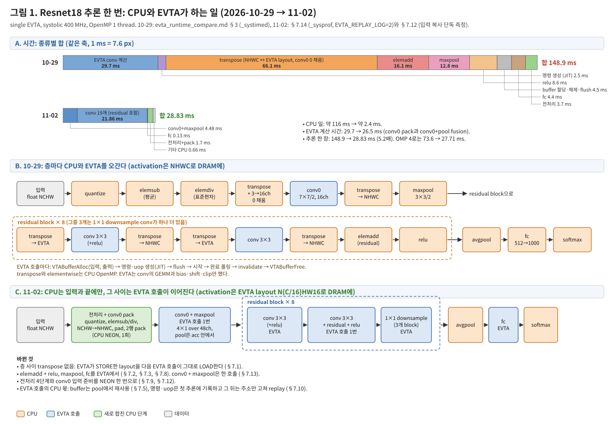

### 그림 2. 무엇을 어디서 바꿨나 (컴파일러, runtime, 하드웨어)

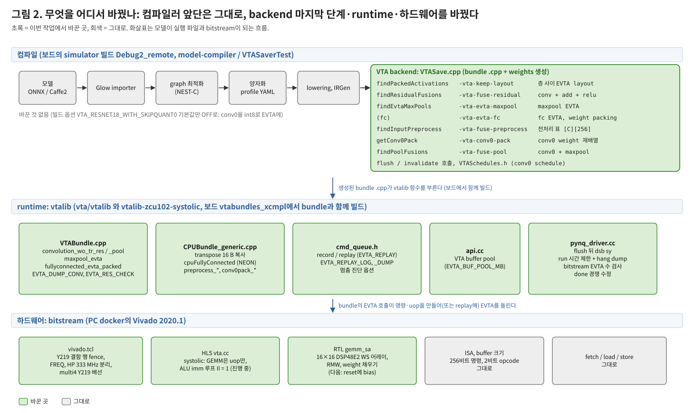

### 그림 3. 층 사이 activation layout: NHWC ↔ EVTA layout → EVTA layout 그대로

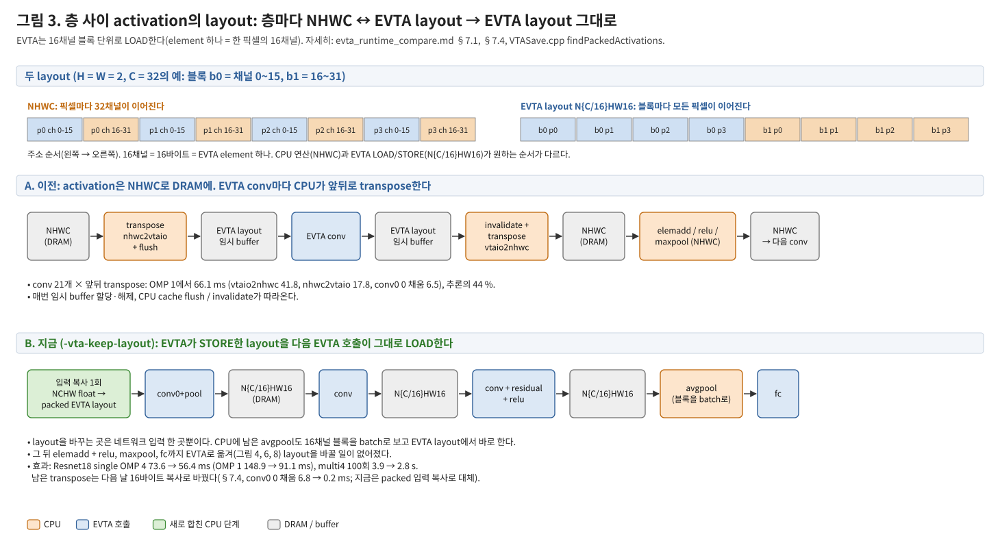

### 그림 4. residual block: conv → CPU elemadd → CPU relu ⇒ EVTA 호출 하나

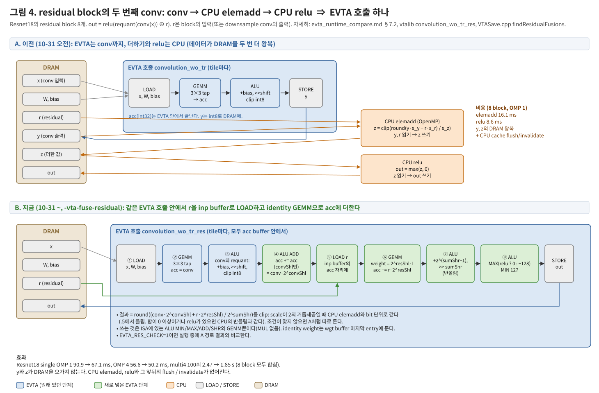

### 그림 5. conv0: 16채널 0 채움 7×7 → packed 입력의 4×1 conv

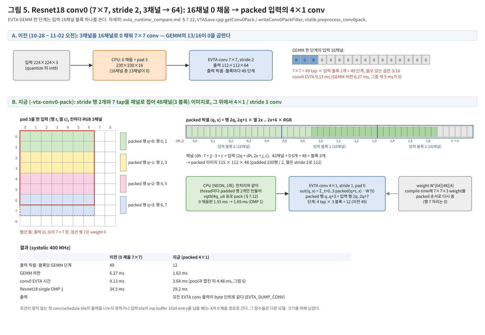

### 그림 6. conv0 + maxpool: EVTA 호출 두 번 → 한 번

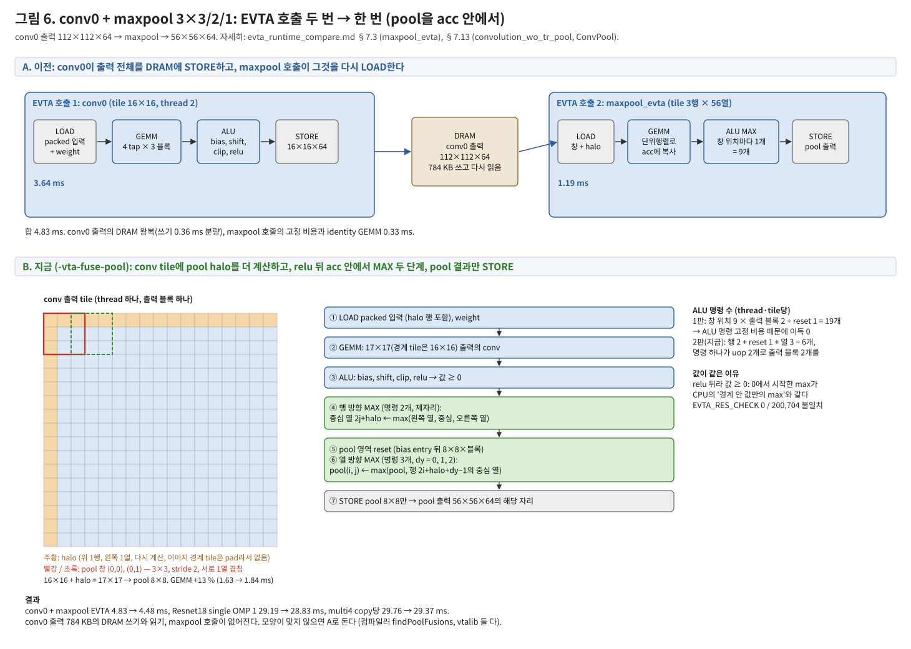

### 그림 7. 입력 전처리: CPU 단계 네 번 → NEON 복사 한 번

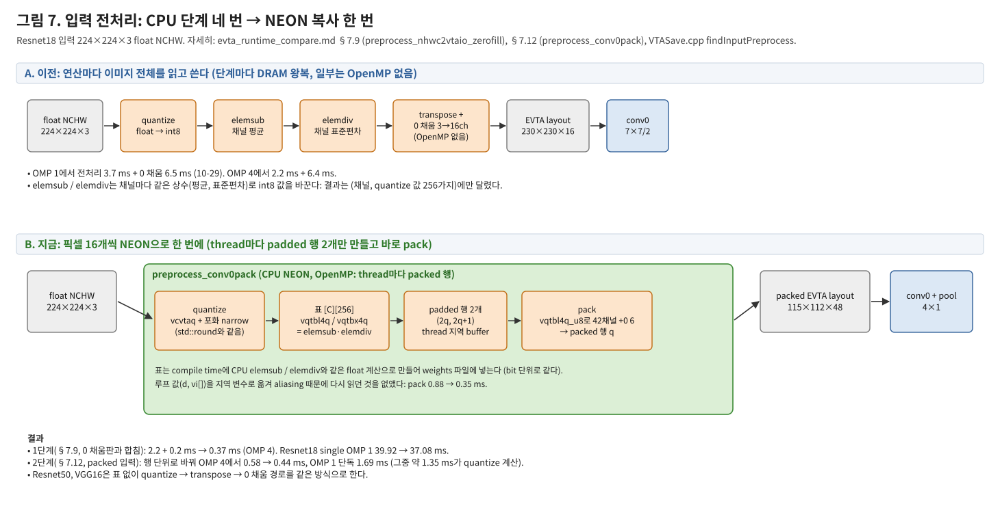

### 그림 8. fc: CPU → NEON → EVTA GEMM

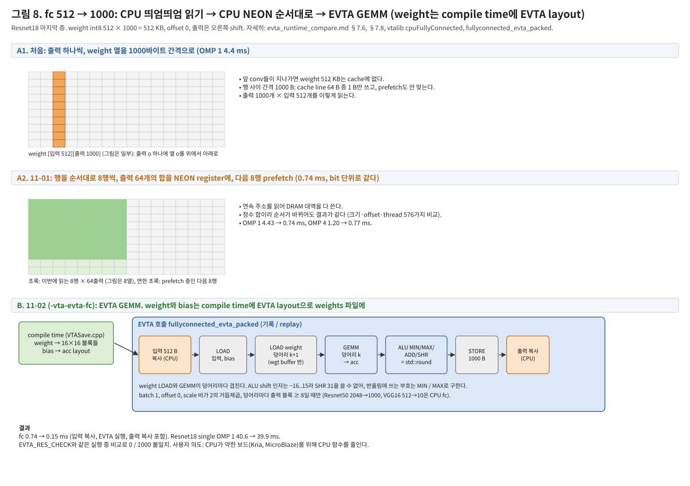

### 그림 9. EVTA 호출 하나의 CPU 쪽 일: buffer pool, record / replay

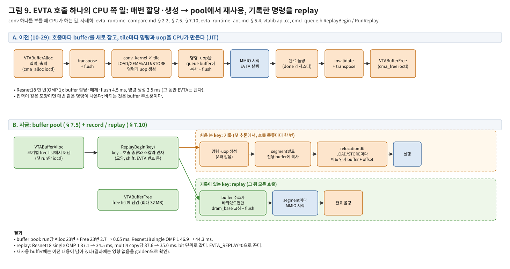

### 그림 10. multi4 멈춤의 원인과 dsb sy

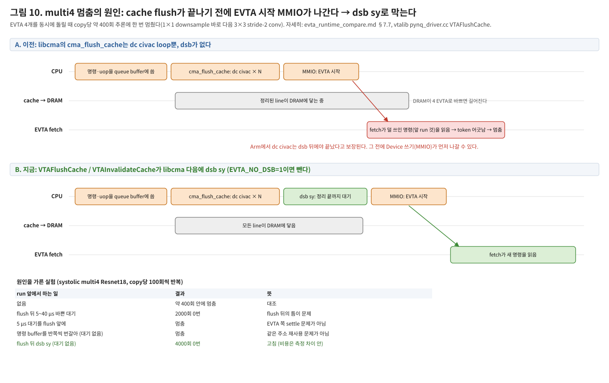

### 그림 11. EVTA 블록도: HLS GEMM → systolic gemm_sa, 클럭 분리

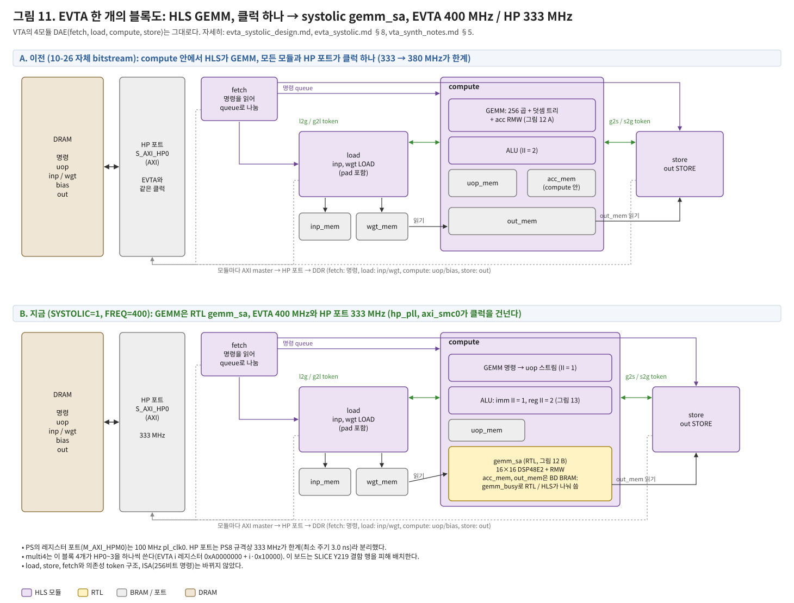

### 그림 12. GEMM 한 단계: HLS broadcast → systolic 어레이

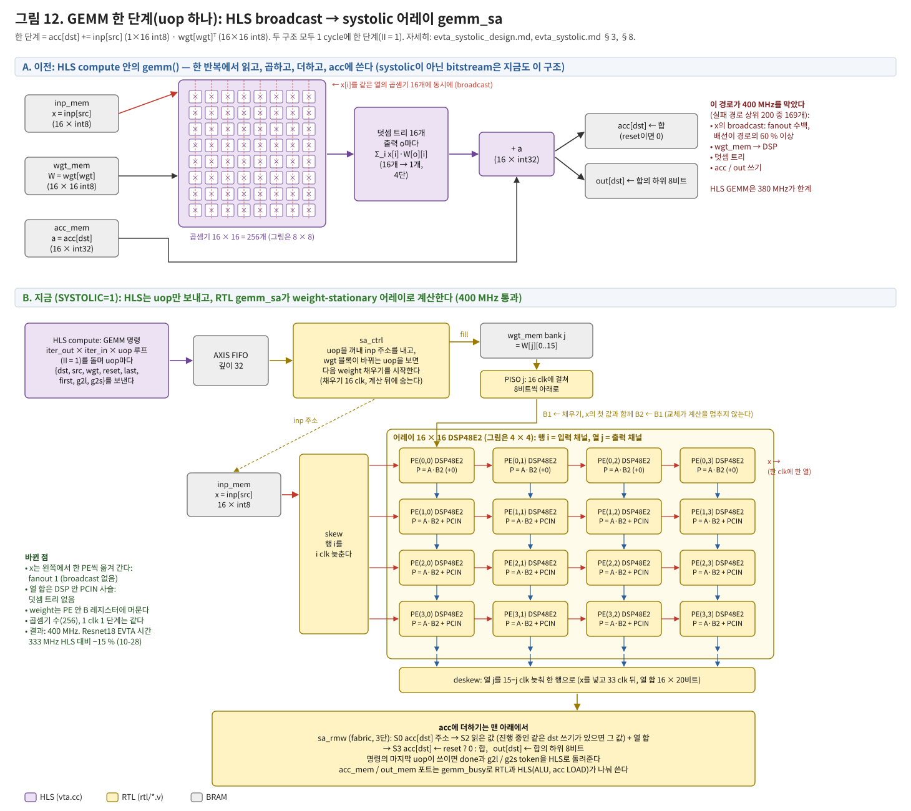

### 그림 13. ALU: II = 2 → imm II = 1, 다음은 RMW reset에 bias

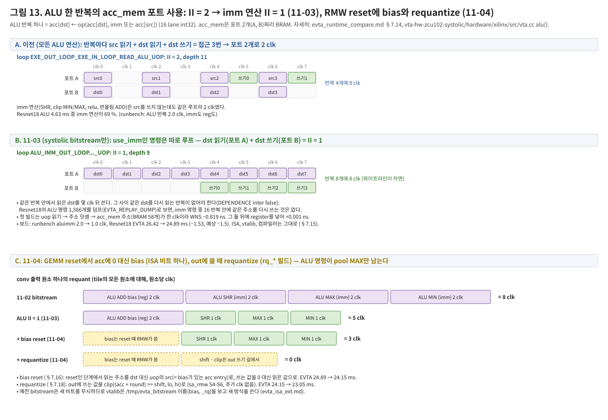

### 그림 14. Resnet18 추론 시간: 단계별로 줄어든 폭

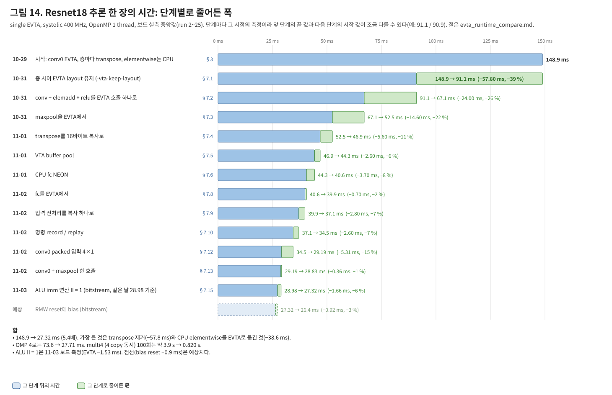

### 그림 15. 지금 EVTA 시간 26.47 ms의 구성과 줄어들 몫

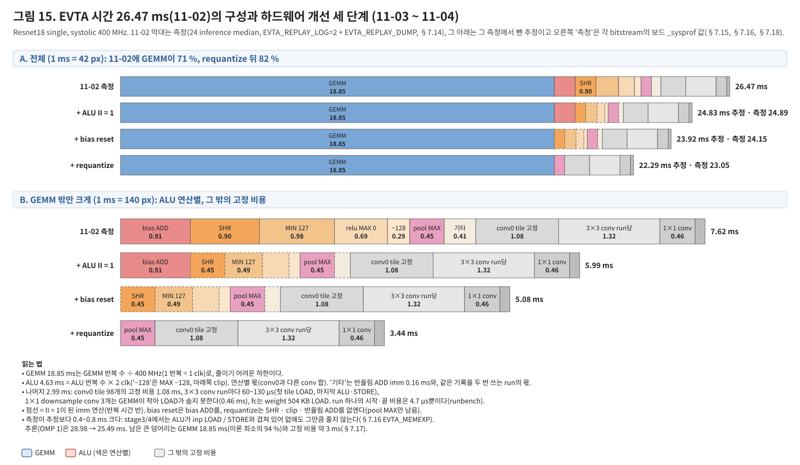

## 구조 그림: 단계마다 무엇을 옮기고 없앴나 (2026-11-04)

같은 그림 틀(CPU, DRAM 버퍼, EVTA의 LOAD / compute / STORE와 SRAM, GEMM, ALU)에 단계마다 이전과 이후를 나란히 그리고,
바뀐 곳(초록 = 새로 / 옮겨 온 것, 빨강 점선 = 없어진 것)과 측정 시간(차이와 %)을 넣었다. 하드웨어 단계(13~16)는 acc_mem 포트, pipeline 단, register, mux까지 그렸다.
생성: `python3 docs/figs/src/make_evta_struct_figs.py`.

| 그림 | 단계 |
|---|---|
| [1](figs/evta_st01_conv0_to_evta.svg) | conv0(3채널)을 CPU float에서 EVTA로 (0 채움) |
| [2](figs/evta_st02_keep_layout.svg) | 층 사이 활성화를 EVTA layout 그대로 |
| [3](figs/evta_st03_residual_fusion.svg) | residual(elemadd + relu)을 conv 호출 안의 EVTA로 |
| [4](figs/evta_st04_maxpool_evta.svg) | max pool을 EVTA ALU로 |
| [5](figs/evta_st05_transpose_neon.svg) | CPU layout 변환을 16바이트 복사로 |
| [6](figs/evta_st06_buffer_pool.svg) | VTA 버퍼 pool |
| [7](figs/evta_st07_cpu_fc_neon.svg) | CPU fc NEON |
| [8](figs/evta_st08_fc_evta.svg) | fc를 EVTA GEMM으로 |
| [9](figs/evta_st09_preprocess_fuse.svg) | 입력 전처리를 conv0 입력 복사 하나로 |
| [10](figs/evta_st10_replay.svg) | EVTA 명령 기록 / 재생 |
| [11](figs/evta_st11_conv0_pack.svg) | conv0을 packed 입력의 4×1 conv로 |
| [12](figs/evta_st12_conv0_pool.svg) | conv0 + max pool을 EVTA 호출 하나로 |
| [13](figs/evta_st13_systolic_gemm.svg) | GEMM: HLS broadcast → RTL systolic 어레이 (HW) |
| [14](figs/evta_st14_alu_ii1_regs.svg) | ALU imm II = 1, acc / out 쓰기 앞 register (HW) |
| [15](figs/evta_st15_bias_reset.svg) | bias reset: acc를 bias로 시작 (HW) |
| [16](figs/evta_st16_requantize.svg) | requantize를 acc → out 쓰기 길에 (HW) |
| [17](figs/evta_st17_summary.svg) | Resnet18 추론 시간을 줄인 단계 요약 |

### 구조 1. conv0(3채널)을 CPU float에서 EVTA로 (0 채움)

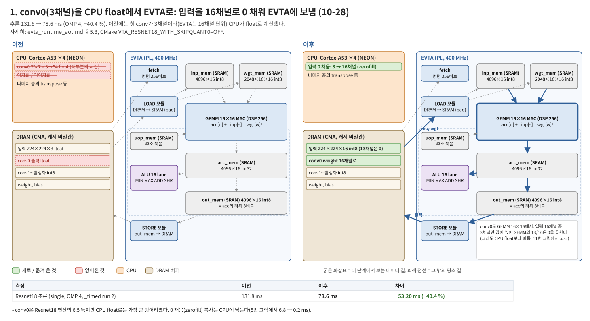

### 구조 2. 층 사이 활성화를 EVTA layout 그대로

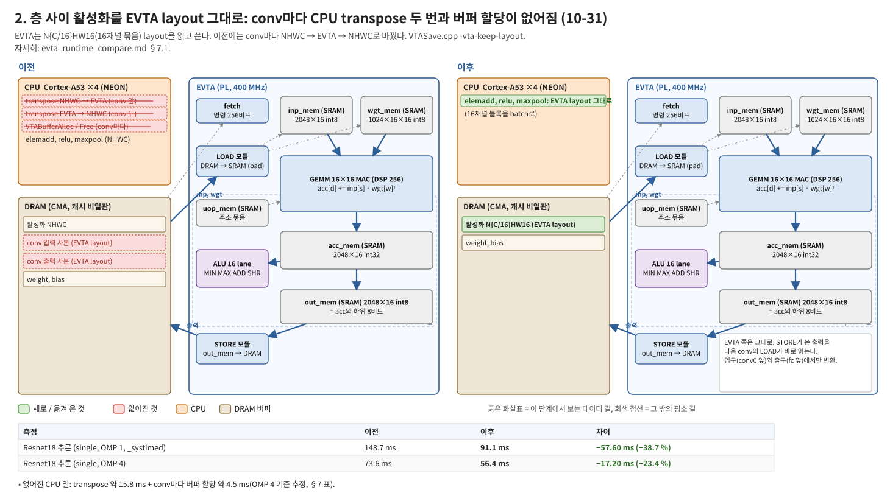

### 구조 3. residual(elemadd + relu)을 conv 호출 안의 EVTA로

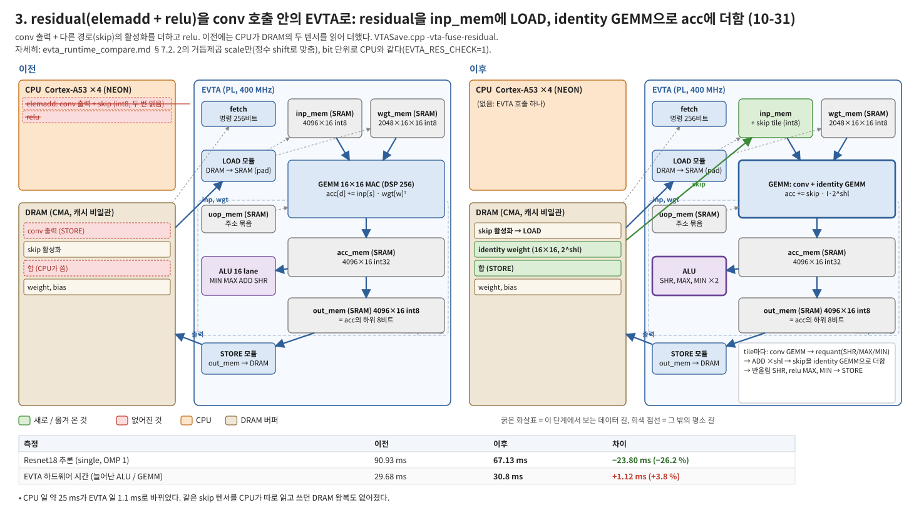

### 구조 4. max pool을 EVTA ALU로

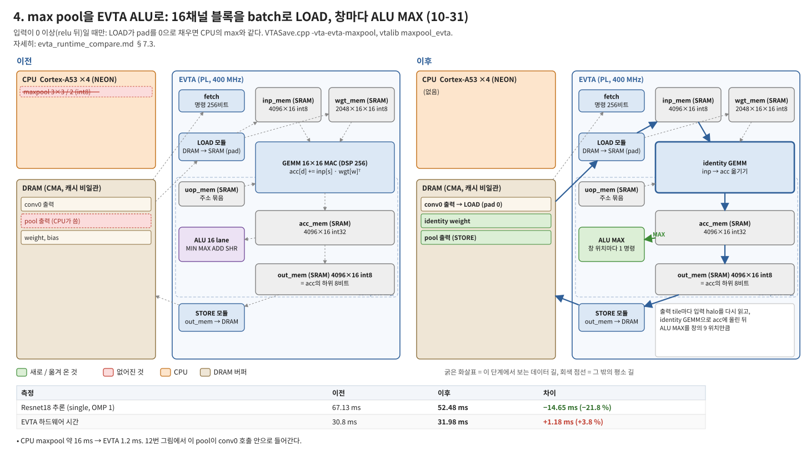

### 구조 5. CPU layout 변환을 16바이트 복사로

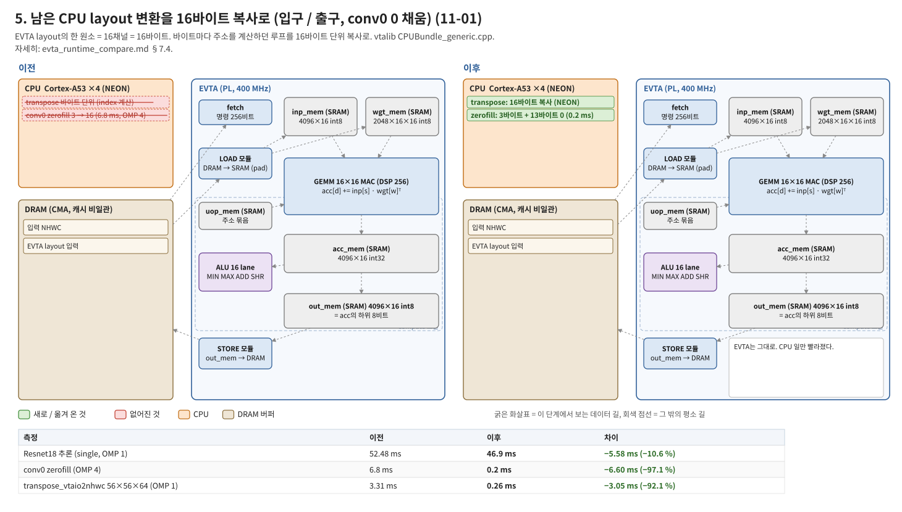

### 구조 6. VTA 버퍼 pool

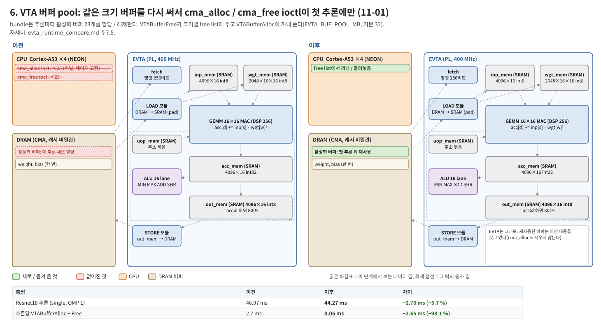

### 구조 7. CPU fc NEON

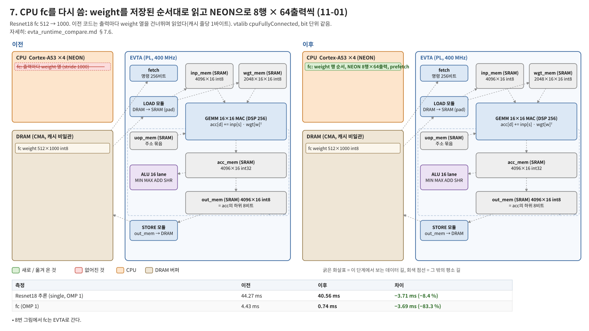

### 구조 8. fc를 EVTA GEMM으로

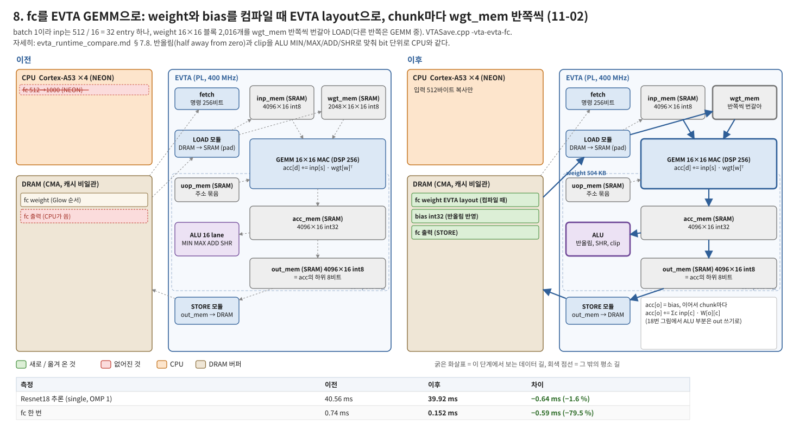

### 구조 9. 입력 전처리를 conv0 입력 복사 하나로

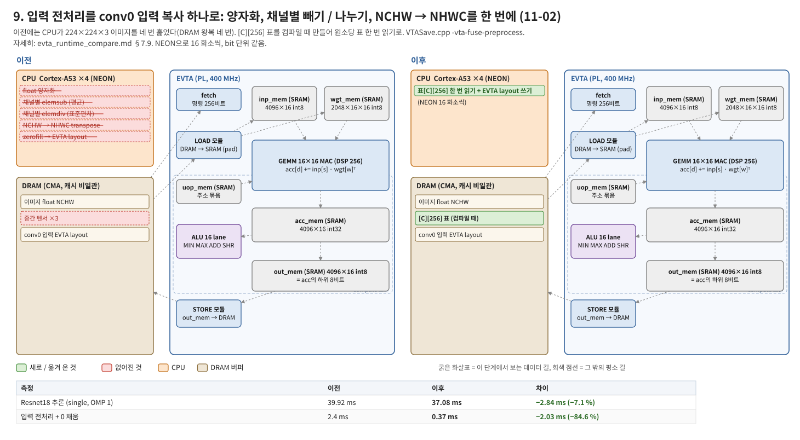

### 구조 10. EVTA 명령 기록 / 재생

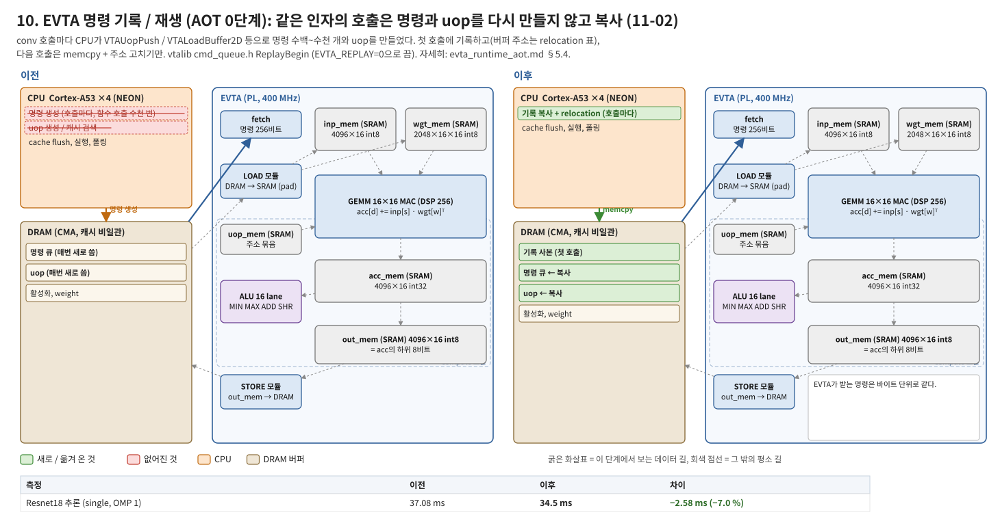

### 구조 11. conv0을 packed 입력의 4×1 conv로

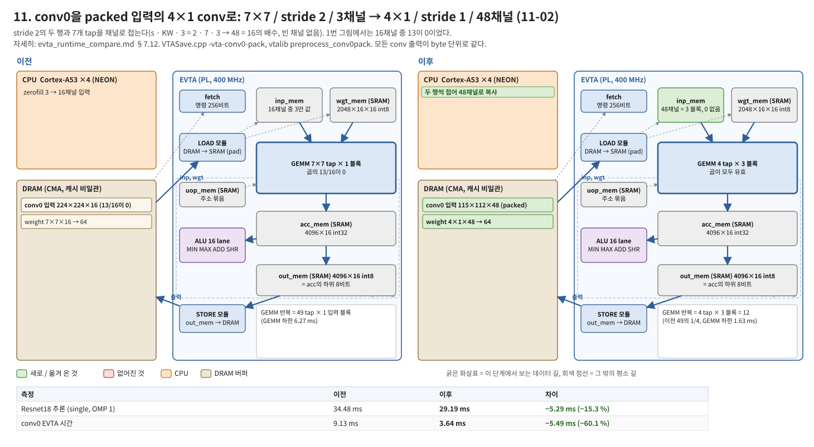

### 구조 12. conv0 + max pool을 EVTA 호출 하나로

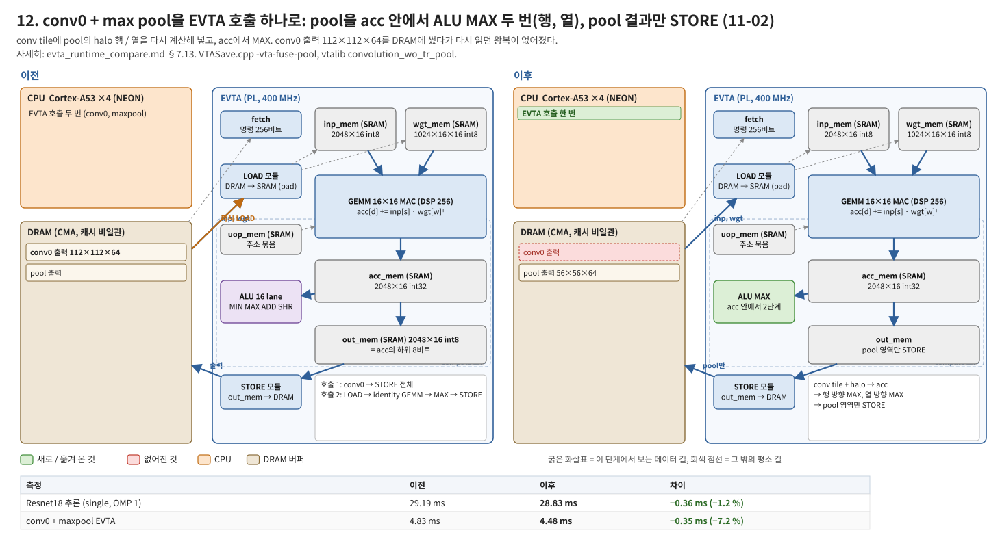

### 구조 13. GEMM: HLS broadcast → RTL systolic 어레이 (HW)

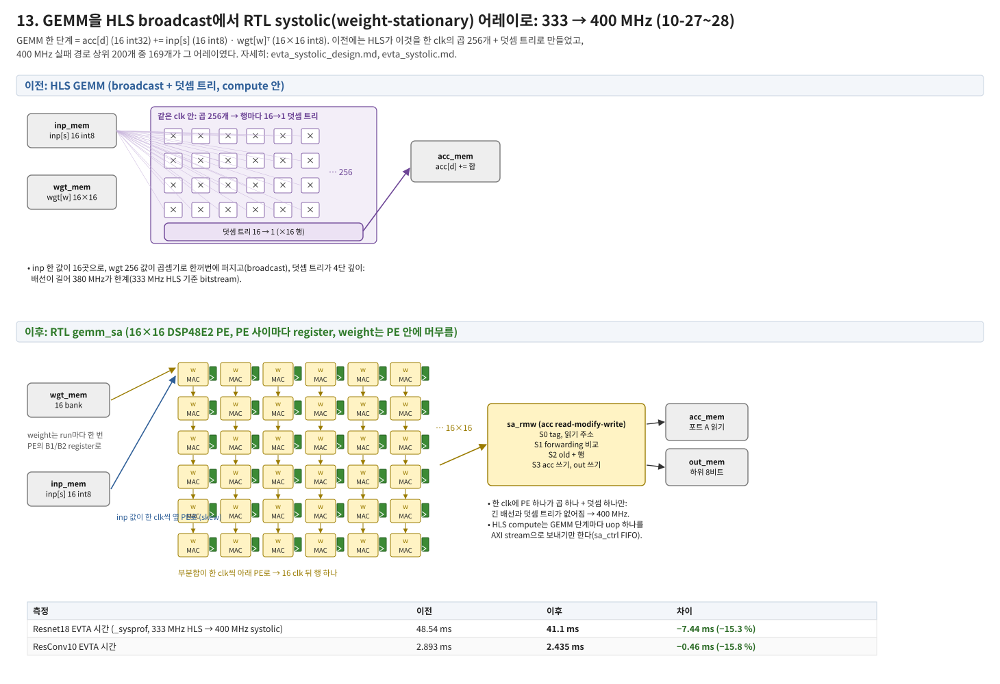

### 구조 14. ALU imm II = 1, acc / out 쓰기 앞 register (HW)

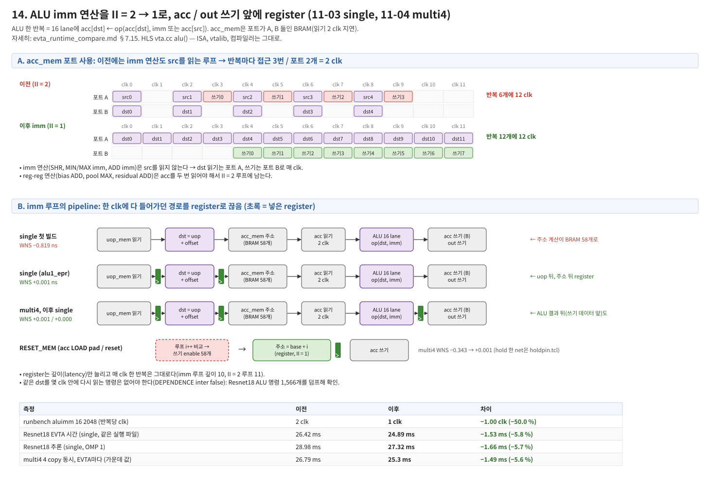

### 구조 15. bias reset: acc를 bias로 시작 (HW)

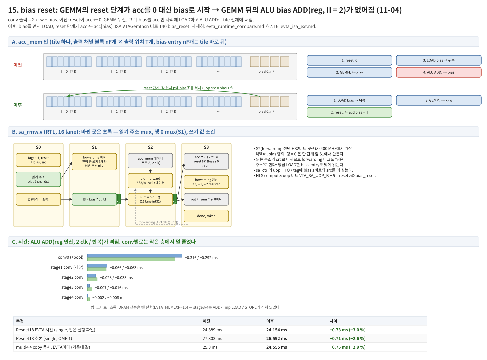

### 구조 16. requantize를 acc → out 쓰기 길에 (HW)

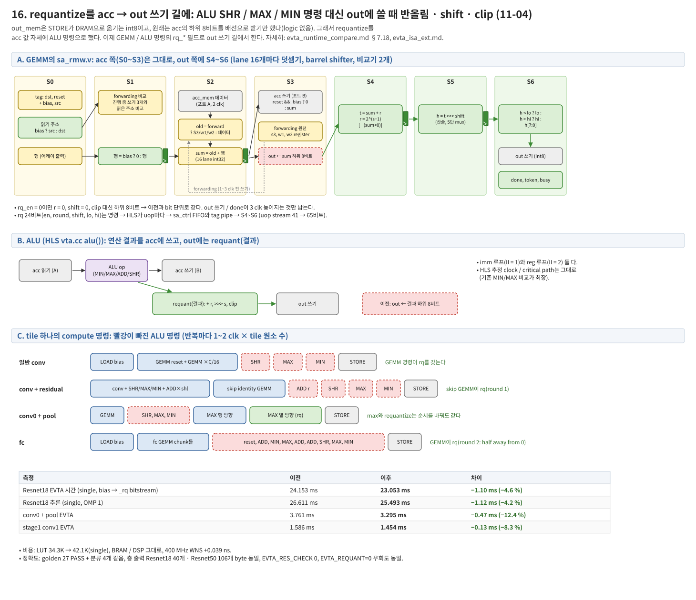

### 구조 17. Resnet18 추론 시간을 줄인 단계 요약

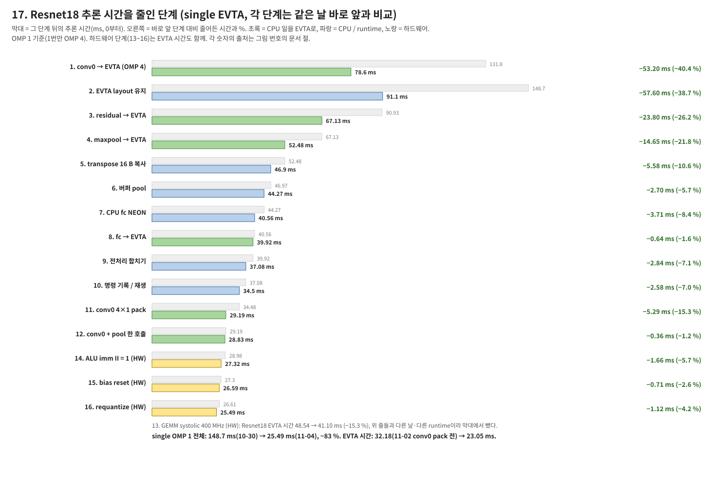

## 문서 지도

| 문서 | 내용 |
|---|---|
| [evta_user_manual.md](evta_user_manual.md) | 명령, 옵션, 어느 dir에서 무엇을 실행하는지 |
| [evta_hw_structure.md](evta_hw_structure.md) | EVTA 하드웨어 구조도: 전체, fetch, load, compute, store, interface와 버퍼, dependence (HLS EVTA와 systolic EVTA; systolic은 gemm_sa, 어레이 / PE, sa_ctrl, sa_rmw도) |
| [evta_isa_ext.md](evta_isa_ext.md) | ISA 확장 비트(bias_reset, rq_*), bitstream별 기능, 다른 모델 돌리는 법 |
| [../CLAUDE.md](../CLAUDE.md) | 빌드 환경, 보드 주의 사항, 변경마다 한두 줄 요약 |
| [evta_runtime_compare.md](evta_runtime_compare.md) | runtime·backend 최적화 본문(§7.1~7.14), 시간 분석, 다른 가속기 비교 |
| [evta_runtime_aot.md](evta_runtime_aot.md) | 명령 AOT 계획과 record / replay 구현 |
| [evta_systolic_design.md](evta_systolic_design.md) | systolic GEMM 설계 (PE, weight 채우기, RMW, HLS·RTL 경계) |
| [evta_systolic.md](evta_systolic.md) | 클럭과 systolic 작업 경과, bitstream별 결과, 외부 설계 조사 |
| [vta_synth_notes.md](vta_synth_notes.md) | 합성 환경, 보드 결함(Y219), 버그와 함정, ISA·버퍼 지도 |
| [evta_multi4_609gops_report.md](evta_multi4_609gops_report.md) | multi4 609.7 GOPS 보고서 |
| [evta_board_compare.md](evta_board_compare.md) | 다른 보드(Kria, Spartan)에 들어가는지 |
| [npu_stack_survey.md](npu_stack_survey.md) | 다른 컴파일러·runtime·NPU·싼 FPGA 조사와 방향 (계속 고쳐 씀) |
| [../vtabundles_xcmpl/README.md](../vtabundles_xcmpl/README.md) | 보드 bundle 빌드·실행 흐름의 상세 |
| [dailyreport/](dailyreport/) | 날짜별 일지 (결정의 이유, 중간에 틀렸던 것) |
