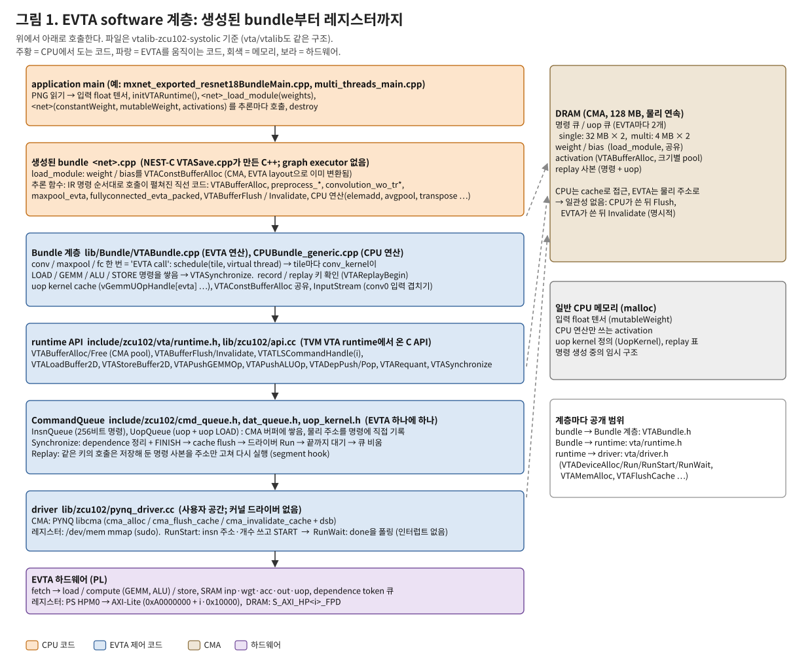
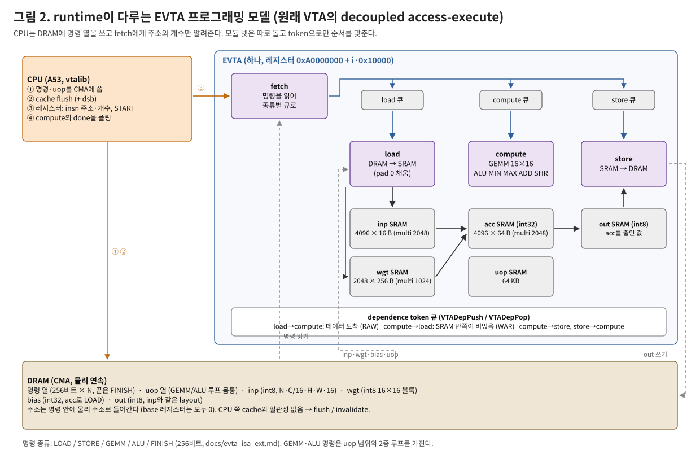
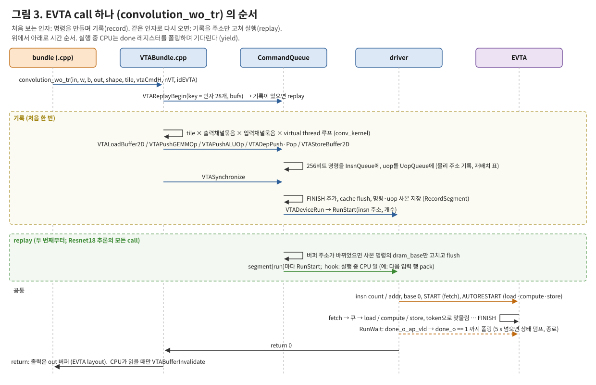
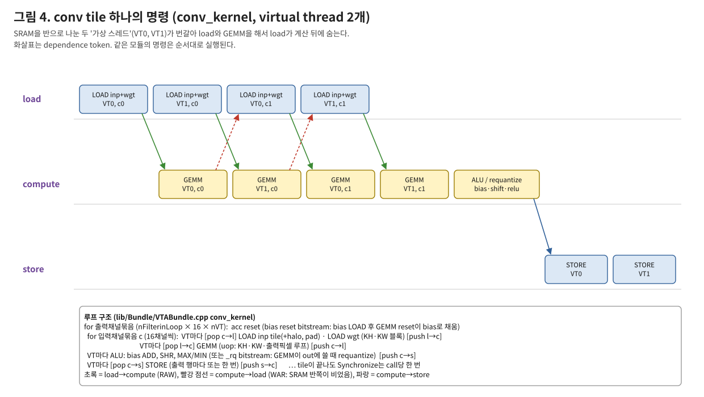
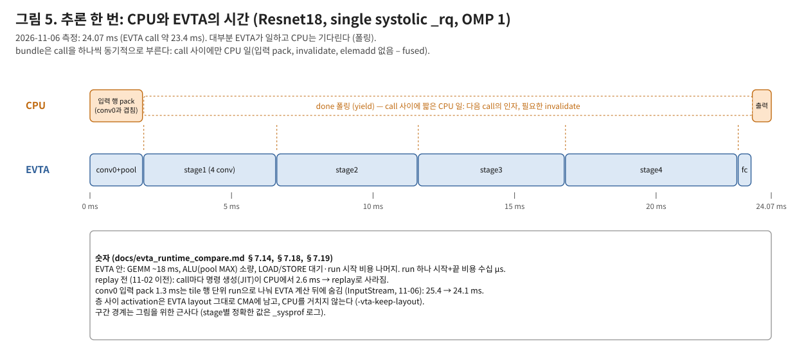
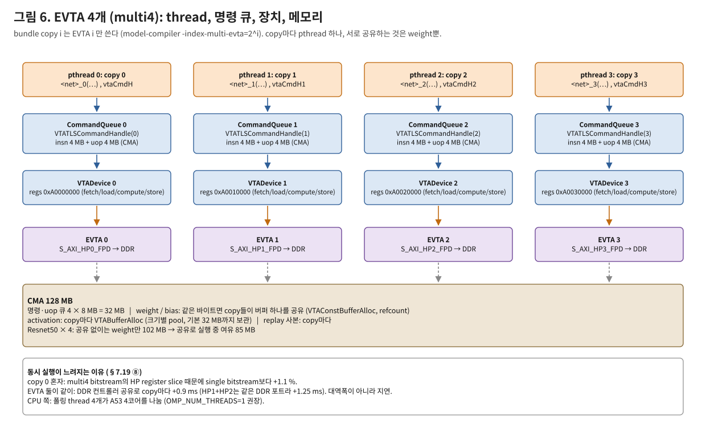

# EVTA runtime / driver 구조와 동작

다른 컴파일러·runtime(TVM VTA, TFLite delegate, Vitis AI VART, IREE, ONNX Runtime EP, NVDLA UMD/KMD 등)과 비교하려는 사람이
**VTA, Glow, NEST-C를 몰라도** 읽을 수 있도록, ZCU102의 EVTA를 움직이는 소프트웨어를 위에서 아래로 설명한다.
backend(NEST-C VTA backend, `VTASave.cpp`)와 compiler(Glow 파이프라인)는 다음 문서에서 다룬다.

- 기준: 2026-11-07의 `main`. 코드 위치는 **`vtalib-zcu102-systolic/`**(systolic bitstream용 runtime). `vta/vtalib/`(HLS bitstream과
  simulator용, git submodule)도 구조와 API가 같고, 다른 점은 §9에 적었다.
- 그림: `python3 docs/figs/src/make_evta_runtime_figs.py` → `docs/figs/evta_rt_*.svg`.
- 숫자는 보드(ZCU102, A53 1.2 GHz × 4, EVTA 400 MHz) 실측이다. 출처: [evta_runtime_compare.md](evta_runtime_compare.md) §7.
- 하드웨어 내부 그림: [evta_hw_structure.md](evta_hw_structure.md). 명령 비트: [evta_isa_ext.md](evta_isa_ext.md).
  명령·옵션·환경 변수: [evta_user_manual.md](evta_user_manual.md). 지금까지의 작업 순서: [evta_overview.md](evta_overview.md).

## 0. 용어

| 용어 | 뜻 |
|---|---|
| EVTA | ETRI가 확장한 VTA(Versatile Tensor Accelerator, TVM 프로젝트의 오픈 NPU). FPGA(PL)에 올린 int8 GEMM + ALU 가속기 |
| bitstream | FPGA 설정 파일. EVTA 1개(single) 또는 4개(multi4), HLS GEMM 또는 systolic GEMM 판이 있다 |
| NEST-C | ETRI의 Glow 확장 컴파일러. 모델(ONNX 등) → **bundle**(C++ 소스 + weight 파일)을 만든다 |
| bundle | 모델 하나를 위한 생성 C++ 코드. graph executor 없이 연산 호출을 순서대로 펼친 함수 하나 + weight 로딩 함수 |
| vtalib | EVTA runtime 라이브러리. bundle이 부르는 연산 함수(Bundle 계층) + runtime API + CommandQueue + driver |
| EVTA call | bundle이 부르는 EVTA 연산 하나 (예: `convolution_wo_tr`, `maxpool_evta`, `fullyconnected_evta_packed`) |
| run | EVTA에 명령 열 하나를 실행시키는 것 (FINISH로 끝남). call 하나 = 보통 run 하나 |
| uop | GEMM/ALU 명령이 루프 안에서 실행하는 micro-op (인덱스 3개). uop SRAM에 올려 둔다 |
| virtual thread (VT) | SRAM을 반씩 나눠 쓰는 두 작업 흐름. load와 계산을 겹치게 한다 (VTA 원래 방식) |
| EVTA layout | activation 배치 `N, C/16, H, W, 16` (16채널을 연속으로). weight는 16×16 블록 |
| CMA | Linux contiguous memory allocator. EVTA가 물리 주소로 읽을 수 있는 연속 메모리 (보드 128 MB) |

## 1. 한눈에



- **사용자 공간에서 모든 것을 한다.**
  - 커널 드라이버가 없다. 레지스터는 `/dev/mem`을 mmap해서 쓰고, DMA 메모리는 PYNQ의 `libcma`로 받는다. 그래서 sudo가 필요하다.
  - 인터럽트는 쓰지 않는다. 끝났는지는 레지스터를 폴링해서 본다.
- **bundle이 곧 실행 계획이다.**
  - 컴파일러가 모델 전체를 직선 C++ 코드로 펼쳐 둔다. graph executor, operator registry, 동적 shape이 없다.
  - 메모리 계획도 거의 없다. activation 버퍼는 문장마다 alloc/free하고, 크기별 pool로 재사용한다.
- **EVTA call은 동기적이다.**
  - call 하나가 명령 열을 만들거나 재사용한 뒤, run을 시작하고, 끝날 때까지 CPU가 기다린다.
  - 여러 call을 한 번에 넘기는 비동기 큐나 command ring은 없다. 이건 계획 3단계에서 할 일이다.
- **명령은 CPU가 실행 시점에 만든다(JIT).**
  - 처음 보는 인자의 call만 만들고, 기록해 둔다.
  - 두 번째 추론부터는 기록을 주소만 고쳐 다시 실행한다(record / replay, §5). AOT로 가는 0단계에 해당한다.
- **원래 VTA runtime(TVM, Apache 2.0)을 이어받은 코드다.**
  - C API(`VTALoadBuffer2D`, `VTAPushGEMMOp`, `VTADepPush` 등)와 `CommandQueue`, `UopKernel` 구조는 TVM의 `vta/runtime/runtime.cc`에서 왔다.
  - ETRI가 그 위에 bundle용 연산 함수(`VTABundle.cpp`)를 얹었다. 2026-10부터 바꾼 곳에는 `//#### JO` 주석이 붙어 있다.

## 2. EVTA 프로그래밍 모델 (runtime이 알아야 하는 하드웨어)



- **모듈 넷이 따로 돈다:** fetch, load, compute, store. 원래 VTA의 decoupled access-execute 구조다.
  - CPU는 DRAM에 256비트 명령 열을 쓰고 fetch에게 주소와 개수만 알려 준다.
  - fetch가 명령을 종류별 큐로 나눠 보낸다. LOAD는 load로, GEMM·ALU는 compute로, STORE는 store로 간다.
- **명령 다섯 가지:**

  | 명령 | 하는 일 |
  |---|---|
  | `LOAD` | DRAM → SRAM 2D 복사. 메모리 종류는 inp, wgt, acc(bias), uop. 가장자리 pad는 0으로 채운다 |
  | `GEMM` | acc[i] += inp[j] · wgt[k]. uop 범위를 2중 affine 루프로 돈다. reset, bias reset, requantize 비트가 있다 |
  | `ALU` | acc에 MIN / MAX / ADD / SHR. 이 bitstream은 opcode가 2비트라 MUL은 없다. 즉시값 또는 vector 연산 |
  | `STORE` | out SRAM → DRAM |
  | `FINISH` | 끝. compute의 done 레지스터를 1로 만든다 |

- **순서는 dependence token으로 맞춘다.** 모듈 사이의 token 큐 넷(load↔compute, compute↔store)에 명령 비트(`push_prev`, `push_next`, `pop_prev`, `pop_next`)로 넣고 뺀다. runtime은 `VTADepPush(from, to)` / `VTADepPop`으로 표시하고, 실제 비트 배치는 InsnQueue가 한다.
- **SRAM:**

  | 구분 | inp | wgt | acc | uop |
  |---|---|---|---|---|
  | single (`16_16_19_18`) | 4096 × 16 B | 2048 × 256 B | 4096 × 64 B | 64 KB |
  | multi (`16_15_18_17`) | 2048 | 1024 | 2048 | 64 KB |

  out은 acc를 int8로 줄여 쓰는 곳이다.
- **명령 안의 주소는 물리 주소다.** LOAD/STORE 명령의 `dram_base`에 원소 단위 물리 주소가 들어간다. base 레지스터는 모두 0이다. 그래서 버퍼가 바뀌면 명령도 바뀌어야 하고, 이것이 replay에 재배치 표가 필요한 이유다.
- **cache 일관성이 없다(non-coherent).** EVTA는 HP 포트로 DDR을 직접 읽는다.
  - CPU가 쓴 데이터는 EVTA가 읽기 전에 flush해야 한다(clean to DRAM).
  - EVTA가 쓴 데이터는 CPU가 읽기 전에 invalidate해야 한다.
  - coherent 포트(HPC/ACP)를 쓰는 설정(`NESTC_EVTA_COHERENT_ACCESSES`)은 이 보드에서 멈춘다.

## 3. driver (`lib/zcu102/pynq_driver.cc`, 인터페이스 `include/zcu102/vta/driver.h`)

| 함수 | 하는 일 |
|---|---|
| `VTAMemAlloc(size, cached)` / `VTAMemFree` / `VTAMemGetPhyAddr` | `libcma`의 `cma_alloc`(xlnk ioctl). cached 매핑과 물리 주소 |
| `VTAFlushCache` / `VTAInvalidateCache` | `cma_flush_cache` / `cma_invalidate_cache` (`dc civac` 루프) 뒤에 **`dsb sy`** |
| `VTADeviceAlloc(i)` | EVTA i의 레지스터 블록 4개(fetch/load/compute/store)를 `/dev/mem`에서 mmap. 그 전에 bitstream 확인 |
| `VTADeviceRunStart(h, insn_phy, count)` | 레지스터 쓰기와 START. 곧바로 return |
| `VTADeviceRunWait(h, wait)` | done 폴링 (`yield`). 시간 초과면 상태를 덤프 |
| `VTADeviceRun` | RunStart + RunWait |

- **레지스터 주소:** EVTA i는 `0xA0000000 + i·0x10000`이다. fetch +0x0000, load +0x1000, compute +0x2000, store +0x3000이고, PS의 M_AXI_HPM0(100 MHz)를 거친다.
- **RunStart 순서:**
  1. fetch에 insn count와 insn addr를 쓴다.
  2. load/compute/store의 base 주소 레지스터 다섯 개를 0으로 쓴다.
  3. compute의 `done_o_ap_vld`(읽으면 지워짐)를 한 번 읽어 지운다.
  4. fetch에 `START`(0x1)를 쓰고, load·compute·store에 `AUTORESTART`(0x81)를 쓴다.
- **RunWait:**
  - `done_o_ap_vld`가 1이 된 것을 본 뒤에야 `done_o == 1`을 믿는다.
    - compute는 이전 run의 FINISH 값 1을 들고 있다.
    - 시작 직후 compute가 load를 기다리는 동안에도 done이 1로 읽힌다. 2026-10-23에 고친 race다.
  - `EVTA_RUN_TIMEOUT_MS`(기본 5 s)를 넘기면 모든 EVTA의 제어 레지스터 상태를 출력한다.
    - 명령 열은 `/tmp/evta_hang_*.insn`에 저장하고 `_exit(5)`로 끝낸다.
    - abort하면 core dump 동안 CMA가 잡혀 있어서 다음 bitstream 적재가 실패하기 때문이다.
- **안전장치:**
  - 실행 스크립트가 적재한 bitstream 이름을 `/tmp/evta_bitstream`에 남긴다.
  - `VTADevice` 생성자는 그 이름에서 EVTA 수를 읽는다(`<n>evta`, `multi<n>`, 없으면 1). 없는 EVTA의 레지스터를 건드리기 전에 끝낸다. 없는 주소를 건드리면 AXI SError → 커널 Oops → 재부팅까지 간다.
  - 동시 실행은 스크립트의 `flock /tmp/evta_run.lock`으로만 막는다. 라이브러리 자체에는 잠금이 없다.
- **profile 빌드(`NESTC_EVTA_PROFILE`):**
  - run마다 시작·끝 시각과 compute 카운터(GEMM/ALU/LOAD 수)를 기록한다(`VTA_SYNC` event).
  - `_prof` bitstream이면 AXI perf monitor의 바이트 수와 지연도 함께 기록한다.
- **CMA의 실제 모습:** PYNQ 2.4의 `xlnk` 드라이버가 128 MB를 관리한다. 실패한 run이 남긴 CMA는 `Xlnk().xlnk_reset()`로 되찾는다(스크립트가 bitstream을 적재하기 전에 한다).

## 4. runtime: CommandQueue (`include/zcu102/cmd_queue.h`, `dat_queue.h`, `uop_kernel.h`, API `lib/zcu102/api.cc`)

### 4.1 객체와 수명

- **CommandQueue는 EVTA마다 하나다.**
  - `VTATLSCommandHandle(i)`가 정적 `shared_ptr` 4개 중 i번째를 만든다. 이름에 TLS가 붙어 있지만 thread별이 아니라 EVTA별이다.
  - 생성될 때 `VTADeviceAlloc(i)`을 부른다.
- **큐 둘:** InsnQueue(256비트 명령)와 UopQueue(64비트 uop). 둘 다 CMA 버퍼 하나씩이다.
  - 크기는 `VTA_MAX_XFER`: single 32 MB × 2, multi 4 MB × 2.
  - 넘치면 `AutoSync`가 중간에 run을 시작한다.
- **bundle 쪽:**
  - 생성된 `VTARuntime.h`의 `initVTARuntime()`이 `vtaCmdH = VTATLSCommandHandle()`를 부른다. multi copy i는 `initVTARuntime<i>()`에서 `vtaCmdH<i>`를 만든다.
  - 모든 EVTA call은 이 handle과 `idEVTA`를 인자로 받는다.

### 4.2 명령 만들기

| API | CommandQueue 동작 |
|---|---|
| `VTALoadBuffer2D(cmd, buf, elem_off, x, y, stride, pads, sram_idx, mem_type)` | LOAD 명령 하나. `dram_base = phy(buf)/elem_bytes + elem_off` |
| `VTAStoreBuffer2D(...)` | STORE 명령 하나 |
| `VTAPushGEMMOp(cmd, &handle, finit, ctx, size, …)` | uop kernel을 찾거나 만든다. uop SRAM에 없으면 uop LOAD를 넣고, 그 뒤에 GEMM 명령 |
| `VTAPushALUOp(...)` | 같은 방식으로 ALU 명령 |
| `VTADepPush/Pop(from, to)` | token 표시 (1 = load, 2 = compute, 3 = store) |
| `VTARequant(cmd, en, round, shift, lo, hi)` | 다음 GEMM/ALU 명령들의 requantize 필드 (`_rq` bitstream) |
| `VTASynchronize(cmd, wait)` | 아래 4.3 |

- **uop kernel cache:**
  - Bundle 계층은 `vGemmUOpHandle[evta]` 같은 목록에서 같은 context 구조체(tile 크기, 채널 수 등)의 handle을 선형 탐색한다.
  - 없으면 `finit` 함수(예: `gemmop_mxn`)가 `VTAUopLoopBegin` / `VTAUopPush` / `VTAUopLoopEnd`로 uop를 기록한다.
  - UopQueue는 kernel이 uop SRAM의 어디에 있는지 기억하고, 없을 때만 uop LOAD를 넣는다.
  - uop SRAM이 차면 "uop buffer overflowed" 경고와 함께 재사용을 멈춘다(Resnet18에서도 나온다).

### 4.3 `Synchronize` = run 하나

1. 마지막 store → compute, load → compute token을 정리하고 `FINISH`를 붙인다.
2. uop 큐와 명령 큐를 cache flush한다(+ `dsb`).
3. replay를 기록하는 중이면 사본을 저장한다(§5).
4. `VTADeviceRun(device, insn_phy, count, 1<<31)`. 끝날 때까지 이 thread가 폴링한다.
5. 큐를 비운다(`Reset`).

- **실행은 항상 동기적이다.** 다음 run의 명령은 이전 run이 끝난 뒤에야 같은 큐 버퍼에 만들어진다.
- 예외는 replay의 segment hook과 InputStream(§5, §6.3)으로, run이 도는 동안 CPU가 다른 일을 한다.

### 4.4 데이터 버퍼 (`api.cc`)

- **`VTABufferAlloc(size)`:**
  - `DataBuffer`(CMA, cached)를 돌려준다. bundle은 `VTABufferGetVirtAddr`로 CPU 주소를 얻는다.
  - **크기별 free list pool**을 쓴다. `VTABufferFree`가 버퍼를 보관하고(기본 32 MB까지, `EVTA_BUF_POOL_MB`), 같은 크기 요청에 다시 준다.
  - 첫 추론 뒤에는 `cma_alloc` ioctl이 없다. Resnet18 기준 2.6 ms가 절약된다.
- **`VTABufferFlush` / `VTABufferInvalidate`:** 명시적 cache 관리다. bundle이 CPU 연산의 앞뒤에 넣는다.
- **`VTAConstBufferAlloc(src, size)` (Bundle 계층):**
  - weight와 bias용이다. 같은 바이트 내용이면 버퍼 하나를 공유한다(FNV-1a 해시 + memcmp, refcount, mutex).
  - multi4의 copy 넷이 weight 한 벌을 같이 쓴다. `EVTA_CONST_SHARE=0`이면 끈다.

## 5. record / replay (AOT 0단계, `cmd_queue.h` `ReplayBegin`)

- **키:** 각 EVTA 연산 함수는 시작할 때 `VTAReplayBegin(cmd, key, bufs)`를 부른다.
  - key는 scalar 인자 전부다(conv는 shape, tile, VT 수, EVTA 번호, fusion 인자, stream, clip 등 28개).
  - bufs는 버퍼 인자 5개(in, weight, bias, out, residual)다.
- **처음 보는 key → 기록:**
  - 함수가 평소대로 명령을 만든다.
  - `Synchronize`가 run마다 명령·uop 사본을 새 CMA에 복사한다. 사본 명령의 uop LOAD 주소는 사본 uop를 가리키게 고친다.
  - LOAD/STORE마다 "몇 번째 버퍼 인자 + offset"을 재배치 표에 적는다.
- **아는 key → replay:**
  - 함수는 명령을 만들지 않고 return한다.
  - 버퍼 물리 주소가 기록 때와 다르면 재배치 표로 `dram_base`만 고치고 flush한 뒤, segment(run)마다 RunStart/RunWait를 한다.
- **segment hook:** run s가 도는 동안 `hook(ctx, tag of s+1)`을 부른다. conv0 입력을 행 단위로 pack·flush하는 데 쓴다(§6.3).
- **효과와 한계:**
  - Resnet18 single 37.1 → 34.5 ms(2026-11-02). bit-exact.
  - 같은 프로세스 안에서만 유지된다. 파일로 남기지 않는다(진짜 AOT 아님).
  - 사본 메모리 한도가 있다(`EVTA_REPLAY_MB`, 기본 16 MB).
  - 끄기: `EVTA_REPLAY=0`. 로그: `EVTA_REPLAY_LOG=1|2` (2는 run마다 GEMM/ALU 반복 수, DRAM 바이트, 시간). 덤프: `EVTA_REPLAY_DUMP=<dir>`.

## 6. Bundle 계층과 생성된 bundle

### 6.1 생성된 bundle의 모양 (`VTASave.cpp`가 쓴다; 예 `vtabundles_xcmpl/hw/Resnet18Test/mxnet_exported_resnet18.cpp`)

```c++
void mxnet_exported_resnet18_load_module(uint8_t *constantWeight) {     // 한 번
  resnetv10_conv0_weight__1 = (int8_t *)VTAConstBufferAlloc(constantWeight + 0, 12288);   // EVTA layout으로 이미 변환됨
  conv_bias__20 = (int8_t *)VTAConstBufferAlloc(constantWeight + 12288, 256);
  ...
}
int mxnet_exported_resnet18(uint8_t *constantWeight, uint8_t *mutableWeight, uint8_t *activations) {   // 추론마다
  int8_t *resnetv10_conv0_fwd__2_res_vbuf = (int8_t *)VTABufferAlloc(802816);
  int8_t *resnetv10_conv0_fwd__2_input_transpose = (int8_t *)VTABufferAlloc(618240);
  preprocess_conv0pack_stream((const float *)data, resnetv10_conv0_fwd__2_input_transpose, ...);  // float → int8 + pack
  convolution_wo_tr_pool(in, w, bias, out, 1, 115, 112, 48, 64, 4, 1, 0, 1, /*relu*/1, /*bias*/1, /*shift*/9,
                         112, 112, vtaCmdH, /*VT*/2, /*tileH*/16, /*tileW*/16, /*EVTA*/0, pool_out, 3, 2, 1);
  VTABufferFree(resnetv10_conv0_fwd__2_input_transpose);
  convolution_wo_tr(...); convolution_wo_tr_res(..., residual_vbuf, ...); ...   // 층마다 call 하나
  fullyconnected_evta_packed(...);
  ...
}
```

- 문장 하나가 Glow IR 명령 하나다. 메모리는 문장마다 `VTABufferAlloc`/`Free`하거나 `malloc`/`free`한다(pool 덕분에 싸다).
- **activation은 층 사이에서 EVTA layout 그대로 CMA에 남는다**(`-vta-keep-layout`). conv 사이에 transpose와 cache 관리가 없다.
- CPU 연산(elemadd, avgpool, CPU conv 등)이 끼면 VTASave가 그 앞에 `VTABufferInvalidate`와 layout transpose를 넣고, 뒤에 `transpose_nhwc2vtaio`와 `VTABufferFlush`를 넣는다.
- schedule(tile 크기, VT 수)은 컴파일 시점에 `include/Backends/VTA/VTASchedules.h`에서 정해져 인자로 들어간다.
- application main은 `initVTARuntime()` → weight 파일 읽기 → `load_module` → 추론 함수 반복 → `destroy_module` → `destroyVTARuntime()` 순서로 부른다.

### 6.2 EVTA 연산 함수 (`lib/Bundle/VTABundle.cpp`)

| 함수 | 하는 일 |
|---|---|
| `convolution_wo_tr` | int8 conv + bias + shift + relu(+ ReLU6 clip, `VTASetActivationClip`), 입력·출력 EVTA layout |
| `convolution_wo_tr_res` | conv + residual add + relu를 call 하나로 (residual을 inp에 LOAD, identity weight GEMM) |
| `convolution_wo_tr_pool` | conv0 + 3×3/2 maxpool을 call 하나로 |
| `maxpool_evta` | maxpool (ALU MAX) |
| `fullyconnected_evta_packed` | fc (weight를 컴파일 시점에 EVTA layout으로) |
| `preprocess_conv0pack[_stream]` | 입력 float → int8 + conv0 packing (CPU, NEON). `_stream`은 행 단위로 run과 겹침 |
| CPU (`CPUBundle_generic.cpp`) | `transpose_*`(16 B 복사), `elemadd`, `avgpool`, `nonvtaconvolution`, `quantize` 등. 일부는 OpenMP |

### 6.3 conv call 하나의 내부





1. 시작할 때 `VTAReplayBegin`을 부른다. replay면 여기서 끝난다.
2. 출력을 tile(`tileH × tileW`)로 나누고 tile마다 `conv_kernel`을 부른다.
   - **출력 채널 묶음:** `nFilterinLoop × 16 × nVT` 채널을 한 번에 다룬다.
   - **acc 초기화:** reset GEMM으로 한다. bias reset bitstream에서는 bias를 LOAD한 뒤 reset이 bias로 채운다.
   - **입력 채널 묶음(16채널):** VT마다 LOAD inp(halo와 pad 포함)와 LOAD wgt 다음 GEMM을 한다. 두 VT가 번갈아 load와 계산을 겹친다.
   - **마무리:** VT마다 bias ADD, SHR, MAX/MIN을 한다. `_rq` bitstream이면 GEMM이 out에 쓸 때 requantize로 대신한다. 그 다음 STORE.
3. call 끝에서 `VTASynchronize`를 한 번 부른다. call 하나가 run 하나다.
   - 예외 1: 입력이 InputStream이면 tile 행마다 run 하나가 된다. Resnet18 conv0+pool은 7행이라 run 7개다.
   - 예외 2: 큐가 넘치면 `AutoSync`로 중간에 run을 시작한다.
- **InputStream (`preprocess_conv0pack_stream`, 2026-11-06):**
  - 입력 pack을 바로 하지 않고 "이 버퍼는 아직 덜 쓰였다"고 등록만 해 둔다.
  - 그 버퍼를 읽는 conv는 tile 행마다 run을 나누고, run s가 도는 동안 hook이 run s+1이 읽을 입력 행을 pack하고 flush한다.
  - Resnet18 25.4 → 24.1 ms.

## 7. 추론 한 번의 시간



- **Resnet18 single (systolic `_rq` 400 MHz, OMP 1, 2026-11-06):**
  - 24.07 ms 중 EVTA call이 약 23.4 ms다.
  - EVTA call 21개(conv 19, conv0+pool 1, fc 1)이고 run은 27개다. conv0이 행 단위로 7개다.
- **CPU가 일하는 곳:** 입력 pack(conv0과 겹침), call 인자 준비, 출력. 나머지 시간에는 done을 폴링한다.
- **EVTA 안:**
  - GEMM이 약 18 ms다.
  - 나머지는 LOAD/STORE 대기와 run 시작·끝 비용이다. run 하나에 수십 µs 들고, 작은 conv0 tile에서 두드러졌다.
  - 층 사이 activation DRAM 왕복을 모두 없애도 줄어드는 상한이 약 2.4 ms다(§7.11).
- **다른 모델(single, 같은 조건):** Resnet50 82.2 ms(EVTA call 54개), VGG16-CIFAR 7.27 ms(19개). MobileNetV2는 1110 ms인데, 97 %가 CPU로 간 depthwise conv, 24채널 conv, conv0이다(2026-11-06).

## 8. EVTA 여러 개 (multi4)



- **copy와 EVTA:**
  - model-compiler가 같은 모델을 copy 4개로 만든다(`-index-multi-evta=2^i`, `-network-name <net>_i`). copy i의 모든 call은 `idEVTA = i`와 `vtaCmdH<i>`를 쓴다.
  - main(`multi_threads_main.cpp`)은 copy마다 pthread를 하나 띄운다.
- **공유:**
  - EVTA끼리 공유하는 것은 CMA weight(`VTAConstBufferAlloc`)와 DDR뿐이다. 명령 큐, 장치, activation, replay 표는 copy마다 따로다.
  - 하드웨어 동기화나 copy 사이 협업(한 모델을 여러 EVTA로 나누기)은 없다. 같은 모델을 여러 개 동시에 돌리는 throughput 구성이다.
- **성능:**
  - Resnet18 copy마다 24.6 ms, Resnet50 86.0 ms. 혼자일 때보다 느린 이유는 그림 6 아래에 적었다.
  - CPU는 폴링 thread 넷이 나눠 쓰므로 `OMP_NUM_THREADS=1`로 둔다.

## 9. vtalib 두 벌과 빌드

| | `vta/vtalib` (submodule `joungheo/nestc2_vtalib`) | `vtalib-zcu102-systolic/` |
|---|---|---|
| 쓰는 bitstream | HLS GEMM (`..._380mhz`, multi `..._4evta_380mhz`), simulator | systolic (`..._sa_400mhz_rq`, multi `..._4evta_sa_400mhz_rq`) |
| 다른 점 | uop 순서가 HLS GEMM용, requantize 없음, conv0 입력은 한 번에 씀 | uop 순서가 weight-stationary systolic용, `VTARequant`·bias reset, InputStream |
| 공통 | API, CommandQueue, driver, replay, buffer pool, const 공유, ReLU6 clip | |

- **빌드:** 보드용은 `vtabundles_xcmpl/`(독립 CMake)가 vtalib과 bundle을 함께 빌드한다(`-DVTALIB=<dir>`, `-DBUNDLE_SET=single|multievtax4`).
- **simulator:** `vta/vtalib`의 `lib/simulator/`(`runtime.cc`, `sim_driver.cc`)는 같은 API를 C++ 모델로 실행한다. 컴파일러 빌드(`Debug2_remote`)와 bundle 생성 검증에 쓴다.
- **CMake 옵션:** `NESTC_EVTA_RUN_ON_ZCU102`, `NESTC_EVTA_MULTI`(큐 크기와 SRAM 깊이), `NESTC_EVTA_PROFILE`(run event), `NESTC_EVTA_PROFILE_AXI_MONITOR`.

## 10. 다른 runtime과 비교할 때 볼 점

| 항목 | 지금 EVTA | 흔한 다른 방식 (비교 대상 예) |
|---|---|---|
| 커널/사용자 경계 | 전부 사용자 공간 (`/dev/mem`, libcma), sudo | 커널 드라이버 + UAPI (NVDLA KMD, Vitis XRT, DRM accel), 또는 UIO/VFIO |
| 완료 통지 | 레지스터 폴링 + `yield` | 인터럽트 + 대기 큐, 또는 fence / event |
| 제출 단위 | run 하나를 동기적으로 (call마다 기다림) | command ring / job 큐에 여러 개 비동기 제출, 의존성은 fence로 |
| 명령 생성 | 실행 시점(JIT), 같은 인자는 프로세스 안 replay | 컴파일 시점에 명령 바이너리(AOT: Vitis AI xmodel, Ethos-U command stream, TVM VTA는 JIT) |
| 그래프 실행 | 생성된 직선 C++ (executor 없음) | graph executor / VM / delegate가 partition을 부름 (TFLite, ORT EP, IREE HAL) |
| 메모리 계획 | 문장마다 alloc/free + 크기별 pool | 컴파일 시점 arena 배치 (TFLite arena, Glow bundle의 activations 영역) |
| 주소 | 명령 안에 물리 주소, 재배치는 runtime이 | base 레지스터 + offset, 또는 IOMMU 가상 주소 |
| 캐시 일관성 | 명시적 flush / invalidate (+ dsb) | coherent 포트, 또는 드라이버의 dma_sync |
| 여러 가속기 | 같은 모델 copy를 EVTA마다 (pthread) | 한 모델을 여러 장치로 partition, 장치 스케줄러 |
| CPU fallback | bundle 안에 CPU 함수 호출 (같은 스레드) | delegate가 지원 안 하는 op는 framework CPU kernel로 |

- **장점:** 층 사이 데이터가 EVTA layout으로 CMA에 남는다. 여러 연산을 call 하나로 합친다(conv+res+relu, conv0+pool). 두 번째 추론부터 명령 생성 비용이 없다(replay). 그래서 Resnet18에서는 EVTA가 시간의 97 %를 쓴다.
- **약점과 계획(`CLAUDE.md`, `docs/npu_stack_survey.md`):**

  | 계획 단계 | 할 일 | 해결하려는 것 |
  |---|---|---|
  | ② ISA 개편 | ALU MUL, depthwise 지원 | 연산 범위 |
  | ③ 인터럽트 + command ring | 비동기 제출 | 동기 call, 폴링 |
  | ④ HAL / UIO / DRM | 커널 경계와 권한 | sudo, `/dev/mem` |
  | ⑤ 하드웨어 루프 FSM | 명령 수 줄이기 | run 비용 |

  지금 구조의 한계도 이 순서로 드러난다: 동기 call과 폴링 → run마다 수십 µs → 연산 범위(MobileNet depthwise는 CPU) → 권한(sudo, `/dev/mem`).

## 11. 코드 위치 (vtalib-zcu102-systolic 기준)

| 파일 | 내용 |
|---|---|
| `lib/zcu102/pynq_driver.cc` | `VTADevice` (mmap, RunStart/RunWait, timeout dump, bitstream 확인, profile event), CMA 래퍼 |
| `include/zcu102/vta/driver.h` | driver 인터페이스, `VTA_MAX_XFER`, 레지스터 offset |
| `include/zcu102/vta/hw_spec.h` | 명령 구조체(`VTAMemInsn`, `VTAGemInsn`, `VTAAluInsn`), opcode, SRAM 크기 (2비트 필드는 `//#### JO`) |
| `include/zcu102/vta/runtime.h`, `lib/zcu102/api.cc` | C API, buffer pool, Flush/Invalidate, Replay·SegmentHook·Requant API |
| `include/zcu102/cmd_queue.h` | `CommandQueue`: 명령 생성, `Synchronize`, record/replay, hang 진단 (`EVTA_STORE_SENTINEL`, `EVTA_PRE_RUN_US`) |
| `include/zcu102/dat_queue.h` | `InsnQueue`(token 비트 배치, 명령 dump), `UopQueue`(uop SRAM cache, uop LOAD) |
| `include/zcu102/uop_kernel.h` | `UopKernel` (uop 열 + 2중 루프) |
| `lib/Bundle/VTABundle.cpp` | EVTA 연산 함수, `conv_kernel`, uop finit 함수(`gemmop_mxn` 등), InputStream, `VTAConstBufferAlloc`, `VTASetActivationClip` |
| `lib/Bundle/CPUBundle_generic.cpp` | CPU 연산 (보드는 이 파일; `CPUBundle_aarch64.cpp`는 ARM Compute Library 판) |
| `include/Bundle/VTABundle.h` | bundle이 include하는 선언 |
| 생성물 `VTARuntime.h` | `vtaCmdH[0-3]`, `initVTARuntime[1-3]()`, uop handle 목록 초기화 |
| `vtabundles_xcmpl/hw*/script/` | 실행 스크립트: bitstream 적재(`load_bit.sh`), `/tmp/evta_bitstream`, `flock`, `run_all.sh`, `run_prof.sh` |
