# EVTA 소프트웨어 스택 한눈에: 모델 파일에서 EVTA 레지스터까지 (그림 11장)

NEST-C 컴파일러와 EVTA runtime 전체를 그림 순서대로 설명하는 입구 문서다. VTA, Glow, NEST-C를 처음 보는 사람(다른 컴파일러·runtime과
비교하려는 세션 포함)이 이 문서 하나로 구조를 잡고, 자세한 내용은 각 절의 링크로 들어가면 된다.

| 편 | 문서 | 그림 |
|---|---|---|
| 컴파일러 앞단 (frontend, 그래프 최적화, lowering, 양자화, IR) | [evta_compiler_frontend.md](evta_compiler_frontend.md) | C1 ~ C4 |
| 컴파일러 뒷단 (VTA backend, bundle 생성) | [evta_compiler_backend.md](evta_compiler_backend.md) | C3, C5 |
| runtime / driver (vtalib) | [evta_runtime_arch.md](evta_runtime_arch.md) | 1 ~ 6 |
| 하드웨어 내부 | [evta_hw_structure.md](evta_hw_structure.md), 명령 비트 [evta_isa_ext.md](evta_isa_ext.md) | |
| 명령·옵션·실행 방법 | [evta_user_manual.md](evta_user_manual.md) | |
| 지금까지의 작업과 숫자 | [evta_overview.md](evta_overview.md), [evta_runtime_compare.md](evta_runtime_compare.md) §7 | |
| 다른 스택 조사와 방향 | [npu_stack_survey.md](npu_stack_survey.md) | |

- 기준: 2026-11-07 `main`.
- 그림 생성:
  - `python3 docs/figs/src/make_evta_compiler_figs.py` (C1 ~ C5)
  - `python3 docs/figs/src/make_evta_runtime_figs.py` (1 ~ 6)
- 숫자는 ZCU102 보드 실측이다(A53 1.2 GHz × 4, EVTA 400 MHz systolic `_rq` bitstream, OMP 1).

## 0. 세 줄 요약

1. **컴파일러(NEST-C = Glow + VTA backend)는 모델 하나를 "vtalib 함수를 순서대로 부르는 C++ 파일 하나 + weight 파일"로 바꾼다.**
   - 양자화는 post-training, power-of-two per-tensor 대칭이다.
   - EVTA로 갈 conv, layout, fusion, tile 크기를 컴파일 때 다 정한다.
2. **runtime(vtalib)은 사용자 공간 라이브러리다.**
   - EVTA call마다 256비트 명령 열을 CPU에서 만든다. 같은 인자의 두 번째 호출부터는 기록을 재사용한다(replay).
   - 레지스터에 시작을 쓰고 done을 폴링한다.
   - 커널 드라이버도, 인터럽트도, 비동기 큐도 없다.
3. **Resnet18 한 번 24.07 ms 중 97 %가 EVTA 시간이다.**
   - 컴파일러가 층 사이 데이터를 EVTA layout으로 묶어 두고 연산을 합쳐 놓은 덕이다.
   - 반대로 EVTA가 못 하는 연산(MobileNetV2의 depthwise 등)은 CPU의 단순 루프로 가서 전체를 지배한다(1110 ms 중 97 %).

## 1. 큰 흐름: 두 번의 컴파일러 실행과 보드 빌드

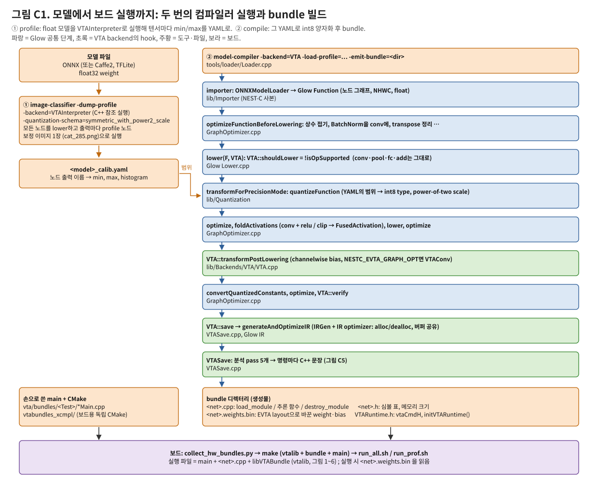

- **① profile:** float 모델을 참조 backend(VTAInterpreter)로 이미지 한 장에 대해 실행해, 노드 출력마다 범위를 YAML로 남긴다.
- **② compile:** 같은 모델을 그 범위로 int8 양자화하고, Glow 공통 단계(파랑)를 거친 뒤 VTA backend hook(초록)이 C++ bundle을 쓴다.
- **보드:** 손으로 쓴 main과 vtalib과 함께 독립 CMake(`vtabundles_xcmpl/`)로 빌드해 실행한다.
- 컴파일러는 보드의 simulator 빌드(`Debug2_remote`)에서 돌린다. 보드용 NEST-C 빌드는 컴파일러를 만들지 않는다.

→ 자세히: [frontend §1](evta_compiler_frontend.md)

## 2. 컴파일러가 어디서 왔나: Glow 위에 덮어쓰기

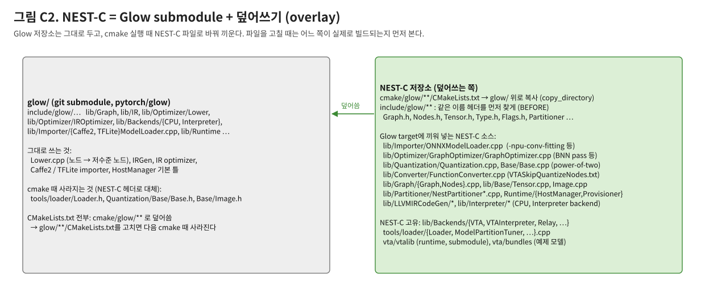

- **Glow는 원본 submodule 그대로다(2022-08 커밋).** NEST-C는 cmake 때 Glow의 CMakeLists와 일부 파일을 자기 것으로 바꿔 끼운다.
- **EVTA에 중요한 NEST-C 파일:**
  - ONNX importer: 채널 맞추기 옵션 `-npu-conv-fitting`
  - 그래프 최적화 파이프라인
  - 양자화: power-of-two 지수 하한
  - `VTASkipQuantizeNodes.txt` 처리
  - VTA backend 전체
- **고칠 때 주의:** 같은 이름의 파일이 두 곳에 있다. 어느 쪽이 빌드되는지는 `cmake/glow/**/CMakeLists.txt`가 정한다.

→ [frontend §2](evta_compiler_frontend.md)

## 3. 모델의 한 조각이 단계마다 어떻게 바뀌나

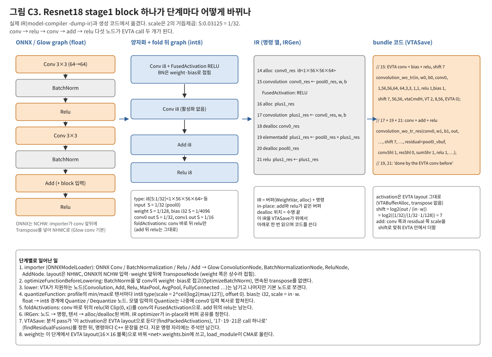

Resnet18의 residual block 하나(conv → BN → relu → conv → BN → add → relu)를 따라가면 컴파일러 전체가 보인다.

| 단계 | 일어나는 일 | 문서 |
|---|---|---|
| importer | ONNX op → Glow 노드, NCHW → NHWC transpose | [frontend §3](evta_compiler_frontend.md) |
| 그래프 최적화 | BatchNorm을 conv weight·bias에 접음 | [frontend §4](evta_compiler_frontend.md) |
| lowering | VTA가 지원하는 노드는 그대로 둠 | 같은 곳 |
| 양자화 | 텐서마다 int8 type (scale 1/32, 1/128 …) | [frontend §5](evta_compiler_frontend.md) |
| activation fold | conv 바로 뒤 relu → conv의 FusedActivation | [frontend §4](evta_compiler_frontend.md) |
| IRGen | 명령 열 + alloc/dealloc, add·relu는 in-place 버퍼 공유 | [frontend §6](evta_compiler_frontend.md) |
| VTASave | conv 하나 → `convolution_wo_tr`, conv + add + relu → `convolution_wo_tr_res` | [backend §4, §5](evta_compiler_backend.md) |

- 결과적으로 다섯 노드가 EVTA call 두 개가 되고, 그 사이 데이터는 EVTA layout으로 CMA에 머문다.
- shift 7은 scale에서 바로 나온다: `(1/32) / (1/32 · 1/128) = 2^7`.

## 4. 양자화: 왜 power-of-two이고, 어디서 깨지나

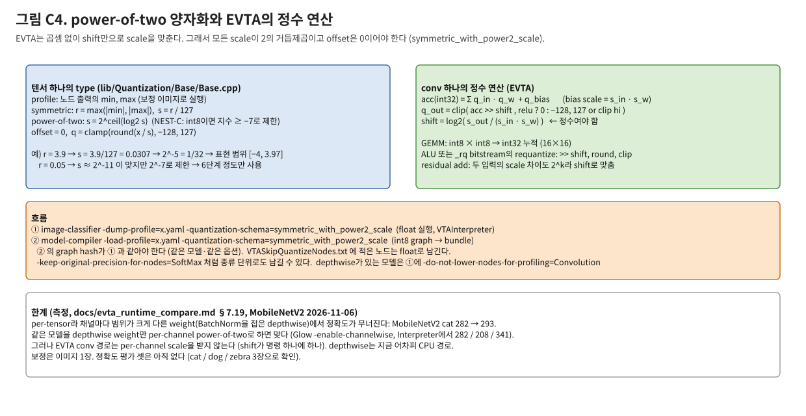

- **EVTA에는 scale용 곱셈기가 없다.** conv 결과를 `>> shift`로만 줄인다. 그래서 모든 scale이 2의 거듭제곱이고 offset이 0이어야 한다.
- **Resnet18/50과 VGG16은 이것으로 정답을 낸다.**
- **MobileNetV2는 깨진다.** BatchNorm이 접힌 depthwise weight가 채널마다 범위가 달라서, per-tensor scale 하나로는 작은 채널이 사라진다.
  - depthwise weight만 per-channel이면 맞는다.
  - 다만 그 depthwise는 어차피 CPU 경로다.

→ [frontend §5](evta_compiler_frontend.md)

## 5. VTA backend: 무엇을 어디서, 어떤 모양으로

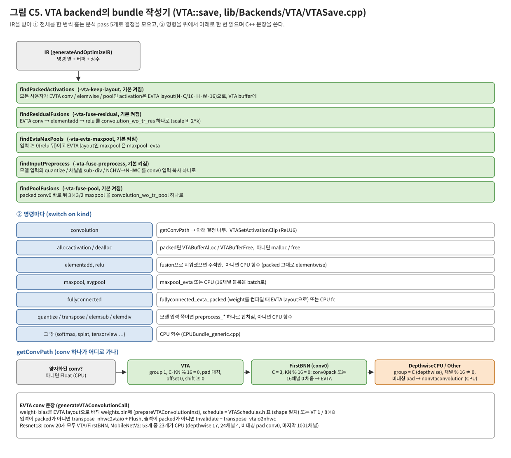

- **분석 pass 다섯 개가 IR 전체를 보고 정한다:**

  | pass | 정하는 것 |
  |---|---|
  | `findPackedActivations` | 어느 activation을 EVTA layout으로 둘지 |
  | `findResidualFusions` | conv + add + relu를 call 하나로 |
  | `findEvtaMaxPools` | maxpool을 EVTA로 |
  | `findInputPreprocess` | 입력 전처리를 conv0 입력 복사로 |
  | `findPoolFusions` | conv0 + pool을 call 하나로 |

- 그 다음 명령마다 문장을 쓴다.
- **conv 하나의 경로(`getConvPath`):**
  - EVTA: group 1, 채널이 16의 배수, 대칭 pad, scale 조건
  - conv0 전용 EVTA 경로: 3채널 이미지 → pack
  - 나머지는 CPU
- **schedule(virtual thread 수, tile 크기)은 shape 표에서 찾는다.**

→ [backend §2 ~ §5](evta_compiler_backend.md)

## 6. 생성된 bundle이 보드에서: software 계층

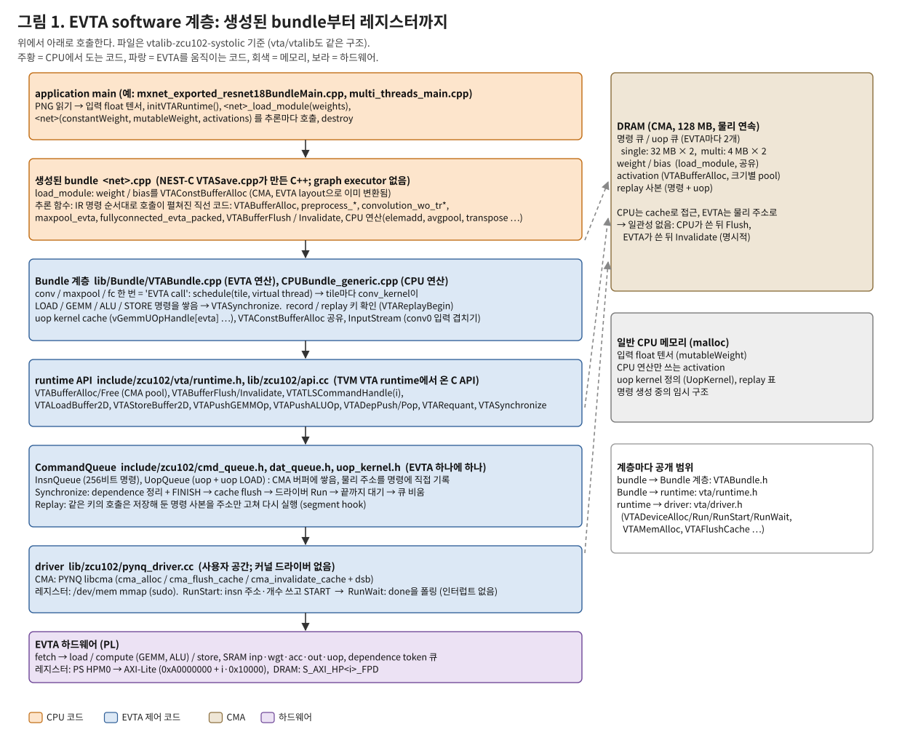

| 계층 | 하는 일 |
|---|---|
| application main | 추론 반복 |
| 생성 bundle | 직선 코드 |
| Bundle 계층 (`VTABundle.cpp`) | EVTA call 하나 = schedule에 따라 tile마다 명령 생성 |
| runtime API / CommandQueue | 명령 큐, 동기화, replay |
| driver (`pynq_driver.cc`) | `/dev/mem` 레지스터, libcma 메모리, 폴링 |

- 메모리는 CMA 128 MB 하나다. cache 일관성이 없어서 flush와 invalidate를 명시적으로 한다.

→ [runtime §1](evta_runtime_arch.md)

## 7. runtime이 다루는 하드웨어 모델

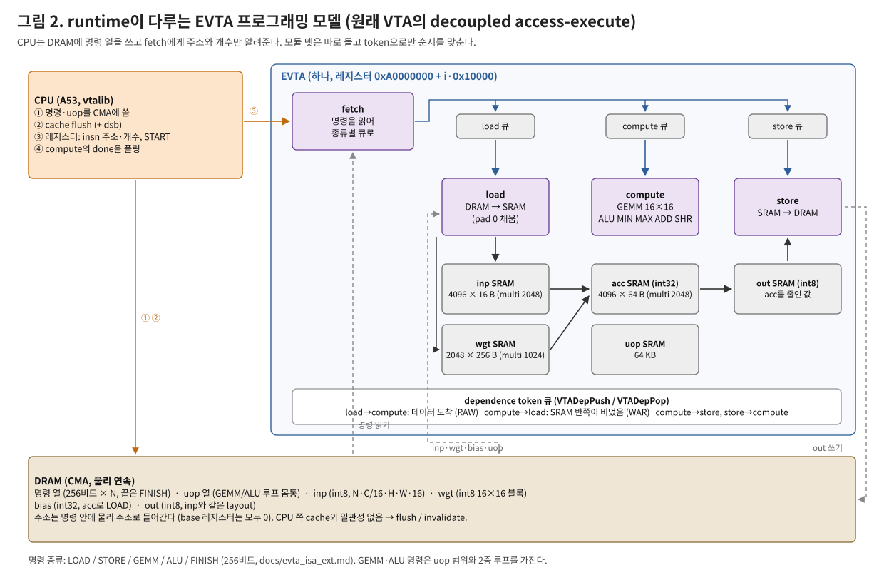

- **CPU 쪽:** CPU는 명령 열을 DRAM에 쓰고 fetch에게 주소와 개수만 준다.
- **EVTA 쪽:**
  - load / compute / store가 각자의 큐에서 명령을 꺼내 돌고, token으로 순서를 맞춘다.
  - 명령 안의 DRAM 주소는 물리 주소다. 그래서 버퍼가 바뀌면 명령을 고쳐야 한다(replay의 재배치).

→ [runtime §2](evta_runtime_arch.md)

## 8. EVTA call 하나

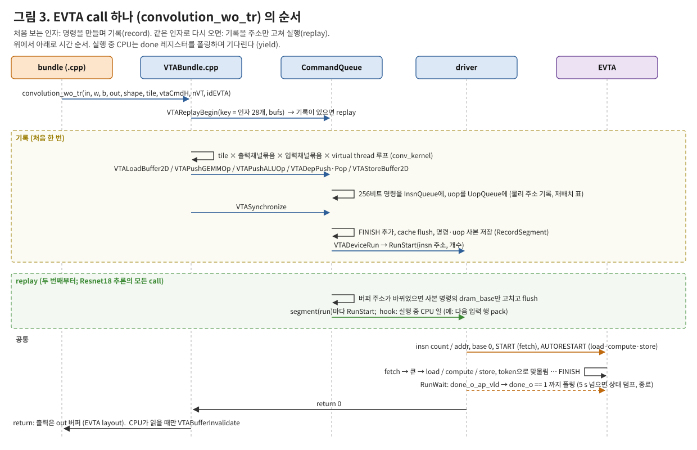

- **첫 호출(기록):** 명령을 만들어 실행하면서 사본을 남긴다.
- **두 번째 호출부터(replay):** 사본의 주소만 고쳐 바로 실행한다.
- **실행 중 CPU:** done을 폴링한다. segment hook으로 다음 입력 행을 준비하는 경우만 예외다.

→ [runtime §4, §5](evta_runtime_arch.md)

## 9. conv tile 하나의 명령

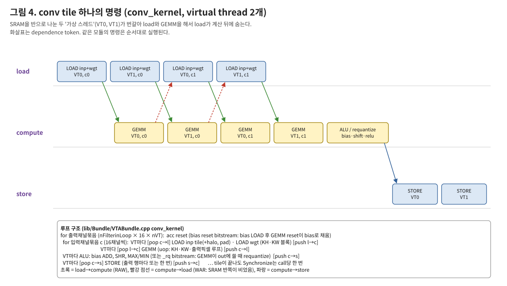

- SRAM을 반으로 나눈 두 virtual thread가 번갈아 LOAD와 GEMM을 해서, 데이터 이동을 계산 뒤에 숨긴다(원래 VTA의 방식).
- 그 뒤 bias, shift, relu는 ALU가 하거나 `_rq` bitstream에서는 GEMM의 쓰기 단계가 하고, STORE로 끝난다.

→ [runtime §6.3](evta_runtime_arch.md)

## 10. 추론 한 번의 시간

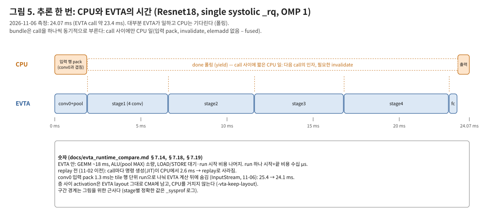

- **Resnet18:**
  - EVTA call 21개, run 27개다. CPU가 일하는 곳은 입력 pack(conv0과 겹침)과 출력뿐이다.
  - EVTA 안에서는 GEMM이 약 18 ms이고, 나머지가 데이터 대기와 run 비용이다.
- **다른 모델:** Resnet50 82.2 ms, VGG16-CIFAR 7.27 ms, MobileNetV2 1110 ms(CPU conv가 97 %).

→ [runtime §7](evta_runtime_arch.md)

## 11. EVTA 여러 개

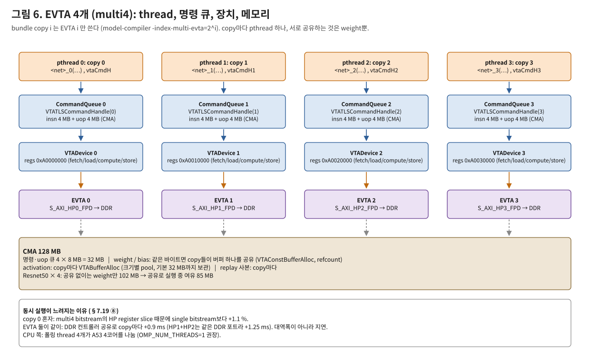

- **구성:** 같은 모델의 copy 4개가 각자의 thread, 명령 큐, EVTA를 쓴다. 공유는 weight(CMA)와 DDR뿐이다.
- **성능:** Resnet18 copy마다 24.6 ms다. 4개 동시가 1개보다 느린 이유는 HP 포트 앞 register slice와 DDR 공유 지연이다.

→ [runtime §8](evta_runtime_arch.md)

## 12. 다른 스택과 비교할 때의 질문 목록

비교 세션에서 상대 스택마다 같은 질문으로 표를 채우면 EVTA 쪽 답과 바로 맞댈 수 있다. EVTA의 답은 각 문서의 "비교할 때 볼 점" 절에 있다([frontend §7](evta_compiler_frontend.md), [backend §8](evta_compiler_backend.md), [runtime §10](evta_runtime_arch.md)).

1. **입력과 그래프:** 모델 형식, 그래프 IR, 정적/동적 shape.
2. **연산 배치:** 가속기와 CPU 연산을 어떻게 나누나 (op 단위 조건, subgraph partition, cost model).
3. **양자화:** per-channel 여부, 비대칭 여부, scale을 정수 곱셈+shift로 하나 shift만 하나, 보정 데이터 양, QAT 지원.
4. **layout과 fusion:** 가속기 layout을 어디서 정하나, 어떤 fusion을 어떤 단계에서 하나.
5. **schedule과 tiling:** 표, 탐색, cost model, auto-tuning.
6. **출력물:** 명령 바이너리(AOT), C/C++ 코드, 런타임에 그래프를 해석.
7. **runtime 실행 모델:** 동기/비동기, command ring, 여러 job 겹치기, CPU 연산과 겹치기.
8. **driver:** 커널 드라이버 / UIO / 사용자 공간, 인터럽트 / 폴링, 메모리 할당자(CMA, IOMMU), cache 일관성.
9. **여러 가속기:** 같은 모델 복제 / 모델 분할 / 장치 스케줄러.
10. **측정 가능성:** 층별 시간, 하드웨어 카운터, 명령 덤프.
