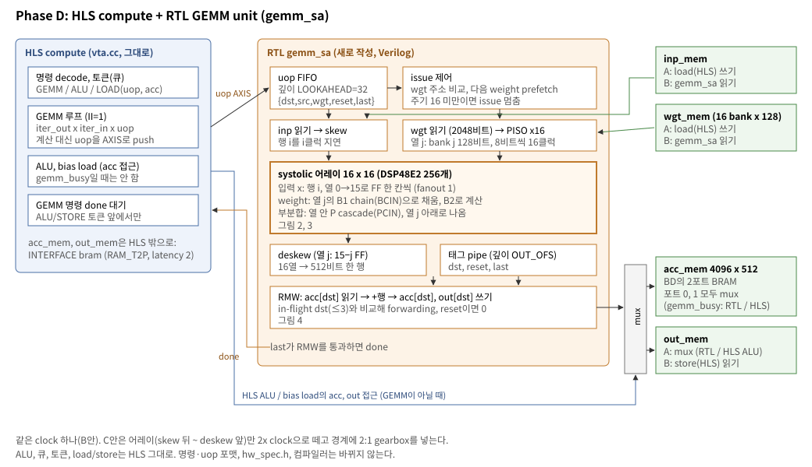
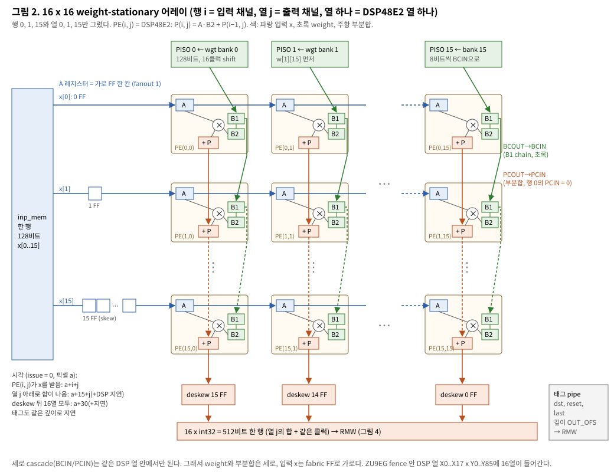
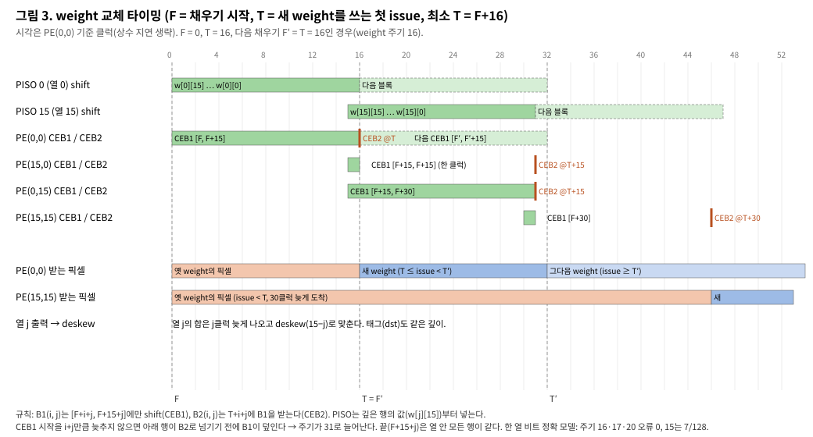
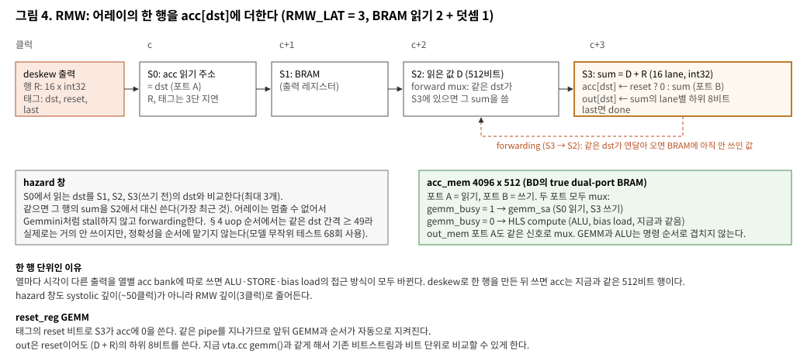

# EVTA systolic GEMM — Phase D 설계서

최종 갱신: 2026-10-27. 상위 문서: `docs/evta_systolic.md`(계획 §0~§7, 조사 §9, 실험 §8·§10).
이 문서는 Phase D(RTL 구현)의 설계다. 무엇을 만들고, 어떻게 연결하고, 어떤 순서로 검증하는지를 적는다.
이 설계는 C++ 사이클 모델(`vta-hw-zcu102-systolic/hardware/xilinx/sim/systolic_model.cc`)로 동작을 확인한 구조를 RTL로 옮긴다.

## 1. 목표와 범위

- **목표**: `vta.cc` `gemm()`(HLS, 16입력 덧셈 트리, II=1)을 RTL weight-stationary systolic 어레이로 바꾼다.
  결과는 지금 비트스트림과 **비트 단위로 같아야** 한다(acc, out 모두).
- **바뀌지 않는 것**: 명령·uop 포맷, `hw_spec.h`, NEST-C 컴파일러, fetch/load/store, ALU, 큐와 토큰.
  런타임은 Phase B의 uop 순서(`vtalib-zcu102-systolic`)를 쓴다(이미 보드에서 기존 HW와 결과가 같음을 확인).
- **클럭**: 먼저 클럭 하나(B안, 목표 400 MHz, 처음에는 333에서 기능 확인). 어레이만 2배 클럭으로 떼는 C안(~600 MHz)이 가능하도록 경계를 레지스터와 스트림으로만 둔다(§9).
- **대상**: single(16/16/19/18, fence `y219`)부터. multi2, multi4는 같은 모듈을 EVTA마다 넣는다.

## 2. 전체 구조

- **HLS compute**는 GEMM 명령을 만나면 지금처럼 `iter_out x iter_in x uop` 루프를 II=1로 돌되, 계산 대신 uop 하나마다
  `{dst, src, wgt, reset, last}`를 AXIS 스트림으로 내보낸다. 끝나기를 기다리지 않고 다음 명령으로 간다.
- **RTL `gemm_sa`**가 스트림을 받아 inp/wgt를 읽고, 어레이로 계산하고, acc/out에 쓴다. 명령 하나가 끝나면(`last`가 RMW를 통과) done 토큰을 AXIS로 HLS에 돌려준다.
- **acc_mem**은 HLS compute 밖(BD의 BRAM)으로 꺼낸다. 지금은 compute 안의 4096 x 512 RAM(`ARRAY_RESHAPE complete dim=2`, `DEPENDENCE inter false`)이다.
  **out_mem**은 지금도 BD BRAM(`INTERFACE bram`)이라 포트 A 앞에 mux만 단다.
- acc_mem 포트 둘과 out_mem 포트 A를 `gemm_busy`로 mux한다. `gemm_busy = 1`이면 RTL, 0이면 HLS(ALU, acc LOAD).

## 3. HLS 쪽 변경 (`vta.cc`, `#ifdef VTA_SYSTOLIC`)

| 항목 | 지금 | 바꾼 뒤 |
|---|---|---|
| GEMM 루프 몸체 | inp/wgt/acc 읽기, 256 곱, 덧셈 트리, acc/out 쓰기 | `gemm_uop.write({dst, src, wgt, reset, last})` |
| acc_mem | compute 안 RAM | `INTERFACE bram port = acc_mem`, `RESOURCE core = RAM_T2P latency = 2` (inp_mem과 같은 모양) |
| GEMM 명령 끝 | 루프가 끝나면 끝 | 그대로 다음 명령으로. `outstanding++` |
| 다른 명령 전 | — | acc/out을 건드리는 명령(ALU, acc LOAD, FINISH) 앞과 **store/load로 가는 토큰을 push하기 전**에 `while (outstanding) { gemm_done.read(); outstanding--; }` |

- uop LOAD(uop_mem 쓰기)는 HLS 안에서만 쓰이므로 drain이 필요 없다. 연속한 GEMM 명령 사이에도 drain하지 않는다(§10 모델: 명령마다 drain하면 ResConv10형 88%, 안 하면 99.8%).
- 확인할 것: HLS 2020.1에서 2포트 외부 `bram` 인터페이스 + 512비트 폭 + ALU 루프의 II(지금 ALU는 acc를 읽고 쓰는 루프). 막히면 acc_mem 포트 하나를 HLS 전용으로 두고 RTL이 다른 포트로 RMW 읽기와 쓰기를 번갈아 쓰는 안을 본다(이 경우 RMW 처리량이 반이 되므로 마지막 수단).

## 4. 인터페이스

**uop 스트림 (HLS → RTL, AXIS, 깊이 LOOKAHEAD = 32 FIFO)**

| 필드 | 폭 (single / multi) | 뜻 |
|---|---|---|
| dst | 12 / 11 | acc/out 행 (acc 깊이 4096 / 2048) |
| src | 12 / 11 | inp 행 (4096 / 2048) |
| wgt | 11 / 10 | wgt 블록 (2048 / 1024) |
| reset | 1 | `reset_reg` GEMM |
| last | 1 | 이 GEMM 명령의 마지막 uop |

주소는 HLS가 `uop + iter_out·factor_out + iter_in·factor_in`으로 계산한 최종 값이다(지금 `gemm()`의 `dst_idx/src_idx/wgt_idx`).

**done 스트림 (RTL → HLS, AXIS, 1비트)**: `last`인 행이 RMW에서 쓰이면 하나 push.

**메모리 포트**

| 메모리 | RTL이 쓰는 포트 | 폭 | 지연 |
|---|---|---|---|
| inp_mem | B (읽기) | 128비트 = x[0..15] | 2 (출력 레지스터) |
| wgt_mem | B (읽기, 16 bank 동시) | 16 x 128 = 2048비트, bank j = w[j][0..15] | 2 + PISO 적재 1 |
| acc_mem | A 읽기, B 쓰기 (mux) | 512비트 = 16 x int32 | 2 |
| out_mem | A 쓰기 (mux) | 128비트 = 16 x int8 | — |

## 5. 어레이

- PE(i, j) = DSP48E2 하나. 열 j(출력 채널)가 DSP 열 하나이고, 행 i(입력 채널)가 그 열의 i번째 DSP다.
- **DSP48E2 설정**(UG579, `docs/evta_systolic.md` §9.3):

| 속성 | 값 | 이유 |
|---|---|---|
| `A_INPUT` | DIRECT | x는 fabric FF로 가로로 온다(A cascade는 세로뿐) |
| `AREG` | 1 | 가로 FF 한 칸 역할 |
| `B_INPUT` | DIRECT(행 0), CASCADE(행 1~15) | 행 0은 PISO, 나머지는 위 DSP의 BCOUT |
| `BREG`, `BCASCREG` | 2, 1 | B1 = 채우기 chain(BCOUT은 B1에서), B2 = 계산용 |
| `INMODE[4]` | 0 | 곱셈기가 B2를 쓴다 |
| `MREG`, `PREG` | 1, 1 | 곱 1단 + P 1단 |
| `OPMODE` | 행 0: P = M, 행 1~15: P = M + PCIN | 부분합 세로 cascade |
| `CEB1`, `CEB2` | §6의 wavefront | weight 교체 |

- **지연 맞추기**: x는 열마다 1클럭(fabric FF → AREG), 부분합은 행마다 1클럭(PREG → PCIN). 그래서 픽셀 a는 PE(i, j)에 a+i+j에 오고,
  위에서 내려오는 부분합도 같은 픽셀의 것이다. MREG 등 PE 안의 지연은 모든 PE에 같은 상수라 열 출력 시각에 상수로 더해질 뿐이다.
- **skew**: inp 한 행을 받아 x[i]를 i클럭 늦춘다(FF 0+1+…+15 = 120개 x 8비트 = 960).
- **가로 전달**: 열 j → j+1은 fabric FF 한 칸(16 x 15 x 8 = 1,920 FF). 모두 fanout 1이다. 지금 HLS의 inp → DSP fanout 346이 400 MHz 실패의 주원인이었다(`evta_systolic.md` §8).
- **출력**: 열 j의 합(16항, int21이면 충분, DSP P는 48비트)이 열 아래로 나온다. 열 j를 15−j클럭 deskew하면 16열이 같은 클럭에 한 행이 된다(FF 120 x 21비트 = 2,520).

## 6. weight 채우기와 교체

- **PISO**: 열 j마다 128비트 병렬 적재, 8비트씩 16클럭 shift. wgt_mem bank j(= w[j][0..15])를 받아 **w[j][15]부터** 넣는다(가장 깊은 행 15가 먼저 들어가야 끝까지 내려간다).
- **CEB1(i, j)**: [F+i+j, F+15+j]에서만 1. 시작을 i+j만큼 늦추고 끝은 열 안에서 같다. 그래야 B2가 아직 쓰는 동안 B1이 덮이지 않으면서 주기 16이 된다.
- **CEB2(i, j)**: T+i+j에 한 클럭. 새 weight로 계산하는 첫 픽셀이 PE(i, j)에 오는 바로 그 시각이다.
- **제약**: T ≥ F+16(채우기가 끝나야 래치), 다음 F′ ≥ T(래치가 끝나기 전에 B1을 다시 채우지 않음). 그래서 weight 주기는 최소 16클럭이다.
- **CE 생성**: 열 0, 행 0의 시작·끝 펄스를 만들고, 대각선 shift register(행 +1, 열 +1마다 한 클럭)로 PE마다 늦춘다. Gemmini가 `propagate` 비트를 데이터와 같은 대각선으로 흘리는 것과 같은 방식이다(`evta_systolic.md` §9.1).
  CEB1 끝(F+15+j)은 열마다 따로(열 +1마다 한 클럭) 둔다.
- **issue 제어**(모델의 controller와 같다):
  1. FIFO 머리 uop의 wgt가 지금 B2의 블록과 같으면 issue한다.
  2. 다르면, 그 블록을 이미 채우고 있으면(prefetch) T = 지금으로 래치하고 issue한다. 단 F+16이 안 지났으면 기다린다(stall, FIFO가 HLS를 backpressure).
  3. 래치한 직후 FIFO(최대 32개)에서 다음으로 다른 wgt를 찾아 채우기를 시작한다(F = max(T, 그 uop이 FIFO에 들어온 때 + wgt 읽기 지연)).
  4. reset uop은 weight를 쓰지 않으므로 바로 issue한다.
- §4의 uop 순서에서는 같은 weight가 ≥ 49클럭 이어지므로(ResConv10 7x7), 채우기 16클럭은 계산 뒤에 숨는다(모델 가동률 99.8%).

## 7. 출력과 RMW

- 태그 `{dst, reset, last}`는 issue부터 RMW 입력까지 데이터와 **같은 깊이**(`OUT_OFS`)의 shift register로 보낸다. 행이 도착하는 클럭에 그 행의 dst가 같이 도착한다.
- RMW 3단: S0에서 acc[dst] 읽기 → S2에서 읽은 값 D → S3에서 sum = D + R(16 lane int32), acc[dst] ← reset ? 0 : sum, out[dst] ← sum의 하위 8비트.
  **reset의 out도 sum의 하위 8비트다**(지금 `vta.cc` 304·306행과 같게). 그래야 기존 비트스트림과 비트 단위로 비교할 수 있다.
  (사이클 모델 `reference()`는 reset일 때 out = 0으로 두었다. Phase D 1단계에서 모델을 `vta.cc`와 같게 고친다.)
- **forwarding**: S0의 dst를 아직 BRAM에 쓰이지 않은 최근 3행의 dst와 비교해, 같으면 가장 최근 sum을 D 대신 쓴다. BRAM은 같은 클럭 읽기·쓰기에서 옛 값을 주도록(READ_FIRST) 두고 forwarding으로 덮는다.
- done: `last`인 행이 S3에서 쓰이면 done 스트림에 하나 push한다.

## 8. 지연과 자원 예산

| 구간 | 클럭 (모델 값) |
|---|---|
| issue → inp 행이 skew 입구 | 2 (`L_INP`) |
| skew + 가로 + 세로 + deskew | 31 (+ DSP 안 상수 지연) |
| RMW | 3 (`RMW_LAT`) |
| 합 `OUT_OFS` | 34 + DSP 상수. RTL 시뮬레이션에서 확정한다 |

| 자원 | 양 | 비고 |
|---|---|---|
| DSP48E2 | 256 | 지금 HLS GEMM과 같은 수(곱셈 256). 덧셈 트리의 LUT/CARRY가 없어진다 |
| FF | skew 960 + 가로 1,920 + deskew 2,520 + PISO 2,048 + 태그 ~34x26 + RMW ~1,600 ≈ 1만 | |
| BRAM | acc_mem 4096 x 512 (지금 compute 안의 것을 BD로 옮김, 수는 같다) | |

## 9. 클럭과 C안 확장점

- B안: `gemm_sa` 전체가 EVTA 클럭(`evta_clk`) 하나. HP 포트는 이미 333 MHz로 분리되어 있다(multi4 `vivado.tcl`, `70ccf2f7`).
- C안: **skew 출력 ~ deskew 입력**(어레이와 CE 생성기, PISO)만 2배 클럭으로 뗀다. 같은 MMCM의 edge-aligned 2x 출력(DPU, PG338),
  경계는 2:1 gearbox(FireFly v2). 빠른 쪽에는 DSP와 FF만 둔다. 그래서 B안에서도 어레이 안에 LUT 논리를 넣지 않는다.

## 10. 검증 계획

| 단계 | 무엇 | 통과 기준 |
|---|---|---|
| D1 | 모델 정리: `reference()`의 reset out을 `vta.cc`와 같게, 모델에 테스트 벡터 덤프(명령, uop, inp/wgt/acc 초기값, 기대 acc/out) 추가 | 모델 300개 다시 일치 |
| D2 | RTL 어레이 단독 TB(xsim): PE 16x16 + skew/deskew + CE 생성기. 한 weight, 연속 weight(주기 16, 17, 20, 15) | 모델과 비트 일치, 주기 15에서 오류(검사가 오류를 잡는지) |
| D3 | `gemm_sa` 전체 TB: uop 스트림 + BRAM 모델 + RMW, D1의 벡터 | 300개 비트 일치, `OUT_OFS` 확정 |
| D4 | 어레이 OOC 합성(Vivado 2020.1, y219 fence 안 DSP 열에 pblock) | 400 MHz(B) 여유, 2x 클럭 상한 측정(C안 판단 자료) |
| D5 | HLS + RTL PL 시뮬레이션: 기존 `build/hardware/xilinx/cosim/simbd`(PS 대신 AXI VIP)에 `gemm_sa` 연결, `prog_*.hex` 케이스 | gemmprobe 케이스가 지금 HW 시뮬레이션과 같음 |
| D6 | single 비트스트림(333 MHz 먼저), `vta_synth_notes` §2.5 순서 | timing(WNS/WHS/WPWS), stuckchk 0 extra, Y219 PIP 0 |
| D7 | 보드: probes(gemmprobe, sramscan, donerace), 번들 golden 30 + Resnet18 281, `_sysprof` 속도 | 기존 비트스트림과 결과 같음, VTA 시간 비교 |
| D8 | 클럭 올리기(360 → 400), multi2/multi4 | 같은 기준 |

## 11. 파일 계획

`vta-hw-zcu102-systolic/hardware/xilinx/` 아래:

| 파일 | 내용 |
|---|---|
| `rtl/sa_pe.v` | DSP48E2 인스턴스 하나(§5 속성), 행 0/나머지 파라미터 |
| `rtl/sa_array.v` | 16x16 PE, 가로 FF, B/P cascade 연결 |
| `rtl/sa_skew.v`, `rtl/sa_deskew.v` | 입력 skew, 출력 deskew |
| `rtl/sa_wfill.v` | PISO 16개 + CEB1/CEB2 wavefront 생성기 |
| `rtl/sa_ctrl.v` | uop FIFO, issue 제어(§6), 태그 pipe |
| `rtl/sa_rmw.v` | RMW 3단, forwarding, done |
| `rtl/gemm_sa.v` | 위를 묶은 top. AXIS 2개, BRAM 포트 4개, `gemm_busy` |
| `rtl/tb/` | D2, D3 테스트벤치와 모델 벡터 |
| `src/vta.cc` | `#ifdef VTA_SYSTOLIC` 분기(§3) |
| `scripts/vivado.tcl` | `gemm_sa`를 BD에 추가, acc_mem BRAM과 mux, `VTA_SYSTOLIC` 빌드 옵션 |
| `Makefile` | `SYSTOLIC=1` (빌드 dir 이름에 `_sa`) |

## 12. 열린 문제

1. HLS 2020.1: 512비트 2포트 외부 bram 인터페이스와 ALU 루프 II(§3). D5 전에 HLS만 따로 합성해 본다.
2. wgt_mem 2048비트 동시 읽기 → PISO 16개 적재: 지금 wgt → DSP 경로(0.06~0.16 ns 여유)가 PISO 적재 한 번으로 바뀐다. 필요하면 레지스터를 한 단 더 넣는다(채우기 지연 +1, 주기에는 영향 없음).
3. multi4: EVTA마다 `gemm_sa`. DSP 256 x 4 = 1,024(ZU9EG 2,520). y219 fence와 위/아래 pblock 배치는 Phase A의 multi4 흐름을 따른다.
4. `reset_reg`의 out 의미는 §7처럼 지금 HW와 같게 한다. 런타임이 reset GEMM의 out을 쓰는지는 따지지 않는다(같게 만들면 상관없음).
