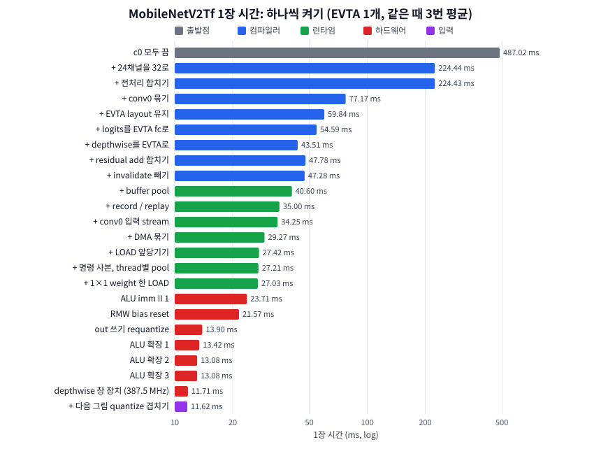
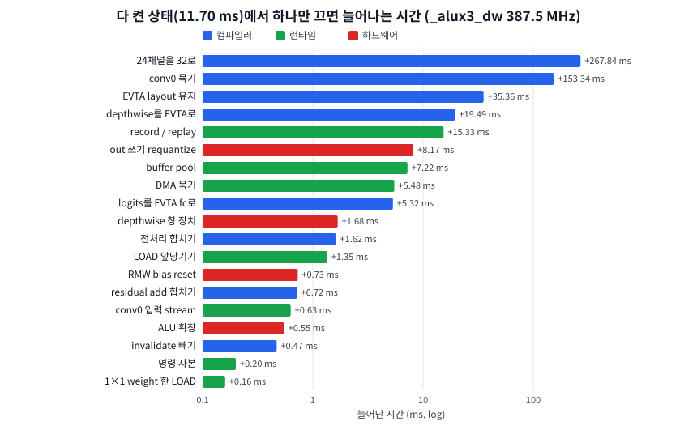

# FPGA NPU에서 MobileNetV2를 487 ms에서 11.6 ms로, EVTA 4개로 291 fps: 컴파일러·런타임·하드웨어를 하나씩 켜며 잰 기여도

2026-11-27. ZCU102(XCZU9EG) 위 EVTA와 NEST-C. 측정은 모두 이 날 같은 때 번갈아 3번씩 잰 평균이다.

## 초록

ZCU102 FPGA에 올린 int8 NPU **EVTA**(16 × 16 GEMM, VTA 계열)와 그 컴파일러 NEST-C(Glow 기반)로 TF-slim MobileNetV2
(ImageNet, 0.658 GOP)를 돌렸다. AMD가 같은 보드의 DPU(B4096 하나, 1 thread)로 낸 270 fps를 넘는 것이 목표였다.

MobileNetV2는 처음에는 EVTA에 거의 맞지 않았다.
- depthwise conv 17개, 채널 24인 conv, 비대칭 pad의 첫 conv, 1001개 출력의 logits가 모두 EVTA 조건 밖이었다.
- 그래서 대부분이 CPU에서 돌았다.

우리가 만든 기능은 거의 모두 켜고 끌 수 있다. 컴파일러 옵션, 런타임 변수, bitstream이 모두 스위치다. 그래서 모두 끈 상태에서 하나씩 켜며, 같은 실행 조건에서 번갈아 쟀다.

- **EVTA 1개, 모두 끈 상태:** 487.0 ms(2.1 fps, 1.4 GOPS)
- **컴파일러 8단계:** 47.3 ms(×10.3). EVTA에 보내는 연산을 늘렸다.
- **런타임 7단계:** 27.0 ms(×1.75). 명령 재사용, DMA 묶기, LOAD 앞당기기.
- **하드웨어 7판:** 11.71 ms(×2.3). ALU II 1, bias reset, out 쓰기 requantize, ALU 확장, depthwise 창 장치.
- **입력 quantize 겹치기:** **11.62 ms**(86.0 fps, 56.6 GOPS). 처음보다 **42배** 빠르다.
- **EVTA 4개**(multi4 bitstream, 창 장치): **291.4 fps(192 GOPS)**. DPU S 270 fps의 108 %다.
  float 입력을 매번 quantize하는 조건에서는 280.6 fps(104 %)다.
- ImageNet val 50,000장 top-1은 int8 68.43 %다(float 71.80 %, DPU int8 67.67 %).

다 켠 상태에서 하나씩만 끄는 측정도 했다. 지금 시간을 가장 크게 좌우하는 것은 다음 넷이다.
1. 24채널 conv를 32채널로 넓혀 EVTA에 보내기: 끄면 +268 ms
2. 첫 conv를 묶어 EVTA로: +153 ms
3. 층 사이 EVTA layout 유지: +35 ms
4. depthwise를 EVTA로: +19 ms

하드웨어에서 가장 큰 것은 out 쓰기 requantize(+8.2 ms)다.
단계마다 출력이 정답(282)이고, 실행 중 매 추론의 출력이 첫 추론과 같다(0 wrong).

## 1. 서론

FPGA NPU를 만드는 쪽에서 가장 흔한 질문은 "같은 FPGA의 상용 IP(AMD DPU)에 견주면 어떤가"다.
- 우리 EVTA는 peak가 작다. 1개 204.8 GOPS(400 MHz)로, DPU B4096 1,151 GOPS의 1/5.6이다.
- 그래서 ResNet 같은 큰 모델은 절대 성능에서 뒤진다([evta_dpu_compare.md](evta_dpu_compare.md) §1).
- MobileNetV2는 다르다. DPU도 가동률이 14 %뿐이다. depthwise conv와 작은 층이 많아 곱셈기를 다 쓰지 못한다.
  그래서 소프트웨어와 작은 하드웨어 수정으로 앞설 여지가 있다고 보았다.

이 문서는 그 과정을 처음부터 끝까지, **기능 하나하나가 얼마나 기여했는지 같은 때 잰 숫자로** 보인다.
날짜순 기록을 이어 붙이면 측정 때와 빌드가 달라 단계의 몫이 흔들린다. 여기서는 지금 코드에서 기능을 끄고 켜서 잰다.

**이 문서의 내용:**
1. MobileNetV2가 VTA 계열 NPU에 맞지 않던 다섯 가지 이유와, 그것을 컴파일러에서 푼 방법(§3.1)
2. 런타임과 드라이버에서 호출마다의 CPU 시간과 DMA 시간을 줄인 방법(§3.2)
3. GEMM 뒤 처리와 depthwise를 위한 작은 하드웨어 확장 다섯 가지(§3.3)
4. 하나씩 켜기와 하나씩 끄기 두 방향의 기여도(§5.2, §5.3)
5. EVTA 4개로 DPU S를 넘는 처리량(§5.4)

## 2. 배경

### 2.1 EVTA와 보드

| 항목 | 값 |
|---|---|
| 보드 | ZCU102, XCZU9EG. Cortex-A53 4코어 1.2 GHz, DDR4. PYNQ 2.4 |
| EVTA | VTA 계열 int8 NPU(ETRI). 명령 4종(LOAD, GEMM, ALU, STORE), 16 × 16 int8 GEMM, acc int32 |
| 우리 하드웨어 | systolic GEMM(`gemm_sa`, weight 고정형) 400 MHz. single(EVTA 1개)과 multi4(EVTA 4개, HP 포트 4개) |
| peak | 16 × 16 × 2 × 400 MHz = 204.8 GOPS(1개), 819.2 GOPS(4개). 387.5 MHz판은 198.4 GOPS |
| 비교 대상 | AMD DPU `DPUCZDX8G` B4096 @ 281 MHz, 1,151 GOPS. ZCU102에 3개. Vitis AI Model Zoo 수치 |

EVTA는 cache-coherent하지 않다. CPU와 EVTA가 같은 DDR을 쓰므로, 주고받을 때마다 cache flush / invalidate가 필요하다.
명령은 CPU의 vtalib가 만들어 command queue로 보낸다.

### 2.2 NEST-C

NEST-C는 ETRI가 Glow 위에 만든 NPU 컴파일러다.
1. ONNX 모델을 Glow 그래프로 읽는다.
2. profile(200장 calibration)로 int8 양자화한다.
3. VTA backend가 bundle을 만든다. bundle은 C++ 코드(`.cpp`)와 weight 파일이다. 층마다 vtalib 함수를 부른다.

bundle을 보드에서 vtalib와 함께 빌드하면 실행 파일이 된다.
- 컴파일러 옵션(`-vta-*`)은 bundle에 어떤 호출을 쓸지 정한다.
- 런타임 변수(`EVTA_*`)는 vtalib가 그 호출을 어떻게 수행할지 정한다.
- vtalib는 올라간 bitstream의 이름에서 하드웨어 기능을 읽는다(`_rq`, `_alux3`, `_dw` …). 그래서 같은 실행 파일이 여러 bitstream에서 돈다.

### 2.3 MobileNetV2가 어려운 이유

모델은 TF-slim float MobileNetV2 1.0 224(`mobilenetv2_tf_f32.onnx`, DPU `tf_mobilenetv2_1.0`의 float 모델)다.
EVTA에 보내는 conv / depthwise / fc의 연산은 0.658 GOP(2 × MAC)다.

| 특징 | 개수 | 처음 EVTA에서 막힌 이유 |
|---|---|---|
| depthwise 3 × 3 conv | 17 | VTA GEMM은 채널끼리 더하는 conv만 한다. 채널마다 따로 하는 conv는 CPU였다 |
| 채널 24인 1 × 1 conv | 4 | EVTA는 16채널 단위다. 24는 16의 배수가 아니다 |
| 첫 conv(3 × 3 / 2, 입력 3채널, TF SAME pad 0 0 1 1) | 1 | pad가 위아래로 다르다(비대칭) |
| logits(1 × 1 conv, 출력 1001) | 1 | 1001은 16의 배수가 아니다 |
| relu 없는 residual add | 10 | 지금까지 합친 residual은 relu가 붙은 것뿐이었다 |
| global avgpool | 1 | CPU |

## 3. 방법: 무엇을 바꿨나

기능마다 스위치 이름을 함께 적는다. 표의 단계 이름은 §5의 표와 같다.

### 3.1 컴파일러 (`lib/Backends/VTA/VTA.cpp`, `VTASave.cpp`)

| 단계 | 스위치 | 하는 일 |
|---|---|---|
| 24채널을 32로 | `-vta-pad-channels` | 24채널 conv / add의 activation을 0 weight로 32채널로 넓힌다. 이웃 conv까지 EVTA로 간다 |
| 전처리 합치기 | `-vta-fuse-preprocess` | float 입력의 quantize와 transpose를 첫 conv의 입력 복사에 합친다(NEON 16픽셀씩) |
| conv0 묶기 | `-vta-conv0-pack` | 3 × 3 / 2 over 3채널을 2 × 1 / 1 over 18채널로 바꾼다. stride의 두 행과 3탭을 채널에 넣는다. 비대칭 pad도 받는다 |
| EVTA layout 유지 | `-vta-keep-layout` | conv 사이 activation을 EVTA layout(N{C/16}HW16)으로 둔다. 층마다 NHWC로 transpose하지 않는다 |
| logits를 EVTA fc로 | `-vta-evta-fc` | 1 × 1 입력 위 1 × 1 conv(1001 출력)를 EVTA fc로 한다. 마지막 16 묶음은 CPU |
| depthwise를 EVTA로 | `-vta-evta-depthwise` | depthwise 3 × 3를 탭마다 16 × 16 대각 weight의 GEMM으로 한다. 채널별 shift는 ALU SHR |
| residual add 합치기 | `-vta-fuse-residual(-norelu)`, `-vta-conv-epilogue`, `-vta-evta-elemadd` | residual add를 앞 conv의 STORE 직전(epilogue)에 한다. relu 없는 add는 requantize 반올림으로 정확히 맞춘다 |
| invalidate 빼기 | `-vta-skip-evta-invalidate` | 다음 EVTA 호출만 읽는 출력에는 cache invalidate를 부르지 않는다 |

양자화는 늘 같다. KL + power-of-two MSE calibration이고, depthwise weight만 채널별 scale이다(`-enable-channelwise-depthwise`).
채널별 scale이 없으면 분류가 틀린다(2026-11-07 ETRI QAT 모델에서 293). EVTA conv의 shift는 반올림한다(`-vta-round-shift`).
이 둘은 정확도에 필요한 것이라 끄지 않는다.

### 3.2 런타임 (`vtalib-zcu102-systolic`)

| 단계 | 스위치 | 하는 일 |
|---|---|---|
| buffer pool | `EVTA_BUF_POOL_MB` | 해제한 VTA buffer를 크기별로 모아 다시 쓴다. 매 추론의 `cma_alloc` ioctl이 없어진다 |
| record / replay | `EVTA_REPLAY` | 첫 호출에서 EVTA 명령과 uop을 기록하고, 다음부터는 buffer 주소만 바꿔 다시 보낸다 |
| conv0 입력 stream | `EVTA_INPUT_STREAM` | 첫 conv를 tile 행마다 run으로 나눈다. 다음 행의 입력 묶기를 앞 run과 겹친다 |
| DMA 묶기 | `EVTA_CONV_BURST` | 연속인 행을 한 행의 LOAD / STORE로, 1 × 1 conv의 weight를 한 LOAD로 |
| LOAD 앞당기기 | `EVTA_LOAD_AHEAD` | 다음 filter group / tile의 LOAD를 앞 GEMM의 token으로 미리 시작한다. 상주 weight는 다시 LOAD하지 않는다 |
| 명령 사본, thread별 pool | `EVTA_REPLAY_VARIANTS`, `EVTA_BUF_POOL_SHARED` | buffer 주소 조합마다 명령 사본을 두어 주소 고치기와 flush를 없앤다. pool은 thread마다 |
| 1 × 1 weight 한 LOAD | `EVTA_WGT_FIT` | wgt 몫을 넘는 1 × 1 conv는 filter 묶음을 줄여 한 LOAD에 넣는다 |

### 3.3 하드웨어 (`vta-hw-zcu102-systolic`, bitstream)

| 판 (bitstream 이름의 표식) | 하는 일 |
|---|---|
| 기준 `_sa_400mhz` | systolic GEMM 400 MHz. ALU는 ETRI와 같다 |
| ALU imm II 1 `_alu1` | immediate가 있는 ALU 명령을 한 step에 acc 읽기 1번, 쓰기 1번으로 한다(II 2 → 1) |
| RMW bias reset `_bias` | GEMM reset이 0 대신 미리 LOAD한 bias를 쓴다. bias ADD 명령이 없어진다 |
| out 쓰기 requantize `_rq` | GEMM / ALU가 out에 쓸 때 반올림 shift와 clip을 한다. ALU SHR / MAX / MIN 세 번이 없어진다. relu 없는 residual 합치기도 이것으로 정확해진다 |
| ALU 확장 1 / 2 / 3 `_alux`, `_alux2`, `_alux3` | MUL, LUT, 축소 연산 등 ALU 연산 추가, II 1 slot. MobileNetV2에서는 avgpool이 EVTA로 간다 |
| depthwise 창 장치 `_dw` | 입력을 한 픽셀씩 읽고 최근 3픽셀을 register에 둔다. 가로 3탭을 한 step에, 세로 3탭은 acc에 더한다. 대각 GEMM보다 step이 1/3이다 |

창 장치판은 400 MHz에서 −0.070 ns가 남았다. 그래서 single은 PLL만 387.5 MHz로 낮췄다([evta_dw_hw_report.md](evta_dw_hw_report.md) §4).
multi4는 400 MHz 그대로이고 HP 포트만 304 MHz다(§3).

### 3.4 입력

- 기본 측정은 **float 입력**이다. 매 추론이 그림의 float를 읽어 첫 conv의 입력 복사에서 quantize한다. DPU의 end-to-end 수치와 가장 가까운 조건이다.
- `.i8`: 미리 quantize해 둔 int8을 읽는다. quantize가 시간 밖이다.
- `INPUT_PIPELINE=1|2`: 앞 그림의 EVTA 연산이 도는 동안 다음 그림을 quantize해 둔다([mobilenetv2_optimize_sw_hw_allmodels.md](mobilenetv2_optimize_sw_hw_allmodels.md) §10).
  - `1`: 둘째 thread가 한다.
  - `2`: copy가 EVTA를 기다리는 polling 사이에 한다.

## 4. 실험 방법

| 항목 | 내용 |
|---|---|
| 코드 | git `be62db8`(2026-11-27). 컴파일러 바이너리는 `0b1439b` 소스(보드 `Debug2_remote`) |
| bundle | `vtabundles_xcmpl/ablation_mnv2.sh gen`: 같은 profile(`mobilenetv2_tf_calib_n200_b2048.yaml`)로 옵션만 바꿔 18개. 다 켠 bundle은 지금 쓰는 bundle과 `.cpp` / weight 모두 바이트까지 같다 |
| 실행 파일 | `ablation_mnv2.sh build`: 보드에서 systolic vtalib(`build_sysabl`)와 HLS vtalib(`build_abl`)로. main은 공통 main(`multi_threads_main.cpp`) |
| 재는 법 | `sudo ablation_mnv2.sh run ladder|loo|hls`. 구성마다 bitstream을 다시 올리고 4 × 25장. `THROUGHPUT 1`의 1장 시간. 목록 전체를 한 바퀴로 3바퀴 돌려 평균했다 |
| 조건 | OMP 1(CPU thread 1개), 실시간 우선순위 없음. 그림 `cat_285.png`, float 입력(§3.4) |
| 흔들림 | 같은 구성 3번의 차이가 0.5 % 안. multi4 4개 동시는 ±3–5 % |
| 맞는지 | 73개 구성 모두 분류 282, 0 wrong |
| 연산량 | 0.658 GOP. fps = 1000 / ms, GOPS = 0.658 × fps |

**끌 수 없는 것.**
- Resnet18 작업에서 NEON으로 다시 쓴 CPU 코드(transpose, depthwise `cw_convolution`, fc, quantize)
- 채널별 depthwise 양자화, 반올림 shift
- schedule 표(`VTASchedules.h`)

이것들은 "모두 끔"(`c0`)에도 들어 있다. 그래서 `c0`는 ETRI 원본보다 빠른 출발점이다.
- 날짜순 기록의 첫 실측은 2026-11-07 ETRI QAT MobileNetV2다. 1,048 ms였고 분류가 틀렸다(293). depthwise가 per-tensor였고, CPU depthwise도 NEON 이전이었다([mobilenetv2_optimization.md](mobilenetv2_optimization.md) §2).
- ETRI 원본 그대로는 이 보드에서 돌지 않는다. 명령 필드 폭(`memory_type`, `alu_opcode` 2 bit)과 cache flush를 고쳐야 했다. 그래서 측정할 수 없다.

## 5. 결과

### 5.1 출발점

| 구성 | bitstream | 1장 | fps (GOPS) |
|---|---|---|---|
| (기록) 11-07 ETRI QAT MobileNetV2, 그때 코드 | systolic `_rq` | 1,048 ms, 분류 오답 | 1.0 (0.6) |
| 컴파일러 옵션 모두 끔, HLS vtalib(`vta/vtalib`) | ETRI `zcu102_..._16_16_19_18.bin` | 475.4 ms | 2.1 (1.4) |
| 같음 | 우리 HLS 333 MHz `vtahw_..._16_16_19_18.bin` | 474.8 ms | 2.1 (1.4) |
| 같음 | 우리 HLS 380 MHz | 473.2 ms | 2.1 (1.4) |
| **`c0`: 모두 끔**, systolic vtalib, 런타임 변수 모두 끔 | systolic `_sa_400mhz` | **487.0 ms** | **2.1 (1.4)** |

- **bitstream의 클럭은 거의 상관없었다.** HLS 333 → 380 MHz에서 0.3 %만 빨라졌다. 시간의 대부분이 CPU였다.
  - EVTA에 간 것은 1 × 1 conv 30개뿐이었다. 그 밖에 conv 23개(depthwise 17, 24채널 4, 첫 conv, logits)가 CPU였다(`VTA_FUSION_LOG` 요약).
- **HLS vtalib에 컴파일러 옵션을 다 켜면 오히려 느리다(475 → 592 ms).** `vta/vtalib`의 `dw_convolution_evta`는 EVTA 대신 같은 계산을 CPU로 한다.
  `vta/vtalib`에는 이 일의 런타임 기능도 대부분 없다. 그래서 아래 측정은 모두 systolic vtalib로 했다.
- `c0`와 `-vta-pad-channels`를 끈 구성만 confidence가 0.3017이다(나머지는 0.3221). 24채널 conv를 CPU에서 하면 반올림이 달라서다. 분류는 같다.

### 5.2 하나씩 켜기



그림 1. 모두 끈 상태에서 기능을 하나씩 더 켠 1장 시간(log 축). 아래 표 3과 같은 값이다.

표 3. EVTA 1개, float 입력, 같은 때 3번 평균. 컴파일러 단계(`c1`–`c8`)는 런타임 변수를 모두 끄고 기준 bitstream에서 쟀다.
런타임 단계는 `c8` bundle에 변수를 하나씩 켰다. 하드웨어 단계는 다 켠 소프트웨어로 bitstream만 바꿨다.

| # | 단계 | 1장 (ms) | 줄어든 시간 | fps (GOPS) | 배율 (누적) |
|---|---|---|---|---|---|
| 0 | `c0` 모두 끔 | 487.02 | | 2.1 (1.4) | 1.0 |
| 1 | + 24채널을 32로 | 224.44 | −262.6 | 4.5 (2.9) | 2.2 |
| 2 | + 전처리 합치기 | 224.43 | 0.0 | 4.5 (2.9) | 2.2 |
| 3 | + conv0 묶기 | 77.17 | −147.3 | 13.0 (8.5) | 6.3 |
| 4 | + EVTA layout 유지 | 59.84 | −17.3 | 16.7 (11.0) | 8.1 |
| 5 | + logits를 EVTA fc로 | 54.59 | −5.3 | 18.3 (12.1) | 8.9 |
| 6 | + depthwise를 EVTA로 | 43.51 | −11.1 | 23.0 (15.1) | 11.2 |
| 7 | + residual add 합치기 | 47.78 | **+4.3** | 20.9 (13.8) | 10.2 |
| 8 | + invalidate 빼기 (= 지금 bundle) | 47.28 | −0.5 | 21.1 (13.9) | 10.3 |
| 9 | + buffer pool | 40.60 | −6.7 | 24.6 (16.2) | 12.0 |
| 10 | + record / replay | 35.00 | −5.6 | 28.6 (18.8) | 13.9 |
| 11 | + conv0 입력 stream | 34.25 | −0.8 | 29.2 (19.2) | 14.2 |
| 12 | + DMA 묶기 | 29.27 | −5.0 | 34.2 (22.5) | 16.6 |
| 13 | + LOAD 앞당기기 | 27.42 | −1.9 | 36.5 (24.0) | 17.8 |
| 14 | + 명령 사본, thread별 pool | 27.21 | −0.2 | 36.8 (24.2) | 17.9 |
| 15 | + 1 × 1 weight 한 LOAD (= 지금 런타임) | 27.03 | −0.2 | 37.0 (24.3) | 18.0 |
| 16 | ALU imm II 1 `_alu1` | 23.71 | −3.3 | 42.2 (27.7) | 20.5 |
| 17 | RMW bias reset `_bias` | 21.57 | −2.1 | 46.4 (30.5) | 22.6 |
| 18 | out 쓰기 requantize `_rq` | 13.90 | **−7.7** | 71.9 (47.3) | 35.0 |
| 19 | ALU 확장 1 `_alux` | 13.42 | −0.5 | 74.5 (49.0) | 36.3 |
| 20 | ALU 확장 2 `_alux2` | 13.08 | −0.3 | 76.5 (50.3) | 37.2 |
| 21 | ALU 확장 3 `_alux3` (single 기본) | 13.08 | 0.0 | 76.5 (50.3) | 37.2 |
| 22 | depthwise 창 장치 `_alux3_dw` 387.5 MHz | 11.71 | −1.4 | 85.4 (56.2) | 41.6 |
| 23 | + 다음 그림 quantize 겹치기(`INPUT_PIPELINE=1`) | **11.62** | −0.1 | **86.0 (56.6)** | **41.9** |
| (참고) | 22 + `.i8`(quantize를 시간 밖으로) | 11.72 | | 85.3 (56.1) | |

**층별로 나누면.** 컴파일러 487.0 → 47.3 ms(×10.3), 런타임 47.3 → 27.0 ms(×1.75), 하드웨어 27.0 → 11.7 ms(×2.3)다.
처음 시간은 대부분 CPU에서 돈 conv였다. 그래서 컴파일러가 EVTA로 보내는 연산을 늘린 것이 가장 컸다.
그다음은 EVTA 호출 하나하나의 CPU 쪽 시간(명령 만들기, buffer 할당)과 DMA였다. 마지막이 EVTA 안의 step 수였다.

단계별로 읽으면:

- **1 24채널을 32로 (−262.6 ms).** 24채널 1 × 1 conv 4개가 CPU였다. 이웃한 add와 depthwise도 EVTA layout을 쓰지 못했다.
  0 weight로 32채널로 넓히면 연산이 1/3 늘지만, CPU int8 conv보다 비교할 수 없이 빠르다.
- **2 전처리 합치기 (0).** 이 시점에는 첫 conv가 CPU라, 합칠 EVTA 입력 복사가 없다. 3단계 뒤에 효과가 난다(§5.3: 끄면 +1.6 ms).
- **3 conv0 묶기 (−147.3 ms).** 비대칭 pad 때문에 CPU에서 돌던 첫 conv가 EVTA로 갔다.
  3채널 입력은 EVTA의 16채널 단위를 거의 다 놀린다. 2 × 1 / 18채널로 바꾸면 GEMM step도 줄어든다.
- **4 EVTA layout 유지 (−17.3 ms).** 층마다 NHWC ↔ EVTA layout transpose가 없어졌다.
  depthwise(CPU NEON)도 EVTA layout을 바로 읽고 쓴다.
- **6 depthwise를 EVTA로 (−11.1 ms).** 여기서는 런타임 기능이 꺼져 있어서 EVTA 호출마다 명령을 새로 만든다.
  그래서 다 켠 상태에서 끌 때(+19.5 ms, §5.3)보다 작다. 기능끼리의 상호작용이다.
- **7 residual add 합치기 (+4.3 ms, 느려짐).** 기준 bitstream에는 out 쓰기 requantize(`_rq`)가 없다.
  - 그러면 relu 없는 add를 conv에 합쳐도 vtalib가 conv + CPU add로 대신 돈다. 합치기 전의 따로 add보다 느렸다.
  - `_rq` bitstream에서 끄면 +0.7 ms다(§5.3). 이 기능은 하드웨어를 전제로 한 컴파일러 기능이다.
- **9–15 런타임.** 1장에 EVTA 호출이 54개 있다. 호출마다 생기던 일이 큰 몫이었다.
  - `cma_alloc` ioctl은 buffer pool로 없앴다(−6.7 ms).
  - 명령 만들기는 replay로 없앴다(−5.6 ms).
  - DMA는 짧은 행이 많았다. 묶기(−5.0 ms)와 앞당기기(−1.9 ms)로 줄였다.
- **16–18 하드웨어 ALU.** conv 하나의 epilogue는 bias ADD, 반올림 SHR, clip MIN / MAX다. tile마다 acc 전체를 여러 번 읽고 썼다.
  - II 1(−3.3 ms)과 bias reset(−2.1 ms)이 그 횟수를 줄였다.
  - requantize(−7.7 ms)가 가장 컸다. 세 번을 GEMM의 out 쓰기 하나에 넣었다. 그러면서 7단계의 합친 add도 EVTA에서 돌게 됐다.
- **19–21 ALU 확장.** avgpool이 EVTA로 갔다(−0.5 ms). 확장 3의 연산(SQACC, LUTC)은 DeiT의 layer norm용이라 MobileNetV2에는 효과가 없다.
- **22 창 장치 (−1.4 ms, −10.5 %).** depthwise의 GEMM step이 약 1/3이 됐다. 클럭이 3 % 낮은 손해를 넘었다.
- **23 입력.** single에는 노는 코어가 있다. 그래서 다음 그림의 quantize를 둘째 thread가 숨긴다(−0.1 ms).
  `.i8`(11.72 ms)은 이 bitstream에서는 float와 차이가 없었다.

### 5.3 하나씩 끄기



그림 2. 다 켠 상태에서 기능 하나만 끄면 늘어나는 시간(`_alux3_dw` 387.5 MHz, log 축).

표 4. 다 켠 상태(float 입력)에서 하나만 끈 1장 시간. 두 bitstream에서 쟀다.

| 끈 것 | `_alux3` 400 MHz | 늘어남 | `_alux3_dw` 387.5 MHz | 늘어남 |
|---|---|---|---|---|
| (다 켬) | 13.09 | | 11.70 | |
| 24채널을 32로 | 280.34 | +267.3 | 279.54 | +267.8 |
| conv0 묶기 | 166.00 | +152.9 | 165.04 | +153.3 |
| EVTA layout 유지 | 46.86 | +33.8 | 47.06 | +35.4 |
| depthwise를 EVTA로 | 31.00 | +17.9 | 31.19 | +19.5 |
| record / replay | 28.53 | +15.4 | 27.03 | +15.3 |
| out 쓰기 requantize | 21.29 | +8.2 | 19.87 | +8.2 |
| buffer pool | 19.92 | +6.8 | 18.92 | +7.2 |
| DMA 묶기 | 18.67 | +5.6 | 17.18 | +5.5 |
| logits를 EVTA fc로 | 18.40 | +5.3 | 17.02 | +5.3 |
| depthwise 창 장치 | (없음) 13.06 | 0.0 | 13.38 | +1.7 |
| 전처리 합치기 | 14.71 | +1.6 | 13.32 | +1.6 |
| LOAD 앞당기기 | 14.48 | +1.4 | 13.05 | +1.4 |
| RMW bias reset | 13.87 | +0.8 | 12.43 | +0.7 |
| residual add 합치기 | 13.84 | +0.8 | 12.42 | +0.7 |
| conv0 입력 stream | 13.70 | +0.6 | 12.33 | +0.6 |
| ALU 확장 | 13.63 | +0.5 | 12.25 | +0.5 |
| invalidate 빼기 | 13.60 | +0.5 | 12.17 | +0.5 |
| 명령 사본 | 13.29 | +0.2 | 11.90 | +0.2 |
| 1 × 1 weight 한 LOAD | 13.25 | +0.2 | 11.86 | +0.2 |

- **어떤 연산이 CPU로 가는가가 가장 크다.** 위 넷은 끄면 연산 일부가 CPU로 돌아간다.
  - 24채널 conv: 끄면 그 이웃 depthwise 3개도 EVTA layout을 잃는다.
  - 첫 conv
  - depthwise 17개: layout 유지를 끄면 이것들도 CPU로 간다.
- 그다음은 EVTA 호출마다의 CPU 시간(replay, pool), out 쓰기 requantize, DMA 묶기다. 각각 5–15 ms다.
- 끝의 다섯은 0.2–0.6 ms씩이다. 합치면 약 2 ms, 1장의 17 %다.
- 하나씩 켜기와 하나씩 끄기의 몫이 다른 것은 기능끼리 얽혀서다.
  - depthwise: 켜기 −11.1 ms, 끄기 +19.5 ms
  - residual 합치기: 켜기 +4.3 ms, 끄기 +0.7 ms
  - 전처리 합치기: 켜기 0, 끄기 +1.6 ms

### 5.4 EVTA 4개와 DPU

표 5. multi4: copy 넷이 EVTA 하나씩, 각자 그림을 처리한다. 다 켠 소프트웨어(`MultiEVTAMobileNetV2TfTest`, 공유 `_sys` 실행 파일)이고, 같은 때 번갈아 3번 쟀다.

| bitstream | 입력 | 4개 동시 | copy당 1장 | copy 0 혼자 |
|---|---|---|---|---|
| `_amul` (ALU MUL, HP 322 MHz) | float | 242.4 fps (159 GOPS) | 16.52 ms | 13.44 ms |
| | `.i8` | 260.8 fps (172 GOPS) | 15.35 ms | 13.24 ms |
| | `INPUT_PIPELINE=2` | 266.6 fps (175 GOPS) | 15.00 ms | 13.30 ms |
| `_amul_dw` (+ 창 장치, HP 304 MHz) | float | 280.6 fps (185 GOPS) | 14.26 ms | 11.98 ms |
| | **`.i8`** | **291.4 fps (192 GOPS)** | 13.73 ms | 11.78 ms |
| | `INPUT_PIPELINE=2` | 281.9 fps (186 GOPS) | 14.20 ms | 11.87 ms |

- **4개 동시는 혼자보다 copy당 2–3 ms 느리다.** CPU 코어 넷, L2 cache, DDR을 넷이 나눠 쓰기 때문이다.
  EVTA 연산 시간은 같다([mobilenetv2_optimize_sw_hw_allmodels.md](mobilenetv2_optimize_sw_hw_allmodels.md) §6–§7).
- 4개 동시 값은 3번이 ±3–5 % 흔들린다. 예를 들면 `.i8` `_amul_dw` 284.8 / 297.5 / 291.9다. `.i8`과 `=2`의 순서는 bitstream마다 바뀌었다.
- `_amul` → `_amul_dw`는 4개 동시 +12 %(`.i8` 기준)다. 혼자 −11 %다.

표 6. AMD DPU와 견줌(DPU는 Vitis AI Model Zoo, `tf_mobilenetv2_1.0_imagenet_224_224_602M`, ZCU102).

| | peak | fps | GOPS(0.658 기준) | 가동률 | ImageNet val top-1 (int8) |
|---|---|---|---|---|---|
| DPU S (B4096 1개, 1 thread) | 1,151 GOPS | 270.0 | 178 | 15 % | 67.67 % |
| DPU T (B4096 3개) | 3,453 GOPS | 764.4 | 503 | 15 % | 같음 |
| EVTA 1개 (`_alux3_dw`, `INPUT_PIPELINE=1`) | 198.4 GOPS | 86.0 | 56.6 | **28.5 %** | 68.43 % |
| EVTA 4개 (`_amul_dw`, `.i8`) | 819.2 GOPS | **291.4** | 192 | **23 %** | 같음 |
| EVTA 4개 (`_amul_dw`, float 입력) | 819.2 GOPS | 280.6 | 185 | 23 % | 같음 |

- **EVTA 4개가 DPU S를 넘는다.** `.i8`로 108 %, 매번 quantize하는 float 입력으로도 104 %다.
  - DPU의 E2E 수치는 전처리와 후처리를 포함한다. float 입력 줄이 그 조건에 더 가깝다.
  - DPU가 미리 int8로 만든 입력으로 쟀는지는 확인하지 못했다.
- **peak는 DPU S의 0.71배지만 처리량은 1.04–1.08배다.** 가동률이 23 % 대 15 %다.
  - DPU의 GOPS는 우리 연산량 0.658 GOP로 다시 계산했다. 표의 0.602 GOP로 하면 163 GOPS, 14 %다.
- **정확도는 같은 수준이다.** float 기준 손실은 우리 −3.37 %p, DPU −2.46 %p다. float 모델의 정확도가 달라(71.80 / 70.13 %) int8 결과는 우리가 0.76 %p 높다.
  - 정확도는 11-24에 ImageNet val 50,000장으로 쟀다([evta_dpu_compare.md](evta_dpu_compare.md) §6).
  - 그 뒤 모든 단계에서 출력 바이트가 같은 것을 확인했다(conv dump, `EVTA_RES_CHECK`, val 출력 hash).
- **DPU T(3개, 764 fps)에는 아직 멀다.** 같은 FPGA에 EVTA를 더 넣거나 픽셀 병렬(PP8)로 EVTA 하나를 키워야 한다(§6).

### 5.5 다른 모델에 준 영향

MobileNetV2를 위해 만든 기능은 다른 모델의 결과 바이트를 바꾸지 않는다.
- 컴파일러 기능은 해당 모양이 있을 때만 작동한다.
- 하드웨어 확장은 별도 경로다.

시간에 준 영향([evta_dw_hw_report.md](evta_dw_hw_report.md) §5.3, [mobilenetv2_optimize_sw_hw_allmodels.md](mobilenetv2_optimize_sw_hw_allmodels.md) §8):

- **11-25 ~ 26 소프트웨어(명령 사본, thread별 pool, 1 × 1 weight 한 LOAD, bundle 다시 만듦):** 11-24 실행 파일보다 Resnet18 / 50이 −2.5–3.4 %, VGG16 −1.3 % 빨라졌다.
- **창 장치판:** depthwise가 없는 다섯 모델은 빨라지지 않는다. 클럭만큼 느려진다.
  - single(387.5 MHz): +1–3 %. 그래서 single 기본은 `_alux3` 400 MHz 그대로다.
  - multi4(EVTA 400 MHz, HP 304 MHz): VGG16만 −2 %(4개 동시)다. 그래서 multi4 기본은 `_amul_dw`로 바꿨다.

## 6. 논의

**왜 소프트웨어가 먼저였나.**
- 출발점에서 EVTA가 쓴 시간은 13 ms쯤이었다(11-07 기록, EVTA conv 30개).
- 나머지 470 ms 넘게가 CPU였다. 하드웨어를 두 배 빠르게 해도 1장은 1–2 %만 줄었을 것이다.
- 컴파일러가 연산을 EVTA로 옮기고, 런타임이 호출마다의 CPU 시간을 줄인 뒤에야(27 ms) EVTA 안의 step 수가 문제가 됐다.
- 그때 넣은 작은 하드웨어 확장 다섯 가지가 27.0 → 11.7 ms였다.
  - requantize: 명령 필드 몇 개와 out 쓰기 경로
  - 창 장치: EVTA당 LUT 1.3k, BRAM 0

**기능끼리 얽힌다.** 표 3과 표 4의 몫은 다르다(§5.3).
- 런타임 기능이 꺼져 있으면 EVTA로 옮긴 연산도 호출마다 CPU 시간을 낸다.
- 하드웨어가 없으면 어떤 컴파일러 기능은 대체 경로로 돈다(residual 합치기).
- 그래서 "이 기능이 몇 % 줄였다"는 순서에 따라 다르다. 표 4(지금 상태에서의 몫)가 앞으로 무엇을 지킬지 정하는 데 더 맞다.

**남은 시간은 어디인가** (EVTA 1개, 11.6 ms).
- 가동률은 28.5 %다. depthwise는 창 장치로도 GEMM 하한(1.39 ms)의 약 2배다(LOAD / STORE와 requantize 시간).
- conv 쪽에도 GEMM 하한 밖의 시간(LOAD / STORE, epilogue)이 남아 있다.
- 4개 동시에서는 copy당 2–3 ms가 CPU 메모리 경쟁이다.

**측정의 한계.**
- 그림 한 장(`cat_285.png`)을 반복해 쟀다. 입력에 따라 시간이 달라지는 연산은 없지만, cache에는 유리하다.
- OMP 1이다. CPU 코어 4개를 다 쓰는 single은 `-t 4`로 따로 재야 한다.
- 4개 동시 값은 ±3–5 % 흔들린다. 3번 평균이라도 `.i8`과 `=2`처럼 몇 % 차이는 가르지 못한다.

**다음 단계.**
- single 창 장치판을 400 MHz로 맞추기(−0.070 ns 남음). 다른 모델의 1–3 % 손해가 없어진다.
- multi4 HP 클럭 다시 올리기
- depthwise LOAD / STORE 겹치기
- 더 크게는 EVTA 하나를 픽셀 병렬(PP8)로 키워 DPU T에 다가가기([evta_todo.md](evta_todo.md))

## 7. 결론

MobileNetV2는 VTA 계열 NPU의 GEMM 모양에 맞지 않는 층이 많다. 처음에는 EVTA가 1장 487 ms 가운데 3 %도 일하지 않았다.
1. 컴파일러가 그 층들을 EVTA 모양으로 바꿨다. 채널을 넓히고, 첫 conv를 묶고, layout을 유지하고, depthwise를 대각 GEMM으로 했다.
2. 런타임이 호출마다의 CPU와 DMA 시간을 줄였다.
3. 작은 하드웨어 확장이 GEMM 뒤 처리와 depthwise의 step을 줄였다.

이렇게 EVTA 1개로 11.6 ms(42배), EVTA 4개로 291 fps를 얻어 같은 보드의 AMD DPU 하나(270 fps)를 넘었다.
기능마다 스위치가 있어서, 기여도를 같은 때 잰 숫자로 나눌 수 있었다.

## 부록 A. 다시 재는 법

```bash
# 보드, vtabundles_xcmpl/ (Debug2_remote에 model-compiler와 profile이 있어야 한다)
./ablation_mnv2.sh gen                   # bundle 18개 (hw/AblMnv2_<tag>, 하나 18 s)
./ablation_mnv2.sh build                 # build_sysabl(systolic), build_abl(HLS), make -j2
sudo /bin/sh -c "R=3 ./ablation_mnv2.sh run ladder"   # 표 3 (27 구성 x 3번, 약 11 분)
sudo /bin/sh -c "R=3 ./ablation_mnv2.sh run loo"      # 표 4 (40 구성)
sudo /bin/sh -c "R=3 ./ablation_mnv2.sh run hls"      # 표 2 HLS 줄
./ablation_mnv2.sh list ladder           # 구성마다 bundle / bitstream / 변수 보기
# 표 5: bitstream과 입력을 바꿔 가며
sudo /bin/sh -c "BIN=vtahw_zcu102_1x16_i8w8a32_16_15_18_17_4evta_sa_amul_dw_400mhz_hp304_rq.bin INPUT_INT8=1 \
  hw_multievtax4/script/run_prof.sh -s _sys -n 25 MultiEVTAMobileNetV2TfTest"
python3 ../docs/figs/src/make_mnv2_paper_figs.py   # 그림 1, 2
```

이 문서의 측정 log는 보드 `~/JO/ubun_wt/abl_261127_{ladder,loo,hls}/`, `~/JO/ubun_wt/m4_261127/`에 있다.

## 부록 B. 더 자세한 기록

- 날짜순, 단계별 근거와 검증: [mobilenetv2_optimization.md](mobilenetv2_optimization.md)(11-07 ~ 10), [mobilenetv2_optimize_sw_hw_allmodels.md](mobilenetv2_optimize_sw_hw_allmodels.md)(11-25 ~ 27)
- 창 장치 하드웨어: [evta_dw_hw_report.md](evta_dw_hw_report.md)(빌드, 성능), [evta_dw_unit.md](evta_dw_unit.md)(구조)
- ALU 확장, requantize: [evta_isa_ext.md](evta_isa_ext.md), [evta_alux_hw.md](evta_alux_hw.md)
- 런타임: [evta_runtime_compare.md](evta_runtime_compare.md) §7, [evta_runtime_aot.md](evta_runtime_aot.md), [evta_load_ahead_guide.md](evta_load_ahead_guide.md)
- DPU 비교와 정확도: [evta_dpu_compare.md](evta_dpu_compare.md)
- 모든 스위치: [evta_user_manual.md](evta_user_manual.md)
