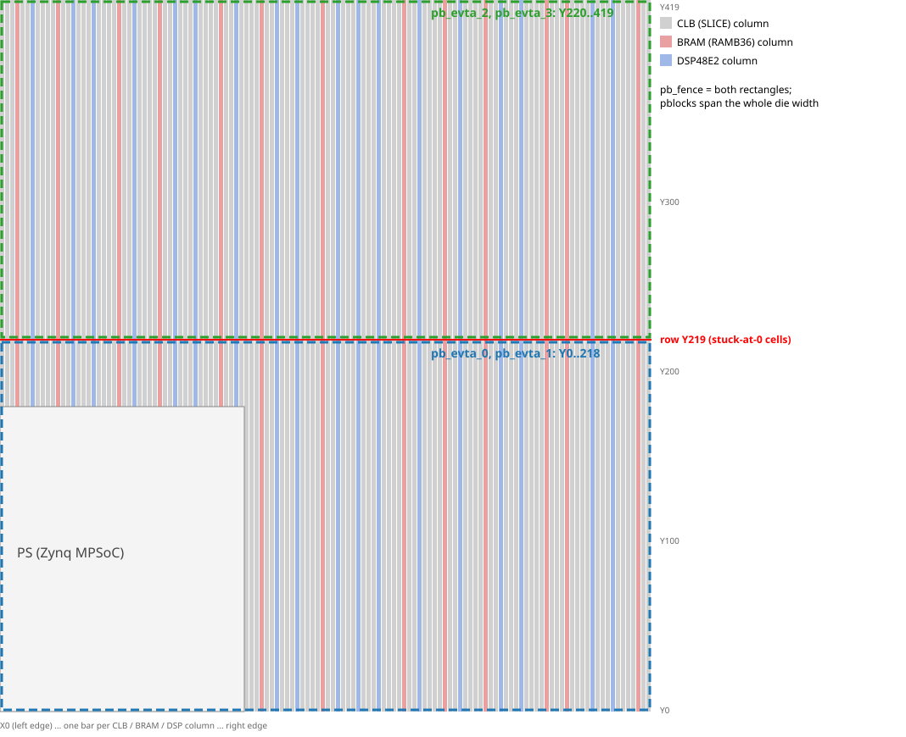
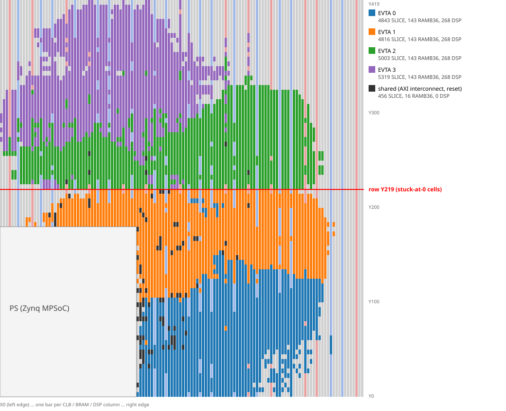

# vta_synth_notes — EVTA 비트스트림 합성/보드 디버깅 핸드오프

최종 갱신: 2026-10-27 (§2.5 명령 모음, 모든 절에 실행 명령; systolic 전환은 `docs/evta_systolic.md`로 분리). 이 문서는 다음 세션이 바로 이어서 작업할 수 있도록, 명령·경로·함정·코드 위치를 모은 것이다.

- 실험 경위와 상세 근거는 `log/BOARD_TODO.md`(시간순 기록)에 있다.
- 디버깅 보고서는 https://claude.ai/artifact/4KvtghuqpzV1GKunEyTRdf (Claude Docs)에 있다.
- 속도 측정 보고서(EVTA 4개 609.7 GOPS, ResConv10 구조와 동작): `docs/evta_multi4_609gops_report.md`. 요약은 §6.
- 이 문서는 "지금 무엇이 되고, 어떻게 돌리며, 어디가 위험한가"만 다룬다.
- **명령 표기**: 실행하는 것이 나오는 곳마다 그대로 붙여 넣을 명령과 실행 위치(호스트/보드, dir)를 적었다.
  명령 안의 변수는 아래 값이다. 새 셸마다 먼저 설정한다(§2.5 0)과 같다).
  ```bash
  # 호스트 PC
  N=/home/ubuntu/npuprg/nestc2_clion/nest-compiler
  VIV="source /tools/Xilinx/v2020.1/Vivado/2020.1/settings64.sh"
  RW=$HOME/tools/rapidwright
  BASEBIT=$N/vta-hw-zcu102-single/build/wgt16_clk200/export/vtahw_zcu102_1x16_i8w8a32_16_16_19_18_wgt16_clk200_lowbram.bit
  # 보드 (ssh xilinx@192.168.20.2)
  B=/home/xilinx/JO/npuprg/nestc2_clion/nest-compiler
  ```
  - 호스트의 Vivado 명령은 호스트 셸에서 `docker exec -u ubuntu -w <dir> vivado2020-build bash -c "$VIV >/dev/null; ..."`로 돌린다. `-w <dir>`가 실행 위치다.
  - 보드의 root 명령은 `sudo -n /bin/sh -c "..."` 형태로만 된다(§1.2).

## 0. 현재 상태 한눈에

| 구성 | 소스 트리 | 상태 | 보드 파일 |
|---|---|---|---|
| single (EVTA 1개, 16/16/19/18) | `vta-hw-zcu102-single` + `vtalib-zcu102-single` | **동작**: 30개 번들 golden PASS. 커밋 `6fa74ee1` | `bit/evta_single_y219_333MHz_pass_261023/` |
| multi2 (EVTA 2개, 16/15/18/17) | `vta-hw-zcu102-multi2` + `vtalib-zcu102-multi2` | **동작**: 전 테스트와 Resnet18 x2 PASS. 커밋 `50201ac5` | `bit/evta_multi2_y219_333MHz_pass_261024/`, `/lib/firmware/vtahw_multi2_y219.bin` |
| multi4 (EVTA 4개, 16/15/18/17) | `vta-hw-zcu102-multi4` + `vtalib-zcu102-multi4` | **333 MHz로 동작** (2026-10-26): Y219 안의 PIP를 하나도 쓰지 않게 재배선, HP 포트 앞 register slice, EVTA별 proc_sys_reset(§3.3). hwtest 전부 PASS, 번들 run_all 전부 PASS. **ResConv10 4-EVTA 동시 609.7 GOPS**(§6), Conv4 4-EVTA 491.6 GOPS. 커밋 `dfec80f7` | `bit/evta_multi4_y219_333MHz_pass_261026/vtahw_zcu102_1x16_i8w8a32_16_15_18_17_4evta.bin` (309.6 MHz판 `bit/evta_multi4_y219_261025/rs_hpm.bin`) |

- 기본 비트스트림(2026-10-26): single `vtahw_single_y219.bin`, multi2 `vtahw_multi2_y219.bin`, multi4 `vtahw_multi4_y219.bin`(= rs_rst).
  `vtabundles_xcmpl/collect_hw_bundles.py`의 `SETS`와 각 `run_all.sh`의 `BIN=${BIN:-...}` 기본값이다.
- 비트스트림 dir마다 `README.md`가 있다(보드에만 있고 git에는 없음): 파일, md5, WNS, 소스 커밋, 런타임 설정.

남은 일의 순서:
1. ~~multi4 333 MHz: EVTA마다 리셋 블록(`proc_sys_reset_<i>`)~~ 완료(rs_rst, §3.3)
2. `_prof` 비트스트림(PROFILE=1: compute 카운터, AXI perf monitor)을 새 fence로 다시 생성. 필요해질 때까지 미룬다
   (VTA_SYNC의 EVTA 시간은 SW 오버헤드가 약 1%뿐이어서 지금은 그것으로 충분하다, §6.1).
3. 보드 소유자에게 PL 결함 통보
4. 성능: conv 사이 CPU 간격(66 µs, 4.4%)을 명령 버퍼 두 개로 숨기기, 실제 네트워크를 EVTA 여러 개에 나누기(§6.5)
5. GEMM을 systolic(weight-stationary)으로 바꾸기: Phase A·B·C 완료, 방향 결정은 `evta_systolic.md` §0, 다음은 Phase D(RTL)

## 1. 환경

### 1.1 호스트 PC (x86, Ubuntu 20.04) — 합성

- **Vivado/HLS 2020.1은 docker 컨테이너 `vivado2020-build` 안에만 있다**(ubuntu 18.04, user `ubuntu`).
  - `/tools/Xilinx`와 nest-compiler 트리가 같은 경로로 마운트되어 있다.
  - 설치 경로는 `/tools/Xilinx/v2020.1/`이며 Y2K22 HLS 패치가 적용되어 있다.
  - 호스트의 `/tools/Xilinx/Vivado/2018.3`과 `2020.2`는 다른 버전이다. 2020.2에는 `vivado_hls`가 없다.
  - `pynq24-build`/`pynq27-build` 컨테이너에는 2020.1이 없다.
  - `vivado.tcl`은 정확히 2020.1을 요구한다.
- 대화형 사용:
  ```bash
  docker exec -it -u ubuntu vivado2020-build bash
  source /tools/Xilinx/v2020.1/Vivado/2020.1/settings64.sh
  ```
- 배치(batch)로 tcl 하나를 돌릴 때:
  ```bash
  D=<작업 dir>
  docker exec -u ubuntu vivado2020-build bash -c \
    "source /tools/Xilinx/v2020.1/Vivado/2020.1/settings64.sh >/dev/null; cd $D && \
     vivado -mode batch -nojournal -log X.log -source X.tcl > X.out 2>&1"
  ```
- **RapidWright**(multi4 재배선용):
  - jar: `~/tools/rapidwright/rapidwright-2020.1.7-standalone-lin64.jar`
    - Vivado 2020.1과 짝이 맞는 버전이다. RWRoute는 없다.
    - 2020.2.7 jar도 받아 두었지만 쓰지 않는다.
  - 디바이스 데이터: `RAPIDWRIGHT_PATH=$HOME/tools/rapidwright/d2020.1`(xczu9eg 포함, 약 2.1 GB).
  - 호스트에는 Java 11 **JRE만** 있고 javac가 없다. 소스 파일 모드로 실행한다: `java -cp <jar> File.java`.
    - 클래스 이름이 jar 안의 난독화 클래스와 겹치면 안 된다(예: `M`).
  - `Design.readCheckpoint(x.dcp)`는 옆에 **암호화되지 않은 `x.edf`**가 있어야 한다. Vivado에서 `write_edif`로 만든다.
  - RapidWright가 쓴 DCP는 Vivado 2020.1에서 그대로 열린다.
  - 실행 형태(호스트, DCP가 있는 dir에서. 2025.2 jar는 데이터 dir `d2025.2`와 짝):
    ```bash
    RAPIDWRIGHT_PATH=$RW/d2025.2 java -Xmx64g -cp $RW/rapidwright-2025.2.2-standalone-lin64.jar <File.java> <args>
    RAPIDWRIGHT_PATH=$RW/d2020.1 java -Xmx64g -cp $RW/rapidwright-2020.1.7-standalone-lin64.jar <File.java> <args>
    ```

### 1.2 보드 (ZCU102, PYNQ 2.4 / Ubuntu 18.04, aarch64)

- 접속은 `ssh zcu102`(= `xilinx@192.168.20.2`)로 한다.
  - 트리: `/home/xilinx/JO/npuprg/nestc2_clion/nest-compiler`
  - 비트스트림 보관: `/home/xilinx/JO/npuprg/bit/<목적>_<YYMMDD>/`
- **공유 보드다.** 작업 전에 `who`/`uptime`을 확인한다.
- **sudo는 `/etc/sudoers.d/evta-test`에 등록된 명령만 비밀번호 없이 된다.**
  - 등록된 명령: `/usr/bin/python3`, `/bin/cp * /lib/firmware/*`, `/bin/sh`, `hwtest/*`, `hw/*`
  - 스크립트는 `sudo -n /bin/sh -c "bash /tmp/x.sh"`처럼 통째로 sudo로 돌리고, 안에서는 sudo를 쓰지 않는다.
  - `sudo ./prog`는 실패한다("a password is required").
- **비트스트림 로드 순서(매 실행 전)**. 실행 위치: 보드, `$B`. root가 필요해서 `sudo -n /bin/sh -c`로 감싼다:
  ```bash
  cd $B
  X=<x>.bin                                   # 예: vtahw_multi4_y219.bin
  sudo -n cp /home/xilinx/JO/npuprg/bit/<dir>/$X /lib/firmware/$X     # /lib/firmware에 없을 때만
  sudo -n /bin/sh -c "$B/vtabundles_xcmpl/hw/script/load_bit.sh $X && \
    python3 $B/vtabundles_xcmpl/hwtest/plreset.py"     # 마지막 줄: pl_resetn0 펄스 (EMIO GPIO 95)
  cat /sys/class/fpga_manager/fpga0/state      # operating
  ```
  - `load_bit.sh`는 firmware 쓰기(`echo 0 > .../fpga0/flags; echo $X > .../fpga0/firmware`)와 `xlnk_reset`을 하고,
    그동안 run 스크립트와 같은 lock(`/tmp/evta_run.lock`)을 잡는다(2026-10-27). plreset은 하지 않는다.
    `xlnk_reset`을 `hw/trace/`에서 실행하므로 `sds_trace_data.dat`(PYNQ `libcma.so`가 종료 시 현재 dir에 씀)가 거기에만 생긴다.
  - 멈춘 실행은 auto-restart 블록을 deadlock 상태로 남긴다. 그래서 매번 다시 로드한다.
  - Ctrl-C로 중단한 뒤에는 `xlnk_reset`이 필요하다(보드: `sudo -n /bin/sh -c "cd $B/vtabundles_xcmpl/hw/trace && python3 -c 'from pynq import Xlnk; Xlnk().xlnk_reset()'"`). CMA 누수가 생기면 "fpga_buff_ != nullptr" 에러가 난다.
- **JTAG/ILA를 쓸 때**: 부팅 후 먼저 실행한다(보드): `cd $B/vtabundles_xcmpl/hwtest && sudo -n /bin/sh -c ./nocpuidle.sh`.
  - 하지 않으면 hw_server 연결 몇 분 뒤 Linux가 조용히 죽는다(cpuidle 문제).
  - JTAG 케이블은 호스트 PC의 hw_server에 붙어 있다.

## 2. 빌드 / 시뮬레이션 / 합성 명령

### 2.1 비트스트림 (호스트, docker 안)

실행 위치: docker 안, `$N/vta-hw-zcu102-<single|multi2|multi4|systolic>/hardware/xilinx`(Makefile이 있는 dir).

```bash
# 호스트에서 docker 셸로 들어가서
docker exec -it -u ubuntu vivado2020-build bash
source /tools/Xilinx/v2020.1/Vivado/2020.1/settings64.sh
cd /home/ubuntu/npuprg/nestc2_clion/nest-compiler/vta-hw-zcu102-single/hardware/xilinx
make ip            # HLS 4블록 (fetch/load/compute/store) → build/hardware/xilinx/hls/<CONF>[_prof]/.done
make bin JOBS=8    # Vivado 블록디자인+구현 → .bit → bit2bin.py → .bin   (전체 약 30분~1시간+)
```

docker 셸 없이 호스트에서 백그라운드로 돌리는 형태는 §2.5 1)에 있다.

Makefile 옵션(모두 `#### JO`):

| 변수 | 의미 |
|---|---|
| `PROFILE=1` | compute 카운터(0x50/0x60/0x70)와 AXI perf monitor를 넣는다. 빌드 dir은 `<CONF>_prof`, 출력은 `vtahw_<CONF>_prof.*` |
| `CSIM=1` | HLS C 시뮬레이션을 먼저 돌린다 |
| `JOBS=8` | Vivado 구현 스레드 수 |
| `EXPORT_NAME` | 출력 이름. 기본값 `vtahw_<BUILD_NAME>` |
| 환경변수 `VTA_BRAM_FENCE` | zcu102 전용. `y219`(기본, EVTA 2개 이하) / `split`(EVTA 3개 이상 기본값, 현재 실패) / `upper` / `none` |

- 출력: `build/hardware/xilinx/vivado/<CONF>[_prof]/export/vtahw_<CONF>[_prof].{bit,bin,hwh,xsa}`와 timing/utilization 리포트.
- `<CONF>` 문자열은 확인한다(호스트, 트리 루트): `cd $N/vta-hw-zcu102-single && python3 config/vta_config.py --cfg-str`.
  - single은 `zcu102_1x16_i8w8a32_16_16_19_18`이다. 숫자 순서는 uop/inp/wgt/acc log2 바이트다.
  - multi는 뒤에 `_<N>evta`가 붙는다.
- 다른 설정으로 빌드할 때는 트리를 복사해 별도 build dir을 쓴 예가 있다(`build/clk200`, `build/wgt16_clk200` 등).

### 2.2 비트스트림 검증 (호스트) — 보드에 올리기 전 필수

복사해서 쓰는 명령은 §2.5 3)에 있다.

실행 위치: 호스트, 비트스트림의 export dir(`$N/vta-hw-zcu102-<T>/build/hardware/xilinx/vivado/<BUILD>/export`).

```bash
cd $N/vta-hw-zcu102-single/build/hardware/xilinx/vivado/zcu102_1x16_i8w8a32_16_16_19_18/export    # 예
X=vtahw_zcu102_1x16_i8w8a32_16_16_19_18
# 1) 타이밍: WNS, WHS, WPWS 모두 >= 0
grep -A3 'WNS(ns)' $X.timing.rpt | sed -n 3p | awk '{print "WNS",$1," WHS",$5," WPWS",$9}'
# 2) 결함 행 사용 여부: 마지막 줄이 "0 extra"여야 함 (extra가 있으면 exit 1)
python3 $N/vtabundles_xcmpl/hwtest/brambist/stuckchk.py $X.bit -b $BASEBIT | tail -1
# 3) Y219 INT 타일에 PIP가 있는 net 수 = 0  (multi4는 run_flow.sh의 route_s 로그가 같은 값을 찍는다, §2.5 2))
#    stuckchk 0 extra만으로는 부족하다: 결함 셀을 안 쓰는 Y219 PIP도 5% 정도 동작하지 않는다(§3.1)
docker exec -u ubuntu -w $PWD/.. vivado2020-build bash -c "$VIV >/dev/null; vivado -mode batch -nojournal -log y219pips.log \
  -source $N/vta-hw-zcu102-systolic/hardware/xilinx/scripts/timing/y219pips.tcl -tclargs vta.runs/impl_1/vta_wrapper_routed.dcp > /dev/null 2>&1"
grep '^CHK' ../y219pips.log        # "CHK nets with any PIP in row Y219: 0"
```

### 2.3 시뮬레이션

- **HLS C sim**: docker 안 `$N/vta-hw-zcu102-single/hardware/xilinx`에서 `make ip CSIM=1`. 테스트벤치는 `hardware/xilinx/sim/vta_test.cc`다.
- **C/RTL cosim, PL 전체 시뮬레이션**: 스크립트가 git-ignore된 scratch dir에만 있다.
  - cosim: `vta-hw-zcu102-single/build/hardware/xilinx/cosim/`(`cosim.tcl`, `cosim_load.tcl`, `compute_tb.cc`)
  - PL 블록디자인 시뮬레이션(PS 대신 AXI VIP): `build/simbd`
  - 결과 요약은 BOARD_TODO 2026-10-20 "host PC" 절에 있다.
  - compute C/RTL cosim. 실행 위치: 호스트, `cosim` dir. 인자 끝 숫자는 profile(0/1). 결과는 `cosim_p<p>.log`:
    ```bash
    cd $N/vta-hw-zcu102-single/build/hardware/xilinx/cosim
    C=../include/zcu102_1x16_i8w8a32_16_16_19_18/vta_config.tcl
    for p in 0 1; do docker exec -u ubuntu -w $PWD vivado2020-build bash -c "$VIV >/dev/null; vivado_hls -f cosim.tcl -tclargs $C $p > cosim_p$p.log 2>&1" & done; wait
    grep -E "RESULT|ERROR|C/RTL co-simulation finished" cosim_p0.log cosim_p1.log
    # load 블록: vivado_hls -f cosim_load.tcl -tclargs $C 0 > cosim_load.log
    ```
  - PL 블록디자인 시뮬레이션. 실행 위치: 호스트, `cosim/simbd`. 인자는 HLS IP dir, vta_config.tcl, profile.
    `prog_<case>.hex`(gen_prog.cc가 만든 명령 이미지)를 `tb.sv`가 돌린다. 결과는 `sim_p<p>.log`:
    ```bash
    H=$N/vta-hw-zcu102-single/build/hardware/xilinx; cd $H/cosim/simbd
    for p in 0 1; do S=$([ $p = 1 ] && echo _prof); docker exec -u ubuntu -w $PWD vivado2020-build bash -c "$VIV >/dev/null; \
      vivado -mode batch -nojournal -log simbd_p$p.log -source simbd.tcl -tclargs $H/hls/zcu102_1x16_i8w8a32_16_16_19_18$S \
      $H/include/zcu102_1x16_i8w8a32_16_16_19_18/vta_config.tcl $p > /dev/null 2>&1" & done; wait
    # 프로젝트를 만든 뒤 시뮬레이션만 다시:
    for p in 0 1; do docker exec -u ubuntu -w $PWD vivado2020-build bash -c "$VIV >/dev/null; vivado -mode batch -nojournal -log sim_p$p.log -source rerun.tcl -tclargs vtasim_p$p/vtasim.xpr > /dev/null 2>&1" & done; wait
    grep -E "^ERROR|out:|SIMDONE|FATAL" sim_p0.log sim_p1.log
    ```
- **설계는 시뮬레이션에서 모두 맞았다.** 보드 문제는 전부 실리콘 결함 때문이었다(§3.1). 시뮬레이션이 PASS라고 보드가 맞는 것은 아니다.

### 2.4 런타임 / 테스트 (보드)

- **ISA 프로브와 HW 테스트**(`vtabundles_xcmpl/hwtest/`, NEST-C/Glow 없이 vtalib만 링크). 빌드 위치: 보드, `$B/vtabundles_xcmpl/hwtest`(sudo 없이):
  ```bash
  cd $B/vtabundles_xcmpl/hwtest
  VTA_COHERENT=false SUFFIX=_nc ./build.sh gemmprobe sramscan donerace          # single → gemmprobe_nc, sramscan_nc, donerace_nc
  for e in 0 1 2 3; do VTA_COHERENT=false SUFFIX=_m BUFF="15 18 17" XFER=8388608 EVTA=$e ./build.sh gemmprobe sramscan donerace; done
                                                                                 # multi → gemmprobe_evta<e>_m, ... (multi2는 e = 0 1)
  BUFF="15 18 17" XFER=8388608 NUM_EVTA=4 SUFFIX=_m ./build.sh multi_gemm_gemm   # → multi_gemm_gemm_4evta_m
  ```
  - 실행 위치: 보드, 같은 dir. 테스트 하나마다 비트스트림을 다시 로드한다. `X`는 `/lib/firmware` 안의 이름:
    ```bash
    cd $B/vtabundles_xcmpl/hwtest; X=vtahw_single_y219.bin
    sudo -n /bin/sh -c "$B/vtabundles_xcmpl/hw/script/load_bit.sh $X && ./gemmprobe_nc reset"     # 테스트 하나
    sudo -n /bin/sh -c "NUM_EVTA=0 /bin/sh ./probes.sh $X"      # 프로브 전체(gemmprobe 5, sramscan 4, donerace). multi는 NUM_EVTA=2|4
    ```
  - `sramscan wgt|inp [invert] [dump]`: SRAM 전체에 패턴을 쓰고 GEMM+STORE로 읽어 비교한다. 0 bytes wrong이어야 한다.
    `dump`로 쓴 `sramscan_wgt.bin`은 `python3 sramscan_analyse.py sramscan_wgt.bin [invert]`로 뱅크별로 본다.
  - `gemmprobe_<reset|zero|ident|perm|ones>`: 10개 명령짜리 GEMM. `GP_IDX=n`으로 SRAM 인덱스를 바꾼다.
  - `donerace`: 드라이버 done race 회귀 테스트. 16/16이어야 한다.
  - `gemm_nc`, `add_test_nc`, `rawtest*`: vtalib 기본 테스트와 raw ISA 프로브(`sudo -n /bin/sh -c "cd $B/vtabundles_xcmpl/hwtest && ./run_rawtests.sh"`, `./run_rawtests2.sh [case ...]`).
  - `multi_gemm_gemm_4evta_m`(`NUM_EVTA=4`로 빌드, multi2는 `NUM_EVTA=2` → `_2evta_m`): multi-EVTA 동시 실행. 모든 EVTA가 "Golden Matched"여야 한다:
    `sudo -n /bin/sh -c "$B/vtabundles_xcmpl/hw/script/load_bit.sh vtahw_multi4_y219.bin && cd $B/vtabundles_xcmpl/hwtest && timeout 120 ./multi_gemm_gemm_4evta_m"`
  - 보조 도구(보드, `$B/vtabundles_xcmpl/hwtest`에서, 비트스트림을 로드한 뒤 `sudo -n /bin/sh -c "python3 <도구> <인자>"`):
    - `dump_regs.py [EVTA ...]`: 블록 레지스터 덤프. 예 `python3 dump_regs.py 0 1`
    - `dump_insns.py [EVTA] [count]`: fetch가 가리키는 DRAM 명령 디코드
    - `plclk.py`: pl_clk, HP 포트 폭(AFIFM). 인자 없음
    - `plclkset.py <MHz>|stop|start|show`: pl_clk0 변경
    - `regpat.py <EVTA ...>`: 레지스터 비트 패턴 쓰기/읽기. 예 `python3 regpat.py 0 1 2 3`
    - `regtest.py`
- **번들**: 순서는 `vtabundles_xcmpl/README.md`를 따른다.
  1. 번들 소스 생성. 실행 위치: 보드, `$B/Debug2_remote`(시뮬레이터 빌드): `./build_sim_bundles.sh [target ...]`
  2. hw dir로 복사. 실행 위치: 보드, `$B/vtabundles_xcmpl`: `./collect_hw_bundles.py [--set multievtax2|multievtax4] [Dir ...]`
  3. 빌드. 실행 위치: 보드, `$B/vtabundles_xcmpl/build`(single) 또는 `build_<set>`: `make -j2 hw_bundles`
     (새 build dir: `mkdir build_multievtax4 && cd build_multievtax4 && cmake -DBUNDLE_SET=multievtax4 -DVTALIB=$B/vtalib-zcu102-multi4 .. && make -j2 hw_bundles`)
  4. 실행. 실행 위치: 보드, hw dir(`$B/vtabundles_xcmpl/hw`, `hw_multievtax2`, `hw_multievtax4`):
     `sudo -n /bin/sh -c "BIN=<x>.bin script/run_all.sh [Dir ...]"`. 결과 표는 로그 끝 `== summary`와 `result/results.txt`(§2.5 6))
  - `run_all.sh`/`run_prof.sh`는 `BIN=${BIN:-<set 기본값>}`이다. 다른 비트스트림은 hw dir에서 `sudo -n /bin/sh -c "BIN=<x>.bin script/run_all.sh"`.
    `run_prof.sh`는 `run_all.sh`에서 BIN 기본값을 읽고, `/lib/firmware/$BIN`이 없으면 멈춘다(2026-10-26 `a37e3e0b`, §3.4 #3).
  - 두 스크립트 모두 `/tmp/evta_run.lock`을 `flock -n`으로 잡는다. 다른 EVTA 실행이 있으면 바로 끝난다(§3.4 #4).
    직접 스크립트를 쓸 때도 `exec 9>/tmp/evta_run.lock; flock -n 9 || exit 1`을 넣는다.
  - set: `single`(`hw/`, `build*/`), `multievtax2`(`hw_multievtax2/`, `cmake -DBUNDLE_SET=multievtax2`),
    `multievtax4`(`hw_multievtax4/`, `-DBUNDLE_SET=multievtax4 -DVTALIB=<root>/vtalib-zcu102-multi4`).
    `_prof`/`_timed` 빌드는 `build_<set>_prof`, `build_<set>_timed`.
    새 build dir은 보드 `$B/vtabundles_xcmpl`에서 `mkdir build_<set>[_prof] && cd build_<set>[_prof] && cmake -DBUNDLE_SET=<set> [-DVTALIB=$B/vtalib-zcu102-multi4] [-DNESTC_EVTA_PROFILE=ON -DBUNDLE_EXE_SUFFIX=_prof] .. && make -j2 hw_bundles`(대괄호는 필요할 때만 넣는다). single은 `-DBUNDLE_SET`를 빼고 dir 이름은 `build`/`build_prof`.
  - 새 비트스트림에는 `-DVTALIB=$PWD/../../vtalib-zcu102-<single|multi2|multi4>`로 짝이 맞는 vtalib 복사본을 쓴다.
    지금은 원본 `vta/vtalib`와 복사본 3개가 주석까지 같다(`config.mk` 제외). 복사본은 런타임 실험용으로 남겨 둔다.
  - `VTA_MAX_XFER`는 vtalib CMake의 `NESTC_EVTA_MAX_XFER`다(2026-10-26 `e119fac9`, vtalib `f716ed3`).
    비우면 `NESTC_EVTA_MULTI`일 때 4 MB, 아니면 `driver.h` 기본 32 MB. xcmpl은 multievtax2 8 MB, multievtax4 4 MB를 넘긴다.
  - PROFILE=1 비트스트림에서는 `-DNESTC_EVTA_PROFILE=ON -DNESTC_EVTA_PROFILE_AXI_MONITOR=ON`을 켠다. APM이 없는 비트스트림에서 이것을 켜면 SIGBUS가 난다.
    `NESTC_EVTA_PROFILE=ON`만 켜면(APM 없음) 일반 비트스트림에서도 VTA_SYNC(EVTA run 시작부터 done까지)가 기록된다.
  - 생성기가 만드는 multi dir(`MultiEVTAConv4Test`, `MultiEVTAResConv10Test`)은 `hw_multievtax4/MultiEVTAConv4TestSrc/make_multi4conv4.py`가
    `hw/<Name>Test`에서 만든다. single set을 먼저 collect해야 한다.
    보드 `$B/vtabundles_xcmpl`에서 `./collect_hw_bundles.py --set multievtax4 MultiEVTAResConv10Test`가 이것을 부른다.
- **보드 위 NEST-C 빌드**(필요할 때만): 보드 `cd $B/Debug2_remote && make -j2 <target>`. 새 build dir을 만들면 메모리가 부족하다(CLAUDE.md 참고).

### 2.5 명령 모음: 빌드부터 보드 측정까지 (2026-10-27 `docs/evta_systolic.md` §8 Phase A의 실행 그대로)

셸에 그대로 붙여 넣으면 된다. `<...>` 부분과 맨 앞 변수만 바꾼다. 경로는 모두 절대 경로다.
호스트 명령은 호스트 셸에서 실행한다(docker 안이 아님, `docker exec`를 명령 안에 넣었다). 보드 명령은 `ssh xilinx@192.168.20.2` 안에서 실행한다.
- 단계마다 **실행 위치**(어느 기계, 어느 dir)를 적었다. 코드 블록 첫 줄의 `cd`가 그 dir이다. `cd`를 건너뛰면 상대 경로(`rs_$TAG.bit`, `script/run_all.sh`, `result/...`)가 맞지 않는다.
- 변수(`N`, `VIV`, `T`, `F`, `X`, ...)는 같은 셸에서 이어 쓴다. 새 터미널이나 새 ssh에서는 0)부터 다시 설정한다. 보드의 `B`, `X`는 보드 셸에서 따로 설정한다.

**0) 공통 변수와 이름**

```bash
# 호스트
N=/home/ubuntu/npuprg/nestc2_clion/nest-compiler
VIV="source /tools/Xilinx/v2020.1/Vivado/2020.1/settings64.sh"
RW=$HOME/tools/rapidwright
BASEBIT=$N/vta-hw-zcu102-single/build/wgt16_clk200/export/vtahw_zcu102_1x16_i8w8a32_16_16_19_18_wgt16_clk200_lowbram.bit
# 보드
B=/home/xilinx/JO/npuprg/nestc2_clion/nest-compiler
```

| 트리 `T` | `<CONF>` | fence | 보드 번들 dir |
|---|---|---|---|
| `single`, `systolic` | `zcu102_1x16_i8w8a32_16_16_19_18` | `y219` | `vtabundles_xcmpl/hw` |
| `multi2` | `zcu102_1x16_i8w8a32_16_15_18_17_2evta` | `y219` | `vtabundles_xcmpl/hw_multievtax2` |
| `multi4` | `zcu102_1x16_i8w8a32_16_15_18_17_4evta` | `split` + 재배선(아래 2) | `vtabundles_xcmpl/hw_multievtax4` |

- `<BUILD>` = `<CONF>` + `_prof`(PROFILE=1) + `_oreg`(MEM_OREG=1, systolic 트리만) + `_<FREQ>mhz`(FREQ를 줄 때).
  예: `zcu102_1x16_i8w8a32_16_15_18_17_2evta_360mhz`, `zcu102_1x16_i8w8a32_16_16_19_18_prof_oreg_360mhz`.
- 출력 이름 `<X>` = `vtahw_<BUILD>`.

**1) 비트스트림 빌드 (호스트, single/multi2/systolic, multi4는 2)도 이어서)**

실행 위치: 호스트, `$N`. Vivado는 docker 안에서 `-w`로 준 `$N/vta-hw-zcu102-$T/hardware/xilinx`(Makefile이 있는 dir)에서 돈다.
docker 셸에서 직접 할 때는 `cd $N/vta-hw-zcu102-$T/hardware/xilinx` 뒤 `make ip && make bin FREQ=$F JOBS=8`.

```bash
cd $N
T=multi2; F=380                    # F= 를 비우면 config의 333 MHz
X=vtahw_zcu102_1x16_i8w8a32_16_15_18_17_2evta_${F}mhz     # 위 표대로
L=$N/vta-hw-zcu102-$T/build/logs; mkdir -p $L
docker exec -d -u ubuntu -w $N/vta-hw-zcu102-$T/hardware/xilinx vivado2020-build bash -c \
  "$VIV >/dev/null && { make ip && make bin FREQ=$F JOBS=8; } > $L/bin_$F.log 2>&1; echo rc=\$? >> $L/bin_$F.log"
tail -2 $L/bin_$F.log              # 끝에 rc=0이 붙으면 끝(30분~1시간 남짓)
```

- `make ip`는 HLS IP가 이미 있으면(`build/hardware/xilinx/hls/<IP>/.done`) 바로 끝난다. FREQ는 PLL만 바꾸므로 IP를 다시 만들지 않는다.
- 옵션은 `make bin` 뒤에 붙인다: `PROFILE=1`(make ip에도 같이), `MEM_OREG=1`(systolic, make ip에도 같이).
  예: `make ip PROFILE=1 MEM_OREG=1 && make bin PROFILE=1 MEM_OREG=1 FREQ=360 JOBS=8`.
- 같은 트리에서 FREQ만 다른 빌드는 동시에 돌려도 된다(빌드 dir이 다르다). HLS가 같은 IP를 동시에 만들면 안 되므로 `make ip`를 먼저 한 번 끝낸다.
- 결과: `$N/vta-hw-zcu102-$T/build/hardware/xilinx/vivado/<BUILD>/export/<X>.{bit,bin,hwh,xsa,timing.rpt,utilization.rpt}`.
- 333 MHz를 넘으면 HP 포트는 333 MHz 별도 클럭으로 간다(multi4 `vivado.tcl`, `70ccf2f7`). 로그에 `HP ports on their own clock` 줄이 나온다.

**2) multi4만: Y219 재배선 (호스트, 1)의 `make bin` 뒤)**

실행 위치: 호스트, **`$N/vta-hw-zcu102-multi4/build/y219`**(필수). `run_flow.sh`가 이 dir에 결과를 쓰고, `VTA_IMPL_DIR`은 이 dir 기준 상대 경로다.

- multi4의 `make bin`은 기본 impl의 write_bitstream DRC(RTSTAT-6)로 `rc=2`로 끝날 수 있다(360 MHz에서 그랬다). 상관없다. 아래 흐름은 `vta_wrapper_opt.dcp`에서 다시 시작한다.

```bash
F=380; TAG=m$F
cd $N/vta-hw-zcu102-multi4/build/y219
VTA_IMPL_DIR=../hardware/xilinx/vivado/zcu102_1x16_i8w8a32_16_15_18_17_4evta_${F}mhz/vta.runs/impl_1 \
  nohup ../../hardware/xilinx/scripts/y219route/flow/run_flow.sh $TAG > flow_$TAG.log 2>&1 &
# 몇 시간 걸린다. flow_$TAG.log 끝에 최종 timing 줄이 나오면 끝:
cat flow_$TAG.log                  # place 뒤 WNS 줄, RapidWright "nets with a PIP", route_s의 CHK, 최종 timing 줄
grep '^CHK' route_s_$TAG.log       # "CHK nets with any PIP in row Y219: 0", "CHK nets not fully routed: 0" 이어야 한다
python3 $N/vta-hw-zcu102-multi4/hardware/xilinx/scripts/bit2bin.py rs_$TAG.bit rs_$TAG.bin
```

- FREQ 없이(333 MHz) 빌드했으면 `VTA_IMPL_DIR`를 주지 않는다(기본값이 `<CONF>` dir이다). TAG는 아무 이름이나 쓴다(예: `rst`).
- 결과: `routed_$TAG.*`(재배치), `rws_$TAG.*`(RapidWright), `rs_$TAG.{dcp,bit,bin,timing.rpt}`(최종).

**3) 호스트 검증 (보드에 올리기 전, 셋 다 통과해야 한다)**

실행 위치: 호스트, 비트스트림이 있는 dir. single/multi2/systolic은 export dir, multi4는 `build/y219`.

```bash
# 둘 중 하나만 실행한다
# (가) single/multi2/systolic
cd $N/vta-hw-zcu102-$T/build/hardware/xilinx/vivado/<BUILD>/export
R=$X.timing.rpt; BIT=$X.bit
# (나) multi4
cd $N/vta-hw-zcu102-multi4/build/y219
R=rs_$TAG.timing.rpt; BIT=rs_$TAG.bit

# 공통 (위 dir에서)
grep -A3 'WNS(ns)' $R | sed -n 3p | awk '{print "WNS",$1," WHS",$5," WPWS",$9}'      # 셋 다 >= 0
python3 $N/vtabundles_xcmpl/hwtest/brambist/stuckchk.py $BIT -b $BASEBIT | tail -1      # "... 0 extra"
```

- WPWS(pulse width)가 음수면 333 MHz를 넘는 클럭이 HP 포트에 들어간 것이다(`evta_systolic.md` §8 주의). WNS/WHS만 보면 놓친다.
- Y219 행 PIP 수: multi4는 위 `route_s_$TAG.log`의 CHK가 이미 그 값이다. single/multi2는(실행 위치: 호스트 아무 dir, docker는 `$V`에서 돈다):
  ```bash
  V=$N/vta-hw-zcu102-$T/build/hardware/xilinx/vivado/<BUILD>
  docker exec -u ubuntu -w $V vivado2020-build bash -c "$VIV >/dev/null; vivado -mode batch -nojournal -log y219pips.log \
    -source $N/vta-hw-zcu102-systolic/hardware/xilinx/scripts/timing/y219pips.tcl -tclargs vta.runs/impl_1/vta_wrapper_routed.dcp > /dev/null 2>&1"
  grep '^CHK' $V/y219pips.log        # "CHK nets with any PIP in row Y219: 0"
  ```
- stuckchk에 extra가 있으면 어느 tile인지 본다(`evta_systolic.md` §8 6). 실행 위치는 위와 같다(`$BIT`가 있는 dir):
  ```bash
  RW=$HOME/tools/rapidwright
  RAPIDWRIGHT_PATH=$RW/d2025.2 java -Xmx16g -cp $RW/rapidwright-2025.2.2-standalone-lin64.jar \
    $N/vta-hw-zcu102-multi4/hardware/xilinx/scripts/y219route/StuckLoc.java $BIT $BASEBIT | grep 'cr X.Y3'
  ```
- critical path 목록(`evta_systolic.md` §8 1)): 실행 위치 `cd $N/vta-hw-zcu102-systolic/build/timing`(결과도 여기에 생긴다), 그다음
  `docker exec -u ubuntu -w $PWD vivado2020-build bash -c "$VIV >/dev/null; vivado -mode batch -nojournal -log t_<name>.log -source ../../hardware/xilinx/scripts/timing/top_paths.tcl -tclargs <routed dcp> <name> > /dev/null 2>&1"`.
  결과는 `<name>.paths.rpt`, `<name>.paths.csv`(slack, logic level, 배선 비율, start/end).

**4) 보드로 복사 (호스트)**

실행 위치: 호스트, `$N`(모든 경로가 절대 경로라 어디서 해도 같다). `X`, `T`, `TAG`, `<BUILD>`는 1)~3)과 같은 값.

```bash
cd $N
# 둘 중 하나만 실행한다
# (가) single/multi2/systolic: export dir 그대로
E=$N/vta-hw-zcu102-$T/build/hardware/xilinx/vivado/<BUILD>/export
# (나) multi4: rs_$TAG.* 를 <X> 이름으로 모은다
E=$N/vta-hw-zcu102-multi4/build/y219/export_$TAG; Y=$N/vta-hw-zcu102-multi4/build/y219; mkdir -p $E
cp $Y/rs_$TAG.bin $E/$X.bin; cp $Y/rs_$TAG.bit $E/$X.bit; cp $Y/rs_$TAG.timing.rpt $E/$X.timing.rpt
cp $Y/routed_$TAG.util.rpt $E/$X.utilization.rpt
cp $N/vta-hw-zcu102-multi4/build/hardware/xilinx/vivado/<BUILD>/vta.srcs/sources_1/bd/vta/hw_handoff/vta.hwh $E/$X.hwh

# 공통
D=/home/xilinx/JO/npuprg/bit/<목적>_<YYMMDD>          # 예: evta_multi4_phaseA_261027
ssh xilinx@192.168.20.2 "mkdir -p $D"
scp $E/$X.{bin,bit,hwh,timing.rpt,utilization.rpt} xilinx@192.168.20.2:$D/
ssh xilinx@192.168.20.2 "sudo -n cp $D/$X.bin /lib/firmware/$X.bin && md5sum $D/$X.bin /lib/firmware/$X.bin"
md5sum $E/$X.bin                    # 세 md5가 같아야 한다
```

**5) 보드: 실행 전 확인과 HW 프로브**

실행 위치: 보드(`ssh xilinx@192.168.20.2`), `$B/vtabundles_xcmpl/hwtest`. `probes.sh`는 스스로 자기 dir(또는 `HWTEST`)로 `cd`한다.

```bash
B=/home/xilinx/JO/npuprg/nestc2_clion/nest-compiler
cd $B/vtabundles_xcmpl/hwtest
ps -eo user,etime,args | grep -E 'run_all|run_prof|Bundle|_nc |_m ' | grep -v grep   # 다른 사람의 EVTA 실행이 없어야 한다
X=<X>.bin                          # /lib/firmware 안의 이름
sudo -n /bin/sh -c "NUM_EVTA=0 /bin/sh $B/vtabundles_xcmpl/hwtest/probes.sh $X"      # single. multi2는 NUM_EVTA=2, multi4는 4
```

- 모든 줄이 `rc=0`이고 gemmprobe `0/16 wrong`, sramscan `0 bytes wrong`, donerace `16/16`이어야 한다. 비트스트림 여러 개를 뒤에 늘어놓아도 된다.
- 기준판과 같이 돌려 비교한다: single `vtahw_single_y219.bin`, multi2 `vtahw_multi2_y219.bin`, multi4 `vtahw_multi4_y219.bin`.
- 보드 트리(main 브랜치)에 아직 `probes.sh`가 없으면(systolic 브랜치에서 추가, 2026-10-27), 꺼내서 쓴다:
  `cd $B && git fetch origin && git show origin/systolic:vtabundles_xcmpl/hwtest/probes.sh > /tmp/probes.sh`, 그리고
  `sudo -n /bin/sh -c "HWTEST=$B/vtabundles_xcmpl/hwtest NUM_EVTA=4 /bin/sh /tmp/probes.sh $X"`.
- 프로브 실행 파일(`gemmprobe_nc`, `gemmprobe_evta<e>_m` 등)은 보드 `hwtest/`에 있다(10-23, 10-26 빌드). 다시 만들 때는 `probes.sh` 머리말의 `build.sh` 줄을 쓴다.

**6) 보드: 번들 golden과 속도**

실행 위치: 보드, 비트스트림 종류에 맞는 hw dir: single `$B/vtabundles_xcmpl/hw`, multi2 `$B/vtabundles_xcmpl/hw_multievtax2`, multi4 `$B/vtabundles_xcmpl/hw_multievtax4`.
`script/run_all.sh`, `result/`가 그 dir 기준 상대 경로다. 결과를 읽을 때도 같은 dir로 간다.

```bash
B=/home/xilinx/JO/npuprg/nestc2_clion/nest-compiler; X=<X>.bin
# 둘 중 하나만 실행한다
# (가) single (hw/)
cd $B/vtabundles_xcmpl/hw
nohup sudo -n /bin/sh -c "BIN=$X script/run_all.sh > /tmp/ra_$X.log 2>&1; \
  for r in 1 2; do BIN=$X script/run_prof.sh ResConv10Test Conv4Test > /tmp/pf_${X}_\$r.log 2>&1; done; echo ALLDONE >> /tmp/ra_$X.log" > /dev/null 2>&1 &

# (나) multi2 / multi4: OMP_NUM_THREADS=1 필수. multi2는 dir만 hw_multievtax2
cd $B/vtabundles_xcmpl/hw_multievtax4
nohup sudo -n /bin/sh -c "export OMP_NUM_THREADS=1; BIN=$X script/run_all.sh > /tmp/ra_$X.log 2>&1; \
  BIN=$X script/run_prof.sh > /tmp/pf_$X.log 2>&1; echo ALLDONE >> /tmp/ra_$X.log" > /dev/null 2>&1 &

# 끝났는지 보고 결과 읽기 (ssh가 끊겨도 nohup이라 계속 돈다). /tmp 로그는 dir 상관없음, result/는 실행한 hw dir에서
cd $B/vtabundles_xcmpl/hw_multievtax4             # 실행한 hw dir (single이면 hw, multi2면 hw_multievtax2)
tail -1 /tmp/ra_$X.log                            # ALLDONE
sed -n '/== summary/,$p' /tmp/ra_$X.log           # PASS / RAN (no golden) 표
sed -n '/== summary/,$p' /tmp/pf_$X*.log          # Dir마다 exit, golden, total_time, total_vta_time
cat result/results.txt result/prof_summary.txt   # 같은 표의 파일(hw dir 안, 다음 실행이 덮어쓴다)
```

- 비교 기준(333 MHz)도 같은 명령에 `X=vtahw_<single|multi2|multi4>_y219.bin`을 넣어 같은 날 다시 잰다.
- 속도 비교는 `total_vta_time`(EVTA 시간)으로 한다. `total_time`은 CPU 연산을 포함한다.
- `run_prof.sh`에 Dir를 주지 않으면 run_all.sh의 모든 번들을 돈다. `_prof` 번들이 빌드되지 않은 Dir는 `NOT BUILT`으로 나온다.
- 번들을 다시 만들어야 하면 `vtabundles_xcmpl/README.md` 순서(Debug2_remote `build_sim_bundles.sh` → `collect_hw_bundles.py [--set <set>]` → `build*/`에서 `make -j2 hw_bundles`)를 따른다.

**7) Phase B: systolic 런타임으로 번들 (보드)**

실행 위치: 보드. 풀기는 `$B`(git 명령), 빌드는 `$B/vtabundles_xcmpl/build_sysprof`, 실행과 결과는 `$B/vtabundles_xcmpl/hw`. 블록 안 `cd`대로 간다.

```bash
B=/home/xilinx/JO/npuprg/nestc2_clion/nest-compiler
# vtalib-zcu102-systolic을 보드 main 트리 밖에 푼다
cd $B && git fetch origin && mkdir -p /home/xilinx/JO/npuprg/systolic && \
  git archive origin/systolic vtalib-zcu102-systolic | tar -x -C /home/xilinx/JO/npuprg/systolic
# 번들 빌드 (make.log 끝에 rc=0)
cd $B/vtabundles_xcmpl && mkdir -p build_sysprof && cd build_sysprof && \
  cmake -DVTALIB=/home/xilinx/JO/npuprg/systolic/vtalib-zcu102-systolic -DNESTC_EVTA_PROFILE=ON -DBUNDLE_EXE_SUFFIX=_sysprof .. > cmake.log 2>&1 && \
  nohup sh -c "make -j2 hw_bundles > make.log 2>&1; echo rc=\$? >> make.log" > /dev/null 2>&1 &
# 실행: build_sysprof/make.log 끝이 rc=0이 된 뒤에. 원래 런타임(_prof)과 새 런타임(_sysprof)
tail -1 $B/vtabundles_xcmpl/build_sysprof/make.log      # rc=0
cd $B/vtabundles_xcmpl/hw
nohup sudo -n /bin/sh -c "BIN=vtahw_single_y219.bin script/run_prof.sh all > /tmp/pf_prof.log 2>&1; \
  BIN=vtahw_single_y219.bin script/run_prof.sh -s _sysprof all > /tmp/pf_sysprof.log 2>&1" > /dev/null 2>&1 &
# 두 실행이 끝난 뒤(/tmp/pf_sysprof.log 끝에 표가 나옴), 같은 hw dir에서
cat result/prof_summary.txt result/sysprof_summary.txt     # 두 표를 나란히 비교
```

- vtalib를 고친 뒤에는 위 `git archive` 줄로 다시 풀고, `build_sysprof`에서 `make -j2 hw_bundles`만 다시 한다.

**8) Phase C: 사이클 모델 (호스트)**

실행 위치: 호스트, 아무 dir(소스와 실행 파일 모두 절대 경로).

```bash
cd $N
g++ -O2 -std=c++14 -Wall -o /tmp/systolic_model $N/vta-hw-zcu102-systolic/hardware/xilinx/sim/systolic_model.cc
/tmp/systolic_model 300 1          # 인자: 무작위 테스트 수, seed. 모두 일치하면 끝에 가동률 표를 찍는다
```

## 3. 찾은 버그, 원인, 해결

### 3.1 [근본 원인] 보드 PL의 configuration 셀 stuck-at-0 (tile row SLICE Y219)

- **증상**: 같은 RTL이 구현할 때마다 다르게 망가졌다.
  - 333 MHz no-prof: GEMM 출력이 일정한 쓰레기 값
  - prof: compute done이 오지 않음
  - 200 MHz: ALU까지 hang
  - ILA 빌드: fetch가 쓰레기 명령을 냄, wgt 손상, deadlock
  - 이 모든 경우에 타이밍과 시뮬레이션은 깨끗했다.
- **찾은 방법**:
  - `hwtest/sramscan`으로 위쪽 BRAM 뱅크만 틀린다는 것을 확인했다.
  - JTAG readback(`hwtest/brambist/readback.tcl`)을 `cfgdiff.py`로 비트스트림·mask와 비교했다.
  - 다른 비트는 모두 **1→0**이었다.
  - 위치: clock-region row 3, type-0 frame 20586..27350, frame word 61 bit 18과 word 62 bit 0-3·12-14
  - 이것은 tile row **SLICE Y219**에 해당한다(RAMB36 Y43 / RAMB18 Y86-87 / DSP Y86-87).
  - 다시 readback, fpga_manager 재로드, JTAG 프로그래밍 모두 같은 결과였다. 장치 자체의 결함이다.
  - readback 명령. 실행 위치: 호스트, `<BUILD>/verify`(없으면 만든다). 먼저 보드에서 `nocpuidle.sh`(§1.2)를 하고 그 bit를 로드한다(§1.2, mask와 같이 만든 `vta.bit`를 bit2bin한 것):
    ```bash
    E=$N/vta-hw-zcu102-single/build/hardware/xilinx/vivado/zcu102_1x16_i8w8a32_16_16_19_18_lowbram/verify; mkdir -p $E; cd $E
    # mask와 같은 설정의 bit (routed DCP에서)
    docker exec -u ubuntu -w $E vivado2020-build bash -c "$VIV >/dev/null; vivado -mode batch -nojournal -log msk.log \
      -source $N/vtabundles_xcmpl/hwtest/brambist/msk.tcl -tclargs ../vta.runs/impl_1/vta_wrapper_routed.dcp vta > /dev/null 2>&1"   # → vta.bit, vta.msk
    python3 $N/vtabundles_xcmpl/hwtest/bit2bin.py vta.bit vta.bin      # 이것을 보드에 올려 로드한다
    docker exec -u ubuntu -w $E vivado2020-build bash -c "$VIV >/dev/null; vivado -mode batch -nojournal -log rb.log \
      -source $N/vtabundles_xcmpl/hwtest/brambist/readback.tcl -tclargs rbE > rb.out 2>&1"      # → rbE.bin (JTAG, 프로그래밍 안 함)
    python3 $N/vtabundles_xcmpl/hwtest/brambist/cfgdiff.py vta.bit vta.msk rbE.bin | head      # 틀린 비트의 frame/word/bit
    # JTAG로 프로그래밍한 뒤 readback: ... -source $N/vtabundles_xcmpl/hwtest/brambist/progrb.tcl -tclargs <x>.bit rbJ
    ```
    `readback.tcl`/`progrb.tcl`은 docker에서 호스트의 hw_server(`172.17.0.1:3121`)에 붙는다.
- **해결**: 설계를 Y219 행 밖에 두는 pblock fence(`vivado.tcl`의 `VTA_BRAM_FENCE`).
  - `y219` 모드에서는 PS를 뺀 모든 셀을 pblock `SLICE_X0Y0:SLICE_X96Y218`(+ RAMB36 ..Y42, RAMB18 ..Y85, DSP ..Y85)에 넣는다.
  - 이 pblock에 CONTAIN_ROUTING을 건다.
  - Y219 행의 사이트와 MMCM row 3..6에는 PROHIBIT를 건다.
  - 검증은 `stuckchk.py`로 0 extra를 확인하는 것이다(호스트: `python3 $N/vtabundles_xcmpl/hwtest/brambist/stuckchk.py <x>.bit -b $BASEBIT`).
  - 모든 설계가 공통으로 쓰는 194비트(word 62 bit 0, 미사용 타일 설정)는 기준선이라 제외한다.
- **2026-10-25 추가: 행 안의 PIP 자체도 일부 고장이다.** wire 검사 설계(`y219route/WireTest.java`, README 참고)로 확인했다.
  - 실행 위치: 호스트, `$N/vta-hw-zcu102-multi4/build/wiretest`. 설계 생성(RapidWright) → bit 생성·보드 로드·JTAG readback·판정(`wiretest_run.sh`가 전부 함):
    ```bash
    Y=$N/vta-hw-zcu102-multi4/hardware/xilinx/scripts/y219route; cd $N/vta-hw-zcu102-multi4/build/wiretest
    # 정적 검사: 행 위를 지나가는 wire. 인자: <out> [row=219] [max nets=0 (전부)] [x 범위]
    RAPIDWRIGHT_PATH=$RW/d2025.2 java -Xmx24g -cp $RW/rapidwright-2025.2.2-standalone-lin64.jar $Y/WireTest.java $PWD/wt_a 219 0 0-999 > wt_a.log 2>&1
    bash $Y/wiretest_run.sh . wt_a wtb_a            # → 고장 node 목록, bad/wrong 수
    # 속도 검사(-Dspeed=1)와 행 안 PIP 검사(-Dinrow=1)
    RAPIDWRIGHT_PATH=$RW/d2025.2 java -Dspeed=1 -Dinrow=1 -Dpips=$Y/stuck_int_pips.txt -Xmx24g -cp $RW/rapidwright-2025.2.2-standalone-lin64.jar \
      $Y/WireTest.java $PWD/wr_a 219 0 0-999 > wr_a.log 2>&1
    bash $Y/wirespeed_run.sh . wr_a wrb_a 100 300 500 750     # MHz마다 결과
    ```
    `wiretest_run.sh`는 보드 `nocpuidle.sh`도 먼저 실행한다. 설계는 PS에 연결되지 않아 AXI로 보드가 멈출 일은 없다.
  - 행 위를 지나가기만 하는 wire(NN/SS 2·4·12): 20,207개 모두 정상, 750 MHz까지.
  - 결함 셀을 쓰지 않는 Y219 PIP를 거친 net: 6,850개 중 382개(5.6%)가 정적으로 실패. readback은 bitstream과 같다. 열마다 고장 PIP가 다르다.
  - 그래서 규칙은 "Y219 INT 타일의 PIP 0개"다. stuckchk 0 extra인 rs_m은 레지스터 비트가 틀리고 EVTA 접근 시 보드가 멈췄다.
- 처음에는 "위쪽 BRAM(Y≥36)이 나쁘다"고 결론 냈었지만 **틀렸다**. Y36..42 BRAM은 정상이고 Y219 행만 문제다.
- 할 일: 보드 소유자에게 알린다.

### 3.2 설계/런타임 버그 (보드 결함과 별개, 모두 수정됨)

| # | 위치 | 버그 | 원인 | 수정 |
|---|---|---|---|---|
| 1 | `vivado.tcl` `pll_clk` | `pl_resetn0`가 clk_wiz까지 리셋해서, 리셋 펄스 동안 333 MHz 클럭이 멈추고 HLS 블록과 FIFO가 리셋되지 않음 | clk_wiz `RESET_PORT` | `CONFIG.USE_RESET {false}`. locked → proc_sys_reset `dcm_locked`. 로드 후 `plreset.py`(보드 `sudo -n /bin/sh -c "python3 $B/vtabundles_xcmpl/hwtest/plreset.py"`) |
| 2 | `pkg_config.py` (zcu102) | 1024비트 wgt 뱅크에 128비트 beat를 read-modify-write로 씀(II=2) | HLS load의 wide BRAM 쓰기 | zcu102에서는 모든 SRAM 뱅크를 AXI beat 폭(128비트)으로. wgt는 16 x 128비트. 결함 행이 주원인이었지만 이 수정은 유지 |
| 3 | `vivado.tcl` | 구현 중 HLS 블록과 큐가 재최적화되어 구현마다 달라짐 | — | fetch/load/compute/store와 7개 큐에 DONT_TOUCH |
| 4 | `pynq_driver.cc` `Run()` (vta/vtalib와 vtalib-zcu102-* 3개) | **done race**: compute `done_o`(0x18)에 이전 FINISH의 1이 남아 있어 바로 리턴함 | HLS s_axilite 출력 레지스터의 유지 동작 | 시작 전에 `done_o_ap_vld`(0x1c, clear-on-read)를 비우고, vld를 본 뒤에만 done을 인정. `hwtest/donerace` 16/16(보드 hwtest dir: `sudo -n /bin/sh -c "$B/vtabundles_xcmpl/hw/script/load_bit.sh <x>.bin && ./donerace_nc 16"`). **이전의 보드 결과(특히 conv 번들)는 의심해야 한다** |
| 5 | `hwtest/sramscan.cpp` | multi 비트스트림에서 바이트 전부 틀림 | 테스트 버그: CHUNK=256 → acc 4096행을 썼는데 multi의 acc 깊이는 2048 | `CHUNK = ACC_DEPTH / 16`, 깊이는 hw_spec.h에서 가져옴 (`3091bd8f`) |
| 6 | `hw_spec.h` (vtalib + vta-hw) | 3비트 `memory_type`/`alu_opcode`로 모든 LOAD/STORE 주소가 1비트 어긋남 | 보드 비트스트림은 2비트 | `VTA_MEMOP_ID_BIT_WIDTH 2`, `VTA_ALU_OPCODE_BIT_WIDTH 2` (`//#### JO`). 그 결과 ALU `MUL`(4)과 `MEM_ID_MOVE`(5)는 인코딩할 수 없다(BNN/XP-GEMM 경로 불가) |
| 7 | vtalib coherent | `VTA_COHERENT_ACCESSES=true`면 보드에서 hang | HP 포트가 non-coherent | `NESTC_EVTA_COHERENT_ACCESSES` 기본 OFF. 번들이 `VTABufferFlush/Invalidate`를 호출(`VTASave.cpp`가 생성) |

### 3.3 multi4: Y219를 넘는 배선 (해결, 309.6 MHz → 333 MHz)

#### Y219 행과 pblock의 위치



- 그림은 site 열(CLB 회색, BRAM 빨강, DSP 파랑)마다 막대 하나씩, 세로축은 SLICE Y(아래 Y0, 위 Y419)다. 열 사이의 배선(INT) 열은 생략했다.
- **Y219 행(빨간 선)은 다이 높이의 정확히 가운데쯤**에 다이 폭 전체를 가로지른다. 이 행의 모든 타일(INT, CLE, BRAM Y43, DSP Y86-87)에 결함 셀이 있다.
- PS(Zynq MPSoC)는 왼쪽 아래(Y0..~179)에 있다. HP0-3 데이터 포트와 M_AXI_HPM0(레지스터)는 모두 PS의 오른쪽 경계(INT_INTF_LEFT_TERM_PSS, Y99-118)로 나온다.
- multi4의 pblock(`vivado.tcl`, `VTA_BRAM_FENCE=split`):
  - `pb_fence` = 아래 사각형(Y0..218) + 위 사각형(Y220..419). PS·MMCM을 뺀 모든 셀.
  - `pb_evta_0`, `pb_evta_1` = 아래 사각형 전체, `pb_evta_2`, `pb_evta_3` = 위 사각형 전체 (`pb_fence`의 자식).
  - **즉 EVTA마다 작은 창을 준 것이 아니라, 반쪽 다이 전체를 두 EVTA가 같이 쓴다.** pblock은 "이 셀들은 이 사각형(들) 안에만 배치하라"는 배치 제약이고, 사각형을 작게 잡으면 EVTA 하나의 위치를 창 하나로 한정할 수 있다. 여기서는 위/아래만 정하려고 반쪽 전체를 줬다.

**PROHIBIT과 CONTAIN_ROUTING은 다른 것이다** (헷갈리기 쉬움)

| 제약 | 대상 | 효과 | multi4에서 |
|---|---|---|---|
| `PROHIBIT` (site 속성) | 배치 | 그 site에 셀을 놓지 않는다. **배선은 막지 않는다** | Y219 행 site(`vivado.tcl`), `place_d.tcl`부터는 Y218-220 행 site까지 |
| pblock (`resize_pblock`) | 배치 | 셀을 사각형 안에만 놓는다 | 위 그림의 두 사각형 |
| `CONTAIN_ROUTING` (pblock 속성) | 배선 | pblock 안의 셀끼리만 연결된 net을 pblock 영역 안에서만 배선한다 | `vivado.tcl` split에서는 켬. **`place_d.tcl`부터는 끔** |

- CONTAIN_ROUTING이 Y219를 지켜 주지 못한 이유:
  - pblock이 두 사각형으로 되어 있으면 두 사각형 사이의 행(Y219)도 "pblock 안"으로 취급되는지, 자식 pblock의 net이 Y219 PIP를 썼다.
  - PS와 EVTA 2/3을 잇는 net(HP2/HP3 ↔ smc_2/3, M_AXI_HPM0 ↔ xbar ↔ EVTA 2/3 레지스터)은 어느 pblock에도 속하지 않아 제약이 없다. 이 net들은 반드시 Y219를 가로질러야 한다.
  - 게다가 CONTAIN_ROUTING을 켜면 배선이 실패했다(RTSTAT-6, 18 conflicts).
- 그래서 `place_d.tcl`(현재 배치)은 CONTAIN_ROUTING을 끄고, Y218-220 행 site를 PROHIBIT해서 배치만 비운 뒤, 배선에서 Y219 PIP를 빼는 일은 별도 도구로 한다(아래 표). Vivado에는 배선 금지 영역(routing blockage) 제약이 없다.
- 배선이 Y219 행을 "지나가는" 것(긴 wire가 행 위를 통과)은 괜찮다. 문제는 그 행의 타일 안에서 **PIP(스위치)를 켜는** 것뿐이다. 그 PIP의 설정 비트가 결함 셀에 있다.

#### 4개 EVTA가 배치된 곳



- EVTA 0·1은 아래(0이 맨 아래, 1이 그 위), EVTA 2·3은 위(2가 Y219 바로 위, 3이 맨 위)다. 다이 오른쪽 끝 몇 열은 비어 있다.
- EVTA 하나 = SLICE 약 4,800~5,300, **RAMB36 143**, DSP 268. 공용(AXI interconnect, reset) = SLICE 456, RAMB36 16.

**아래쪽에 EVTA 3개를 넣을 수 있나? → 들어가지 않는다.**

| 자원 (Y219 아래, Y0..218) | 있는 것 | EVTA 3개 + 공용 | |
|---|---|---|---|
| RAMB36 (Y0..42) | 379 | 3 × 143 + 9 = 438 | **59개 부족** |
| SLICE | 14,666 | 약 14,700 + 443 | 100% 넘음 |
| DSP48E2 | 1,080 | 804 | 충분 |

- PS가 아래 왼쪽을 차지해서 아래 반쪽(392 RAMB36, Y43 행 13개는 결함 행이라 제외 → 379)이 위 반쪽(520)보다 작다.
- 버퍼(16/15/18/17: uop 64 KB, inp 32 KB, wgt 256 KB, acc 128 KB = 480 KB)는 RAMB36 약 107개 분량인데 EVTA당 143개를 쓴다. 뱅크를 128비트 폭으로 나누면서(§3.2 #2) 생기는 손실로 보인다(확인 안 함). 버퍼를 줄이면 들어갈 수 있지만 vtalib 상수와 성능이 바뀐다(§5.4).
- 어떻게 나누든 위쪽에 EVTA가 하나라도 있으면 PS ↔ EVTA net이 Y219를 넘어야 한다. 그래서 배선 단계에서 Y219 PIP를 빼는 방법이 필요하다.

#### 시도한 것

| 시도 | 결과 |
|---|---|
| `split` + 자식 pblock CONTAIN_ROUTING | RTSTAT-6 배선 실패(18 conflicts) |
| `split`, CONTAIN_ROUTING 끔(`build/y219/route_a2.tcl`) | 배선은 깨끗함. WNS −0.126 ns. **528개 net이 Y219 PIP 사용** |
| RapidWright로 Y219 PIP 금지 후 재배선(`Y219Route.java`), 하드 블록 | 29 net 실패. 대부분 Y218/Y220 sink |
| 같은 도구, PathFinder식(노드 빼앗기 + history cost) | **수렴하지 않음**. 5시간에 1003회 재배선, 같은 net을 15~19번 왕복. 중단함 |
| Y218·Y219·Y220 세 행 배치 금지 후 재배치(`build/y219/place_d.tcl`) → `routed_d.dcp` | WNS −0.100 ns, 배선 OK. Y219 PIP net 528 → 239 |
| `routed_d`에 `Y219Route.java` v1(net 전체 뜯기) → `rr_d` | Y219 PIP 0, bitstream까지 됨. **WNS −2.83 ns** (reset net이 사슬로 배선됨) |
| v2(끊긴 sink만 다시) → `rr_e` | WNS −1.75 ns |
| v3(끊긴 가지를 우회로 다시 잇기) → `rr_g` | WNS −1.99 ns, antenna DRC로 bitstream 실패. 직접 짠 A*는 지연 모델이 없어 긴 wire로 고리를 돈다 |
| RapidWright 2025.2 RWRoute partial(`Y219RWRoute.java`) → `rw_a`/`rw_b` | WNS −1.58 ns, sink 78~156개 미배선. RWRoute는 설계의 clock 제약을 몰라 criticality가 0 |
| **dummy로 Y219 노드 점유 + Vivado 재배선**(`Y219Block.java` + `build/y219/y219block.tcl`) → `blk_e` | **WNS 0.000, WHS +0.006**, 미배선 0. 그러나 dummy를 지운 뒤 **169 net이 Y219 PIP 사용** — Vivado가 sink 없는(ANTENNAS) dummy net의 노드를 막힌 자원으로 보지 않는 것으로 보임(조사 중) |

위 표의 각 시도를 다시 돌리는 명령. 실행 위치: 호스트, **`$N/vta-hw-zcu102-multi4/build/y219`**(스크립트 안의 상대 경로가 이 dir 기준이다).
입력은 `make bin`(fence `split`, FREQ 없음)의 `../hardware/xilinx/vivado/zcu102_1x16_i8w8a32_16_15_18_17_4evta/vta.runs/impl_1`.
RapidWright가 읽는 DCP 옆에는 같은 이름의 `.edf`가 있어야 한다(Vivado `write_edif`, `place_d.tcl`은 직접 쓴다).

```bash
cd $N/vta-hw-zcu102-multi4/build/y219
Y=../../hardware/xilinx/scripts/y219route
viv() { docker exec -u ubuntu -w $PWD vivado2020-build bash -c "$VIV >/dev/null; vivado -mode batch -nojournal -log $1.log -source $2 -tclargs ${*:3} > /dev/null 2>&1"; }
viv route_a2 $Y/flow/route_a2.tcl                 # CONTAIN_ROUTING 없이 배선 → routed_a2.dcp
viv place_d  $Y/flow/place_d.tcl routed_d         # Y218-220 배치 금지 → routed_d.{dcp,edf,timing.rpt}
# Y219Route.java (RapidWright 2020.1, v1~v3 = 그때의 소스 판; 지금 소스는 마지막 판)
RAPIDWRIGHT_PATH=$RW/d2020.1 java -Xmx110g -Dlimit=5000000 -Dbudget=3000 -cp $RW/rapidwright-2020.1.7-standalone-lin64.jar \
  $Y/Y219Route.java routed_d.dcp rr_d.dcp > rr_d.log 2>&1
# RWRoute partial (RapidWright 2025.2)
RAPIDWRIGHT_PATH=$RW/d2025.2 java -Xmx100g -cp $RW/rapidwright-2025.2.2-standalone-lin64.jar $Y/Y219RWRoute.java routed_d.dcp rw_a.dcp > rw_a.log 2>&1
# dummy 점유 + Vivado 재배선
RAPIDWRIGHT_PATH=$RW/d2025.2 java -Xmx100g -Dxw=6 -cp $RW/rapidwright-2025.2.2-standalone-lin64.jar $Y/Y219Block.java routed_d.dcp blk_c.dcp > blk_c.log 2>&1
viv blk_c_v $Y/flow/y219block.tcl blk_c.dcp blk_f     # → blk_f.dcp, 로그의 "CHK nets ..." 줄
grep '^CHK' blk_c_v.log
# Vivado로 연 DCP의 Y219 PIP net 수 (위 어느 결과든)
viv y219pips $N/vta-hw-zcu102-systolic/hardware/xilinx/scripts/timing/y219pips.tcl rr_d.dcp; grep '^CHK' y219pips.log
```

- 원인 분석(RapidWright, `y219route/Up.java`, 원본 `~/tools/rapidwright/t/Up.java`). 호스트 아무 dir에서
  `RAPIDWRIGHT_PATH=$RW/d2020.1 java -Xmx16g -cp $RW/rapidwright-2020.1.7-standalone-lin64.jar $N/vta-hw-zcu102-multi4/hardware/xilinx/scripts/y219route/Up.java SLICE_X47Y218 F4`:
  - Y218 행 IMUX 입력의 uphill 노드 절반은 Y219 타일의 INODE(_BLS)에서 온다. Y220 행은 BLN에서 같은 구조다.
  - Y219 PIP를 막으면 Y218/Y220 sink는 로컬 INT_NODE_IMUX 3개만 남는다. 그래서 혼잡해진다.
  - 그래서 바로 옆 행까지 비우면 net들은 그 행을 "지나가기만" 하게 된다.
- RapidWright 메모: 2020.1.7은 재배선기 v1-v3, 2025.2.2는 RWRoute와 `Y219Block`(2023.2는 이 설계의 clock leaf 노드에서 예외). 2025.2의 data dir에는 jar 안의 `timing/ultrascaleplus/*.txt`를 풀어 둬야 한다. Vivado 2020.1은 2025.2가 쓴 DCP를 읽는다.
- 그림 다시 만들기(`docs/figs/zcu102_y219.svg`, `multi4_placement.svg`). 실행 위치: 호스트, `$N/vta-hw-zcu102-multi4/build/y219`(`routed_d.dcp`와 `.edf`가 있는 dir):
  ```bash
  cd $N/vta-hw-zcu102-multi4/build/y219; Y=../../hardware/xilinx/scripts/y219route
  RAPIDWRIGHT_PATH=$RW/d2025.2 java -Xmx60g -cp $RW/rapidwright-2025.2.2-standalone-lin64.jar $Y/FloorDump.java routed_d.dcp routed_d.csv
  python3 $Y/floorplan_svg.py routed_d.csv $N/docs/figs
  ```
- 2026-10-25 이후:

| 시도 | 결과 |
|---|---|
| prjuray `segbits_int.db`로 결함 셀을 쓰는 PIP 606종만 금지(`stuckpips.py`) → `Y219RWRoute.java -Dpips -Dcrit=0.95` → rs_m(321.7 MHz) | stuckchk 0 extra, 타이밍 OK. **보드 실패**: 레지스터 비트 틀림, EVTA0 hang, EVTA2/3 접근 시 보드 멈춤 |
| wire 검사 설계(정적/속도/행 안 PIP) | 지나가는 wire 정상, 행 안 PIP 5.6% 고장(§3.1) |
| **Y219 PIP 전부 금지**: `Y219RWRoute.java -Dcrit=0.95`(`-Dpips` 없음) → `flow/route_s.tcl` → rs_z | Y219 PIP net 0, 333 MHz WNS −0.488 |
| rs_z + `flow/mmcm_set.tcl` MULT 40.25 → **rs_zm (280 MHz)** | WNS +0.057, WHS −0.002(1 path). 보드: EVTA 0-3 regpat, gemmprobe, sramscan, donerace, `multi_gemm_gemm_4evta_m` 모두 PASS |
| rs_z의 333 MHz 위반은 대부분 smc_2/3(Y221-225) → PS SAXIGP4/5 WDATA. `vivado.tcl`에서 smc와 `S_AXI_HP<i>_FPD` 사이에 `axi_register_slice`(`hpslice<i>`, 전 채널 REG=1)를 넣고 `pb_hpslice`(fence 아래쪽)에 둠 → `flow/run_flow.sh hp`(place_d → Y219RWRoute → route_s) → rs_hp | Y219 PIP net 0, 333 MHz WNS −0.199. 남은 위반은 `proc_sys_reset` → compute_3 리셋 fan-out(지연의 97%가 배선) |
| rs_hp + `mmcm_set.tcl` MULT 44.5 → **rs_hpm (309.6 MHz)** | WNS +0.019, WHS +0.008. stuckchk: multi2와 같은 194개, 0 extra. 보드: regpat(3회 로드), gemmprobe 4/4, sramscan, donerace 16/16(EVTA 0-3), `multi_gemm_gemm_4evta_m` 3회 모두 Golden Matched. 같은 묶음을 두 번 돌려 모두 PASS |
| + EVTA별 `proc_sys_reset_<i>` (각 EVTA pblock 안) → **rs_rst (333 MHz)** | WNS +0.008, WHS +0.010, Y219 PIP 0. stuckchk 194, 0 extra. 보드: gemmprobe, sramscan, donerace, mg4 3회 PASS. Conv4 EVTA 시간 1.864 ms(124 GOPS/EVTA) |

위 표를 다시 돌리는 명령. 실행 위치: 호스트, **`$N/vta-hw-zcu102-multi4/build/y219`**. `viv()`와 `Y`는 위 블록과 같다.

```bash
cd $N/vta-hw-zcu102-multi4/build/y219; Y=../../hardware/xilinx/scripts/y219route
viv() { docker exec -u ubuntu -w $PWD vivado2020-build bash -c "$VIV >/dev/null; vivado -mode batch -nojournal -log $1.log -source $2 -tclargs ${*:3} > /dev/null 2>&1"; }
# 결함 셀 PIP 목록 (U-Ray segbits_int.db, build/wiretest/uray/에 받아 둠)
python3 $Y/stuckpips.py $N/vta-hw-zcu102-multi4/build/wiretest/uray/segbits_int.db > $Y/stuck_int_pips.txt
# rs_m: 결함 셀 PIP만 금지 (보드 실패)
RAPIDWRIGHT_PATH=$RW/d2025.2 java -Xmx100g -Dcrit=0.95 -Dpips=$Y/stuck_int_pips.txt -cp $RW/rapidwright-2025.2.2-standalone-lin64.jar \
  $Y/Y219RWRoute.java blk_f.dcp rws_m.dcp > rws_m.log 2>&1
viv route_s_m $Y/flow/route_s.tcl rws_m.dcp rs_m
# rs_z: 행의 PIP 전부 금지 (-Dpips 없음)
RAPIDWRIGHT_PATH=$RW/d2025.2 java -XX:ActiveProcessorCount=8 -Dcrit=0.95 -Xmx64g -cp $RW/rapidwright-2025.2.2-standalone-lin64.jar \
  $Y/Y219RWRoute.java blk_f.dcp rws_z.dcp > rws_z.log 2>&1
viv route_s_z $Y/flow/route_s.tcl rws_z.dcp rs_z; grep '^CHK' route_s_z.log
# MMCM만 바꾸기 (배치·배선 그대로): rs_zm 280 MHz = MULT 40.25, rs_hpm 309.6 MHz = MULT 44.5
viv mm_z  $Y/flow/mmcm_set.tcl rs_z.dcp rs_zm 40.25
viv mm_hp $Y/flow/mmcm_set.tcl rs_hp.dcp rs_hpm 44.5
grep -A3 'WNS(ns)' rs_hpm.timing.rpt | sed -n 3p
# rs_hp, rs_rst: vivado.tcl을 바꾼 make bin 뒤 전체 흐름 (place_d → Y219RWRoute → route_s), §2.5 2)
nohup $Y/flow/run_flow.sh rst > flow_rst.log 2>&1 &
# 각 결과 bit의 검사와 .bin
python3 $N/vtabundles_xcmpl/hwtest/brambist/stuckchk.py rs_rst.bit -b $BASEBIT | tail -1
python3 $N/vta-hw-zcu102-multi4/hardware/xilinx/scripts/bit2bin.py rs_rst.bit rs_rst.bin
```

보드 확인(rs_*.bin을 `/lib/firmware`에 넣은 뒤, 보드 `$B/vtabundles_xcmpl/hwtest`에서):
`sudo -n /bin/sh -c "NUM_EVTA=4 /bin/sh ./probes.sh rs_rst.bin"`, `sudo -n /bin/sh -c "$B/vtabundles_xcmpl/hw/script/load_bit.sh rs_rst.bin && python3 regpat.py 0 1 2 3"`,
`sudo -n /bin/sh -c "$B/vtabundles_xcmpl/hw/script/load_bit.sh rs_rst.bin && timeout 120 ./multi_gemm_gemm_4evta_m"`(mg4).

- 재현 순서는 `vta-hw-zcu102-multi4/hardware/xilinx/scripts/y219route/README.md`에 있다(작업 dir `build/y219`). 지금 쓰는 흐름의 명령은 §2.5 1)·2).
- 버퍼를 줄여 4개를 모두 아래에 넣는 안은 시작했다가 중단했다.
- 타이밍: 333 MHz에서 배치 단계부터 −0.1 ns 수준이다. DONT_TOUCH를 풀고 다시 배치하는 `place_f.tcl`이 준비되어 있다(`y219route/flow/place_f.tcl`, build/y219에서 `viv place_f $Y/flow/place_f.tcl` → `routed_f.dcp`).
  클럭만 바꾸려면 `make bin FREQ=<MHz>`(§2.5 1)). config 기본값은 `config/pkg_config.py`의 zcu102 `fpga_freq`/`fpga_per`.

#### 333 MHz까지 간 과정 (rs_hpm → rs_rst, 2026-10-25~26)

1. **rs_z**(Y219 PIP 0개)의 333 MHz 위반은 대부분 위쪽 smartconnect `smc_2/3`(Y221-225)에서 아래쪽 PS `SAXIGP4/5`(HP2/HP3)
   WDATA로 가는 경로였다. 이 경로는 Y219를 반드시 건너고, 건널 때 행 안에서 방향을 바꿀 수 없어 길게 돈다.
   - 수정: `vivado.tcl`에서 smc와 `S_AXI_HP<i>_FPD` 사이에 `axi_register_slice`(`hpslice<i>`, 모든 채널 REG=1)를 넣었다.
   - 이것을 fence 아래쪽 pblock `pb_hpslice`에 두었다. 건너는 구간이 레지스터 사이 한 단계가 된다.
   - 함정: fence xdc의 `-regexp {vta_i/hpslice\d}`가 아무것도 잡지 못했다. glob으로 바꾸고, `place_d.tcl`이 다시 추가한다.
   - 결과 **rs_hp**: 333 MHz WNS −0.199.
2. rs_hp의 남은 위반은 전역 `proc_sys_reset` 하나에서 compute_3(위쪽 맨 끝)으로 가는 리셋 fan-out이었다.
   지연의 97%가 배선이었다.
   - 우선 MMCM을 309.6 MHz(MULT 44.5, `flow/mmcm_set.tcl`, 명령은 위 블록의 `viv mm_hp ...`)로 내린 **rs_hpm**으로 보드를 확인했다(WNS +0.019).
3. **rs_rst**: `vivado.tcl` `add_evta`가 EVTA마다 `proc_sys_reset_<i>`를 만들고 그 EVTA의 pblock 안에 둔다.
   - 리셋 net이 Y219를 건너지 않게 됐다.
   - `flow/run_flow.sh rst`(place_d → Y219RWRoute → route_s, build/y219에서 `nohup ../../hardware/xilinx/scripts/y219route/flow/run_flow.sh rst > flow_rst.log 2>&1 &`) 결과: WNS +0.008, WHS +0.010, Y219 PIP 0, stuckchk 194(0 extra).
   - 보드: gemmprobe 4/4, sramscan 0 wrong, donerace 16/16(EVTA 0-3), mg4 3회 Golden Matched.
   - 번들(보드 `cd $B/vtabundles_xcmpl/hw_multievtax4 && sudo -n /bin/sh -c "OMP_NUM_THREADS=1 script/run_all.sh"`)은 MultiEVTAConvTest와 MultiEVTAConv4Test가 PASS, Resnet18 4 copy와 single이 281.
     MultiEVTAResConv10Test는 직접 실행(§6)에서 4개 출력 모두 golden이었다(`run_all.sh`로는 아직 안 돌림).
   - 비트스트림: `bit/evta_multi4_y219_333MHz_pass_261026/`, 커밋 `dfec80f7`.
   - 309.6 → 333 MHz(+7.7%)로 Conv4 EVTA 시간은 1.909 → 1.864 ms(−2.4%)만 줄었다. load/store가 GEMM 뒤에 숨지 않는 비율이 크기 때문이다.
     ResConv10은 GEMM 가동률 93.5%라 클럭에 거의 비례한다(§6.2).

### 3.4 2026-10-26: 런타임·번들 흐름에서 찾은 문제 (비트스트림과 별개)

| # | 증상 | 원인 | 수정 |
|---|---|---|---|
| 1 | 보드의 `vtalib-zcu102-single/multi2`에 done race 수정(§3.2 #4)이 없었다. 그 전의 일부 결과는 수정 없는 런타임으로 잰 것이다 | PC에서 고치고 push했지만 보드가 pull하지 않았다. 반대 방향으로 파일을 옮겨 맞추다 엇갈렸다 | 보드에서 `cd $B && git pull --ff-only && cd vta/vtalib && git pull --ff-only`. vtalib 서브모듈은 보드에서 init되지 않았으므로 `vta/vtalib` 안에서 pull한다. 바뀐 런타임으로 다시 실험해 single Conv4/ResConv1, multi2/multi4 run_all 모두 PASS, Resnet18 281. 이후 규칙: 보드에서 고치고 보드에서 push, PC는 pull. 복사본을 맞추기 전에는 (1) 보드의 원본과 복사본, (2) 보드와 PC(주석 포함)를 비교해 어느 쪽이 새것인지 먼저 정한다 |
| 2 | `build_*_timed`에서 cmake 실패: 같은 `mxnet_exported_resnet18.cpp`에 custom command가 두 개 | multi set에서 한 Dir의 실행 파일 두 개(single/multi thread)가 같은 .cpp를 쓰는데, timed 사본 경로가 같았다 | timed 사본 경로를 `timed/<Dir>/<target>/<file>`로 바꿨다. 실행 파일 하나에 timed .cpp가 여러 개면 `timing_<stem>.csv`로 따로 쓴다(`8002aeab`) |
| 3 | `run_prof.sh`가 비트스트림을 다시 로드하지 않았다(이전 실행의 PL에 그대로 돎) | `run_all.sh`의 `BIN=${BIN:-x.bin}` 줄을 그대로 읽어 `BIN`이 리터럴 `${BIN:-x.bin}`이 됐다. firmware 쓰기가 실패했지만 계속 진행했다 | sed로 기본값만 뽑고, `/lib/firmware/$BIN`이 없으면 멈춘다(`a37e3e0b`) |
| 4 | 사용자의 `run_prof.sh -s _timed`(multi4)와 내 single `_prof` 실행이 겹쳤다: `Internal error: Oops: 9600014e`(SError), bus error(exit 135), MISMATCH, 중간에 "writing ... to Xilinx ZynqMP FPGA Manager", EVTA별 시간 표가 안 나옴 | 실행마다 PL을 다시 로드하므로, 한 실행이 다른 실행이 쓰는 중인 PL을 바꿔 넣었다 | 혼자 다시 돌려 모두 PASS. `run_all.sh`/`run_prof.sh`가 `/tmp/evta_run.lock`을 잡는다(`68a51f05`). 공유 보드이므로 실행 전 `ps`/`dmesg`도 확인한다 |
| 5 | `build_multievtax2`에 새 타깃(`multi4conv4Bundle`)이 없음 | `add_bundle_if_present`는 configure할 때 hw dir에 소스가 있어야 타깃을 만든다. collect 전에 configure했다 | collect 뒤 build dir에서 `cmake .` 다시 실행(보드 `cd $B/vtabundles_xcmpl/build_multievtax2 && cmake . && make -j2 hw_bundles`) |
| 6 | multi set의 `VTA_MAX_XFER`가 xcmpl `CMakeLists.txt`에만 있었다. vtalib만 가져가는 사람은 32 MB 기본값으로 CMA가 모자란다 | — | vtalib CMake 옵션 `NESTC_EVTA_MAX_XFER`(`e119fac9`, vtalib `f716ed3`) |
| 7 | 4-EVTA conv 측정이 412~579 GOPS로 실행마다 달랐다 | 스레드 4개가 각자 OpenMP 4개(기본값)를 띄워 4코어에 16개가 됐다. conv 사이 CPU 명령어 생성이 늦어지고, 가장 늦은 EVTA가 wall을 정한다 | conv 반복 측정은 `OMP_NUM_THREADS=1`(예: §6.1 아래 명령). ResConv10 609.7, Conv4 491.6~493.4로 3회 모두 같다(§6) |
| 8 | 측정 도중 보드 ssh가 몇 분씩 끊겼다. 보드에서 `git push`가 github.com:22 타임아웃 | 보드 쪽 네트워크(재부팅은 없었음, `uptime -s` 그대로). 인터넷은 되고 22번 포트만 막혔다 | 긴 측정은 `nohup`으로 보드에서 돌리고 결과 파일을 나중에 읽는다. push는 연결이 돌아온 뒤 다시 한다. `pkill -f "git push"`를 ssh 명령 안에서 쓰면 그 ssh 셸 자신도 죽는다 |

- single 기본 비트스트림을 etri `zcu102_1x16_i8w8a32_16_16_19_18.bin`에서 `vtahw_single_y219.bin`으로 바꿨다(`50cdfe85`).
  - 둘 다 35개 번들이 돌고 golden 30개가 PASS다. stuckchk도 같다(194, 0 extra).
  - EVTA 시간 비율(etri/Y219)은 큰 conv와 Resnet18 1.01, Resnet50 1.07, ResConv5/8·Vgg16Cifar10·Conv_inception_5b_5x5 1.10~1.21이다.
    Y219판이 그만큼 빠르다.

## 4. 빠지기 쉬운 함정

**툴과 버전**
- Vivado는 docker 안의 2020.1만 쓴다. 호스트의 2020.2에는 HLS가 없고, 2018.3은 버전이 다르다.
- RapidWright 버전은 Vivado와 맞춘다(2020.1.x).
  - 데이터 zip은 첫 실행 때 자동으로 받지 못한다. 릴리스의 `rapidwright_data.zip`을 직접 풀고 `RAPIDWRIGHT_PATH`를 지정했다.
- 보드에는 `clang`/`python` 심볼릭 링크가 없다. `clang++-8`, `python3`를 쓴다(Makefile의 `PYTHON ?= python3`).

**Vivado 제약**
- `get_sites -regexp {A|B}`처럼 두 사이트 타입을 한 번에 넘기면 **첫 타입만** 반환한다. PROHIBIT는 타입별로 한 줄씩 쓴다.
- CONTAIN_ROUTING은 두 사각형으로 된 pblock의 **사이 행**을 막지 못한다.
  - PS에서 나오는 net(HP rdata/rvalid, smartconnect 출구)은 어느 pblock에도 속하지 않는다.
  - Vivado에는 "이 행 배선 금지" 같은 routing blockage가 없다. 그래서 RapidWright를 쓴다.
- fence 첫 시도에서 Y219 행 PROHIBIT를 빼먹었더니 cascade된 wgt BRAM 쌍이 Y42/Y43에 걸쳐 배치되었다.
- `make`는 `vivado.tcl`이 바뀌면 bit을 다시 만든다. `hw_spec.h`, `hls.tcl`, `src/*`가 바뀌면 HLS IP까지 다시 만든다.

**타이밍**
- 333 MHz에서 multi는 슬랙이 0.003~0.05 ns뿐이다.
- PS 레지스터 포트 `M_AXI_HPM0`는 `pl_clk0` 100 MHz에서 돈다. 333 MHz에 묶었을 때는 타이밍을 놓쳤다. 클럭 컨버터는 `axi_xbar`에 있다.
- `pl_clk1..3`은 보드에서 꺼져 있다. 설계에서 쓰면 안 된다.
- **WNS ≥ 0이어도 보드에서 틀릴 수 있다**(§3.1). 반드시 stuckchk를 돌린다.

**보드와 런타임**
- `.bin` 이름은 `vtahw_` 접두사를 붙인다. etri 비트스트림(`zcu102_1x16_i8w8a32_16_16_19_18.bin`)과 CONF 문자열이 같아서 덮어쓸 위험이 있다.
- HP1-3 포트 폭은 비트스트림이 아니라 **부트 이미지**(AFIFM 레지스터)가 정한다. multi에서 0이 나오면 `plclk.py`로 확인한다(보드 `cd $B/vtabundles_xcmpl/hwtest && sudo -n /bin/sh -c "python3 plclk.py"`, HP 줄). 현재 보드는 모두 128비트다.
- CMA 풀은 128 MB이고 런타임은 핸들당 2 x `VTA_MAX_XFER`(기본 32 MB → 64 MB)를 미리 잡는다.
  - multi에서는 vtalib CMake `NESTC_EVTA_MAX_XFER`(multi2 8 MB, multi4 4 MB)로 줄인다. hwtest는 `XFER=`.
  - 4-EVTA 테스트를 2-EVTA 비트스트림에서 돌리면 안 된다. EVTA2/3 레지스터가 없다.
- 레지스터 맵:
  - EVTA i: `0xA0000000 + i*0x10000`. fetch/load/compute/store는 +0x0000/0x1000/0x2000/0x3000.
  - 데이터 포트: `S_AXI_HP<i>_FPD`
  - APM(prof): `0xA0050000 + i*0x10000`
  - 자세한 내용은 BOARD_TODO "Register map".
- `dump_regs.py`로 compute 0x1c를 읽으면 안 된다. 실행 중에 읽으면 vld가 지워진다.
- vta-hw의 `reset_reg` GEMM은 out에 **이전 acc+곱** 값을 쓴다. etri HW는 0을 쓴다. 의미가 다르다
  (보드 hwtest dir에서 `sudo -n /bin/sh -c "$B/vtabundles_xcmpl/hw/script/load_bit.sh <x>.bin && ./gemmprobe_nc reset"`).

**ILA**
- 프로브 이름은 opt 이후 `vta_i/<net>` 또는 `u_ila_0_<net>`가 된다. Tcl regexp로 매칭한다.
- BASIC capture + 펄스 qualifier를 쓸 때는 `TRIGGER_POSITION 0`으로 둔다.
- qualifier는 TVALID가 아니라 TREADY에 건다.
- 넓은 프로브(1024비트 wgt)를 달면 타이밍이 깨진다(`_ila5` WNS −0.9).

**git / 트리**
- vta-hw 소스는 이 저장소의 `vta-hw-zcu102-*`(upstream 복사본에 `#### JO` 수정)다. `tvm/3rdparty/vta-hw` 서브모듈은 손대지 않는다.
- `build/`는 git-ignore 대상이다. ILA/cosim 스크립트와 `.bin`은 git에 없다.

## 5. GEMM: HW ↔ 컴파일러 인터페이스

### 5.1 파일 지도

| 층 | 파일 | 내용 |
|---|---|---|
| HW config | `vta-hw-zcu102-*/config/vta_config.json` | LOG_* 크기 (single 16/16/19/18, multi 16/15/18/17) |
| | `vta-hw-zcu102-*/config/pkg_config.py` | zcu102 타깃(xczu9eg, 333 MHz, non-coherent `axi_cache 0011`, beat 폭 뱅크) |
| HW ISA | `vta-hw-zcu102-*/include/vta/hw_spec.h` | 명령어와 uop 비트필드. **vtalib `include/zcu102/vta/hw_spec.h`와 같은 파일이다(diff 없음)** |
| HLS | `vta-hw-zcu102-*/hardware/xilinx/src/vta.cc` | `fetch`(132), `load`(169), **`gemm`(236)**, `alu`(327), `compute`(415, prof 카운터 438-440), `store`(561) |
| | `.../src/vta.h` | HLS 타입(`insn_T`, `uop_T`, `bus_T`, idx 타입) |
| | `.../scripts/hls.tcl` | HLS 합성(CSIM/PROFILE 인자) |
| | `.../scripts/vivado.tcl` | 블록디자인: 큐 FIFO 32B, SRAM 뱅크, HP 포트, APM, fence |
| 런타임 | `vtalib-zcu102-*/include/zcu102/cmd_queue.h`, `lib/zcu102/api.cc` | `VTALoadBuffer2D`, `VTAStoreBuffer2D`, `VTAUopLoopBegin/End`, `VTAUopPush`, `VTAPushGEMMOp`, `VTADepPush/Pop`, `VTASynchronize` |
| | `vtalib-zcu102-*/lib/zcu102/pynq_driver.cc` | 레지스터 쓰기와 `Run()`(done race 수정, APM) |
| | `vtalib-zcu102-*/CMakeLists.txt` | `-D` 매크로(크기, 주소, 오프셋, `NESTC_EVTA_MULTI` → 15/18/17) |
| 커널 | `vtalib-zcu102-*/lib/Bundle/VTABundle.cpp` | `reset_acc`(89), `gemmop_mxn`(132), `gemmop_1x1`(156), **`conv_kernel`(342)**, `convolution_wo_tr`(2547) 등 |
| | `vtalib-zcu102-*/lib/Bundle/CPUBundle_aarch64.cpp` | `transpose_nhwc2vtaio`(4990), `transpose_nhwc2vtak`(5029): DRAM 레이아웃 변환 |
| 컴파일러 | `lib/Backends/VTA/VTA.cpp` | 지원 op 판정, VTAConv 그래프 최적화(채널 /group % 16 검사 509-515, 필터 6차원 재배열 566, `createVTAConv` 591) |
| | `lib/Backends/VTA/VTASave.cpp` | 번들 C++ 생성. `saveConvolutionInst`(3066)가 VTA/non-VTA를 고르고, `generateVTAConvolutionCall`(2084)/`generateEVTAConvolutionCall`(2219)이 `convolution_wo_tr(...)`를 출력. 입력 transpose와 `VTABufferFlush`(1654~) |
| | `lib/Backends/VTA/ClassGen/VTASpecific{Nodes,Instrs}.h` | `VTAConvolution` 노드와 명령 |
| | `include/Backends/VTA/` | 백엔드 헤더 |
| 테스트 | `vtabundles_xcmpl/hwtest/{gemmprobe,sramscan,donerace}.cpp` | GEMM 경로를 직접 두드리는 프로브 |

### 5.2 명령어 포맷 (256비트, `hw_spec.h`)

- 명령어 하나 = 32바이트(`VTA_LOG_INS_WIDTH 8`). upstream VTA는 128비트다.
  - fetch→load/gemm/store 큐 FIFO도 32바이트 폭이다(`vivado.tcl`이 hw_spec.h의 INSN_BYTES를 따름).
- opcode 3비트: LOAD 0, STORE 1, GEMM 2, FINISH 3, ALU 4, XP_GEMM 5.
- 의존성 토큰 4비트: `pop_prev_dep`, `pop_next_dep`, `push_prev_dep`, `push_next_dep`.
  - load↔compute(l2g/g2l)와 compute↔store(g2s/s2g) 큐로 오간다.
  - 런타임 `VTADepPush/Pop(from, to)`에서 1=load, 2=compute, 3=store.
- **`VTAMemInsn`**(LOAD/STORE):
  - `memory_type`는 **2비트**: UOP 0, WGT 1, INP 2, ACC 3. OUT(4)/MOVE(5)는 2비트로 표현할 수 없다.
  - 그 밖의 필드: `sram_base` 16, `dram_base` 32(원소 단위 주소), `y_size`/`x_size`/`x_stride` 각 16, `y_pad_0/1`·`x_pad_0/1` 각 4.
- **`VTAGemInsn`**:
  - 앞부분: `reset_reg` 1, `uop_bgn` (LOG_UOP_DEPTH=13), `uop_end` 14, `iter_out`/`iter_in` 각 14
  - factor 필드:
    - `dst_factor_out/in`: LOG_ACC_DEPTH
    - `src_factor_out/in`: LOG_INP_DEPTH
    - `wgt_factor_out/in`: LOG_WGT_DEPTH
  - 마지막: `gemm_from_output` 1
  - 실행 의미(`vta.cc gemm`):
    ```
    for it_out < iter_out: for it_in < iter_in: for upc in [uop_bgn, uop_end):
      dst = uop.dst + it_out*dst_factor_out + it_in*dst_factor_in   (src, wgt 동일)
      acc[dst] += inp[src] (1x16 int8) · wgt[wgt]^T (16x16 int8)   → int32 1x16
      out[dst] = acc[dst] 하위 8비트 ; reset_reg면 acc[dst]=0 (out은 위 값)
    ```
- **`VTAAluInsn`**: `alu_opcode` **2비트**(MIN 0, MAX 1, ADD 2, SHR 3; MUL 불가), `use_imm`, `imm` 16비트 signed.
- **비트 배치는 GCC 비트필드 규칙을 따른다**: 64비트 워드에 들어가지 않는 필드는 다음 워드로 넘어간다.
  - 확인한 예: GEMM `wgt_factor_in`은 bits 138:128, ALU `imm`은 143:128.
  - HLS가 같은 방식으로 디코드하는 것을 생성된 `compute.v`에서 확인했다.
  - 필드 폭을 바꾸면 HW와 SW 양쪽에서 다시 확인해야 한다. upstream 헤더에는 static_assert가 없다.
- **uop**(`VTAUop`, 64비트): `dst_idx`(LOG_ACC_DEPTH), `src_idx`(LOG_INP_DEPTH), `wgt_idx`(LOG_WGT_DEPTH).

### 5.3 버퍼 레이아웃과 크기

| 버퍼 | 원소 | 원소 크기 | single 깊이 (log2 B) | multi 깊이 (log2 B) |
|---|---|---|---|---|
| uop | 1 uop | 8 B | 8192 (16) | 8192 (16) |
| inp | 1x16 int8 | 16 B | 4096 (16) | 2048 (15) |
| wgt | 16x16 int8 | 256 B | 2048 (19) | 1024 (18) |
| acc | 1x16 int32 | 64 B | 4096 (18) | 2048 (17) |
| out | 1x16 int8 | 16 B | acc와 같은 인덱스 | |

- HW 뱅크 구성(zcu102, `pkg_config.py`): 모든 뱅크가 AXI beat 폭 128비트다.
  - wgt 원소 하나는 16개 뱅크 x 128비트다.
  - acc는 4 x 128비트다.
  - 깊이 공식은 `hw_spec.h` 56-122줄.
- **DRAM 레이아웃**(번들이 CPU에서 변환하고 `VTABufferFlush`한다):
  - 입력/출력 활성값: NHWC → **N, C/16, H, W, 16** (`transpose_nhwc2vtaio`). 역변환은 `transpose_vtaio2nhwc`.
  - 필터: KN,KH,KW,C(NHWC) → **KN/16, C/16, KH, KW, 16(n), 16(c)** (`transpose_nhwc2vtak`). wgt 원소 = 16x16 블록.
  - 컴파일러 쪽 `VTA.cpp:566`의 6차원 재배열(`F8H.at({c0/16, c3/16, c1, c2, c0%16, c3%16})`)도 같은 레이아웃이다.
  - bias: int32, acc 원소 단위로 LOAD ACC.
- **conv 타일링**(`VTABundle.cpp conv_kernel`):
  - acc reset(uop 루프 1개) 뒤 입력 채널 16개 단위로 반복한다: LOAD INP(패딩 포함 2D), LOAD WGT(`KH*KW` x `nFilterinLoop`), GEMM.
  - 입력 SRAM은 `INP_MEM_ENTRY/2` 두 영역을 번갈아 쓰는 double buffer다.
  - 이어서 ALU(bias ADD, SHR, relu MAX/MIN)와 STORE.
  - `nVirtualThread`로 acc/wgt SRAM을 나눈다.
  - 최소 타일 7x7(`MIN_H_SIZE/MIN_W_SIZE`)보다 작으면 더미 행/열로 채운다.

### 5.4 파라미터 config가 맞아야 하는 곳 (하나를 바꾸면 전부 바꾼다)

1. `vta-hw-zcu102-*/config/vta_config.json`: HW 크기. CONF 문자열과 HLS `-D`가 여기서 나온다.
2. `vtalib-zcu102-*/CMakeLists.txt`(또는 `vta/vtalib/CMakeLists.txt`): `-DVTA_LOG_*_BUFF_SIZE`. `NESTC_EVTA_MULTI`이면 15/18/17.
3. `vtabundles_xcmpl/hwtest/build.sh`: `BUFF="inp wgt acc"`(기본 `16 19 18`).
4. `hw_spec.h`(두 복사본): ISA 폭(memory_type/alu_opcode 2비트, 256비트 insn).
5. **`VTABundle.cpp conv_kernel`의 하드코딩 상수**: `ACC_MEM_ENTRY=2048`, `INP_MEM_ENTRY=2048`, `WGT_MEM_ENTRY=1024`(379-381, 783-785, 1193-1195, 1589-1591).
   - 이 값은 multi 깊이다. **single 비트스트림에서도 커널은 버퍼의 절반만 쓴다.**
   - 버퍼를 multi보다 더 줄이면 여기를 반드시 고쳐야 한다. 그렇지 않으면 SRAM 범위를 넘는다.
     (2026-10-25: 15/15/17/16 축소안을 준비하면서 2·3번만 맞추고 이곳을 빠뜨렸다. 그 안은 중단했다.)
   - 할 일(multi4 작업 뒤): `hw_spec.h`의 `VTA_INP_BUFF_DEPTH` / `VTA_WGT_BUFF_DEPTH` / `VTA_ACC_BUFF_DEPTH`로 바꾼다.
     wgt 깊이 매크로에는 `VTA_BUFFER_NTIMES`가 곱해져 있으니 값을 먼저 확인한다. single에서는 타일이 2배가 되므로
     single 번들을 다시 검증해야 한다.
6. `hw_spec.h` `VTA_LOG_OUT_BUFF_SIZE`는 vtalib CMake에 16으로 하드코딩되어 있다(HANDOFF.md 발견 #10).
7. uop 버퍼(`VTA_LOG_UOP_BUFF_SIZE`): vtalib CMake에 16으로 하드코딩, hwtest는 `UOP=`(기본 16).
8. 컴파일러가 VTA conv를 고르는 조건(`VTASave.cpp:3093`): group==1, 입력 C % 16 == 0, KN % 16 == 0, 모든 offset 0, `scale > 1`이고 2의 거듭제곱 shift ≥ 0, `biasScale == inScale*filterScale`. 하나라도 어기면 CPU(`nonvtaconvolution`)로 간다.

**비트스트림과 런타임 중 어디에 들어가나**

| 항목 | 비트스트림(HLS/Vivado) | 런타임(vtalib, 번들, hwtest) |
|---|---|---|
| 1 `vta_config.json` | **여기서 결정**: HLS `-D`, BRAM 뱅크 크기, CONF 이름 | — |
| 2 vtalib CMake `-DVTA_LOG_*_BUFF_SIZE` | — | 런타임과 번들이 쓰는 `hw_spec.h` 매크로 값 |
| 3 hwtest `BUFF=` / `UOP=` | — | hwtest 바이너리 |
| 4 `hw_spec.h` ISA 폭 | **양쪽 모두**(vta-hw 복사본은 HLS, vtalib 복사본은 런타임) | 〃 |
| 5 `VTABundle.cpp` 상수 | — | 번들의 conv 타일링 |

- 5번을 매크로로 바꾸는 것은 **런타임만의 변경이라 비트스트림을 다시 만들 필요가 없다.** 다만 매크로 값은 2번에서 오므로,
  2번이 그 비트스트림의 1번과 같아야 한다.
- 버퍼 크기 자체를 바꿀 때는 1번(비트스트림 재빌드)과 2·3·5번(런타임 재빌드)을 함께 바꾼다.
- 런타임이 비트스트림의 크기를 확인하는 장치는 없다. 맞지 않으면 SRAM 범위를 넘거나 결과가 틀릴 뿐 오류는 나지 않는다.

## 6. 속도 측정

자세한 내용(ResConv10 구조, 명령 흐름, 측정 프로그램, 원자료)은 `docs/evta_multi4_609gops_report.md`에 있다.

### 6.1 측정 방법 (무엇을 재는가)

| 방법 | 빌드 / 명령 | 재는 것 | 주의 |
|---|---|---|---|
| 번들 전체 시간 | `build*/`, `run_all.sh` | 번들 main의 2번째 실행 시간(`CLOCK_MONOTONIC`) | CPU 연산 포함 |
| VTA_SYNC | `build*_prof/`(`-DNESTC_EVTA_PROFILE=ON -DBUNDLE_EXE_SUFFIX=_prof`), `run_prof.sh` → `prof.log` | `VTASynchronize`마다 EVTA run 시작부터 done까지(`exe_time`)와 타임스탬프, `total_vta_time` | SW 오버헤드 약 1%. PROFILE=1 비트스트림 없이도 됨. compute 카운터 값(`gemm_count` 등)은 PROFILE=1 비트스트림에서만 의미가 있고, 사이클이 아니라 명령에서 센 수다 |
| 문장별 시간 | `build*_timed/`(`-DBUNDLE_TIMED=ON -DBUNDLE_EXE_SUFFIX=_timed`), `run_prof.sh -s _timed` → `timed.log`, `timing*.csv` | `timed_bundle.py`가 번들 .cpp의 문장마다 시간 측정을 넣는다. conv/FC는 GOPS도 | `convolution_wo_tr` 시간 = CPU 명령어 생성 + EVTA + 완료 대기 |
| 여러 EVTA 동시 | `hw_multievtax{2,4}/MultiEVTA<Name>Test/multi4<name>Bundle <mask> <iters> [conv]` | barrier로 같이 출발해 마지막 EVTA가 끝날 때까지의 wall, EVTA별 시간, golden 비교 | `conv`는 `convolution_wo_tr`만 반복. **`OMP_NUM_THREADS=1`로 잰다** |

각 방법의 명령. 실행 위치: 보드. 빌드는 `$B/vtabundles_xcmpl/build*`, 실행은 hw dir(single `hw`, multi `hw_multievtax2|4`).
비트스트림 `X`는 `/lib/firmware` 안의 이름이다. 실행 전 `ps`로 다른 EVTA 실행이 없는지 본다(§2.5 5)).

```bash
X=vtahw_multi4_y219.bin
# 번들 전체 시간 (golden 포함): 로그 끝 == summary, result/results.txt
cd $B/vtabundles_xcmpl/hw_multievtax4 && sudo -n /bin/sh -c "OMP_NUM_THREADS=1 BIN=$X script/run_all.sh"     # 뒤에 Dir 이름을 붙이면 그 번들만
# VTA_SYNC: 빌드 dir이 없으면 한 번 만든다 (multievtax4는 -DVTALIB=$B/vtalib-zcu102-multi4도)
cd $B/vtabundles_xcmpl && mkdir -p build_multievtax4_prof && cd build_multievtax4_prof && \
  cmake -DBUNDLE_SET=multievtax4 -DVTALIB=$B/vtalib-zcu102-multi4 -DNESTC_EVTA_PROFILE=ON -DBUNDLE_EXE_SUFFIX=_prof .. && make -j2 hw_bundles
cd $B/vtabundles_xcmpl/hw_multievtax4 && sudo -n /bin/sh -c "OMP_NUM_THREADS=1 BIN=$X script/run_prof.sh"   # <Dir>/prof.log, result/prof_summary.txt
# 문장별 시간: 빌드 -DBUNDLE_TIMED=ON -DBUNDLE_EXE_SUFFIX=_timed (build_<set>_timed), 실행
cd $B/vtabundles_xcmpl/hw_multievtax4 && sudo -n /bin/sh -c "OMP_NUM_THREADS=1 BIN=$X script/run_prof.sh -s _timed"  # <Dir>/timed.log, timing*.csv
# 여러 EVTA 동시 (conv만 반복): mask 15 = EVTA 0-3, 1 = EVTA0만. 실행 파일의 dir에서
cd $B/vtabundles_xcmpl/hw_multievtax4/MultiEVTAResConv10Test
sudo -n /bin/sh -c "$B/vtabundles_xcmpl/hw/script/load_bit.sh $X && OMP_NUM_THREADS=1 ./multi4resconv10Bundle 15 400 conv" | grep RESULT
cd ../MultiEVTAConv4Test
sudo -n /bin/sh -c "$B/vtabundles_xcmpl/hw/script/load_bit.sh $X && OMP_NUM_THREADS=1 ./multi4conv4Bundle 15 200 conv" | grep RESULT
```
- 이 dir들과 실행 파일을 처음 만들 때(`$B/vtabundles_xcmpl`): `./collect_hw_bundles.py --set multievtax4 MultiEVTAResConv10Test`, `(cd build_multievtax4 && make -j2 multi4resconv10Bundle)`.

### 6.2 결과 (2026-10-26, 333 MHz, 모두 golden 일치)

| 측정 | EVTA 1개 | 2개 | 4개 |
|---|---|---|---|
| ResConv10(7x7x512→512) conv 반복, multi4 | 152.6 GOPS | — | **609.7 GOPS** (3회 609.6~609.7) |
| ResConv10, multi2 | 152.8 | 305.5 | — |
| Conv4(56x56x64→64) conv 반복, multi4 | 123.5 | — | 491.6~493.4 |
| Conv4, multi2 | 123.6 | 247.1 | — |
| ResConv10 EVTA 시간(VTA_SYNC) | 1.4473 ms | — | 1.4491 ms |
| ResConv10 번들 그대로 반복(CPU transpose 포함) | — | — | 296.6 GOPS |

- 이론 최대는 EVTA당 256 MAC x 2 x 333.3 MHz = 170.7 GOPS(4개 682.7)다. 609.7은 그 89.3%다.
- ResConv10 GEMM 451,584회 = 1.3548 ms, EVTA 시간 1.449 ms → GEMM 가동률 93.5%. Conv4는 1.864 ms로 73%다.
- 4개를 동시에 돌려도 EVTA 시간이 0.12%만 늘었다. EVTA당 1.66 GB/s, 4개 6.65 GB/s를 써도 HP 포트·DDR 경쟁은 없다.
- conv 사이 CPU 간격은 66 µs(4.4%)다. 측정 구간의 82.8%에서 4개가 모두 돌고 있었다.
- single `_timed` 전체 순위(보고서 §5.1): 상위는 모두 231.2 Mops 3x3 conv(7x7x512, 14x14x256)로 146~152.5 GOPS,
  stage1 모양(56x56x64)은 122~124 GOPS. 출력이 tile 하나에 들어가고 입력 채널 반복이 긴 conv가 빠르다.

### 6.3 함정

- 기본 OpenMP 설정(스레드마다 4개)에서는 4-EVTA conv가 558~579(ResConv10), 412~476(Conv4) GOPS로 낮고 실행마다 달랐다.
- MultiEVTAResnet18의 layer별 GOPS(149)는 동시 값이 아니다. copy 4개의 같은 layer가 최대 120 ms 어긋나 돌았다.
- 실행마다 비트스트림 재로드, 실행 lock(§2.4). 다른 사람의 실행과 겹치면 SError가 나고 결과도 틀린다(§3.4 #4).

### 6.4 이전 측정과의 관계

- 309.6 MHz rs_hpm: Conv4 EVTA 1.909 ms, conv 반복 457.3 GOPS(4개).
- 333 MHz rs_rst: Conv4 EVTA 1.864 ms, 489.6~493.4 GOPS(4개).
- single 비트스트림(16/16/19/18)의 ResConv10 EVTA 시간도 1.449 ms다. 커널 상수(`ACC/INP/WGT_MEM_ENTRY`)가 multi 깊이라
  타일링이 같다(§5.4 #5).

### 6.5 다음에 할 수 있는 것

- conv 사이 CPU 간격 숨기기: 명령 버퍼를 둘로 나눠 EVTA가 도는 동안 다음 conv의 명령을 만든다. 4개 합계 약 638 GOPS까지 가능.
- 실제 네트워크에서 EVTA 여러 개 쓰기: layer 안에서 출력 채널을 나누거나(intra-layer split), 여러 입력을 EVTA마다 나눈다.
  Resnet18 4 copy 동시 실행은 CPU(conv0, transpose)가 병목이다(WORKLOG, README To do).

## 7. 유용한 경로 모음

- 기록:
  - `log/BOARD_TODO.md`: 시간순 결과. 새 결과는 여기에 절을 추가한다.
  - `log/board_20261020/`, `log/host_2026102{1,2}/`: 덤프, ILA csv
- 속도 측정: `docs/evta_multi4_609gops_report.md`, 측정 프로그램 `vtabundles_xcmpl/hw_multievtax4/MultiEVTAConv4TestSrc/`,
  결과 `vtabundles_xcmpl/hw*/<Dir>/timing*.csv`, `prof.log`, `vtabundles_xcmpl/hw*/result/*_summary.txt`, `results.txt`(git 제외).
  hw dir 구성(`script/`만 git, `result/`, `trace/`, 번들 dir): `vtabundles_xcmpl/WORKLOG.md` §11
- 이전 리뷰 핸드오프: `HANDOFF.md`(vta-hw vs upstream 비교, 발견 사항 #1-#22)
- 결함 도구: `vtabundles_xcmpl/hwtest/brambist/`(`readback.tcl`, `cfgdiff.py`, `stuckchk.py`, `progrb.tcl`, brambist v1/v2)
- multi4 작업 dir: `vta-hw-zcu102-multi4/build/y219/`
  - 스크립트: `route_a2.tcl`, `place_d.tcl`, `route_c.tcl`, `chk.tcl`/`chkbody.tcl`(git 제외). git에 있는 판은 `hardware/xilinx/scripts/y219route/flow/`
    (`place_d.tcl`, `route_a2.tcl`, `place_f.tcl`, `route_s.tcl`, `mmcm_set.tcl`, `y219block.tcl`, `chkbody.tcl`, `run_flow.sh`). 명령은 §3.3
  - 로그: `rr_*.log`
- 재배선기: `vta-hw-zcu102-multi4/hardware/xilinx/scripts/y219route/Y219Route.java`
- RapidWright 프로브: `~/tools/rapidwright/t/`(`Up.java`: 노드 uphill 분석, git 판은 `y219route/Up.java`, 명령은 §3.3)
- 커밋 규칙:
  - `git commit -s`(DCO)
  - 커밋은 요청이 있을 때만 한다. 지금까지는 보드 검증 뒤에 커밋했다.

## 8. GEMM systolic 전환 → `docs/evta_systolic.md`

계획, 조사(Gemmini, UG579, DSP-Fetch, DPU, Tensil, AutoSA, INT8 packing), 실험(Phase A 클럭·타이밍, Phase B uop 순서, Phase C 사이클 모델)과
**방향 결정**(그 문서 §0)은 `docs/evta_systolic.md`로 옮겼다(2026-10-27). 요약:
- 지금 HLS GEMM으로 360~380 MHz가 보드에서 동작한다(EVTA 시간 −7~12%). 333 MHz를 넘으면 HP 포트를 333 MHz로 분리해야 규격 안이다(`evta_systolic.md` §8의 "주의").
- systolic RTL(같은 클럭)은 400 MHz(+20%)가 목표이고, 큰 이득은 어레이만 2배 클럭(DPU 방식)에서 나온다. 다음은 Phase D(RTL).
